## Overview

Agilex® 27 devices provide the next-generation multi-core Armv9.2-A hard processor system (HPS) after those provided with the Agilex® 3, Agilex® 5, Agilex® 7 and  Stratix® 10 SoC FPGA devices. Agilex® 27  devices support  features, such as TSN/MAC, USB 3.1 Gen2, SD/eMMC, I3C and xSPI.


The Agilex® 27 HPS application processors can run Linux with a scalable performance using one to four Arm* Cortex*-A cores with variable frequencies that allow for a wide range of applications.

The Agilex® 27 Simics virtual platform models the HPS processor with two Arm Cortex-A720 cores, two Arm Cortex-A520 cores, and HPS peripherals. The Agilex® 27 HPS virtual platform is released as part of the Simics® Simulator for Altera® FPGAs software, which also includes a virtual platforms where the Agilex® 27 device is instantiated, emulating the concept of having different versions of a development kit or daughter cards.

The Agilex® 27 device has the following supported virtual platforms:

- Agilex® 27  Universal Virtual Platform. 

The following sections describe the prerequisites for the Intel Simics Simulator for Altera® FPGA and the available virtual platforms, including prebuilt binaries, and instructions for building these binaries. It also covers some common use cases that you can exercise on the virtual platforms.


### Prerequisites


To exercise the instructions presented on this page (build your binaries and exercise the use cases), your system must satisfy the following prerequisites:

- Host PC with Linux OS. (**Note:** Instructions on this page use Ubuntu 22.04 LTS.)
- The following packages are needed to deploy the Simics project:
  - GCC 6.3 compiler or higher
  - g++ 9.4 or higher
  - GNU make 4.1 or higher
- Local Ethernet network with DHCP server (provides IP address to the board).
- Intel Simics Simulator for Altera® FPGAs installed.
- Altera® Agilex® 27 Virtual Platform components available to be deployed.


**Notes:**

- For binaries building instructions, see [Build Instructions for HPS Baseline System Example Design](#build-instructions-for-hps-baseline-system-example-design).
- For installation instructions for the Intel Simics Simulator for Altera® FPGAs and the Agilex® 27 virtual platforms, refer to the following documents:
  - [Intel® Simics® Simulator Landing Page](https://www.altera.com/products/development-tools/simics-virtual-platform)
  - [Intel® Simics® Simulator for Altera® FPGAs User Guide](https://docs.altera.com/r/docs/784383/current)
  - [Agilex® 27 Virtual Platforms User Guide](https://docs.altera.com/r/docs/d401085/26.3/intel-simics-simulator-for-altera-fpgas-agilex-27-virtual-platform-user-guide/about-this-document)
  - [Intel® Simics® Simulator for Altera® FPGAs Release Notes](https://docs.altera.com/r/docs/870556/current/intel-simics-simulator-for-altera-fpgas-release-notes/)
- U-Boot, Linux compilation, Yocto compilation, and the creation of an SD card image require a Linux host PC.
  To create these binaries, the toolchain and other software required need to be downloaded. This is described as part of the instructions in each section.
- The Intel Simics Simulator for Altera® FPGAs is available only for Linux systems. In a system with Windows OS, this can be used through WSL.
- In case any use case requires additional prerequisites, these are listed as part of the use case description.


## Release Content


### Prebuilt Binaries

You can find the prebuilt binaries from the HPS Baseline System Example Design prebuilt at the following URL:

* SD Card: [HPS Baseline System Example Design Binaries](https://releases.rocketboards.org/2026.10/gsrd/agilex27_gsrd.baseline-a520/). 

**Note**: The Binaries directory also includes the **simics_scripts.zip** file which includes the Simics components that integrate the Simics framework included in the System Example Design repository.

You can exercise them using the Simics framework included under HPS Baseline System Example Design or also from a separate Simics environment in which you need to create and build the Simics project manually.


| HPS Peripheral                         | Supported |
| :------------------------------------- | :-------- |
| SD/eMMC Controllers                    | Yes   |
| SD/eMMC PHY                            | No     |
| DMA Controller                         | Yes      |
| XGMAC Ethernet Controller              | Yes     |
| USB 3.1 Gen2 Controller               | Yes     |
| USB 2.0 OTG Controller                 | Yes     |
| GPIO Controller                        | Yes      |
| I2C Controller Initiator/Target        | Yes/Yes      |
| SPI Controller Initiator/Target        | No/No      |
| I3C Controller Initiator/Target        | Yes/Yes      |
| APB Timer                              | Yes     |
| xSPI Controller SDM                   | Yes     |
| xSPI Controller HPS                   | Yes     |
|ARMv9 GIC700 & ARMv9 520 and 720          | No |
| GICD /GIC ITS                         | No/No      |
| EDAC RAS Driver                        | No      |
| Clock manager                          | Yes      |
| Reset manager                          | Yes      |
| UART                                   | Yes      |
| WatchDog timer                         | Yes     |
| System manager                         | Yes      |
| SDM Config DMA                         | No       |
| SDM Mailbox                            | No      |
| PPU                                   | Yes |
| DDR                                   | Yes |
|  ARMv9 SVE  (Linux EL1)                     | Yes |
| SMP Linux (4 Cores)                          | Yes |
| CPU BOOT Core feature                      | No |
| SVC SOC FPGA manager                   | No     |
| SVC FPGA firmware                      | No      |
| SMMU                                   | Yes      |
| SVC FCS Crypto                         | No       |
| SVC HWMON                              | No       |
| SVC RSU                                | No       |
| CVP                                    | No       |
| PMU                                    | Yes       |

#### Known Issues with the Release

For known issues in this release please refer to the [Intel® Simics® Simulator for Altera® FPGAs Release Notes](https://docs.altera.com/r/docs/870556/current/intel-simics-simulator-for-altera-fpgas-release-notes/)

### Build Instructions for HPS Baseline System Example Design

The HPS Baseline System Example Design provides a framework based on **kas** and **yocto**, that allows you to build be HPS binaries in a more simplified and automated methodology. In the HPS Baseline System Example Design, the [agilex7-ed-hps-baseline](https://github.com/altera-fpga/agilex27-ed-hps-baseline) repository integrates software and Quartus design components. 


For the  Simics simulation case specific, the HPS Baseline System Example Design also provides a Simics simulation framework which allows you to run Simics simulations using directly the binaries produced from the build. The following steps shows how to generate the required binaries that can be used in Simics simulation.

**Note:** In 26.3 Release, the HPS Baseline System Example Design used in this example only provides a directory targeted for **a520** cores in which is expected that the generated binaries have an **a520** core as the boot core (core 0). In the case of Simics, the selection of the boot core is done through the **hps_boot_core** parameter in the target script simics/linux/<device\>_boot/\*.simics).


#### Build Instructions for SD Card


##### Set Up the Environment


```bash
sudo rm -rf agilex27_sed_a520_sd
mkdir agilex27_sed_a520_sd
cd agilex27_sed_a520_sd
export TOP_FOLDER=$(pwd)
export GITCONFIG_FILE="$HOME/.gitconfig"
```


Enable Quartus tools to be called from command line:


```bash
source ~/altera_pro/26.3/qinit.sh
```


##### Build SD Card HPS Baseline System Example Design


This section provides the instructions needed to build the HPS binaries needed to boot from SD Card in Simics.

**Note:** To Build the HPS Baseline System Example Design you need to have the **KAS** version 4.8.2 in your Linux build machine. You also need also install `python3-newt`, and `python3.10-venv` packages. You can get them with:

```bash
$ sudo apt-get install python3-newt python3.10-venv
$ python3 -m pip install --upgrade kas
$ kas --version
kas 4.8.2 (configuration format version 19, earliest compatible version 1)
```
The instructions to build the HPS Baseline System Example Design to boot from SD Card are shown next:


```bash
#Optional to Cash yocto downloads and sstate dirs
export BB_ENV_PASSTHROUGH_ADDITIONS="DL_DIR SSTATE_DIR"
export DL_DIR="$HOME/tasks/yocto/downloads"
export SSTATE_DIR="$HOME/tasks/yocto/sstate"
 
# Build sd binaries
cd $TOP_FOLDER
rm -rf agilex27_soc_devkit_sed_sd_a520 && mkdir agilex27_soc_devkit_sed_sd_a520 && cd agilex27_soc_devkit_sed_sd_a520
wget https://github.com/altera-fpga/agilex27-ed-hps-baseline/releases/download/QPDS26.3_REL_BASELINE_PR/dk-dev-agilex27-enablement-baseline-a520.zip
unzip dk-dev-agilex27-enablement-baseline-a520.zip
rm dk-dev-agilex27-enablement-baseline-a520.zip
cp -r $TOP_FOLDER/agilex27_soc_devkit_sed_sd_a520/software/yocto_linux $TOP_FOLDER/agilex27_soc_devkit_sed_sd_a520/software/yocto_linux_sd
cd $TOP_FOLDER/agilex27_soc_devkit_sed_sd_a520/software/yocto_linux_sd
# Add some tools used to exercise use cases
sed -i '/local_conf_header:/a\\n  add-tools: |\n    CORE_IMAGE_EXTRA_INSTALL \+= \"gdbserver devmem2 openssh\"\n' kas.yml
# Remove optimizations that are not needed in machines with high amount of memory.
sed -i '/BB_NUMBER_THREADS\|PARALLEL_MAKE/d' kas.yml

time ./build.sh sd
```


The output files that will be used to simulate with Simics are:

* $TOP_FOLDER/agilex27_soc_devkit_sed_sd_a520/software/yocto_linux_sd/build/tmp/deploy/images/agilex27/u-boot-spl-dtb.bin
* $TOP_FOLDER/agilex27_soc_devkit_sed_sd_a520/software/yocto_linux_sd/build/tmp/deploy/images/agilex27/gsrd-console-image-agilex27.rootfs.wic


## Agilex® 27  Universal Simics Virtual Platform


This virtual platform is associated with the **agilex27-universal.simics** target script. The following figure shows a high-level block diagram of this virtual platform. In this diagram, you can observe the main components that can be exercised during the execution of the use cases described later on this page. The implementation of this virtual platform allows all the peripherals in the HPS to be enabled at the same time, which is not possible in physical hardware implementations. The pinmux  imposes restrictions on the physical hardware. In the case of the pinmux in the physical hardware, you can enable only a subset of peripherals simultaneously because there are not enough pins if all peripherals are enabled simultaneously. This limitation does not exist in the Agilex® 27 Universal Virtual Platform because the physical IO interface are not simulated. 

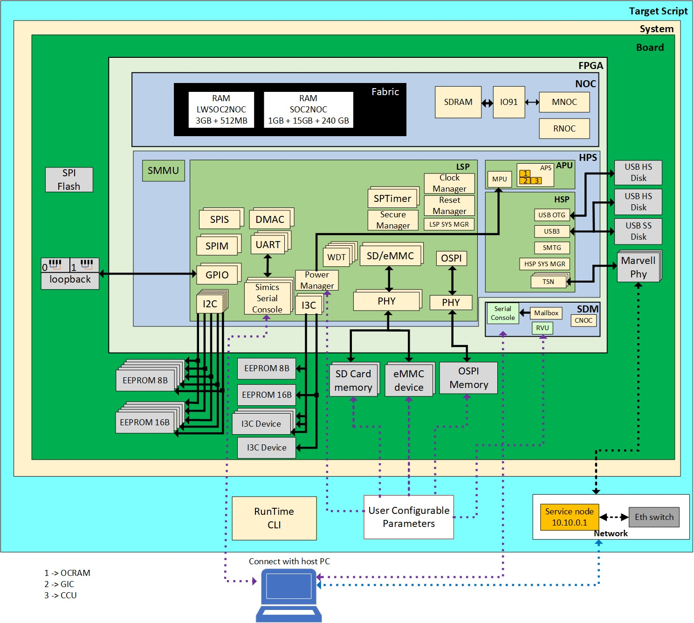{:style="width:60%;}

In this block diagram:

- The architecture of the virtual platform follows a hierarchy that goes from **target script → system → board → fpga → [NOC, HPS, SDM]** which is aligned with the Simics virtual platform development philosophy that tries to match with the real Quartus design architecture.
- The **target script** instantiates the **system component**, provides the CLI run time commands, and creates the network configuration. This script also defines the parameters that configure other components.
- The **system component** represents the complete virtual platform system and instantiates the **board component**. This component is implemented in a Python file.
- The **board component** represents the model of a PCB (analogous to a development kit). It includes the instance of the **FPGA component** and all board components connected to the FPGA (for example, flash devices, ethernet PHY). The GPIO loopback connection is implemented here. This component is implemented in a Python file.
- The **FPGA component** represents the top-level Quartus design model in the Quartus Prime software project design that targets the Agilex® 27 SoC FPGA device. It matches the logical hierarchy of the fictitious Quartus design that the Agilex® 27 Universal Virtual Platform models. This component instantiates the different sub-systems in the deivice and is implemented as a Python script.
- The embedded software running on the HPS component is expected to be the same that can be run in the real silicon. Exercising the HPS-embedded software in this virtual platform allows you to debug the software using the Simics debug capabilities.

### Main Features Supported by the Altera® Agilex® 27 Universal Virtual Platform

The following sections describes some typical use cases that can be exercised with the Universal Virtual Platform.

#### Boot an Operative System

The Agilex® 27 Universal Virtual Platform allows you to exercise the HPS software in all parts of the boot flow for Linux* operating systems. You can exercise the boot flow from a flash device such as an SD Card. Booting from an SD Card is the default boot mode.


#### Basic Ethernet

The basic ethernet functionality is configured from the **agilex27-universal.simics** target script. The virtual platform simulates a network switch and a router in the simulated environment using the service node component referred to as **service_node_cmp0**. This provides a TFTP server to transfer files from the host PC to the target system and a DHCP server to assign an IP to the target system dynamically.

The service node acts as a simulated environment router configured with the 10.10.0.1 IP address. The DHCP service is configured to assign an IP in the range of 10.10.0.100 and 10.10.0.199. The service node is also configured to provide Network Address Port Translation (NAPT) for outgoing traffic, allowing it to interact with the host PC enabling TFTP, SCP, and SSH services.

The target device provides ethernet functionality using the XGMAC/TSN devices, enabling an **ethX** ethernet link. This link connects with an ethernet switch instantiated in the target script. Only the TSN0 instance is connected to this switch using the Marvell ethernet Phy instantiated at the **board** level.

Basic ethernet support in the virtual platform allows the target software to set a MAC address locally to allow communication over the network. This supports all key transport layers of a protocol, such as TCP, UDP, and ICMP. Basic ethernet allows communication over IPv4 and IP6 protocols while supporting different hardware offloading features. The virtual platform supports L2, L3, and L4 filtering and can show network statistics.

#### CPU Power-On and Boot Core Selection

The virtual platform supports setting the CPU power-on settings and the CPU boot core selection. This configuration is defined at the target script level (**agilex27-universal.simics**) for this virtual platform. Based on the configuration, the virtual platform exposes only the appropriate number of cores available to the target software. When multiple CPUs are enabled, the virtual platform is configured to support symmetric multiprocessing (SMP).


#### Reset Flow

The virtual platform is designed to support all key reset flows described in the Agilex® 27  HPS Technical Reference Manual. Reset flows initiated by the CPU are simulated through the same mechanism in which the CPU writes to the appropriate addresses (reset manager device). Resets triggered by the external hardware signaling are simulated with Simics' commands.


| Reset Type     | Recipe                                   | Notes                                                        |
| :------------- | :--------------------------------------- | :----------------------------------------------------------- |
| Power-on reset | Not supported                            | The power-on reset is not supported as its effect is equivalent to restarting the simulation in a virtual platform simulation. However, if this is required for some exceptional use cases, you can trigger the cold reset instead, as this resets most domains. |
| HPS cold reset | **system.board.fpga.hps.hps-cold-reset** | Simulates toggling the **HPS_COLD_nRESET** pin using the command registered in the board component. |
| HPS warm reset | **system.board.fpga.hps.hps-warm-reset** | Simulates a warm reset of the HPS without triggering any other event. This type of reset is not enabled through external means in hardware. The command is registered in the HPS component. |
| Watchdog reset | Software-based                           | The watchdog timer peripheral in the HPS can be configured and enabled through software. When the watchdog expires, the HPS resets (only the trigger of warm reset is supported). |


#### GPIO Loopback Connection

The virtual platform supports the feature that allows creating a loopback connection in certain pins in GPIO0 and GPIO1 ports. This is implemented at the **board** component level. The loopback implementation directly connects GPIO **in** and **out** pins of the GPIO ports in both directions to reflect the same state on those pins. In each GPIO port, the pair of pins that are connected are shown in the following table:

| Pin Source | Pin Destination |
| :--------- | :-------------- |
| 0          | 1               |
| 5          | 6               |
| 18         | 19              |
| 20         | 21              |


**Note:** The loopback connection is activated by default from the target script.


#### USB Disks Hot-Plug Support

The virtual platform instantiates three USB disks that support hot-plugging by using Simics CLI commands to emulate plugging and unplugging the USB disks.

The current connection of the USB disks in this virtual platform is indicated in the following table:


| Disk         | Type            | Slot | USB Controller |
| :----------- | :-------------- | :--- | :------------- |
| usb3_disk    | SuperSpeed (SS) | usb3 | USB 3.1 Gen 1  |
| usb3_hs_disk | High Speed (HS) | usb2 | USB 3.1 Gen 1  |
| usbotg_disk  | High Speed (HS) | otg  | USB 2.0 OTG    |


#### FPGA Fabric Example Design

The fabric design is modeled as a set of RAM devices connected to the SOC2NOC bridges (SOC2FPGA in previous devices) . You can write and read to these components using Simics commands through the CLI or also using software running on the HPS. 

| Bridge | RAM Adrress - Size |
| :--------- | :-------------- |
| LWSOC2NOC | At 0x20000000 - 512 mb   |
| LWSOC2NOC | At 0x100000000 - 3 gb   |
| SOC2NOC | At 0x40000000 - 1 gb |
| SOC2NOC | At 0x440000000 - 960 mb |
| SOC2NOC | At 0x4400000000 - 240 gb |


#### FPGA2SOC and FPGA to SDRAM Access

The FPGA2SOC bridge provide a way in which the FPGA fabric IPs can interact coherently with the HPS subsystem. For non-coherent transactions from the FPGA to the SDRAM, this is done directly through the MNOC.
The implementation of these 2 paths includes two new memory spaces in the FPGA logic model that are used to send read and write transactions to the HPS or SDRAM component from the FPGA logic.

You can send read and write transactions through each one of these paths from the Intel Simics CLI.

#### UART0/UART1/UART2 Serial Console Selection

The Agilex 27 Universal virtual platform supports creating a serial console that could be connected to each one of the 3 UART devices in the HPS. This feature provides more flexibility to the virtual platform allowing you to match your board. The selection of the serial console to be displayed is controlled by the **create_hps_apu_serialX_console** configuration parameters. These  parameters allow you to enable creating the corresponding serial console. A serial console object is created and connected when the corresponding parameter is set to TRUE. Note that is possible to have both serial consoles enabled or both disabled.

#### 2.1.3.10.	Secure Device Management Modeling

The Agilex® 27 Virtual Platform includes a hybrid model (H-Mod) of the SDM which is able to run a pre-built firmware allowing this to interact with the HPS responding to MCSR messages. The SDM H-Mod model is also provided with a serial console that provides information about the MCSR messages that the HPS sends through SDM/HPS mailbox. This is helpful for debugging purposes and this can be enabled or disabled through a configuration parameter.

### Configurable Parameters in the Altera® 27 Universal Virtual Platform

The parameters that you can configure are shown in the following table:

| Parameter                    | Description                                                  | Range                | Default Value |
| :--------------------------- | :----------------------------------------------------------- | :------------------- | :------------ |
| **reset_vector** |Assigns the reset vector address to the SDM riscv-e61swg microcontroller. When this microcontroller is released from reset, this will start executing instructions from this address. | Hex 64-bits | 0x84000000 |
|**sdm_hmod_fw_image_filename** | Path and name of the binary file corresponding to the SDM firmware.  | File name string. | "" |
| **sdm_hmod_fw_console** | Control the showing of the SDM Debug Terminal | Boolean | False |
| **skip_access_control** | It enables or disables all the access control marker/checker IPs including world guard (SDM private NoC), SAI (SDM public NoC, MNoC, RNoC) and Trust Zone (HPS) | Boolean | True  |
| **sd_image_filename**<br />**sd_image_filename1** | Name of the SD image to load into the SD memory model of the board component. Supported formats are `.img` and `.wic`. One for each one of the SD/eMMC controllers. | Filename string      | ""            |
| **mmc_image_filename** | Path and name of the image to load into the eMMC devices of the board component. Same name for both SD/eMMC controllers. | File name string | "" |
| **hps_apu_fsbl_image_filename** | Path and name of the HPS FSBL image. Supported format is .bin. | Filename string      | ""            |
| **hps_boot_core**              | The CPU to use as the boot core.                             | Integer [0,2]        | 0             |
| **hps_core0_1_power_on**       | The power-on states of CPU 0/1.                              | Boolean              | True          |
| **hps_core2_power_on**         | The power-on states of CPU 2.                                | Boolean              | True          |
| **hps_core3_power_on**         | The power-on states of CPU 3.                                | Boolean              | True          |
| **create_hps_apu_serial0_console**<br/>**create_hps_apu_serial1_console**<br/> **create_hps_apu_serial2_console** | Create a console component (serial console) and connect it to the corresponding UART controller peripheral of the HPS. There are 3 independent User-Configurable parameters to enable or disable each one of the corresponding serial consoles. | Boolean              | True          |
| **create_hps_eth0_network**    | Choose whether to create or not a basic ethernet network and connect the `ethX` peripheral of the HPS IP to this. | Boolean              | True          |
| **create_hps_sd_card**<br />**create_hps_sd_card1** | Create the SD card in the board component and connect it to the SD/eMMC controller. You can set either the create_hps_sd_cardX or create_hps_mmcX parameter to true at a time. | Boolean              | True          |
| **create_hps_mmc**<br />**create_hps_mmc1** | Create the eMMC card in the board component and connect it to the SD/eMMC controller.  One for each one of the SD/eMMC controllers.  One for each one of the SD/eMMC controllers. You can set either the create_hps_sd_cardX or create_hps_mmcX parameter to true at a time. | Boolean              | False         |
| **ospi0_flash0_image_filename** | Path and name of the image to load into the ospi0_flash0 OSPI flash device in the board component, connected to HPS OSPI controller (through the PHY). | File name string | ""          |
| **spi_image_filename** | Path and name of the image to load into the SPI flash device model of the board component connected to the SPIM0 controller. | File name string | ""          |
| **usb3_image_filename**        | Name of the USB disk image corresponding to the SuperSpeed disk in the board component connected to the USB 3.1 controller. | Filename string      | ""            |
| **usb3_hs_image_filename**     | Name of the USB disk image corresponding to the high-speed disk in the board component connected to the USB 3.1 controller. | Filename string      | ""            |
| **usb_otg_image_filename**     | Name of the USB disk image corresponding to the high-speed disk in the board component connected to the USB 2.0 OTG controller. | Filename string      | ""            |


### Exercising Simics Simulation from HPS Baseline System Example Design Framework

The HPS Baseline System Example Design build framework is provided with the capability to simulate some reference use cases using the binaries built with this framework. The components included as part of the HPS Baseline System Example Design repository are listed next. These are included at **$TOP_FOLDER/agilex27_soc_devkit_sed_\*/simics/linux** directory.


* [runsimics.sh](https://github.com/altera-fpga/agilex27-ed-hps-baseline/blob/QPDS26.3_REL_BASELINE_PR/dk-dev-agilex27-enablement/baseline-a520/simics/linux/runsimics.sh) : This script is in charge of deploy the Simics project under the $TOP_FOLDER/agilex27_soc_devkit_sed_sd_a520/simics/linux directory, which becomes the Simics project directory, and then build it,  similarly to what is described in the [Simulation Setup section](#simulation-setup).  The script receives as parameter the device used to boot  along with the path of the location of the binaries. <br>
Parameters:<br>  1\. **Boot mode:** **sdmmc** to boot from sdcard and **backdoor_boot** to boot from SDRAM using backdoor mechanism.  <br>  2\. **Binaries path:** Path where the binaries were built. The binaries needed could be the ones listed as output of the [Build SD Card HPS Baseline System Example Design](#build-sd-card-hps-baseline-system-example-design) section, but the binaries could be taken from any other source. 

* [sdmmc_boot](https://github.com/altera-fpga/agilex27-ed-hps-baseline/blob/QPDS26.3_REL_BASELINE_PR/dk-dev-agilex27-enablement/baseline-a520/simics/linux/sdmmc_boot) directory: This directory is used to the exercise the boot for SD Card use case. This includes the [sdmmc_gsrd.simics](https://github.com/altera-fpga/agilex27-ed-hps-baseline/dk-dev-agilex27-enablement/baseline-a520/simics/linux/sdmmc_boot/sdmmc_gsrd.simics) target script which defines the parameters needed to boot in this mode. The .simics target script calls the Agilex 27 Universal Virtual Platform target script which is the one that configures this virtual platform, loading all the components needed. In the binary directory, the SD Card image must be called **gsrd-console-image-agilex27.rootfs.wic**.

* [backdoor_boot](https://github.com/altera-fpga/agilex27-ed-hps-baseline/blob/QPDS26.3_REL_BASELINE_PR/dk-dev-agilex27-enablement/baseline-a520/simics/linux/backdoor_boot) directory: This directory is used to exercise Linux boot, but loading the SSBL and Linux binaries from SDRAM as backdoor mechanism. This includes  [backdoor_gsrd.simics](https://github.com/altera-fpga/agilex27-ed-hps-baseline/dk-dev-agilex27-enablement/baseline-a520/simics/linux/backdoor_boot/backdoor_gsrd.simics) target script which defines the parameters needed to boot in this mode. The .simics target script calls the Agilex 27 Universal Virtual Platform target script which is the one that configures this virtual platform, loading all the components needed. In the binaries directory, the U-Boot SSBL is named **u-boot.itb**, the Linux kernel is named **Image**, the Linux device tree is named **socfpga_agilex27_socdk.dtb** and the Linux file system is named **console-image-minimal-agilex27.rootfs.cpio.gz.u-boot**.

The default boot modes supported by the HPS Baseline System Example Design are:

* Booting from U-Boot to Linux from SD Card using Agilex 27 Universal Virtual Platform
* Booting from U-Boot to Linux from Backdoor using Agilex 27 Universal Virtual Platform

The use cases that are listed in the [Use Cases Supported by the Agilex® 27 Universal Virtual Platform](#use-cases-supported-by-the-agilextm-27-universal-virtual-platform) are also supported, but require manual update of the **.simics** target scripts included in the boot mode directories listed above.

####  Simulation Setup under HPS Baseline System Example Design Framework

At this time, it is assumed that you had already built the HPS binaries as indicated in [Build Instructions for HPS Baseline System Example Design](#build-instructions-for-hps-baseline-system-example-design) and you also have installed the Intel Simics Simulator for Altera FPGAs in to your Linux machine.

You also need to add the following to yout Linux **$PATH** environment variable:

* Simics Simulator installation directory. 


This can be done with:

```bash
$ cd $TOP_FOLDER
# Simics installation dir
$ export PATH=<Simics_installation_dir>/simics/bin/:$PATH
```
#### Exercise SDCard Boot Mode under HPS Baseline System Example Design Framework

It is assumed that the instructions at [Simulation Setup under HPS Baseline System Example Design Framework](#simulation-setup-under-hps-baseline-system-example-design-framework) section have been already executed.

The **runsimics.sh** script need to be called, providing as parameters the **sdmmc** boot mode and the location of the binaries.

```bash
$ cd $TOP_FOLDER/agilex27_soc_devkit_sed_sd_a520/simics/linux/
$ ./runsimics.sh  sdmmc $TOP_FOLDER/agilex27_soc_devkit_sed_sd_a52/software/yocto_linux_sd/build/tmp/deploy/images/agilex27/
```
This will deploy the **agilex27-universal** virtual platform under **$TOP_FOLDER/agilex27_soc_devkit_sed_sd_a520/simics/linux/** directory, create the Simics project and build it. This will also launch the Simics simulation using **$TOP_FOLDER/agilex27_soc_devkit_sed_sd_a520/simics/linux/sdmmc_boot/sdmmc_gsrd.simics** as target script. 

When the simulation is launched, the current Linux terminal will become the Simics CLI and  3 serial consoles for the uart0, uart1 and uart2 will pop up.

To start running the simulation enter **"run"**  or **"r"** command in the Simics CLI. You will see some text coming out in the uart0.

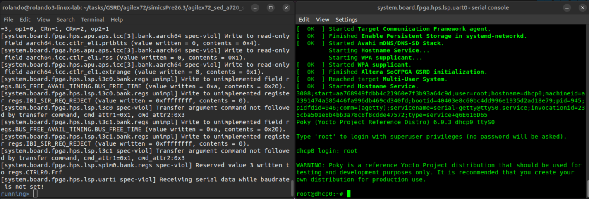

#### Exercise Backdoor Boot under HPS Baseline System Example Design Framework

It is assumed that the instructions at [Simulation Setup under HPS Baseline System Example Design Framework](#simulation-setup-under-hps-baseline-system-example-design-framework) section have been already executed.

The **runsimics.sh** script need to be called, providing as parameters the **backdoor** boot mode and the location of the binaries.

```bash
$ cd $TOP_FOLDER/agilex27_soc_devkit_sed_sd_a520/simics/linux/
$ ./runsimics.sh backdoor $TOP_FOLDER/agilex27_soc_devkit_sed_sd_a520/software/yocto_linux_sd/build/tmp/deploy/images/agilex27/
```
This will deploy the **agilex27-universal** virtual platform under **$TOP_FOLDER/agilex27_soc_devkit_sed_sd_a520/simics/linux/** directory, create the Simics project and build it. This will also launch the Simics simulation using **$TOP_FOLDER/agilex27_soc_devkit_sed_sd_a520/simics/linux/backdoor_boot/backdoor_gsrd.simics** as target script.

When the simulation is launched, the current Linux terminal will become the Simics CLI and  3 serial consoles for the uart0, uart1 and uart2 will pop up.

To start running the simulation enter **"run"**  or **"r"**  in the Simics CLI. You will see some text coming out in the uart0.

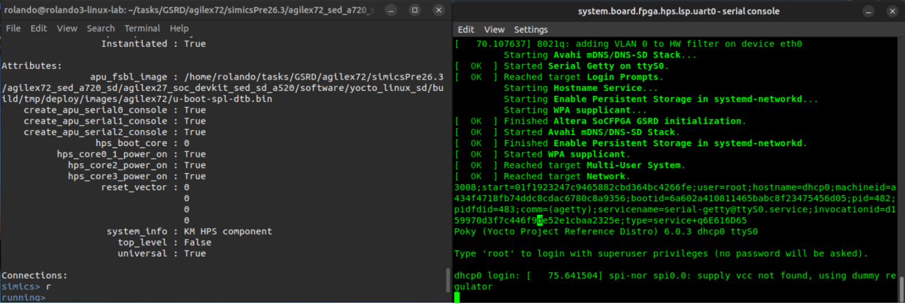


#### Exercise Simics Simulation with a720 as Boot Core

The build flow described in [Build Instructions for HPS Baseline System Example Design](#build-instructions-for-hps-baseline-system-example-design) section uses as starting point the **baseline-a520** project directory. From real hardware perspective, this directory includes a Quartus project in which the **a520** core (core 0) is used as the boot core. From the Simics simulation perspective, the Quartus design included in any of this project directory is not relevant because the model of the Quartus design is expected to be included as part of the model of the Agilex 27 device, and what is really relevant for Simics, is just the selection of the boot core which is defined through the **hps_boot_core** configuration parameter. The **hps_boot_core** parameter can be changed in the target script provided under the **simics/linux/<*_boot>** directory. For example, if you want to use an **a720** core as boot core for SD Card boot,  you need to manually change the value of the boot core to 2 or 3(**i.e. $hps_boot_core = 2**) in the **simics/linux/sdmmc_boot/sdmmc_gsrd.simics**  target script.

Once that you change this parameter, you can run the simulation in the same way as described earlier. You can use the **processor-status** command from the Simics CLI to confirm that your simulation is booting from core 2 (do it when the HPS is running U-Boot). You can see from the next image that the core 2 is enabled while the others are disabled.

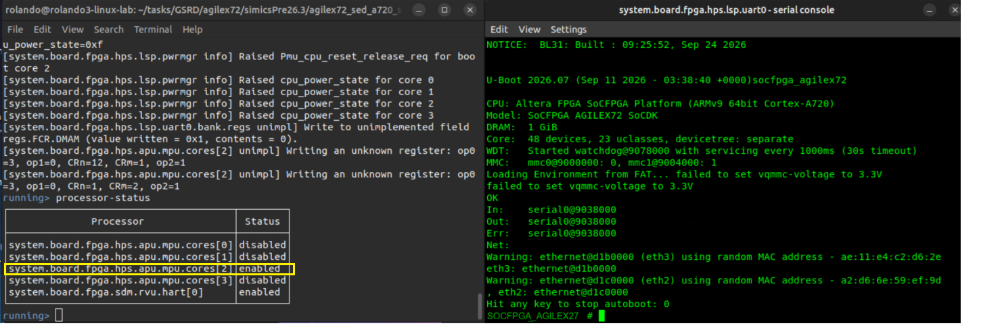


### Use Cases Supported by the Agilex® 27  Universal Virtual Platform

The following sections explain some supported use cases using the **Agilex® 27 Universal** virtual platform. 

**Note:** The instructions in each of the use case shows how this can be exercised in a Simics environment apart from the HPS Baseline System Example Design, but these can also be exercise from the Simics framework inside of the HPS Baseline System Example Design. For this last case, you can modify the **\*.simics** target scripts provided inside of the HPS Baseline System Example Design (below **simics/linux/** directory) as indicated in the use case description or create a new target script and call  it from the **runsimics.sh** script.

The preconditions required to exercise each use case are listed in the following section.

#### Simulation Setup 

Consider that the Intel Simics Simulator for Altera® FPGAs Simulator has been installed on a Linux System and the output binaries generated from [Build Instructions for HPS Baseline System Example Design](#build-instructions-for-hps-baseline-system-example-design) section are already available.


1\. Create a project directory under the Intel Simics Simulator installation directory (Assuming it is **SimicsInstallDir**):

  ```bash
  $ mkdir project-1
  $ cd project-1
  ```

2\. Under the new project directory created, deploy the **agilex27-universal** virtual platform:

  ```bash
  $<Simics installation dir>/simics/bin/simics_intelfpga_cli --deploy agilex27-universal
  Simics(R) Simulator for Intel(R) FPGA CLI:
  INFO: Preparing to initialize /home/simicsUser/SimicsInstallDir/project-1 as a
  Simics workspace
  Project created successfully
  # Observe that the directory has been initialized and the simics and 
  ## simics-riscfree commands appear in the project directory. Also, 
  ## note that the target directory is created. This includes the target 
  # script corresponding to the deployed platform.
  ```

3\. Build the virtual platform components with **make** command:

  ```bash
  $ make
  === Environment Check ===
  '/home/simicsUser/SimicsInstallDir/project-1' is up-to-date
  === Building module km-universal-board-comp ===
  GEN     module_id.c
  DEP     module_id.d
  :
  CCLD    km-universal-board-comp.so
  === Building module km-universal-fpga-comp ===
  GEN     module_id.c
  DEP     module_id.d
  :
  CCLD    km-universal-fpga-comp.so
  === Building module km-universal-system-comp ===
  GEN     module_id.c
  DEP     module_id.d
  :
  CCLD    km-universal-system-comp.so
  
  ```

4\. Create the **agilex27HPSbins/sdcard** copy there the following binaries created in [Build Instructions for HPS Baseline System Example Design](#build-instructions-for-hps-baseline-system-example-design) section to the Simics project directory:

```bash
$ mkdir agilex27HPSbins && cd agilex27HPSbins
$ mkdir sd && cd sd
$ cp $TOP_FOLDER/agilex27_soc_devkit_sed_sd_a520/software/yocto_linux_sd/build/tmp/deploy/images/agilex27/gsrd-console-image-agilex27.rootfs.wic .
$ cp $TOP_FOLDER/agilex27_soc_devkit_sed_sd_a520/software/yocto_linux_sd/build/tmp/deploy/images/agilex27/u-boot-spl-dtb.bin .
$ cd ../..
```

5.\ Customize the configuration of the Agilex® 27  Universal virtual platform, according to the setup required to exercise any specific use case. Set up the **hps_apu_fsbl_image_filename** parameter with the first-stage bootloader. As the boot implies booting from an SD Card device, configure **sd_image_filename** and **create_hps_sd_card** parameters (this image should include the main bootloader (U-Boot SSBL) and the OS and/or application images). As part of the configuration, select the core used to boot using the **hps_boot_core** parameter, which could be a A520 core ( 0 or 1) or a  A720 core (2 or 3). You also need to provide the path of the SDM FW (included as part of the Simics project created) to be used with the **sdm_hmod_fw_image_filename** parameter and enable the output of the SDM debug terminal (**sdm_hmod_fw_print.hex** for firmware debug version). You also need to indicate which HPS serial console to create using  **create_hps_apu_serial*_console** parameters (console0 is the one used by the SED). You also need to skip the trusted zone check using the **skip_access_control** parameter.

You can configure the virtual platform by creating a top-level target script (named based on the simulation purpose) that is expected to be run with this (example: **uboot_linux_sdcard.simics** used to boot from U-Boot to Linux from an SD Card device). You become the owner of this new target script, in which, you can set the required parameters and call the original virtual platform target script (**targets/agilex27-universal/agilex27-universal.simics** path). An example of the setup required to run a simulation that exercises the boot flow going from U-Boot to Linux, booting from an SD Card is shown in the following:

```bash
# uboot_linux_sdcard.simics
# Provide the FSBL
$hps_apu_fsbl_image_filename = "agilex27HPSbins/sd/u-boot-spl-dtb.bin"
# Provide the SD Card Image for SDMMC0 controller
$sd_image_filename = "agilex27HPSbins/sd/gsrd-console-image-agilex27.rootfs.wic"
$create_hps_sd_card = TRUE
$create_hps_sd_card1 = FALSE

# Provide the SDM FW for the SDM H-Model and enable print messages in the firmware
$sdm_hmod_fw_image_filename = "./binaries/sdm_hmod_fw/sdm_hmod_fw_print.hex"
$sdm_hmod_fw_console = TRUE

# Select the Boot Core
$hps_boot_core = 0
# Enable only the Serial console for UART0
$create_hps_apu_serial0_console = TRUE
$create_hps_apu_serial1_console = FALSE
$create_hps_apu_serial2_console = FALSE

# Skip trusted zone check 
$skip_access_control = TRUE

# Execute the target script for the Agilex27 Universal Virtual Platform
run-script "targets/agilex27-universal/agilex27-universal.simics"
```

  **Note:** The **uboot_linux_sdcard.simics** file must be created under the Simics project directory.

  **Tip:** Any specific configuration needed for a use case is indicated under the **Setup** section of that use case.

#### Use Case: Exercise SDCard Boot Flow from FSBL to Linux

This use case consists of booting from an SDCard device going from U-Boot to Linux prompt passing through **U-Boot SPL → ATF → U-Boot → Linux**.

<h5>Setup</h5>

Complete the procedure described in the [Simulation Setup](#simulation-setup) section.

You will need to copy the following binaries to your project directory: 

<h5>Procedure</h5>

To exercise this use case, follow the below steps once the Simulation setup is complete:

1\. From the project directory, launch the simulation using the **uboot_linux_sdcard.simics** target script. This script launches the simulator and the current terminal becomes the Simics CLI:

  ```bash
  $ ./simics uboot_linux_sdcard.simics 
  ```

2\. From the Simics CLI, start running the simulation with the **run** command.

  ```bash
  simics>  run
  ```

3\. Wait to get to the Linux prompt in the target serial console. 

4\. Login into the Linux prompt using the **root** user without a password.

  ```bash
  # Target Serial console
  U-Boot SPL 2026.07 (Sep 11 2026 - 03:38:40 +0000)
  Reset state: Cold
  A520 comp0   1850000 kHz
  A720 core2   2500000 kHz
  A720 core3   2500000 kHz
  LSP main      500000 kHz
  LSP sys fr    125000 kHz
  LSP MP        250000 kHz
  LSP SP        125000 kHz
  SDMMC0        200000 kHz
  DDR: SDRAM init in progress ...
  DDR: Calibration success
  :
  Trying to boot from MMC1
  :
  NOTICE:  SOCFPGA: CPU ID = 0
  NOTICE:  SOCFPGA: Setting CLUSTERECTRL_EL1
  NOTICE:  BL31: v2.15.1(release):1454b4ecf
  NOTICE:  BL31: Built : 09:25:52, Sep 24 2026
  
  U-Boot 2026.07 (Sep 11 2026 - 03:38:40 +0000)socfpga_agilex27
  
  CPU: Altera FPGA SoCFPGA Platform (ARMv9 64bit Cortex-A520)
  Model: SoCFPGA AGILEX27 SoCDK
  DRAM:  1 GiB
  Core:  48 devices, 23 uclasses, devicetree: separate
  WDT:   Started watchdog@9078000 with servicing every 1000ms (30s timeout)
  MMC:   mmc0@9000000: 0, mmc1@9004000: 1
  Loading Environment from FAT... failed to set vqmmc-voltage to 3.3V
  :
  Starting kernel ...
  
  [    0.000000] Booting Linux on physical CPU 0x0000000000 [0x410fd802]
  [    0.000000] Linux version 6.18.37-altera-geb14289ad150 (oe-user@oe-host) (aarch64-poky-linux-gcc (GCC) 15.3.0, GNU ld (GNU Binutils) 2.46.1) #1 SMP PREEMPT Fri Sep 11 09:53:10 UTC 2026
  [    0.000000] KASLR enabled
  [    0.000000] Machine model: Altera SoCFPGA Agilex27 SoCDK
  [    0.000000] efi: UEFI not found.
  [    0.000000] earlycon: uart0 at MMIO32 0x0000000009038000 (options '115200n8')
  [    0.000000] printk: legacy bootconsole [uart0] enabled
  [    0.000000] Reserved memory: created DMA memory pool at 0x0000000080000000, size 1 MiB
  [    0.000000] OF: reserved mem: initialized node atf@80000000, compatible id shared-dma-pool
  [    0.000000] OF: reserved mem: 0x0000000080000000..0x00000000800fffff (1024 KiB) nomap non-reusable atf@80000000
  [    0.000000] Reserved memory: created DMA memory pool at 0x0000000080100000, size 15 MiB
  [    0.000000] OF: reserved mem: initialized node svcbuffer@80100000, compatible id shared-dma-pool
  [    0.000000] OF: reserved mem: 0x0000000080100000..0x0000000080ffffff (15360 KiB) nomap non-reusable svcbuffer@80100000
  :
  [    0.000000] Kernel command line: earlycon panic=-1 root=/dev/mmcblk0p2 rw rootwait
  [    0.000000] random: crng init done
  [    0.000000] printk: log buffer data + meta data: 131072 + 458752 = 589824 bytes
  :
  [  OK  ] Started Hostname Service.
  
  Poky (Yocto Project Reference Distro) 6.0.3 dhcp0 ttyS0
  
  Type 'root' to login with superuser privileges (no password will be asked).
  
  dhcp0 login: root
  
  WARNING: Poky is a reference Yocto Project distribution that should be used for
  testing and development purposes only. It is recommended that you create your
  own distribution for production use.

  root@dhcp0:~# 
  ```
  This finishes the main scenario of this use case, but there are some extensions that are described next.

  **Note**: You can speed-up the boot process by skipping the U-Boot autoboot countdown by pressing any key and then typing the **boot** command:


  ```bash
  U-Boot 2026.07 (Sep 11 2026 - 03:38:40 +0000)socfpga_agilex27
  
  CPU: Altera FPGA SoCFPGA Platform (ARMv9 64bit Cortex-A520)
  Model: SoCFPGA AGILEX27 SoCDK
  DRAM:  1 GiB
  Core:  48 devices, 23 uclasses, devicetree: separate
  :
  Warning: ethernet@d1b0000 (eth3) using random MAC address - e2:f4:9a:d0:ef:9d
  eth3: ethernet@d1b0000
  Warning: ethernet@d1c0000 (eth2) using random MAC address - ce:de:dd:28:e1:e7, eth2: ethernet@d1c0000
  Hit any key to stop autoboot: 0  <-- Hit any key to skip count down
  SOCFPGA_AGILEX27 # boot          <-- Enter boot command to proceed with the booting 
  mmc0 is current device
  Scanning mmc 0:1...
  Found U-Boot script /boot.scr.uimg
  :
  ```

#### Use Case: Exercise Hello Application

This is an extension of the **Use Case: Exercise SDCard Boot Flow from FSBL to Linux** and includes executing the **hello** application from the Linux prompt.

<h5>Setup</h5>

Complete the procedure described in the [Simulation Setup](#simulation-setup) section.

<h5>Procedure</h5>

1. Execute the parent use case to get to the Linux prompt and log in.

2. Execute the **hello** application located in the **/home/root/alteraFPGA** directory. After executing this application, the **Hello SoC FPGA!** message is displayed on the command prompt:

  ```bash
  # Target Serial console 
  root@dhcp0:~#  ./alteraFPGA/hello 
  Hello SoC FPGA!
  ```

#### Use Case: Exercise System Check Application


This use case is an extension of the **Use Case: Exercise SDCard Boot Flow from FSBL to Linux** and includes executing the System Check Application. 

<h5>Setup</h5>

Same setup as the parent use case.

<h5>Procedure</h5>

1\. Execute the parent use case to get to the Linux prompt and log in.

2\. From the target system serial console, execute the System Check application (**syschk**) located under the **/home/root/alteraFPGA** directory directory. This shows some system information, such as the target system IP address (10.10.0.100).

  ```bash
  # Target Serial console 
  root@dhcp0:~#  ./alteraFPGA/syschk 
  
   ALTERA SYSTEM CHECK
  
  lo                    : 127.0.0.1
  eth0                  : 10.10.0.100
  
  mmc1::                : OFF
  mmc0::                : OFF
  
  ```

3\. Close the System Check application with **Ctrl+C**.


#### Use Case: Access the Web Server Application from Host PC

This use case is an extension of the **Use Case: Exercise SDCard Boot Flow from FSBL to Linux** and includes accessing from the host PC a web page that is being hosted by the target system, which runs a web server application. This application is launched automatically as part of the Linux boot process.

<h5>Setup</h5>

In the **uboot_linux_sdcard.simics** Simics script, create an incoming port forwarding shown in the following:

```bash
run-script "targets/agilex27-universal/agilex27-universal.simics"
connect-real-network-port-in ethernet-link = ethernet_switch0 target-ip=10.10.0.100 target-port = 80 host-port = 4080 -tcp 
```

The port forwarding created allows you to access the webpage from the host PC. In the configuration, use the **connect-real-network-port-in** command, port 4080 in the host PC, and the target port in the target system is 80 (HTTP port). You also assign as the target IP, the IP that corresponds to the target system, which is 10.10.0.100. Also, indicate that this port forwarding is related to the TCP protocol. You can check the new port forwarding setup using the **list-port-forwarding-setup** command (this setup also could be done from the Simics CLI but in this case, the simulation should be stopped to perform the network configuration).

<h5>Procedure</h5>

1. Execute the parent use case to get to the Linux prompt and log in.
2. Confirm that the Web server is active by entering this command into the Linux shell:
```bash
root@dhcp0:~# ps aux | grep -E 'lighttpd'
root         976  0.0  0.3   9764  3732 ?        Ss   15:35   0:01 /usr/sbin/lighttpd -D -f /etc/lighttpd/lighttpd.conf
```

2. From the host PC, open a web browser and access the webpage running in the target system using the address: http://localhost:4080 . Note that the host machine is referred to as **localhost** and the port is 4080, which is the one visible from the host PC. 

  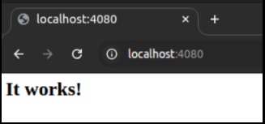

  **Note:** The IP address of the host PC could be used as well instead of **localhost**.


A variation of this use case consists of accessing the web page from another PC under the same network that the host PC (both PCs in a real network). For this, use the IP address of the host PC instead of **localhost** and continue using the same port: **http://<*host PC address*>:4080**.

**Note:** In the Linux Ubuntu system, you can get the IP address using the **ifconfig** command from a terminal. Also, ensure that the firewall in this PC is not blocking port 80.

#### Use Case: Access RAM model in Fabric from Linux Prompt

This use case is an extension of the **Use Case: Exercise SDCard Boot Flow from FSBL to Linux** and includes accessing from Linux the RAM model in the FPGA fabric for read and write operations. For this, the **devmem2** Linux application is used. Also, a Simics CLI script is used to write some initial content to the memories in the example design. The example, uses the 512 MB RAM connected to LWSOC2NOC  at 0x20000000 offset.

<h5>Setup</h5>

Start with the setup as the parent use case. From the Simics CLI or using the **uboot_linux_sdcard.simics** Simics script, add the script branch that adds some content to the memories in the example design. The script branch writes 256 32-bit words in each memory.


```bash
# uboot_linux_sdcard.simics
:
run-script "targets/agilex27-universal/agilex27-universal.simics"
script-branch{
  # Wait until we see any message in the Serial Console to be sure the model has been fully initialized
  bp.console_string.wait-for system.board.fpga.hps.lsp.console0.con "U-Boot SPL"
  $idx = 0
  while ($idx < 256) {
    $addr = 4*$idx
    $valueMem1 = 0xcafe0000 | $idx
    echo "Set Values " + (hex($valueMem1)) + " at address " + (hex($addr))
    system.board.fpga.noc._image_fabric_lwsoc2fpga_target_512mb.set $addr $valueMem1    

    $idx+=1 
  }
}
```
<h5>Procedure</h5>

1\. Execute the parent use case to get to the Linux prompt and log in.

2\. Read the first and last locations written by the CLI script in the memories in the example design using the **devmem2** application in Linux. This command receives the physical memory that wants to be accessed (in this case, based on the offset where the LWSOC2NOC bridges are mapped to):

  ```bash
  dhcp0 login:  root 
  root@dhcp0:~#  devmem2 0x20000000 w 
  /dev/mem opened.
  Memory mapped at address 0xffff90372000.
  Read at address  0x20000000 (0xffff90372000): 0xCAFE0000
  root@dhcp0:~#  devmem2 0x200003fc w 
  /dev/mem opened
  Memory mapped at address 0xffff95b6c000.
  Read at address  0x200003FC (0xffff95b6c3fc): 0xCAFE00FF
  ```

  Observe that the values read matches the expected ones.

  **Note:** The addresses in parenthesis in the capture above correspond to the virtual address in which Linux maps the physical address corresponding to the location in the memory example design that is being accessed. This virtual address may be different than the one shown in the capture.

3\. Use the `devmem2` command to write into the memories in the example design and read back the data. For this, the following addresses are selected:


| Bridge    | Address    | Memory Design Addr | Index | Value      |
| :-------- | :--------- | :----------------- | :---- | :--------- |
| LWSOC2NOC | 0x20000400 | 0x400              | 256   | 0xcafe0200 |


  ```bash
  root@dhcp0:~#  devmem2 0x20000400 w 0xcafe0200 
  /dev/mem opened.
  Memory mapped at address 0xffffa528a000.
  Read at address  0x20000400 (0xffffa528a400): 0x00000000
  Write at address 0x20000400 (0xffffa528a400): 0xCAFE0200, readback 0xCAFE0200
  ```

4\. Read back to the previous memory location written to confirm the operation was performed successfully.

  ```bash
  root@dhcp0:~#  devmem2 0x20000400 w  
  /dev/mem opened.
  Memory mapped at address 0xffff966aa000.
  Read at address  0x20000400 (0xffff966aa400): 0xCAFE0200
  ```


#### Use Case: Debug Bare-Metal Code Using Intel Simics Simulator

This use case consists of performing a debug session in a bare-metal environment, which in this case corresponds to a U-Boot application example. In this use case, debugging is performed using only the Simics CLI commands allowing us to navigate on the source code of the application, advance in the execution of this, and observe and modify values of variables. The application is created in the form of a U-Boot command (**helloTestApp**) that should be executed from the U-Boot shell. The application starts by printing a hello message (**Hello Altera® SoC FPGA!**) and printing the number of times the command has been executed since the last power-up. After this, the application enters into a loop in which it waits for 100 sec and increases an iteration counter by one. The content on the loop is executed as long as the iterator counter is lower than 100000 and also the value of the **exitVar** variable remains in 0, otherwise, it leaves the loop and continues printing the number of times the content of the loop was executed. After this, the code performs some mathematical operations involving the iterator value and other variables and finally prints the result of the final operation.


The source code of the application is shown next. This is included in the **do_helloTestApp()** function, which then is referenced in the **U_BOOT_CMD** macro, which converts this into a U-Boot command. This source code must be included in a new file under the U-Boot repository as **cmd/socFPGATrainingExamples.c**. Also, to be built as part of the U-Boot binaries, update the **cmd/Makefile** file by adding **obj-y += socFPGATrainingExamples.o**.

```bash
/*
   Training Examples called from a command from U-Boot shell
*/

#include <stdio.h>
#include <command.h>
#include <linux/delay.h>

static char helloTestCmd_help_text[] =
   "helloTestApp\t\n";

static unsigned int execCount = 0;

static int do_helloTestApp(struct cmd_tbl *cmdtp, int flag, int argc, char *const argv[])
{
   volatile unsigned char exitVar = 0;
   unsigned int waitIter = 0;
   volatile unsigned int myVarA = 0;
   unsigned int temp = 0;
   unsigned int result;

   if (argc > 1)
   {
      return CMD_RET_USAGE;
   }

   printf("Hello Altera® SoC FPGA! \r\n");
   execCount++;
   printf("Executed %d times \r\n", execCount);
   printf("Relocated address of do_helloTestApp: %p and execCount: %p \r\n", &do_helloTestApp, &execCount);

   while ((exitVar == 0) && (waitIter < 100000)){
       udelay(100);
       waitIter++;
   }

   printf("Exit from loop at iteration: %d \r\n", waitIter);

   temp = waitIter + myVarA;
   result = temp % 1000;

   printf("Final result: %d \r\n", result);

   return CMD_RET_SUCCESS;
}

U_BOOT_CMD(
   helloTestApp, 1, 1, do_helloTestApp,
   "Command used to launch hello application", helloTestCmd_help_text
);
```

Note: You can perform the build of this application by updating the Yocto recipe as part of the flow described in [Build SD Card HPS Baseline System Example Design](#build-sd-card-hps-baseline-system-example-design) section. This can be done by creating a patch in which you describe the files that need to be created/updated in the U-Boot repository and then deploy it. This can be done during the Yocto customization stage (Customize the Yocto Build). To create the u-boot patch (`myUbootExampleApp.patch`), do the following:

```bash
cd $TOP_FOLDER/
git clone -b QPDS26.3_REL_BASELINE_PR https://github.com/altera-fpga/u-boot-socfpga u-boot-socfpga-patch
cd u-boot-socfpga-patch/
 - Create cmd/socFPGATrainingExamples.c file with the source code provided of the example application.
 - Edit cmd/Makefile to include the build of socFPGATrainingExamples.c
    obj-$(CONFIG_CMD_BOOTM) += bootm.o
    obj-$(CONFIG_CMD_HELP) += help.o
    obj-y += panic.o
    obj-y += version.o
    obj-y += socFPGATrainingExamples.o

git add cmd/Makefile cmd/socFPGATrainingExamples.c
git diff --patch --staged > myUbootExampleApp.patch
# Add the Upstream-status label to prevent issues
sed -i '1i Upstream-Status: Pending\n' myUbootExampleApp.patch
```

To deploy the patch in the Yocto build flow do the following just before calling the **time ./build.sh** command:

1\. Copy the `$TOP_FOLDER/u-boot-socfpga-patch/myUbootExampleApp.patch` file to the **$TOP_FOLDER/agilex27_soc_devkit_sed_sd_a520/software/yocto_linux_sd/meta-custom/recipes-bsp/u-boot/files/patches/** directory.

2\. Request to deploy the path by adding a patch to the **$TOP_FOLDER/agilex27_soc_devkit_sed_sd_a520/software/yocto_linux_sd/meta-custom/recipes-bsp/u-boot/u-boot-socfpga_%.bbappend** file:

```bash
  # Set path for configs and source patches
  FILESEXTRAPATHS:prepend := "${THISDIR}/files/configs:${THISDIR}/files/patches:"
  
  SRC_URI:append = " \
        file://myUbootExampleApp.patch \
        "
```

3\. Continue with the rest of the Yocto build flow indicated with the **time ./build.sh sd** command.


After these steps, the application is included in the U-Boot binary file (**u-boot.itb**), which is part of the SD Card image created (**gsrd-console-image-agilex27.rootfs.wic**) and a symbol file corresponding to the U-Boot image, located at **$TOP_FOLDER/agilex27_soc_devkit_sed_sd_a520/software/yocto_linux_sd/build/tmp/deploy/images/agilex27/u-boot**. The symbol file is used later during the setup of the debug session.

<h5>Setup</h5>

Start with the setup of the main use case defined at [Simulation Setup]#simulation-setup). Modify the target script to add the created symbol file and set a breakpoint at the entry point of the  **do_helloTestApp** function as indicated in the following:

```bash
# uboot_linux_sdcard.simics
:
run-script "targets/agilex27-universal/agilex27-universal.simics"
add-symbol-file  $TOP_FOLDER/agilex27_soc_devkit_sed_sd_a520/software/yocto_linux_sd/build/tmp/deploy/images/agilex27/u-boot  0x3FD07000 -relative
add-pathmap-entry "/usr/src/debug/u-boot-socfpga/v2026.07+git/"  "$TOP_FOLDER/agilex27_soc_devkit_sed_sd_a520/software/yocto_linux_sd/build/tmp/work/agilex27-poky-linux/u-boot-socfpga/v2026.07+git/sources/u-boot-socfpga-v2026.07+git/"
bp.source_location.break do_helloTestApp
```

**Note:** The symbol file is being loaded with an offset relocation of 0x3FD07000. This is needed because in a late stage of the U-Boot execution, this relocates itself into a different SDRAM memory location and this should be indicated to the debugger, so there is a match between the addresses indicated in the symbol file and the real memory address location of the symbols. You can obtain this relocation offset by subtracting the real address of a specific function (which can be obtained from the application being executed) and the original offset from the same function in the symbols file (provided in the **$TOP_FOLDER/agilex27_soc_devkit_sed_sd_a520/software/yocto_linux_sd/build/tmp/work/agilex27-poky-linux/u-boot-socfpga/v2026.07+git/build/socfpga_agilex27_defconfig-agilex27-socdk-atf/u-boot.sym** file). An example of the calculation of this relocation offset is shown in the following figure (values are from a different release):

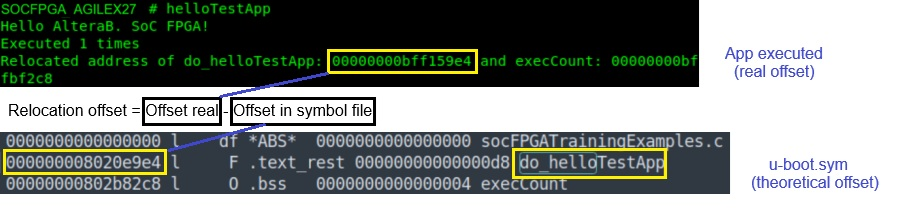

**Note:** During the debug, the Simics debuger uses the path of source code extracted from the symbols file using the path:
**/usr/src/debug/u-boot-socfpga/v2026.07+git/** path. In order to allow the debugger to access the real source code, we are using the **add-pathmap-entry** path to map this path to the real location.

<h5>Procedure</h5>

1\. Start the simulation similar to how it is done in the main use case, but in the serial console stop the U-Boot autoboot by pressing a key on the reception of the message "**Hit any key to stop autoboot:**". 

2\. Start the U-Boot example application by calling the **helloTestApp** command from the U-Boot shell. This will make the breakpoint set in the target script trigger and the simulation will be stopped. In the Simics CLI, you will see the following message:

  ```bash
    [tcf] Breakpoint 1 on execution in context board.fpga.hps.apu.mpu.cores[0]
  ```

3\. From Simics CLI, start a debug session by calling the following command:

  ```bash
  simics> system.board.fpga.hps.apu.mpu.cores[0].debug
  dbg0 (the arm-cortex-a520 system.board.fpga.hps.apu.mpu.cores[0])
  Now debugging the arm-cortex-a520 system.board.fpga.hps.apu.mpu.cores[0]
  do_helloTestApp(cmdtp=(struct cmd_tbl *) 0xbffb8fd0, flag=0, argc=1, argv=(char * const *) 0xbfb0cb60) at /usr/src/debug/u-boot-socfpga/v2026.07+git/cmd/socFPGATrainingExamples.c:16
  16	   volatile unsigned char exitVar = 0;
  ```
4\. Following the program's logic, if the value of **exitVar** stays zero and the program is continued, the loop will continue until it reaches 100,000 and then the program ends with output messages in the serial console. You can check the values of the variable using the **sym-type**  and **sym-value** features:

  ```bash
  simics> dbg0.sym-type exitVar 
      volatile unsigned char 
  simics> dbg0.sym-value exitVar 
     0 '\x00' 
  simics> dbg0.sym-type myVarA 
     volatile unsigned int- 
  simics> dbg0.sym-value myVarA 
     0
  ```

5\. Control the program by using *breakpoint* and *value modification*. In this section, first insert a breakpoint at Line 34, which is in the loop (You may let the program run for a few seconds before inserting this breakpoint). With that, expect the program to pause when the breakpoint is met and modify the value of **exitVar**.

  ```bash
  //The loop conditions are exitVar and waitIter   
  32| while ((exitVar == 0) && (waitIter < 100000)){   
  33|    udelay(100);   
  34|    waitIter++;   
  35| }
  ```

  In the Simics Console, enter the following line to insert the breakpoint at Line 34:
  ```bash
  running> bp.source_line.break filename=socFPGATrainingExamples.c line-number=34
  Breakpoint 2: 0x2 (planted) 
  ```

  As the breakpoint is planted, continue the program by entering **run**. The program will stop when the breakpoint is hit. When the program stopped, modify the value of **exitVar** in the Serial Console by using the **sym-write** feature.

  ```bash
  simics> run
  [tcf] Breakpoint 2 on execution in context board.fpga.hps.apu.mpu.cores[0]
  do_helloTestApp(cmdtp=(struct cmd_tbl *) 0x0, flag=1000, argc=-1827941622, argv=(char * const *) 0x2) at /usr/src/debug/u-boot-socfpga/v2026.07+git/cmd/socFPGATrainingExamples.c:34
  34	       waitIter++;
  simics> dbg0.sym-write exitVar 1 
     exitVar = 1 '\x01'
  simics> run
  ```

  Next, enter **run** and see the program ends immediately due to **exitVar=1**.
  ```bash
  SOCFPGA_AGILEX27 # helloTestApp
      Hello Altera® SoC FPGA!
      Executed 1 times
      Relocated address of do_helloTestApp: 00000000bff159e4 and execCount: 00000000bffbf2c8 
      Exit from loop at iteration: 9691
      Final result: 691
  SOCFPGA_AGILEX27 #
  ```

  From the output print, it shows that the program iterated for 9691 loops before hitting the Line-34 breakpoint you planted, this number would be bigger if you waited longer before planting the breakpoint. Lastly, the modification of **exitVar**  ended the program.

  *Note:*
    a) You can modify the value of **myVarA** and **exitVar** at any time before the looping ends (the test program ends after 99,999 loops).
    b) If the loop-ending condition (**myVarA** and **exitVar**) changed, the program should exit in the next **run**.
    c) Using the same Simics session, you can enter **helloTestApp** in U-boot Shell to restart the test program again.

6\. For the first time the program is executed, the output shows **“Executed 1 times”**, this value will increase (+1) as you run the program again without ending the Simics session. Meanwhile, in the serial console, the program has ended as soon as it just started because the controlling variable **exitVar**, having a value of 1, already reached the loop-ending condition. Output on a serial console:

  ```bash
  SOCFPGA_AGILEX27 # helloTestApp
      Hello Altera® SoC FPGA!
      Executed 1 times
      Relocated address of do_helloTestApp: 00000000bff159e4 and execCount: 00000000bffbf2c8 
      Exit from loop at iteration: 2
      Final result: 2
  SOCFPGA_AGILEX27 #
  ```

7\. If the value **exitVar** remained zero, the loop counter is allowed to run for 99,999 loops. While the program is looping, you may change the value of **myVarA** to ‘345’. The **Final result** will be 345 when the looping ends. Final result is the modulus value where the `Final result = ( (waitIter + myVarA) % 1000 )`

  ```bash
   SOCFPGA_AGILEX27 # helloTestApp
      Hello Altera® SoC FPGA!
      Executed 2 times
      Relocated address of do_helloTestApp: 00000000bff159e4 and execCount: 00000000bffbf2c8 
      Exit from loop at iteration: 100,000
      Final result: 345
  SOCFPGA_AGILEX27 #
  ```

8\. If both values of **exitVar** and **myVarA** remain unchanged, both being zero respectively, the looping continues until it reaches waitIter = 100,000. When the program ends, the **Final result** would be zero.

  ```bash
  SOCFPGA_AGILEX27 # helloTestApp
      Hello Altera® SoC FPGA!
      Executed 1 times
      Relocated address of do_helloTestApp: 00000000bff159e4 and execCount: 00000000bffbf2c8 
      Exit from loop at iteration: 100,000
      Final result: 0
  SOCFPGA_AGILEX27 #
  ```

#### Use Case: Debug Bare-metal Code Using Simics-RiscFree

This use case is an extension to the use case in section **Use Case: Debug Bare-metal Code Using Intel Simics Simulator** above but the debugging steps are performed in the Simics-RiscFree IDE. The test program used here is the same **helloTestApp.c**
**Important:** The offset relocation of 0x3FD07000 in the symbol file is still required and must be done before the symbol file is used to launch Simics-RiscFree. This offset may change is future releases.

<h5>Setup</h5>

This section requires the **simics-riscfree** script included in your Intel Simics Simulator project directory. You also need to register the path of RiscFree into your $PATH environment variable.

1\. To launch Simics-RiscFree IDE, use this command:

  ```bash
  $  export PATH= <Path of Quartus Pro Installation>/riscfree/RiscFree:$PATH
  $  ./simics-riscfree 
  ```

2\. Following the command, you must set up a **RiscFree**  workspace. You should use a new directory as a **RiscFree** workspace which must be different and outside from the Simics project directory.
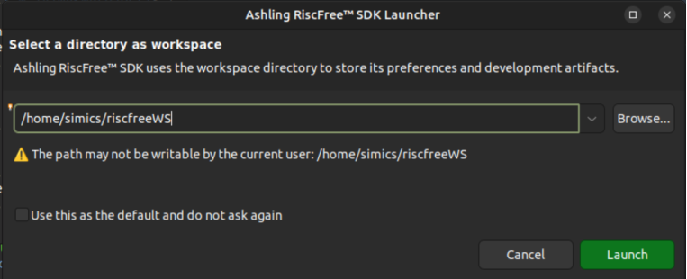

3\. In the **RiscFree** SDK GUI launched, you should see the current Simics project you selected shown in the Project Explorer window. If this is not shown, you can open it from **"Window > Show View > Project Explorer"** menu.

  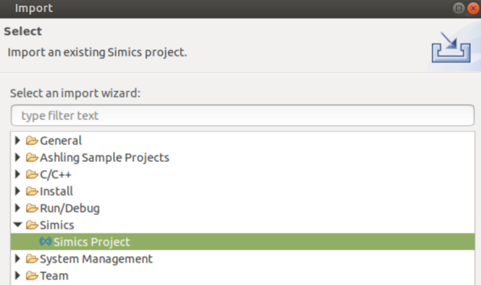

4\. From the Project Explorer window, right-click on the target script you want to launch (**uboot_linux_sdcard.simics**) and select **“Debug As > Simics Session”**.
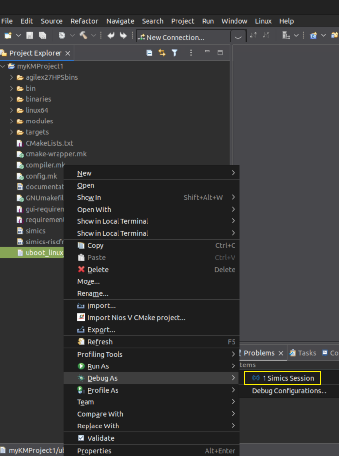

5\. When prompted for Switching Perspective, select **Yes**. The interface switches to the RiscFree Debugger, which is more user-friendly for debugging.
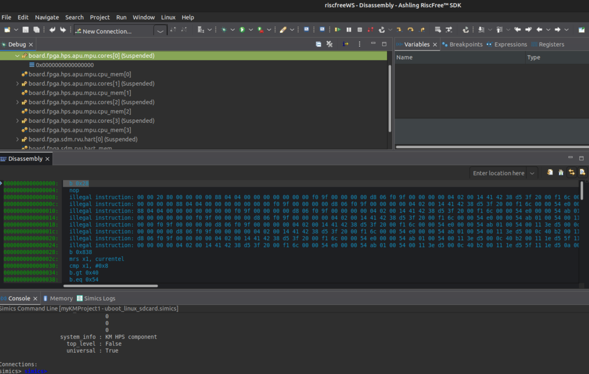

6\. In the Debug view, select the project - uboot_linux_sdcard.simics, do right-click  and select Edit project to configure the debug session:

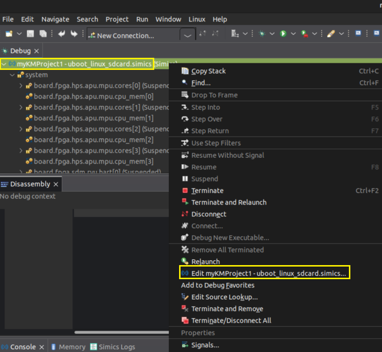

7\. Go to the **Path Map** tab menu and **Add**  a new source code mapping providing the Source and Destination as shown next:

* Source: /usr/src/debug/u-boot-socfpga/v2026.07+git/ 

* Destination: <TOP_FOLDER>/agilex27_soc_devkit_sed_sd_a520/software/yocto_linux_sd/build/tmp/work/agilex27-poky-linux/u-boot-socfpga/v2026.07+git/sources/u-boot-socfpga-v2026.07+git

* Keep **Context query** empty.

  Press **Apply** and **Continue**.
  

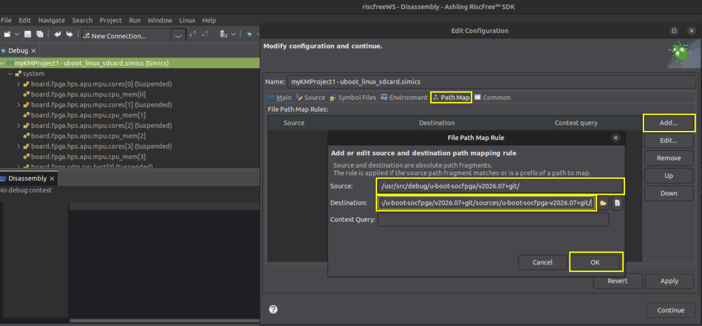

**NOTE:** Symbols file should be already defined in the **Symbol Files ** tab.

<h5>Procedure</h5>

1\. In the RiscFree Debugger window, click on the **Resume** button  to start the simulation. You should see that the HPS starts booting by looking at the active HPS serial console. You can also see that the Simics CLI is shown in the RiscFree SDK.

2\.  In the serial console wait until you see the **Hit any key to stop autoboot** message, press any key to stop the autoboot to OS, which will then go into the U-boot Shell.

  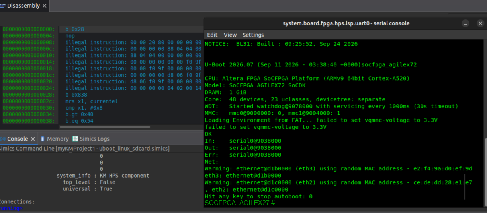

3\. Start the test program by entering **helloTestApp** in the U-boot Shell. The breakpoint is hit and the simulation stops. The application source code (**socFPGATrainingExamples.c**) is shown in the RiscFree SDK:

  ```bash
  SOCFPGA_AGILEX27 # helloTestApp
  ```

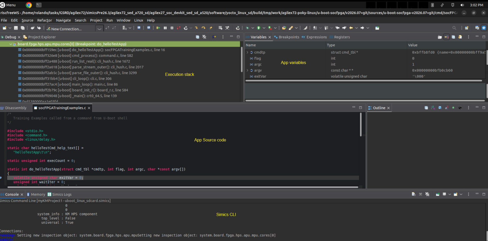


4\.Use the **step into/step-over** buttons  to get to the **while ((exitVar == 0)  &&  (waitIter < 100000))** line and show a capture of this with list command.


5\. At this point, if you click on the **Run** button, the test program prints **“Hello Altera® SoC FPGA!”**. The applications enters into the while loop. Run for few seconds and pause the simulation with the **Suspend** button.

  **Note:** If the loop already ended, relaunch the test program "helloTestApp" to proceed to the next step.

6\. Set a breakpoint in the line 34 of the **socFPGATrainingExamples.c** file using the Riscfree source code window by doing a double left-click at the column at the left of this line and select **Toggle Breakpoint**. You can also do it from the Simics CLI using: **bp.source_line.break filename=socFPGATrainingExamples.c line-number=34**.

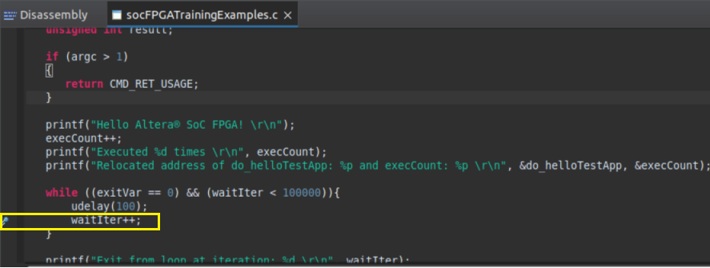

7\. Run the test and wait until the breakpoint triggers. To modify the loop conditions for debugging purposes, you can modify the value of **exitVar** in the Variable window. For example, changing the value of **exitVar** from the current value to ‘\001’. As `exitVar` is no longer zero, the condition of the loop is exceeded, and thus the looping ends. 

  After modification:

  [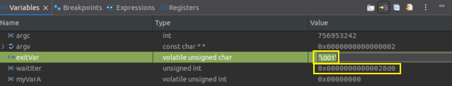

8\. The loop exits depending on two conditions: **exitVar** not equals to zero OR **waitIter** reached 100,000. As the value of exitVar is modified to 1 in the middle of looping, the loop ends with exitVar = 1 and `waitIter` at any number less than 100,000. In this example, **waitIter** is 10449 when the loop ends. Following the code logic, **Final result** is the modulus value where Final result = ( (waitIter + myVarA) % 1000 ) = 449.

  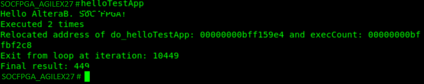

#### Use Case: Remote Debugging of a Linux User Mode Application Using GDB/GDBServer

This use case is an extension of the **Use Case: Exercise SDCard Boot Flow from FSBL to Linux** and consists of performing a debug session in a Linux user mode application using GDB. For this, the debugging is done using the GDB server running in the target system. To use GDB server, it is also necessary to set up the Simics network connectivity with the host PC, which is the one that runs ARM DS through TCP protocol. The application to be debugged, **myGDBDebugExample.c**, is listed next. This application first determines the core in which this is started and then enters into a loop counting the number of times the loop is executed and continue observing the execution core. It also counts the number of times the application is executed in each one of the four cores. The application exits from the loop when the iterator reaches a limit or the **exitVar** variable has a value of '1', which under normal flow never should occur. After the loop, the application assigns the value in **x** variable to the **a** and **b** variables and then adds these variables and assigns the result value in **c** variable. At the end, the application prints the result of the addition, the number of times the loop was iterated, the final value of **exitVar**, and the number of times each core executed the application.

  ```bash
  #define _GNU_SOURCE

  #include <stdio.h>

  #define NUM_CORES 4
  unsigned int coreCount[NUM_CORES];

  unsigned long int read_mpidr(void)
  {
      unsigned long int value;
      asm volatile("mrs %[result], mpidr_el1" : [result] "=r" (value));
      return value;
  }

  unsigned int getCore(){
     static unsigned int corePrev = (unsigned int)(-1);
     unsigned long mpidr;
     unsigned int core;

     mpidr = read_mpidr();
     core = (mpidr >> 8) & 0xFF;    
     if (core != corePrev)
     {
        coreCount[core]++; 
        corePrev = core;
     }

     return core;
  }

  int main()
  {

     int x = 1000;
     unsigned int core;    
     unsigned int iter = 0;
     int a;
     int b;
     int c;
     volatile int exitVar = 0;

     core = getCore();
     printf("=== My Debug example started on Core %d ===\n", core); 

     while((exitVar==0) && (iter < 1000000000))
     {
         core = getCore(); 
         iter++;
     }
     a = x;
     b = x;
     c = a + b;
     printf("Count:%d  iter: %d  exitVar:%d \n", c, iter, exitVar);
     for (core = 0; core < NUM_CORES; core++)
         printf("  core[%d]: %d times\r\n", core, coreCount[core]);

     return 0;
  }
  ```

<h5>Setup</h5>

1\. Start with the setup as the parent use case. From the Simics CLI or from the **uboot_linux_sdcard.simics** Simics script, add the network configuration that allows establishing the GDB server connexion between the target system and the host PC. This configuration creates an incoming forwarding port for TCP traffic from a port in the host PC to port **9123** in the target system. The port in the host PC is shown when calling the **list-port-forwarding-setup** command.

  ```bash
  # uboot_linux_sdcard.simics
  :
  run-script "targets/agilex27-universal/agilex27-universal.simics"
  connect-real-network-port-in 9123 ethernet-link = ethernet_switch0 target-ip = 10.10.0.100 -tcp 
  list-port-forwarding-setup
  ```

2\. The Linux example application must be compiled so you can have the executable binary available. This binary is generated with a toolchain and should be built to include debug information (i.e. symbol file). The instructions to build the applications are shown next. This generates the **myGDBDebugExample** ELF binary.

```bash
$ mkdir SymDbg && cd SymDbg
$ wget https://developer.arm.com/-/media/Files/downloads/gnu/14.3.rel1/binrel/\
arm-gnu-toolchain-14.3.rel1-x86_64-aarch64-none-linux-gnu.tar.xz
$ tar xf arm-gnu-toolchain-14.3.rel1-x86_64-aarch64-none-linux-gnu.tar.xz
$ rm -f arm-gnu-toolchain-14.3.rel1-x86_64-aarch64-none-linux-gnu.tar.xz

$  ./gcc-arm-10.2-2020.11-x86_64-aarch64-none-linux-gnu/bin/aarch64-none-linux-gnu-gcc -g -o  myGDBDebugExample myGDBDebugExample.c
$  cp myGDBDebugExample <your Simics project directory>
```

<h5>Procedure</h5>

1\. Launch the simulation as the parent use case. You should see something like the following capture in the Simics CLI:

```bash
Connections:
Host TCP port 4000 -> 10.10.0.100:9123
Warning: This can expose the target system on the host local network.
NAPT enabled with gateway 10.10.0.1/24 on link ethernet_switch0.link.
NAPT enabled with gateway fe80::2220:20ff:fe20:2000/64 on link ethernet_switch0.link.

Real DNS enabled at 10.10.0.1/24 on link ethernet_switch0.link.
Real DNS enabled at fe80::2220:20ff:fe20:2000/64 on link ethernet_switch0.link.

Host TCP port 4000 -> 10.10.0.100:9123
simics> 
```
Observe the ports numbers that are displayed from the **list-port-forwarding-setup** command. For this example:
  *  In Host machine: 4000
  * In Simics target machie: 9123  


2\. Execute parent use case to get to the Linux prompt and log in.

3\. Take the Linux application binary to the target system filesystem using tftp. For this, you will need to do the following. The **myGDBDebugExample** binary should be located in the Simics project directory before calling **tftp** command. This step makes use of the tftp server that is included as part of the Simics simulator in whcih the TFTP server directory is the project directory.

  ```bash
  root@dhcp0:~# tftp -gr myGDBDebugExample 10.10.0.1 
  root@dhcp0:~# chmod +x myGDBDebugExample 
  ```

4\. Start a GDB Server debug session over the application from the Linux prompt using the port created in the target system during the port forwarding setup:

  ```bash
  root@dhcp0:~# gdbserver 10.10.0.1:9123 myGDBDebugExample 
  Process /home/root/myArmDSDebugExample created; pid = 1095
  Listening on port 9123
  ```

5\. In your host machine, in the **SymDbg** directory, start a GDB session using **gdb** from the installed toolchain and the ELF of the application:

```bash
$  <strong>./arm-gnu-toolchain-14.3.rel1-x86_64-aarch64-none-linux-gnu/bin/aarch64-none-linux-gnu-gdb myGDBDebugExample</strong>
GNU gdb (Arm GNU Toolchain 14.3.Rel1 (Build arm-14.174)) 15.2.90.20241229-git
Copyright (C) 2024 Free Software Foundation, Inc.
License GPLv3+: GNU GPL version 3 or later <http://gnu.org/licenses/gpl.html>
This is free software: you are free to change and redistribute it.
There is NO WARRANTY, to the extent permitted by law.
Type "show copying" and "show warranty" for details.
This GDB was configured as "--host=x86_64-pc-linux-gnu --target=aarch64-none-linux-gnu".
Type "show configuration" for configuration details.
For bug reporting instructions, please see:
<https://bugs.linaro.org/>.
Find the GDB manual and other documentation resources online at:
    <http://www.gnu.org/software/gdb/documentation/>.

For help, type "help".
Type "apropos word" to search for commands related to "word"...
Reading symbols from myGDBDebugExample...
(gdb) 
```
6\. Connect with the remote GDB server running in the target, using the host port:
```bash
(gdb) target remote localhost:4000
Remote debugging using localhost:4000
Reading symbols from /home/rolando/tasks/SimicsEnv/Simics_KM/26.3.0.14/myKMProject1/SymDbg/arm-gnu-toolchain-14.3.rel1-x86_64-aarch64-none-linux-gnu/aarch64-none-linux-gnu/libc/lib/ld-linux-aarch64.so.1...
__memcmpeq () at ../sysdeps/aarch64/memcmp.S:114
warning: 114	../sysdeps/aarch64/memcmp.S: No such file or directory
(gdb) 
```

In the target system serial console you should the that the remote connection was acchieved by seeing the **Remote debugging from host 10.10.0.1, port 4100**
 message.

7\. Set a breakpoint at the **main()(** function and run until the simulation hits the breakpoint. List the application source code:

```bash
(gdb) break main
Breakpoint 1 at 0x4006dc: file myGDBDebugExample.c, line 34.
(gdb) continue
Continuing.

Breakpoint 1, main () at myGDBDebugExample.c:34
34	     int x = 1000;
(gdb) list
29	  }
30	
31	  int main()
32	  {
33	
34	     int x = 1000;
35	     unsigned int core;    
36	     unsigned int iter = 0;
37	     int a;
38	     int b;
(gdb) 
```

8\. Run for some seconds using the **continue** command and then stop again using **Ctrl+C**: 

```bash
(gdb) continue
Continuing.
Program received signal SIGINT, Interrupt.
0x000000000040064c in read_mpidr () at myGDBDebugExample.c:11
11	      asm volatile("mrs %[result], mpidr_el1" : [result] "=r" (value));
(gdb) 
```

9\. Set a breakpoint inside of the while loop at line 47, run until the breakpoint is hit, list the code and observe the value of some variables:

```bash
(gdb) break 47
Breakpoint 2 at 0x400708: file myGDBDebugExample.c, line 47.
(gdb) continue
Continuing.

Breakpoint 2, main () at myGDBDebugExample.c:47
47	         core = getCore(); 
(gdb) list
42	     core = getCore();
43	     printf("=== My Debug example started on Core %d ===\n", core); 
44	
45	     while((exitVar==0) && (iter < 1000000000))
46	     {
47	         core = getCore(); 
48	         iter++;
49	     }
50	     a = x;
51	     b = x;
(gdb) (gdb) p iter
$1 = 1990111
(gdb) p x
$2 = 1000
(gdb) p a
$3 = 0
(gdb) p b
$4 = 0
(gdb) p exitVar
$5 = 0
(gdb)
```
10\. Change the value of **x** variable and also set **exitVar** to 1 to allow the program to exit the loop and finish the application.

```bash
(gdb) set variable x = 2500
(gdb) set variable exitVar = 1
(gdb) continue
Continuing.
[Inferior 1 (process 3069) exited normally]
(gdb)
```
11\. Observe in the serial console that the application finishes printing the value of  some variables that includes the number of iterations run and the **Count** variable.  Note that the value if this one is calulated correctly (5000) using the updated value of **x** variable (2500).

```bash
root@dhcp0:~# gdbserver 10.10.0.1:9123 myGDBDebugExample     
Process /home/root/myGDBDebugExample created; pid = 2896
Listening on port 9123
Remote debugging from host 10.10.0.1, port 4100
=== My Debug example started on Core 0 ===
root@dhcp0:~# gdbserver 10.10.0.1:9123 myGDBDebugExample 
Process /home/root/myGDBDebugExample created; pid = 3069
Listening on port 9123
Remote debugging from host 10.10.0.1, port 4101
=== My Debug example started on Core 0 ===
Count:5000  iter: 1990112  exitVar:1 
  core[0]: 1 times
  core[1]: 0 times
  core[2]: 0 times
  core[3]: 0 times

Child exited with status 0
root@dhcp0:~# 
```


12\. Finish the GDB debug session in the host PC entering the  **quit** command.
