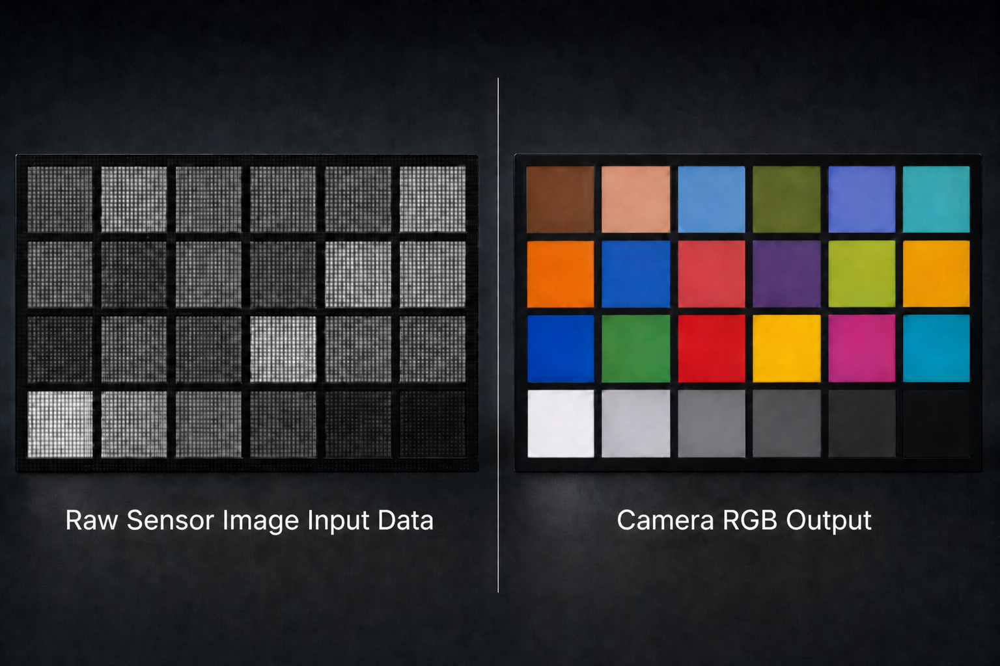
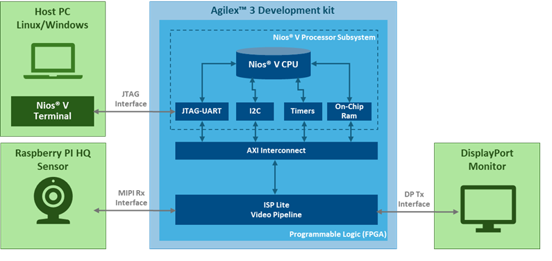
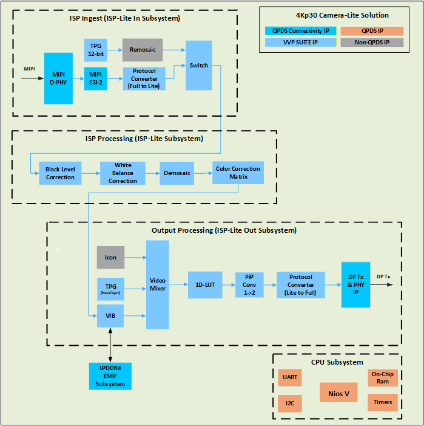

# **4Kp30 Camera Lite Solution System Example Design for Agilex® 3 Devices**

## **Overview**

The 4Kp30 Camera Lite Example Design for Agilex® Devices demonstrates a practical, area-efficient, and cost-efficient glass-to-glass camera system solution. Support for the industry-standard Mobile Industry Processor Interface (MIPI) D-PHY and MIPI CSI-2 interfaces on Agilex® FPGAs provides a powerful platform for camera product development.

The MIPI interface supports up to 2.5 Gbps per lane and up to eight lanes per MIPI interface, enabling seamless data reception from a 4K image sensor into the FPGA fabric for further processing. The MIPI CSI-2 IP converts pixel data to AXI4-Stream outputs, which enables connectivity to other IP cores in the Altera® Video and Vision Processing (VVP) Suite.

|
Example of Sensor Bayer vs RGB Output
|
| --- |
|  |

The design is a hardware and software co-design:

* The hardware path includes a sensor feeding an Image Signal Processing (ISP) subsystem. The ISP subsystem is a video processing pipeline that incorporates VVP IP cores to convert raw sensor image data into RGB video data. The design drives the resulting 4Kp30 streaming video output through an Altera® DisplayPort IP.

The following diagram provides an overview of the interaction between the software running on the Nios® V processor and the hardware components in the programmable logic.

|
Camera Lite Top-Level System Block Diagram
|
| --- |
|  |

* The software stack is a bare-metal application that runs on an embedded Nios® V soft processor. The backend of the software application interrogates the hardware, discovers the IP components dynamically, and configures them. Multiple feedback loops monitor the hardware and keep components in lockstep—for example, DisplayPort Hot Plug Detect (HPD). The frontend of the software creates a terminal-based user interface and runs it over a JTAG UART.

The following figure shows the main hardware components and subsystems.

|
Camera Lite Top-Level Hardware Block Diagram
|
| --- |
|  |

## Detailed Design

The detailed design can be found at [User Guide](https://github.com/altera-fpga/agilex3-ed-camera/blob/rel/26.1.1/agilex3c-ed/a3w135b-dk/4k-isp-lite-ed/docs/doc-camera-lite.md)

The project GitHub repository can be found at [https://github.com/altera-fpga/agilex3-ed-camera/tree/rel/26.1.1](https://github.com/altera-fpga/agilex3-ed-camera/tree/rel/26.1.1)

 

## Notices & Disclaimers

Altera&reg; Corporation technologies may require enabled hardware, software or service activation.
No product or component can be absolutely secure. 
Performance varies by use, configuration and other factors.
Your costs and results may vary. 
You may not use or facilitate the use of this document in connection with any infringement or other legal analysis concerning Altera or Intel products described herein. You agree to grant Altera Corporation a non-exclusive, royalty-free license to any patent claim thereafter drafted which includes subject matter disclosed herein.
No license (express or implied, by estoppel or otherwise) to any intellectual property rights is granted by this document, with the sole exception that you may publish an unmodified copy. You may create software implementations based on this document and in compliance with the foregoing that are intended to execute on the Altera or Intel product(s) referenced in this document. No rights are granted to create modifications or derivatives of this document.
The products described may contain design defects or errors known as errata which may cause the product to deviate from published specifications.  Current characterized errata are available on request.
Altera disclaims all express and implied warranties, including without limitation, the implied warranties of merchantability, fitness for a particular purpose, and non-infringement, as well as any warranty arising from course of performance, course of dealing, or usage in trade.
You are responsible for safety of the overall system, including compliance with applicable safety-related requirements or standards. 
&copy; Altera Corporation.  Altera, the Altera logo, and other Altera marks are trademarks of Altera Corporation.  Other names and brands may be claimed as the property of others. 

OpenCL* and the OpenCL* logo are trademarks of Apple Inc. used by permission of the Khronos Group™. 

 

