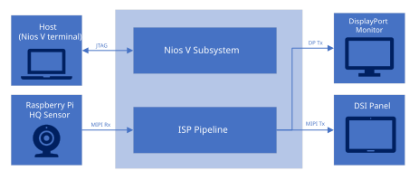
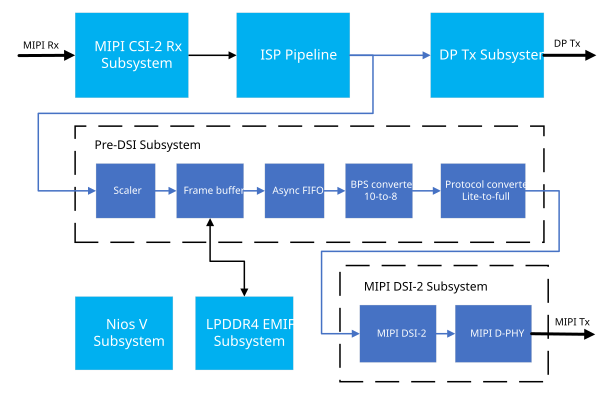

# **MIPI CSI-2 Camera to DSI-2 Display System Example Design for Agilex® 3 Devices**

## **Overview**

The MIPI® CSI-2™ Camera to DSI-2™ Display Example Design for Agilex® 3 extends the
[4k30 Camera Lite Example Design](https://github.com/altera-fpga/agilex3-ed-camera/tree/rel/26.1.1/agilex3c-ed/a3w135b-dk/4k-csi-dsi-ed/),
adding a secondary Mobile Industry Processor Interface (MIPI)
Display Serial Interface 2 (DSI-2) + MIPI D-PHY™ Tx output, which mirrors the main camera stream. This design serves as a full MIPI
Camera Serial Interface 2 (CSI-2) Rx to MIPI DSI-2 Tx reference.

|
MIPI CSI-2 Camera to DSI-2 Display
|
| --- |
|  |

The MIPI interface supports up to 2.5Gbps per lane and up to 8x lanes per MIPI interface, enabling
seamless data reception from a 4K image sensor to the FPGA fabric for further processing. The MIPI
CSI-2 IP instance converts pixel data to AXI4-Streaming outputs, enabling connectivity to other IP
cores within Altera®'s Video and Vision Processing (VVP) Suite.

|
Top-Level System Block Diagram
|
| --- |
|  |

A video switch is used to duplicate the output after "Output processing" subsystem, which feeds a "Pre-DSI subsystem"
that downscales and buffers the input from 3840x2160p30 to 1280x800p60.

|
Top-Level Hardware Block Diagram
|
| --- |
|  |

## Detailed Design

The detailed design can be found at [User Guide](https://github.com/altera-fpga/agilex3-ed-camera/blob/rel/26.1.1/agilex3c-ed/a3w135b-dk/4k-csi-dsi-ed/docs/index.md)

The project GitHub repository can be found at [https://github.com/altera-fpga/agilex3-ed-camera/tree/rel/26.1.1](https://github.com/altera-fpga/agilex3-ed-camera/tree/rel/26.1.1)

 

## Notices & Disclaimers

Altera&reg; Corporation technologies may require enabled hardware, software or service activation.
No product or component can be absolutely secure. 
Performance varies by use, configuration and other factors.
Your costs and results may vary. 
You may not use or facilitate the use of this document in connection with any infringement or other legal analysis concerning Altera or Intel products described herein. You agree to grant Altera Corporation a non-exclusive, royalty-free license to any patent claim thereafter drafted which includes subject matter disclosed herein.
No license (express or implied, by estoppel or otherwise) to any intellectual property rights is granted by this document, with the sole exception that you may publish an unmodified copy. You may create software implementations based on this document and in compliance with the foregoing that are intended to execute on the Altera or Intel product(s) referenced in this document. No rights are granted to create modifications or derivatives of this document.
The products described may contain design defects or errors known as errata which may cause the product to deviate from published specifications.  Current characterized errata are available on request.
Altera disclaims all express and implied warranties, including without limitation, the implied warranties of merchantability, fitness for a particular purpose, and non-infringement, as well as any warranty arising from course of performance, course of dealing, or usage in trade.
You are responsible for safety of the overall system, including compliance with applicable safety-related requirements or standards. 
&copy; Altera Corporation.  Altera, the Altera logo, and other Altera marks are trademarks of Altera Corporation.  Other names and brands may be claimed as the property of others. 

OpenCL* and the OpenCL* logo are trademarks of Apple Inc. used by permission of the Khronos Group™. 

 

