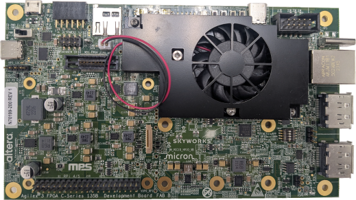
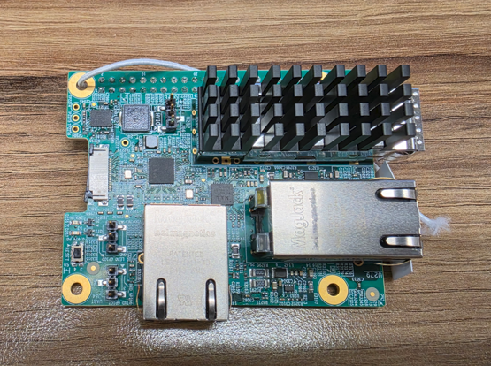
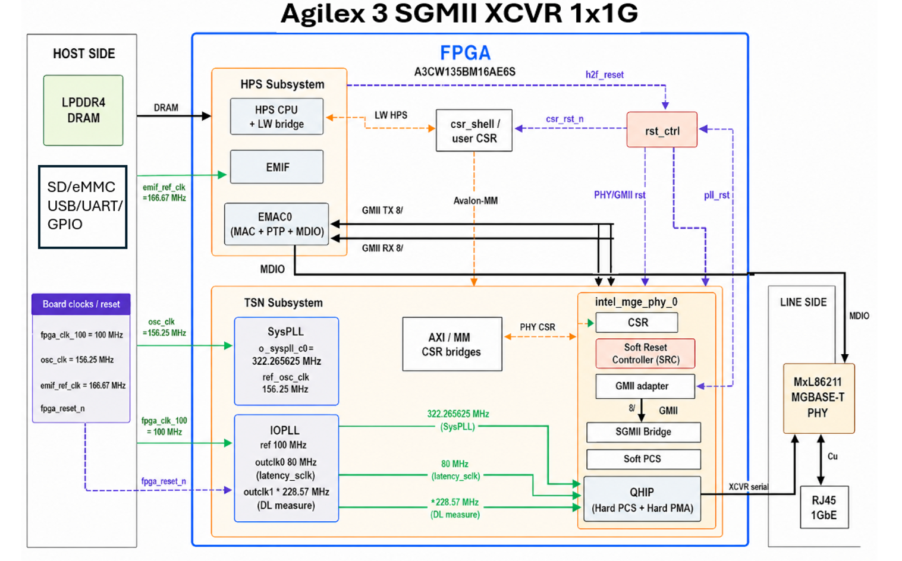
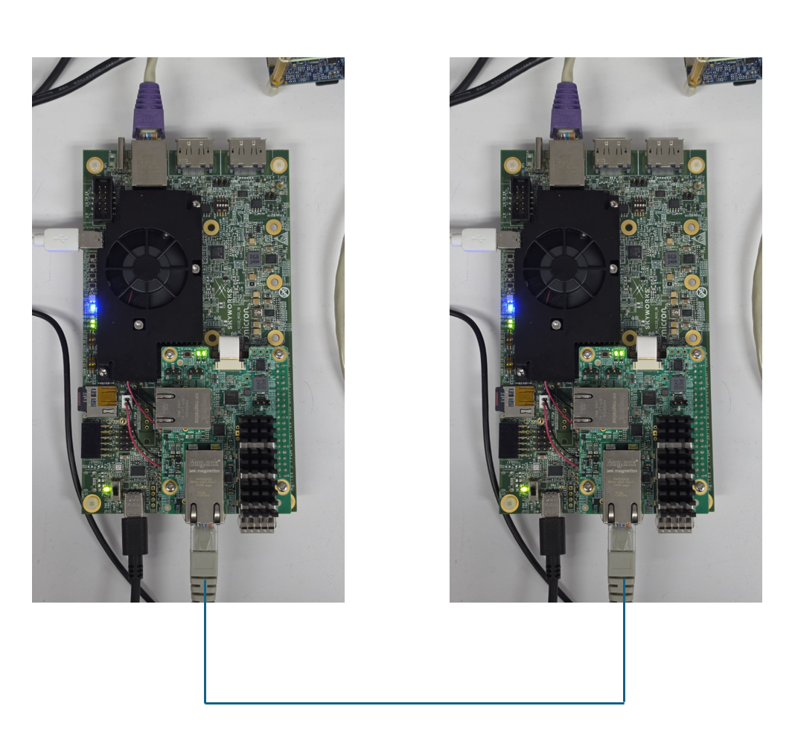
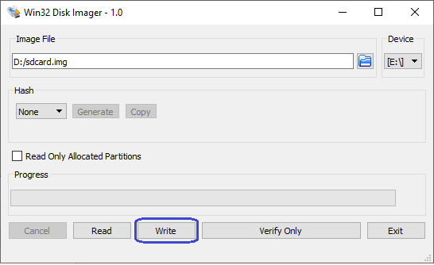

# HPS Time Sensitive Network - XCVR SGMII 1x1G System Example Design for the Agilex 3 FPGA and SoC C-Series Development Kit

## Introduction

The IEEE Ethernet is a core technology which is a backbone for IT operations and was designed to provide best effort communication suitable for IT operations. Operational Technology vendors have innovatively used Core IEEE Ethernet technology with proprietary solutions for enabling time-bounded communication. To address the need for precision timing, traffic shaping, and time-bounded communication over networks, IEEE introduced a suite of standards known as Time Sensitive Networking (TSN).

Agilex&trade; 3 C-Series is designed as an end point for Industrial automation application with support for the following TSN protocols:

<h5> Time Synchronization Protocols: </h5>
  
* IEEE 1588-2008 Advanced Timestamp (Precision Time Protocol - PTP):
  * Function: Provides sub-microsecond accuracy for time synchronization between computing systems over a local area network.
    * Key Features: 2-step synchronization, PTP offload, and timestamping.
    * Use Case: Synchronizing industrial devices to operate in unison, ensuring coordinated actions across factory or plant operations.
  * IEEE 802.1AS (Timing and Synchronization):
    * Function: A profile of PTP (version 2) that ensures precise time synchronization in a hierarchical master-slave architecture.
    * Key Features: Prioritizes accuracy and variability of timing, crucial for industrial and automotive systems.
    * Use Case: Synchronizing devices to a common time for optimal operation and collaboration.

<h5> Credit Based Shaper Protocol: </h5>

* IEEE 802.1Qav (Time-Sensitive Streams Forwarding and Queuing):
  * Function: Provides low-latency, time-synchronized delivery of audio and video streams over Ethernet networks.
    * Key Features: Credit-based shaper ensuring end-to-end guaranteed bandwidth with fairness to best-effort traffic.
    * Use Case: Ensuring dedicated bandwidth for audio-video bridging (AVB) streams with minimal latency.

<h5> Traffic Scheduling Protocols: </h5>

* IEEE 802.1Qbv (Time-Scheduled Traffic Enhancements):
  * Function: Enables the transmission of frames at specific scheduled times within microsecond ranges.
    * Key Features: Critical for time-sensitive scheduled traffic in industrial applications.
    * Use Case: Facilitating precise, time-critical communication for industrial devices like PLCs and drives.
  * IEEE 802.1Qbu (Frame Preemption):
    * Function: Allows high-priority frames to preempt lower-priority frames, reducing latency and jitter.
    * Key Features: Utilizes Express Media Access Control (eMAC) and Preemptable Media Access Control (pMAC).
    * Use Case: Ensuring high-priority frames arrive with fixed latency, crucial for applications requiring consistent timing.
  
These TSN standards collectively enable precise timing, traffic shaping, and time-bounded communication, making them indispensable for applications requiring high reliability and determinism.

The details of TSN are out of scope of this document. Here are some reference to the TSN specifications:

* [The IEEE Std 802.1AS™-2011 "Timing and Synchronization for Time-Sensitive Applications in Bridged Local Area Networks"](https://standards.ieee.org/standard/802_1AS-2011.html?oslc_config.context=https%3A%2F%2Frtc.intel.com%2Fgc%2Fconfiguration%2F964)
* [The IEEE Std 802.1Qav™-2009 “Forwarding and Queuing Enhancements for Time-Sensitive Streams”](https://standards.ieee.org/standard/802_1Qav-2009.html?oslc_config.context=https%3A%2F%2Frtc.intel.com%2Fgc%2Fconfiguration%2F964)
* [The IEEE Std 802.1Qbv™-2015 “Enhancements for Scheduled Traffic”](https://standards.ieee.org/standard/802_1Qbv-2015.html?oslc_config.context=https%3A%2F%2Frtc.intel.com%2Fgc%2Fconfiguration%2F964)
* [The IEEE Std 802.1Qbu™-2016 “Frame Preemption”](https://standards.ieee.org/standard/802_1Qbu-2016.html?oslc_config.context=https%3A%2F%2Frtc.intel.com%2Fgc%2Fconfiguration%2F964)
  
### Overview

The TSN XCVR SGMII is a Reference design, enable datapath between [HPS](https://docs.altera.com/r/docs/848530/26.1/hard-processor-system-technical-reference-manual-agilex-3-socs/agilex-3-hard-processor-system-technical-reference-manual-revision-history), [EMAC Controller](https://docs.altera.com/r/docs/848530/26.1/hard-processor-system-technical-reference-manual-agilex-3-socs/ethernet-media-access-controller), [Multirate Ethernet
PHY IP](https://docs.altera.com/r/docs/813667/26.1/1g/2.5g/5g/10g-multirate-ethernet-phy-ip-user-guide-agilextm-3-and-agilextm-5-fpgas-and-socs/about-the-1g/2.5g/5g/10g-multirate-ethernet-phy-ip-for-agilextm-3-and-agilextm-5-devices) and MxL86211 PHY running at 1G rate on the Agilex™ 3 FPGA C-Series Development Kit.

Note:
* Datapath: HPS EMAC0 ↔ GMII (8-bit) ↔ intel_mge_phy (Direct) ↔ serial XCVR ↔ MxL86211 MGBASE-T PHY at 1G.

* Single port (NUM_PHY=1); EMAC1/EMAC2 unused.
* MR PHY in Direct PHY mode with GMII adapter (ENABLE_GMII_ADAPTER=1, ENABLE_SGMII=0, EXT_PHY_MGBASET=1).
* IEEE 1588 / PTP enabled on MR PHY and HPS EMAC (emac_ptp_trig / emac_ptp_pps).

```text 
 ┌─ agilex3_top ──────────────────────────────────────────────────────────┐
 │                                                                        │
 │  ┌─ subsys_hps ───────────┐  GMII-8  ┌─ subsys_tsn ────────────────┐   │   XCVR   ┌──────────┐
 │  │ CPU + LPDDR4 (EMIF)    │─────────►│ intel_mge_phy_0 (Direct)    │───┼────────►│ MxL86211 │
 │  │ SDMMC / USB / UART     │◄─────────│ SysPLL / IOPLL              │◄──┼─────────│ MGBASE-T │
 │  │ EMAC0  (MAC)           │          │ AXI / MM CSR bridges        │   │          └──────────┘
 │  └───────────┬────────────┘          └──────────────┬──────────────┘   │
 │              │                                      │                  │
 │              │         LW HPS (CSR / control)       │                  │
 │              └──────────► csr_shell / user CSR ◄────┘                  │
 │                           rst_ctrl (+ reserved CSR stubs)              │
 └────────────────────────────────────────────────────────────────────────┘

  Left: HPS SoC + board peripherals          Middle: fabric PHY/TSN          Right: external PHY
  Horizontal arrows: Ethernet packet path    Lower path: register / reset control
```

### Prerequisites

This system example design is based on the [Agilex 3 C-Series Development Kit HPS Baseline System Example Design (formerly known as "GSRD" or "Golden System Reference Design")](https://altera-fpga.github.io/rel-26.1/embedded-designs/agilex-3/c-series/gsrd/ug-gsrd-agx3/). It is recommended that you familiarize yourself with the Baseline System Example Design development flow before proceeding with this design.
The TSN through FPGA IO System Example Design requires the HPS Enablement Expansion Board (also referred as HPS Daughter Card), which is included with the development kit.

#### Development Kit

This Example Design targets the Agilex 3 FPGA C-Series Development Kit, utilizing the Baseline System Example Design. 
Refer to [GSRD\#Development Kit](https://altera-fpga.github.io/rel-26.1/embedded-designs/agilex-3/c-series/gsrd/ug-gsrd-agx3/#development-kit) for details about the board, including how to install the HPS Daughter Card.

* Altera&reg; Agilex&trade; 3 FPGA C-Series Development Kit
* HPS Enablement Expansion Board. Included with the development kit.
* Mini USB Cable
* Micro USB Cable
* Ethernet Cable
* Micro SD card and USB card writer

**Altera&reg; Agilex&trade; 3 FPGA C-Series Development Kit:**




**TSN Daughter card:**



TSN daughter card is required for this design.


#### Development Environment

Host PC with:

*   64 GB of RAM. Less will be fine for only exercising the binaries, and not rebuilding the HPS Baseline System Example Design (formerly known as "GSRD" or "Golden System Reference Design").
*   Linux OS installed. Ubuntu 22.04LTS was used to create this page, other versions and distributions may work too.
*   Serial terminal (for example GtkTerm or Minicom on Linux and TeraTerm or PuTTY on Windows)
*   Altera&reg; Quartus&reg; Prime Pro Edition version. Used to recompile the hardware design. If only writing binaries is required, then the smaller Altera&reg; Quartus&reg; Prime Pro Edition Programmer is sufficient.
*   The prebuilt binaries were built using Quartus version 26.1
*   The instructions for rebuilding the binaries use Quartus version 26.1
*   Local Ethernet network, with DHCP server
*   Internet connection. For downloading the files, especially when rebuilding the HPS Baseline System Example Design (formerly known as "GSRD" or "Golden System Reference Design").


### Release Contents  

#### Binaries

* Prebuilt binaries are located [here](https://github.com/altera-fpga/agilex3-ed-tsn-sgmii/releases/tag/26.1-1).

#### Component Versions

Altera&reg; Quartus<sup>&reg;</sup> Prime Pro Edition Version 26.1 and the following software component versions integrate the 26.1 release. 


| Component                             | Location                                                     | Branch                       | Commit ID/Tag       |
| :------------------------------------ | :----------------------------------------------------------- | :--------------------------- | :------------------ |
| Agilex 3 Design | [https://github.com/altera-fpga/agilex3c-ed-gsrd](https://github.com/altera-fpga/agilex3c-ed-gsrd)    | main  | QPDS26.1_p1_REL_GSRD_PR   |
| Linux                                 | [https://github.com/altera-fpga/linux-socfpga](https://github.com/altera-fpga/linux-socfpga) | socfpga-6.18.2-lts | QPDS26.1_REL_GSRD_PR |
| Arm Trusted Firmware                  | [https://github.com/altera-fpga/arm-trusted-firmware](https://github.com/altera-fpga/arm-trusted-firmware) | socfpga_v2.14.0   | QPDS26.1_REL_GSRD_PR |
| U-Boot                                | [https://github.com/altera-fpga/u-boot-socfpga](https://github.com/altera-fpga/u-boot-socfpga) | socfpga_v2026.01 | QPDS26.1_REL_GSRD_PR |
| Yocto Project                         | [https://git.yoctoproject.org/poky](https://git.yoctoproject.org/poky) | scarthgap | latest              |
| Yocto meta-altera-fpga Layer | [https://github.com/altera-fpga/meta-altera-fpga](https://github.com/altera-fpga/meta-altera-fpga) | scarthgap | QPDS26.1_p1_REL_GSRD_PR |
| KAS | [https://github.com/siemens/kas/](https://github.com/siemens/kas/) | master | 5.2 |

**Note:** The combination of the component versions indicated in the table above has been validated through the use cases described in this page and it is strongly recommended to use these versions together. If you decided to use any component with different version than the indicated, there is not warranty that this will work.

#### Release Notes


### TSN XCVR SGMII 1x1G Architecture

Agilex™  FPGAs provide a powerful platform for showcasing 1G Ethernet with TSN-enabled applications with all the TSN features including IEEE 802.1AS, IEEE802.1Qbv, IEEE802.1Qbu, IEEE802.1Qav in HPS subsystem by enabling the EMAC Controller. 

This tree is the Agilex™ 3, 1×1G variant (HPS EMAC0 ↔ GMII-8 ↔ MR PHY Direct ↔ MxL86211 MGBASE-T).


This Example design showcases 1G



#### Hardware Setup

 The _Board-to-Board_ hardware setup connection details are captured in the image below.


Note:

_1. This is the reference hardware setup  and user can leverage with their own hardware setup(Ex: Board to Third party device)._

#### Address Map Details

##### HPS LW H2F Register Map 
The **lightweight HPS-to-FPGA (LWHPS2FPGA)** bridge into `subsys_tsn`. Absolute addresses below use the LWHPS window base **`0x1000_0000`** (same map exercised in simulation as `0x1002_xxxx` for the CSR slice).

TSN / MR PHY window

| Absolute (HPS) | Offset in TSN map | Slave | Width | Notes |
| -------------- | ----------------- | ----- | ----- | ----- |
| `0x1000_0000`–`0x100F_FFFF` | `0x0`–`0x100000` | `intel_mge_phy_0.reconfig` | 32 | MR PHY / PMA reconfig |
| `0x1002_0100`–`0x1002_013F` | `0x20100`–`0x20140` | `intel_mge_phy_0.avalon_mm_csr` | 16 | MR PHY Avalon CSR |
| `0x1002_0140`–`0x1002_017F` | `0x20140`–`0x20180` | `mm_bridge_2` → `tsn_rsvd_csr` | 16 | Reserved stub |
| `0x1002_0180`–`0x1002_01FF` | `0x20180`–`0x20200` | `mm_bridge_3` → `tsn_rsvd_csr` | 16 | Reserved stub |
| `0x1002_0200`–`0x1002_02FF` | `0x20200`–`0x20300` | `mm_bridge_4` → `tsn_rsvd_csr` | 32 | Reserved stub |
| `0x1002_0300`–`0x1002_037F` | `0x20300`–`0x20380` | `mm_bridge_0` → `csr_shell` / `user_csr_space_config3` | 32 | Soft user CSR (active) |
| `0x1002_0380`–`0x1002_03FF` | `0x20380`–`0x20400` | `mm_bridge_5` → `tsn_rsvd_csr` | 32 | Reserved stub |
| `0x1002_0400`–`0x1002_07FF` | `0x20400`–`0x20800` | `mm_bridge_6` → `tsn_rsvd_csr` | 32 | Reserved stub |

Source: `src/vds/tsn_subsys/tsn_subsys.vds` address map; soft CSR via `custom_ip/csr_shell.sv` → `user_csr_space_config3.v`.

##### User Space CSR 

(`user_csr_space_config3`) — base `0x1002_0300`

Register offsets are byte addresses within the user CSR window (7-bit Avalon address in RTL).

| Offset | Register | Access | Fields |
| ------ | -------- | ------ | ------ |
| `0x00` | `STATUS_REG` | RO | `[0]` `mrphy_pll_lock`, `[1]` `rx_ready`, `[2]` `tx_ready`, `[3]` `rx_block_lock`, `[6:4]` `op_speed` |
| `0x04` | `RESET_CTRL` | RW | `[0]` `i_rst_n`, `[1]` `i_tx_rst_n`, `[2]` `i_rx_rst_n` |
| `0x08` | `DELAY_TX` | RO | Additional user TX delay |
| `0x0C` | `DELAY_RX` | RO | Additional user RX delay |
| `0x10` | `ERROR` | RW | `[0]` `Unsupported_Speed_Error` |
| `0x14` | `DR_STATUS` | RW/RO | `[0]` `dr_error_status` (RW), `[16]` `dr_new_cfg_applied` (RO) |
| `0x18` | `XCVR_MODE` | RW | `[1:0]` `xcvr_mode` (`2'b00` = 1G in this design) |
| `0x1C` | `PHY0_TX_DELAY` | RO | PHY TX delay |
| `0x20` | `PHY0_RX_DELAY` | RO | PHY RX delay |

### User Flow

 There are two ways to test the design based on user flow.

<h5> User Flow 1: Testing with Prebuild Binaries. </h5>

<h5> User Flow 2: Testing Complete Flow. </h5>

 |User Flow|Description|Required for [User flow 1](#user-flow)|Required for [User flow 2](#user-flow)|
 |-|-|-|-|
 |Environment Setup|[Tools Download and Installation](#tools-download-and-installation)|Yes|Yes|
 ||[Installing Dependency Packages for SW Compilation](#installing-dependency-packages-for-sw-compilation)|No|Yes|
 ||[Package Download](#package-download)|No|Yes|
 |Compilation|Simulation|No|No|
 ||[Hardware Compilation](#hardware-compilation)|No|Yes|
 ||[Software Compilation](#software-compilation)|No|Yes|
 |Programming|[Programming Hardware binary](#programming-hardware-binary)|Yes|Yes|
 ||[Programming Software Image](#programming-software-image)|Yes|Yes|
 ||[Linux boot](#linux-boot)|Yes|Yes|
 |Testing|[Run Ping Test](#running-ping-test)|Yes|Yes|
 ||[Running _iperf_ Test](#running-iperf-test)|Yes|Yes|

#### Environment Setup

##### Tools Download and Installation

1\. Quartus Prime Pro

* Download the Quartus® Prime Pro Edition software version 26.1 from the FPGA Software Download Center of the Altera® Website. Follow the on-screen instructions to complete the installation process. Choose an installation directory that is relative to the Quartus® Prime Pro Edition software installation directory.

* Set up the Quartus tools in the PATH, so they are accessible without full path.
  


Enable Quartus tools to be called from command line:


```bash
source ~/altera_pro/26.1/qinit.sh
```


2\. Download and setup the build toolchain. It will be used only by the GHRD makefile to build the debug HPS FSBL, to build the \_hps\_debug.sof file:

Note that this is installed in the `TOP_FOLDER`. You may installed this is in other location, but note the path and export it accordingly

```bash
# Create the top folder to store all the build artifacts:
rm -rf artifacts.enablement
mkdir artifacts.enablement
cd artifacts.enablement
export TOP_FOLDER=`pwd`
```

```bash
cd $TOP_FOLDER
wget https://developer.arm.com/-/media/Files/downloads/gnu/11.2-2022.02/binrel\
/gcc-arm-11.2-2022.02-x86_64-aarch64-none-linux-gnu.tar.xz
tar xf gcc-arm-11.2-2022.02-x86_64-aarch64-none-linux-gnu.tar.xz
rm -f gcc-arm-11.2-2022.02-x86_64-aarch64-none-linux-gnu.tar.xz
```

```bash
export PATH=`pwd`/gcc-arm-11.2-2022.02-x86_64-aarch64-none-linux-gnu/bin:$PATH
export ARCH=arm64
export CROSS_COMPILE=aarch64-none-linux-gnu- 
```

3\. Win32 Disk Imager

* Download and install the latest [Win32 Disk Imager](https://win32diskimager.org/).

4\. Agilex&trade;  3 FPGA C-Series Development Kit Board Test System (BTS)

* Go to the [Agilex™ 3 FPGA C-Series Development Kit](https://www.altera.com/products/devkit/po-3000/agilex-3-fpga-and-soc-c-series-development-kit) webpage, download and extract the [installer package](https://docs.altera.com/v/u/resources/868489/agilextm-3-fpga-and-soc-c-series-fpga-development-kit-installer-package-dk-a3w135bm16aea), which includes [BTS](https://docs.altera.com/r/docs/851698/current/agilex-3-fpga-and-soc-c-series-development-kit-user-guide/board-test-system).
  
   _Note: If you are using [User Flow 1](#1-testing-with-prebuild-binaries), after the BTS installation, go to [Programming](#programming-the-binaries) stage directly._

##### Installing Dependency Packages for SW Compilation

Follow the instructions in the Baseline [Yocto Build Prerequisites](https://altera-fpga.github.io/rel-26.1/embedded-designs/agilex-3/c-series/gsrd/ug-gsrd-agx3/#yocto-build-prerequisites) section.

##### Package Download

```bash
cd $TOP_FOLDER
rm -rf agilex3-ed-tsn-sgmii
git clone -b rel/26.1 https://github.com/altera-fpga/agilex3-ed-tsn-sgmii
```

#### Compilation

##### Hardware Compilation

```bash
cd $TOP_FOLDER/agilex3-ed-tsn-sgmii/src/hw/dk-a3w135bm16aea/
quartus_sh --flow compile top.qpf -c top
```
The project pulls RTL (agilex3_top.v, custom_ip/*), SDC files, and VDS systems (src/vds/**/*.vds and IP) via top.qsf.

The following file will be generated:

`$TOP_FOLDER/agilex3-ed-tsn-sgmii/src/hw/dk-a3w135bm16aea/output_files/top.sof`

<h5>Build QSPI Image</h5>

```bash
cd $TOP_FOLDER
rm -f top.hps.jic top.core.rbf

# Note : If user doing compilation first time, download the prebuilt u-boot-spl-dtb.hex  file and create the following path $TOP_FOLDER/agilex3-ed-tsn-sgmii/src/sw/agilex3-gsrd-images/u-boot-agilex3-socdk-gsrd-atf/ and copy the u boot file here.


SOF=$TOP_FOLDER/agilex3-ed-tsn-sgmii/src/hw/dk-a3w135bm16aea/output_files/top.sof
JIC=top.jic
HPS_PRELOADER=$TOP_FOLDER/agilex3-ed-tsn-sgmii/src/sw/artifacts/u-boot-spl-dtb.hex

quartus_pfg -c $SOF $JIC \
  -o device=MT25QU128 \
  -o flash_loader=A3CW135BM16AE6S \
  -o hps_path=$HPS_PRELOADER \
  -o mode=ASX4 \
  -o hps=1


```

The following file will be created:

`$TOP_FOLDER/top.hps.jic`

<h5>Build RBF</h5>

```bash
cd $TOP_FOLDER
rm -f top.*.rbf

# Note : If user doing compilation first time, download the prebuilt u-boot-spl-dtb.hex file

# Input FPGA design file
SOF=$TOP_FOLDER/agilex3-ed-tsn-sgmii/src/hw/dk-a3w135bm16aea/output_files/top.sof

# HPS preloader file
HPS_PRELOADER=$TOP_FOLDER/agilex3-ed-tsn-sgmii/src/sw/artifacts/u-boot-spl-dtb.hex

# Generate bootable SOF with HPS preloader
quartus_pfg -c -o hps_path=$HPS_PRELOADER $SOF $SOF

# Generate RBF for runtime FPGA configuration
quartus_pfg -c -o hps=on $SOF $TOP_FOLDER/top.rbf

```

The following file will be generated:

`$TOP_FOLDER/top.core.rbf`
`$TOP_FOLDER/top.hps.rbf`

##### Software Compilation

<h5>Set Up Yocto</h5>

```bash
   cd $TOP_FOLDER/agilex3-ed-tsn-sgmii/src/sw
   # Run the `agilex3-gsrd-build.sh` script to sync the submodules.
   . agilex3-gsrd-build.sh
   # Run the `build_setup` script to set up the build environment.
   build_setup
```

<h5> Optional: Follow these steps, if you have a custom GHRD  </h5>

Follow the below procedure to add the generated `agilex3_gsrd_ghrd.core.rbf` file.

Update the recipe `$WORKSPACE/meta-sm-tsn-sgmii/recipes-bsp/ghrd/hw-ref-design.bbappend` as follows:

```bash
cd $TOP_FOLDER
CORE_RBF=$WORKSPACE/meta-altera-tsn-sgmii/recipes-bsp/ghrd/files/agilex3_gsrd_ghrd.core.rbf
rm -rf $CORE_RBF
ln -s $TOP_FOLDER/top.core.rbf $CORE_RBF
CORE_SHA=$(sha256sum $CORE_RBF | cut -f1 -d" ")
FILE="$WORKSPACE/meta-sm-tsn-sgmii/recipes-bsp/ghrd/hw-ref-design.bbappend"
OLD_URI='SRC_URI\[agilex3_gsrd_core.sha256sum\] += "[^"]*"'
NEW_URI="SRC_URI[agilex3_gsrd_core.sha256sum.sha256sum] += \"$CORE_SHA\""
sed -i "s|$OLD_URI|$NEW_URI|" "$FILE"
```

<h5> Build Yocto </h5>

Build Yocto:

```bash
    # Run the `bitbake_image` command to generate the binaries.
    bitbake_image
```

Gather Files:

```bash
   #  Package the binaries into the build folder.
    package
```

The following files will be created:

* `$TOP_FOLDER/agilex3-ed-tsn-sgmii/src/sw/agilex3-gsrd-images/u-boot-agilex3-socdk-gsrd-atf/u-boot-spl-dtb.hex`

* `$TOP_FOLDER/agilex3-ed-tsn-sgmii/src/sw/agilex3-gsrd-images/u-boot-agilex3-socdk-gsrd-atf/u-boot.itb`

* `$TOP_FOLDER/agilex3-ed-tsn-sgmii/src/sw/agilex3-gsrd-images/sdimage.tar.gz`

#### Programming

_Note:_

* Download the [Prebuild Binaries](#binaries), if you are leveraging on _[User Flow 1](#user-flow-1-testing-with-prebuild-binaries)._
* Leave all jumpers and switches in their default configuration.

##### Programming Software Image

<h5> Write SD Card </h5>

1. Extract the SD card image(sdimage.tar.gz) archive and obtain the file `gsrd-console-image-agilex3.wic`.

2. Write the extracted SD card image (gsrd-console-image-agilex3.wic) to the micro-SD card using the included USB writer in the host computer:

On Linux, use the dd utility as shown below:

```bash
    # Determine the device associated with the SD card on the host computer. 
    cat /proc/partitions
    # This will return for example /dev/sdx
    # Use dd to write the image in the corresponding device
    sudo dd if=gsrd-console-image-agilex3.wic of=/dev/sdx bs=1M
    # Flush the changes to the SD card
    sync
```

On Windows, use the Win32DiskImager program. First, rename the gsrd-console-image-agilex3.wic to an .img file (sdcard.img, for example) and write the image as shown in the following figure:



##### Programming Hardware binary

<h5> Write QSPI Flash</h5>

1. Download the JIC image, then write it to QSPI.

```bash
jtagconfig --setparam 1 JtagClock 16M
quartus_pgm -c 1 -m jtag -o "pvi;top.hps.jic"
```

##### Linux Boot

1. Open the serial port of Board A and Board B by using serial communication utility.

    _Note: Follow the instructions in the BaseLine Example Design [configure-serial-console](https://altera-fpga.github.io/rel-26.1/embedded-designs/agilex-3/c-series/gsrd/ug-gsrd-agx3/#configure-serial-console) section, to configure and setup serial connection._

2. Power cycle the board.

3. Monitor the serial communication windows and wait for Linux to boot, use _root_ as user name, and no password is required.

##### Running Ping Test

Use _ifconfig_ to configure the IP address on both the Board DUT and start testing.

Example:-

```bash
ifconfig

eth0: flags=4163<UP,BROADCAST,RUNNING,MULTICAST>  mtu 1500
        inet 169.254.220.240  netmask 255.255.0.0  broadcast 169.254.255.255
        inet6 fe80::b068:1aff:fe7c:aa02  prefixlen 64  scopeid 0x20<link>
        ether b2:68:1a:7c:aa:02  txqueuelen 1000  (Ethernet)
        RX packets 347637  bytes 484781613 (462.3 MiB)
        RX errors 0  dropped 0  overruns 0  frame 0
        TX packets 178614  bytes 32669690 (31.1 MiB)
        TX errors 0  dropped 0 overruns 0  carrier 0  collisions 0
        device interrupt 23  base 0x8000

eth1: flags=4163<UP,BROADCAST,RUNNING,MULTICAST>  mtu 1500
        inet 169.254.225.122  netmask 255.255.0.0  broadcast 169.254.255.255
        inet6 fe80::e45c:b0ff:fee4:767c  prefixlen 64  scopeid 0x20<link>
        ether e6:5c:b0:e4:76:7c  txqueuelen 1000  (Ethernet)
        RX packets 328640  bytes 456017787 (434.8 MiB)
        RX errors 0  dropped 0  overruns 0  frame 0
        TX packets 171153  bytes 32075199 (30.5 MiB)
        TX errors 0  dropped 0 overruns 0  carrier 0  collisions 0
        device interrupt 40

lo: flags=73<UP,LOOPBACK,RUNNING>  mtu 65536
        inet 127.0.0.1  netmask 255.0.0.0
        inet6 ::1  prefixlen 128  scopeid 0x10<host>
        loop  txqueuelen 1000  (Local Loopback)
        RX packets 2736892  bytes 166952698 (159.2 MiB)
        RX errors 0  dropped 0  overruns 0  frame 0
        TX packets 2736892  bytes 166952698 (159.2 MiB)
        TX errors 0  dropped 0 overruns 0  carrier 0  collisions 0

# Execute this command on Board #A DUT: 
 ifconfig eth0 192.168.1.100
  
# Execute this command on Board #B DUT: 
 ifconfig eth0 192.168.1.101

# Do ping to Board #B from Board #A

root@agilex3:~# ping -I eth0 192.168.1.101
PING 192.168.1.101 (192.168.1.101): 56 data bytes
64 bytes from 192.168.1.101: seq=0 ttl=64 time=1.053 ms
64 bytes from 192.168.1.101: seq=1 ttl=64 time=0.330 ms
64 bytes from 192.168.1.101: seq=2 ttl=64 time=0.250 ms
64 bytes from 192.168.1.101: seq=3 ttl=64 time=0.178 ms
64 bytes from 192.168.1.101: seq=4 ttl=64 time=0.164 ms

--- 192.168.1.101 ping statistics ---
5 packets transmitted, 5 packets received, 0% packet loss
round-trip min/avg/max = 0.423/0.623/1.224 ms
```

##### Running _iperf_ Test

* Execute below command on Board #A DUT.

```text
    iperf3 -s eth0
```

* Execute below command on Board #B DUT. User need to configure the inet address.

```text
    iperf3 eth0 -c 192.168.1.100 -b 0 -l 15000
```

* Output:
```text
Board #A DUT
Server listening on 5201 (test #1)
-----------------------------------------------------------
Accepted connection from 192.168.1.101, port 47546
[  5] local 192.168.1.100 port 5201 connected to 192.169.1.101 port 47550
[ ID] Interval           Transfer     Bitrate
[  5]   0.00-1.00   sec   111 MBytes   927 Mbits/sec
[  5]   1.00-2.00   sec   111 MBytes   930 Mbits/sec
[  5]   2.00-3.00   sec   111 MBytes   931 Mbits/sec
[  5]   3.00-4.00   sec   111 MBytes   930 Mbits/sec
[  5]   4.00-5.00   sec   111 MBytes   933 Mbits/sec
[  5]   5.00-6.00   sec   111 MBytes   930 Mbits/sec
[  5]   6.00-7.00   sec   111 MBytes   931 Mbits/sec
[  5]   7.00-8.00   sec   111 MBytes   931 Mbits/sec
[  5]   8.00-9.00   sec   111 MBytes   931 Mbits/sec
[  5]   9.00-10.00  sec   111 MBytes   929 Mbits/sec
[  5]  10.00-10.03  sec  2.75 MBytes   916 Mbits/sec
- - - - - - - - - - - - - - - - - - - - - - - - -
[ ID] Interval           Transfer     Bitrate
[  5]   0.00-10.03  sec  1.09 GBytes   927 Mbits/sec                  receiver

Board #B DUT
Connecting to host 192.168.1.100, port 5201
[  5] local 192.168.1.101 port 47550 connected to 192.168.1.100 port 5201
[ ID] Interval           Transfer     Bitrate         Retr  Cwnd
[  5]   0.00-1.00   sec   109 MBytes   917 Mbits/sec    0    378 KBytes
[  5]   1.00-2.00   sec   111 MBytes   930 Mbits/sec    0    378 KBytes
[  5]   2.00-3.00   sec   111 MBytes   932 Mbits/sec    0    378 KBytes
[  5]   3.00-4.00   sec   111 MBytes   928 Mbits/sec    0    378 KBytes
[  5]   4.00-5.00   sec   111 MBytes   927 Mbits/sec    0    378 KBytes
[  5]   5.00-6.00   sec   111 MBytes   928 Mbits/sec    0    424 KBytes
[  5]   6.00-7.00   sec   111 MBytes   929 Mbits/sec    0    424 KBytes
[  5]   7.00-8.00   sec   111 MBytes   932 Mbits/sec    0    424 KBytes
[  5]   8.00-9.00   sec   111 MBytes   927 Mbits/sec    0    424 KBytes
[  5]   9.00-10.01  sec   110 MBytes   917M bits/sec    0    424 KBytes
- - - - - - - - - - - - - - - - - - - - - - - - -
[ ID] Interval           Transfer     Bitrate         Retr
[  5]   0.00-10.01  sec  1.08 GBytes  928 Gbits/sec    0            sender
[  5]   0.00-10.02  sec  1.08 GBytes  927 Gbits/sec                  receiver

iperf Done.
root@agilex3:~#

```

## PTP/TSN Delay Programming
Note: For TSN and PTP tests, programming of the egress and ingress delays with delays of mrphy IP is required. Once you boot till kernel prompt, at the /home/root/ you will find the below files

1. README_ tsn-delay-config
2. tsn-delay-config

For the concurrent design, as the delay values needs to be updated for all the three interface eth0, eth1 and eth2, you just need to run the tsn-delay-config application just once at every power cycle (./tsn-delay-config), the application itself will detect automatically all the eth interfaces connected to the mrphy and will update the egress and ingress values. You can then run the PTP and TSN test cases.
