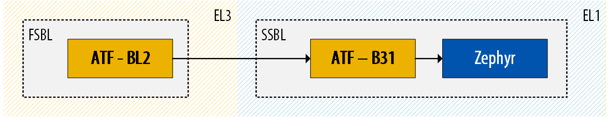
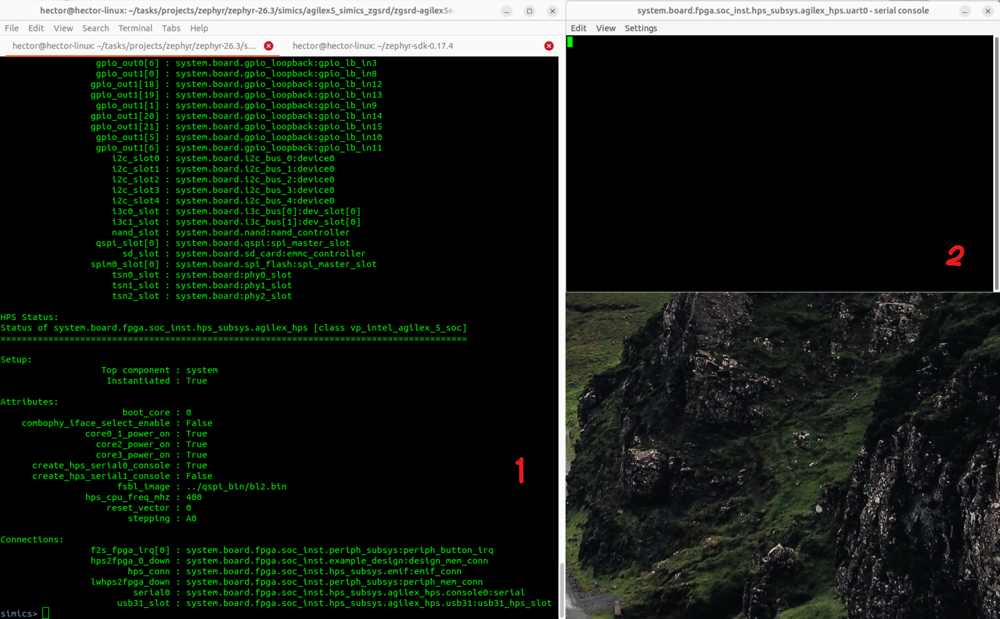
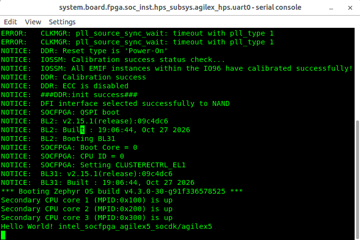

## Overview

This tutorial demonstrates how to build, package, and execute the Zephyr Real-Time Operating System (RTOS) on the virtual model of the Altera Agilex™ 5 E-Series Hard Processor System (HPS) using the [Intel Simics® Simulator](https://www.altera.com/products/development-tools/simics-virtual-platform). Simics enables comprehensive full-system simulation, allowing you to validate firmware, OS boot flows, and driver interactions before targeting physical silicon.

The Agilex 5 E-Series architecture pairs high-performance Arm Cortex-A55 and Cortex-A76 cores with rich HPS peripherals. Zephyr provides a modular RTOS footprint suited for real-time determinism applications.

The Arm Trusted Firmware (ATF) acts as the First-Stage Bootloader (FSBL) and Second-Stage Bootloader (SSBL) for Zephyr, as illustrated below:

{:style="width:60%; display:block; margin-left:auto; margin-right:auto"}

Using the Agilex 5 E-Series Universal Virtual Platform (`agilex5e-universal.simics`), you can run production-ready Zephyr binaries with full visibility into HPS register states, peripheral interaction, and system execution without physical hardware.

**What you will learn**

* Setting up the Zephyr development environment and target Simics scripts.
* Compiling Zephyr images and boot components for the Agilex 5 HPS target.
* Booting compiled images via the Simics CLI using virtual QSPI memory and a serial console.
* Testing RTOS features on virtual peripheral targets.

## Prerequisites

This document builds upon the [Intel® Simics® Simulator for Altera FPGAs Agilex™ 5 and Agilex™ 3 Virtual Platform](https://docs.altera.com/r/docs/786901/25.3/intel-simics-simulator-for-altera-fpgas-agilextm-5-and-agilextm-3-virtual-platform-user-guide/about-this-document). Review [Chapter 2: Intel Simics Simulator and Virtual Platforms](https://docs.altera.com/r/docs/784383/25.3/intel-simics-simulator-for-altera-fpgas-user-guide/intel-simics-simulator-and-virtual-platforms) and [Chapter 5: Getting Started with Intel Simics Simulator](https://docs.altera.com/r/docs/784383/25.3/intel-simics-simulator-for-altera-fpgas-user-guide/getting-started-with-intel-simics-simulator) before proceeding.

* Host PC with:
  * Linux OS installed. Ubuntu 22.04 LTS was used to create this page, other versions and distributions may work too
  * Altera&reg; Quartus® Prime Pro Edition Programmer and Tools, Version 26.3.
  * [Altera&reg; Simics Simulator](https://www.altera.com/downloads/simulation-tools/simics-simulator), Version 26.3

For installation procedures, refer to [Chapter 4: Installing the Intel Simics Simulator for Altera FPGAs](https://docs.altera.com/r/docs/784383/25.3/intel-simics-simulator-for-altera-fpgas-user-guide/installing-the-intel-simics-simulator-for-altera-fpgas) of the [Intel® Simics® Simulator for Altera FPGAs User Guide](https://docs.altera.com/r/docs/784383/current).

---

## Release Contents

This release package provides pre-compiled boot binaries, source repository references, and peripheral driver support definitions for the Agilex 5 virtual platform.

## Pre-built Binaries

Pre-built binaries are available in the following [link](https://releases.rocketboards.org/2026.10/zephyr/agilex5_dk_a5e065bb32aea_zephyr/).

Binaries for a `Hello World` application and the `Shell Subsystem` (CLI) are provided in the release package under their respective folders (`hello_world` and `cli`). Both folders contain an identical layout described below:

| File Name                           | Description                                                                                                                                         |
|:------------------------------------|:----------------------------------------------------------------------------------------------------------------------------------------------------|
| `bl31.bin`                          | Arm Trusted Firmware (TF-A) Stage 3-1 raw binary (EL3 Runtime Firmware / PSCI implementation).                                                      |
| `zephyr.bin`                        | Final compiled raw binary executable of the Zephyr RTOS application.                                                                                |
| `qspi_boot/`                        | Directory containing boot images and configuration binaries for QSPI flash memory boot.                                                             |
| `baseline_a55.sof`                  | Quartus SRAM Object File containing the compiled FPGA fabric configuration bitstream for the Agilex 5 baseline design.                              |
| `baseline_a55_hps_auto.sof`         | Intermediate SRAM Object File automatically generated by Quartus PFG with the HPS First Stage Bootloader (`bl2.hex`) integrated into the bitstream. |
| `bl2.bin`                           | Arm Trusted Firmware (TF-A) Stage 2 raw binary (First Stage Bootloader / FSBL for the HPS).                                                         |
| `bl2.hex`                           | Intel HEX representation of `bl2.bin` generated via `objcopy`, consumed by Quartus PFG to embed BL2 into the SOF and flash image.                   |
| `fip.bin`                           | Firmware Image Package binary generated by `fiptool`, packaging the TF-A BL31 runtime firmware and Zephyr OS (`bl31.bin` + `zephyr.bin`).           |
| `qspi_flash_image_agilex5_boot.pfg` | Quartus Programming File Generator XML configuration specifying flash partitions, source bitstreams, raw binary payloads, and output targets.       |
| `qspi_image.jic`                    | JTAG Indirect Configuration file used by the Quartus Prime Programmer to write the complete boot image into target QSPI flash memory via JTAG.      |
| `qspi_image_jic.map`                | Memory map text file generated by Quartus PFG detailing flash partition boundaries, start/end byte addresses, and layout.                           |
| `qspi_image_jic.rpd`                | Raw Programming Data binary containing the full byte-level flash memory image for direct QSPI flash writers or flash emulators.                     |

!!! note
    Pre-built Binaries target the QSPI memory as boot media

### Source Repositories

Altera&reg; Quartus<sup>&reg;</sup> Prime Pro Edition Version 26.3 and the following software component versions integrate the 26.3 release.  

| Component            | Location                                                                                                   | Branch                     | Commit ID/Tag             |
|:---------------------|:-----------------------------------------------------------------------------------------------------------|:---------------------------|:--------------------------|
| Agilex 5 Design      | [https://github.com/altera-fpga/agilex5e-ed-gsrd](https://github.com/altera-fpga/agilex5e-ed-gsrd)         | main                       | QPDS26.3_REL_BASELINE_PR       |
| Zephyr RTOS          | [https://github.com/zephyrproject-rtos/zephyr](https://github.com/zephyrproject-rtos/zephyr)               | main                       | v4.3.0 |
| Altera Zephyr RTOS   | [https://github.com/altera-fpga/zephyr-socfpga](https://github.com/altera-fpga/zephyr-socfpga)             | socfpga_v4.3.0   | QPDS26.3_REL_BASELINE_PR       |
| Arm Trusted Firmware | [https://github.com/altera-fpga/arm-trusted-firmware](https://github.com/altera-fpga/arm-trusted-firmware) | socfpga_v2.15.0 | QPDS26.3_REL_BASELINE_PR       |

!!! note
    The combination of the component versions indicated in the table above has been validated through the use cases described in this page and it is strongly recommended to use these versions together. If you decided to use any component with different version than the indicated, there is not warranty that this will work.

### Zephyr Driver Availability

The table below lists the support status for the Hard Processor System (HPS) peripheral drivers included in this Zephyr RTOS release for Agilex 5:

| HPS Peripheral         | Supported Status |
|:-----------------------|:-----------------|
| SD Card driver         | Yes              |
| GPIO Driver            | Yes              |
| I2C Driver             | Yes              |
| UART Driver            | Yes              |
| Timer Driver           | Yes              |
| WatchDog Driver        | Yes              |
| SMP Driver             | Yes              |
| QSPI Driver            | Yes              |
| Ethernet Driver        | Yes              |
| SDM Mailbox Driver     | Yes              |
| HPS DMA Driver         | Yes              |
| I3C driver             | Partially        |
| EDAC/RAS drivers       | No               |
| Clock Driver driver    | Yes              |
| Warm/Cold Reset driver | Yes              |

!!! note
    Drivers with support status `No` have not been fully tested. Drivers with support status `Partially` have completed basic functional testing but have not undergone a full validation cycle.

---

## Testing Pre-Compiled Binaries

This section describes how to validate the a pre-built Zephyr images and Arm Trusted Firmware (ATF) binaries using the Agilex 5 Universal Virtual Platform. Use this flow to confirm simulator bring-up, verify console output, and exercise virtual peripherals without building the target software stack from source.

For detailed procedural explanations of Simics execution, refer to [Chapter 5: Getting Started with Intel Simics Simulator](https://docs.altera.com/r/docs/784383/25.3/intel-simics-simulator-for-altera-fpgas-user-guide/getting-started-with-intel-simics-simulator) in the Intel® Simics® Simulator for Altera FPGAs User Guide.

!!! note
    Pre-built Binaries targets QSPI memory as boot media

### Environment Setup for Pre-compiled Binaries

Add the Simics installation path to your system `PATH` variable. The command below assumes an installation in the current user home directory. Adjust the path as required:

```bash
export PATH=~/altera_pro/intel-fpga-ext_26.3/simics/bin/:$PATH
```

### Deploy the Simics Virtual Platform

Follow the steps below to create a simulation workspace, deploy the Agilex 5 E-Series Universal Virtual Platform, and generate the top-level launch script.

**Step 1: Create Workspace Directory -** Create a workspace directory for simulation:

```bash
mkdir agilex5_zgsrd
cd agilex5_zgsrd
export CWD=$(pwd)
```

**Step 2: Deploy Virtual Platform -** Deploy an instance of the `agilex5e-universal` virtual platform:

```bash
cd $CWD
rm -rf zgsrd-agilex5e-universal
mkdir zgsrd-agilex5e-universal
cd zgsrd-agilex5e-universal
simics_intelfpga_cli --deploy agilex5e-universal
```

Expected output transcript:

```text
Simics(R) Simulator for Intel(R) FPGA CLI: 

INFO: Preparing to initialize /home/altera/tasks/projects/zephyr/simics/agilex5_zgsrd/tmp as a Simics workspace
Project created successfully
```

Compile the virtual platform modules:

```bash
make
```

This build step compiles the local virtual platform modules in `$CWD/zgsrd-agilex5e-universal` and prepares the `./simics` launcher script.

**Step 3: Configure Virtual Platform Execution Script -** Set the `cputype` environment variable to designate the boot core type (`a55` or `a76`).

```bash
export cputype=a55
```

The script below assigns the core configuration and sets the boot artifacts to target the `qspi_bin` folder.

```bash
cd $CWD/zgsrd-agilex5e-universal
cputypestring=""
if [ "$cputype" = "a76" ]; then
cputypestring='$hps_boot_core = 2
$hps_core0_1_power_on = TRUE
$hps_core2_power_on = TRUE
$hps_core3_power_on = TRUE'
fi

# Create zephyr_qspi.simics virtual platform configuration file 
# Add paths to boot artifacts
tee zephyr_qspi.simics << 'EOF'
# TOP-LEVEL CONFIG Script TO BOOT ZEPHYR.
local $board_name = "system.board.fpga"
# First stage boot loader, ATF BL2 path
$fsbl_image_filename = ../qspi_bin_prebuilt/bl2.bin
# Boot from QSPI
$qspi_image_filename = ../qspi_bin_prebuilt/qspi_image_jic.rpd
# Enable Serial Console
$create_hps_serial0_console=TRUE
EOF
# Add CPU parameter 
echo "$cputypestring" >> zephyr_qspi.simics
# Add start execution simics command
echo 'run-script "targets/agilex5e-universal/agilex5e-universal.simics"' >> zephyr_qspi.simics
```

For more parameter details, consult Chapter [2.1.3 Agilex™ 5 Universal Virtual Platform User-Configurable Parameters](https://docs.altera.com/r/docs/786901/25.3/intel-simics-simulator-for-altera-fpgas-agilextm-5-and-agilextm-3-virtual-platform-user-guide/agilextm-5-universal-virtual-platform-user-configurable-parameters) of the Intel® Simics® Simulator for Altera FPGAs Agilex™ 5 and Agilex™ 3 Virtual Platform User Guide.

### Download Pre-built Binaries

Download and extract the precompiled archive into the workspace for the application you want to test:

=== "Hello World"

    ```bash
    cd $CWD 
    mkdir qspi_bin_prebuilt
    cd qspi_bin_prebuilt
    wget https://releases.rocketboards.org/2026.10/zephyr/agilex5_dk_a5e065bb32aea_zephyr/hello_world/qspi_boot/bl2.bin
    wget https://releases.rocketboards.org/2026.10/zephyr/agilex5_dk_a5e065bb32aea_zephyr/hello_world/qspi_boot/qspi_image_jic.rpd
    ```

=== "CLI"

    ```bash
    cd $CWD 
    mkdir qspi_bin_prebuilt
    cd qspi_bin_prebuilt
    wget https://releases.rocketboards.org/2026.10/zephyr/agilex5_dk_a5e065bb32aea_zephyr/cli/qspi_boot/bl2.bin
    wget https://releases.rocketboards.org/2026.10/zephyr/agilex5_dk_a5e065bb32aea_zephyr/cli/qspi_boot/qspi_image_jic.rpd
    ```

### Test Zephyr Pre-compiled Images

**Step 1: Launch Virtual Platform -** Launch the virtual platform:

```bash
cd $CWD/zgsrd-agilex5e-universal
./simics zephyr_qspi.simics
```

Executing the script initializes two windows:

* **Terminal 1 (Simics CLI):** The interactive command prompt used to control the simulation, step through instructions, and inspect registers.
* **Terminal 2 (Serial Console):** A telnet-backed virtual terminal connected to the HPS UART 0 interface, displaying firmware and OS output.

{:style="display:block; margin-left:auto; margin-right:auto"}

**Step 2: Run Simulation -** Run the simulation from the Simics CLI (Terminal 1):

```text
simics> run
```

The system executes the boot sequence and logs output to the serial console (Terminal 2):

{:style="width:60%; display:block; margin-left:auto; margin-right:auto";}

**Step 3: Stop and Exit Simulation -** Stop and exit simulation.

To pause execution, issue the `stop` command in Terminal 1:

```text
running> stop
simics>
```

To terminate the Simics session:

```text
simics> exit
```

---

## Compiling from Source and Testing

Follow the steps in this section to set up the toolchain, compile Zephyr and Arm Trusted Firmware (ATF) from source, and package an RTOS application into a bootable image using the Quartus Programming File Generator, and execute the resulting binaries in the Simics simulator.

The procedure is described for booting Zephyr OS from a SD card or QSPI memory.

### Environment Setup for Source Compilation

Prepare the host build environment by installing required system packages, configuring the Arm GNU and Zephyr SDK toolchains, and retrieving the reference FPGA bitstream.

**Step 1: Install System Dependencies -** Install system tool dependencies:

```bash
sudo apt-get install --no-install-recommends \
git cmake ninja-build gperf ccache dfu-util device-tree-compiler wget \
python3-dev python3-pip python3-setuptools python3-tk python3-wheel \
python3-venv xz-utils file libpython3-dev make gcc gcc-multilib \
g++-multilib libsdl2-dev libmagic1 libguestfs-tools libssl-dev
```

**Step 2: Establish Workspace Staging Area -** Establish workspace staging area:

```bash
mkdir -p agilex5_zgsrd
cd agilex5_zgsrd
export CWD=$(pwd)
```

**Step 3: Set Up Arm GNU Toolchain -** Download and register the Arm GNU toolchain:  

```bash
cd $CWD
wget https://developer.arm.com/-/media/Files/downloads/gnu/14.3.rel1/binrel/\
arm-gnu-toolchain-14.3.rel1-x86_64-aarch64-none-linux-gnu.tar.xz
tar xf arm-gnu-toolchain-14.3.rel1-x86_64-aarch64-none-linux-gnu.tar.xz
rm -f arm-gnu-toolchain-14.3.rel1-x86_64-aarch64-none-linux-gnu.tar.xz
export PATH=`pwd`/arm-gnu-toolchain-14.3.rel1-x86_64-aarch64-none-linux-gnu/bin/:$PATH
export ARCH=arm64
export CROSS_COMPILE=aarch64-none-linux-gnu-
```

**Step 4: Retrieve Baseline FPGA Bitstream -** Retrieve baseline FPGA bitstream.

Simics executes the HPS processor and peripherals in simulation without programming the physical FPGA logic fabric. However, the Quartus Programming File Generator (`quartus_pfg`) requires an SRAM Object File (`.sof`) header to construct the virtual QSPI configuration file (`.jic`/`.rpd`).


```bash
cd $CWD
rm -f baseline_a55_hps_debug.sof
wget https://releases.rocketboards.org/2026.10/gsrd/agilex5_dk_a5e065bb32aea_gsrd.baseline-a55/baseline_a55_hps_debug.sof
```

**Step 5: Install Zephyr SDK -** Install and initialize the Zephyr SDK:

```bash
cd $CWD
wget https://github.com/zephyrproject-rtos/sdk-ng/releases/download/v0.17.4/zephyr-sdk-0.17.4_linux-x86_64.tar.xz
wget -O - https://github.com/zephyrproject-rtos/sdk-ng/releases/download/v0.17.4/sha256.sum | shasum --check --ignore-missing 
tar xvf zephyr-sdk-0.17.4_linux-x86_64.tar.xz
rm -rf zephyr-sdk-0.17.4_linux-x86_64.tar.xz
cd zephyr-sdk-0.17.4
# Run the SDK setup script to configure toolchains, host tools, and CMake integration
./setup.sh -t all
```

Register toolchain variables in the active environment:

```bash
export ZEPHYR_SDK_INSTALL_DIR=$(pwd)
export ZEPHYR_TOOLCHAIN_VARIANT=zephyr
```

### Compile Arm Trusted Firmware (ATF)

Build the Arm Trusted Firmware (ATF) Stage 2 (`bl2`) and Stage 3-1 (`bl31`) bootloaders along with the `fiptool` packaging utility for the Agilex 5 QSPI boot flow.

=== "Build ATF for QSPI Boot"

    **Step 1: Compile ATF Source Tree -** Clone and compile the ATF source tree:  
     
     ```bash
     cd $CWD
     git clone -b QPDS26.3_REL_BASELINE_PR https://github.com/altera-fpga/arm-trusted-firmware arm-trusted-firmware-qspi
     cd arm-trusted-firmware-qspi
     make realclean
     make PLAT=agilex5 SOCFPGA_BOOT_SOURCE_QSPI=1 SOCFPGA_SIP_SVC_V3=0 bl2 bl31 PRELOADED_BL33_BASE=0x80100000 -j$(nproc) 
     ```

    **Step 2: Compile FIP Utility -** Compile the ATF Firmware Image Package utility (`fiptool`):

    ```bash
    make fiptool
    cp tools/fiptool/fiptool $CWD
    ```

    The compilation generates the following output build artifacts:  

    - `$CWD/arm-trusted-firmware-qspi/build/agilex5/release/bl2.bin`  
    - `$CWD/arm-trusted-firmware-qspi/build/agilex5/release/bl31.bin`  
    - `$CWD/fiptool`

=== "Build ATF for SD Card Boot"

    **Step 1: Compile ATF Source Tree -** Clone and compile the ATF source tree:  
     
     ```bash
     cd $CWD
     git clone -b QPDS26.3_REL_BASELINE_PR https://github.com/altera-fpga/arm-trusted-firmware arm-trusted-firmware-sd
     cd arm-trusted-firmware-sd
     make realclean
     make PLAT=agilex5 SOCFPGA_BOOT_SOURCE_SDMMC=1 SOCFPGA_SIP_SVC_V3=0 bl2 bl31 PRELOADED_BL33_BASE=0x80100000 -j$(nproc) 
     ```

    **Step 2: Compile FIP Utility -** Compile the ATF Firmware Image Package utility (`fiptool`):

    ```bash
    make fiptool
    cp tools/fiptool/fiptool $CWD
    ```

    The compilation generates the following output build artifacts:  

    - `$CWD/arm-trusted-firmware-sd/build/agilex5/release/bl2.bin`  
    - `$CWD/arm-trusted-firmware-sd/build/agilex5/release/bl31.bin`  
    - `$CWD/fiptool`

=== "Build ATF for NAND Boot"

    **Step 1: Compile ATF Source Tree -** Clone and compile the ATF source tree:  
     
     ```bash
     cd $CWD
     git clone -b QPDS26.3_REL_BASELINE_PR https://github.com/altera-fpga/arm-trusted-firmware arm-trusted-firmware-nand
     cd arm-trusted-firmware-nand
     make realclean
     make PLAT=agilex5 SOCFPGA_BOOT_SOURCE_NAND=1 SOCFPGA_SIP_SVC_V3=0 bl2 bl31 PRELOADED_BL33_BASE=0x80100000 -j$(nproc)
     ```

    **Step 2: Compile FIP Utility -** Compile the ATF Firmware Image Package utility (`fiptool`):

    ```bash
    make fiptool
    cp tools/fiptool/fiptool $CWD
    ```

    The compilation generates the following output build artifacts:  

    - `$CWD/arm-trusted-firmware-nand/build/agilex5/release/bl2.bin`  
    - `$CWD/arm-trusted-firmware-nand/build/agilex5/release/bl31.bin`  
    - `$CWD/fiptool`

### Compile Zephyr Kernel and Applications

Zephyr build trees are managed using the `west` meta-tool. In this flow, the upstream Zephyr repository is initialized, dependencies are fetched, and the core tree is substituted with the Altera downstream branch supporting Agilex 5 HPS peripherals.

The Altera downstream Zephyr repository provides several sample applications to validate Hard Processor System (HPS) peripherals, as detailed in the following table. The build procedure in this section demonstrates targeting the HPS General-Purpose I/O (GPIO) block using the blinky application.

| Component / Feature | Application Path                                                     | Description                                                                                                                                               |
|:--------------------|:---------------------------------------------------------------------|:----------------------------------------------------------------------------------------------------------------------------------------------------------|
| HelloWorld          | `samples/hello_world/`                                               | Basic sanity test that prints "Hello World!" and board target information to verify toolchain, boot flow, and serial console output.                      |
| GPIO                | `samples/basic/blinky/`                                              | Demonstrates the GPIO driver API by toggling an LED (`led0` devicetree alias) on and off at 1-second intervals and printing the status.                   |
| Timer/Counter       | `samples/drivers/counter/alarm/`                                     | Demonstrates the counter driver API by starting a hardware timer, setting an alarm callback, and updating the alarm interval upon interrupt.              |
| Watchdog            | `samples/drivers/watchdog/`                                          | Configures the watchdog timer to reset the SoC upon expiration, feeds the watchdog 5 times, and then allows it to expire to test reset behavior.          |
| UART                | `samples/drivers/uart/echo_bot`                                      | Implements an interrupt-driven UART echo bot that buffers incoming characters in a message queue and echoes completed lines back to the console.          |
| QSPI                | `samples/drivers/soc_flash_qspi`                                     | Validates the QSPI NOR flash driver by retrieving geometry, erasing flash blocks, writing test data, and verifying the readback and erase data integrity. |
| SDM Mailbox         | `samples/subsys/sip_svc/`                                            | Uses the SiP SVC subsystem to communicate with the Secure Device Manager (SDM) via ARM EL3 SMC calls, sending mailbox commands to query chip voltage.     |
| HPS DMA             | `samples/drivers/dma/mem_to_mem/`                                    | Demonstrates asynchronous memory-to-memory transfers using the Synopsys DesignWare AXI DMA controller with linked-list descriptors and cache maintenance. |
| CLI                 | `subsys/shell/`                                                      | Implements Zephyr's interactive command-line shell, reading input and executing registered commands.                                                      |

**Step 1: Initialize Zephyr Workspace -** Initialize Python virtual environment and checkout repositories:

```bash
cd $CWD
python3 -m venv ~/.zephyrproject/.venv
source ~/.zephyrproject/.venv/bin/activate
pip3 install wheel west
west init -m https://github.com/zephyrproject-rtos/zephyr --mr v4.3.0 zephyrproject
cd $CWD/zephyrproject
west update
west zephyr-export
pip install -r $CWD/zephyrproject/zephyr/scripts/requirements.txt
```

**Step 2: Switch to Altera Downstream Repository -** Switch to the Altera downstream Zephyr repository:

```bash
cd $CWD/zephyrproject
rm -rf zephyr 
git clone -b QPDS26.3_REL_BASELINE_PR --single-branch https://github.com/altera-fpga/zephyr-socfpga.git zephyr
west update
west zephyr-export
```

**Step 3: Build Zephyr GPIO Application -** Build the Zephyr GPIO application image:

This example builds the GPIO `blinky` application. Change the path to compile a different application.

```bash
cd $CWD/zephyrproject/zephyr
west build -b intel_socfpga_agilex5_socdk samples/basic/blinky -d agilex5
```

The build generates the target executable at the following location:
- `$CWD/zephyrproject/zephyr/agilex5/zephyr/zephyr.bin`

### Create Simics Zephyr Boot Artifacts

=== "Boot from QSPI"

    The virtual platform boots from a simulated QSPI flash model. To construct this image, `fiptool` packages the Secure Monitor (`bl31.bin`) and non-secure OS (`zephyr.bin`) into a single Firmware Image Package (`fip.bin`). The Quartus Programming File Generator then maps `bl2.hex` into initial boot sectors and places `fip.bin` at offset `0x03C00000`.

    **Step 1: Stage FIP Container -** Stage ATF and Zephyr payloads into a unified FIP container:

    ```bash
    cd $CWD
    mkdir -p qspi_bin && cd qspi_bin
    cp $CWD/arm-trusted-firmware-qspi/build/agilex5/release/bl2.bin .
    $CWD/fiptool create --soc-fw $CWD/arm-trusted-firmware-qspi/build/agilex5/release/bl31.bin --nt-fw $CWD/zephyrproject/zephyr/agilex5/zephyr/zephyr.bin fip.bin
    ```

    **Step 2: Create PFG Specification -** Create the Quartus Programming File Generator specification (`qspi_flash_image_agilex5_boot.pfg`):

    ```bash
    base64 -d <<'EOF' | gunzip > "qspi_flash_image_agilex5_boot.pfg"
    H4sICCoD5WoCA3FzcGlfZmxhc2hfaW1hZ2VfYWdpbGV4NV9ib290LnBmZwCtU8lu2zAQvfsrCH6A
    JTtRT7IBbypSoLVrp0BvBGWOZALaSlKO3a8vqZVS2jQFyhNnhvPe4yx+EcXoCkLyPFvgGV5OkC9B
    KZ7FEp1LqfKUsJAwLhZ46mCU5gwWeHX6/ogd8zYvVVEqEvEEpLbNsX0oo6l+/0MWnPCUxoCRhoKz
    ysVdA2Kk7oWOf3ra4Ca7QjCpJC+UFiUdOyDhnGeMinuNXmd/Xh3wayIr7W1MZwj6V7rTbkOOh+0/
    UqKQK/lCC1Pk99JHCZUXwuDKz0A4WwaVva3tme+M4039HasBpkfOqEm+kaIE0LRrWedBnC3wurXI
    bNCWgqoLuhSSmMsCh8l8eoEbXoZUQsIzINTziIkzCMt4KvPId8zTTlhHU8kayPAFfRmOUeuwK9e0
    4LgOcKX0qN8EpspaaMSLacgz32kTKxIbdlDQjsd2thP1PPe+fnPnH2uWYd1HJRGKmwYjARLEFVgl
    M+I3YEQSypioHO3VvbnNwQgs3ywwp02EPrHqx37/TJ6+BHuNw39qfe5whH4nwh2LcHsRtFR5T19b
    Q2K3Jj7M/hOj/uLDZvTtN3h1K18TD+d92L0kpwzEcuXttu4Hb71+mK92j6c2o4lORhDVSFApeZyl
    kKluIHoXKvRaV6q6D5OmLnY1ukE2S2gtjzXi9nr2+O9nNBWxKduxNrj9EvTj/kc+29Q/1gsaxcvJ
    LylEZ0MHBgAA
    EOF
    ```

    **Step 3: Convert `bl2.bin` to HEX Format -** Use `objcopy` to convert the raw `bl2.bin` binary into an Intel HEX image (`bl2.hex`).

    ```bash
    cd $CWD/qspi_bin
    aarch64-none-linux-gnu-objcopy -v -I binary -O ihex --change-addresses 0x00000000 bl2.bin bl2.hex
    ```

    **Step 4: Generate the QSPI RPD Boot Image -** Link the compiled FPGA `.sof` bitstream and run `quartus_pfg` to generate the final QSPI flash programming files.

    ```bash
    cd $CWD/qspi_bin
    ln -sf $CWD/baseline_a55_hps_debug.sof baseline_a55_hps_debug.sof
    quartus_pfg -c qspi_flash_image_agilex5_boot.pfg
    deactivate
    ```

    This command generates the `$CWD/qspi_bin/qspi_image.jic` and `$CWD/qspi_bin/qspi_image.rpd` flash programming images.

    **Compilation Artifacts Summary**

    At the completion of the build flow, `$CWD/qspi_bin/` contains the following files:

    | File                 | Description                                                       |
    |:---------------------|:------------------------------------------------------------------|
    | `bl2.bin`            | ATF FSBL raw binary executed first by Simics.                     |
    | `bl2.hex`            | ATF FSBL translated to Intel HEX format for PFG packaging.        |
    | `bl31.bin`           | ATF BL31 EL3 runtime monitor binary.                              |
    | `zephyr.bin`         | Compiled Zephyr kernel and application binary.                    |
    | `fip.bin`            | Combined Firmware Image Package containing BL31 and Zephyr.       |
    | `qspi_image.rpd`     | Complete QSPI flash memory raw programming data image for Simics. |

=== "Boot from SD Card"

    The virtual platform boots from a simulated SD Card model. To construct this image, `fiptool` packages the Secure Monitor (`bl31.bin`) and non-secure OS (`zephyr.bin`) into a single Firmware Image Package (`fip.bin`). The `make_sdimage.sh` script package all the required binaries in a SD Card image.

    **Step 1-  Stage FIP Container -** Stage ATF and Zephyr payloads into a unified FIP container:

    ```bash
    cd $CWD
    mkdir -p sdcard_bin && cd sdcard_bin
    cp $CWD/arm-trusted-firmware-sd/build/agilex5/release/bl2.bin .
    $CWD/fiptool create --soc-fw $CWD/arm-trusted-firmware-sd/build/agilex5/release/bl31.bin --nt-fw $CWD/zephyrproject/zephyr/agilex5/zephyr/zephyr.bin fip.bin
    ```

    **Step 2 - Create `make_sdimage.sh` Script -** Create the SD Card image creator scrips:

    ```bash
    base64 -d <<'EOF' | gunzip > "make_sdimage.sh"
    H4sICDydXWUCA21ha2Vfc2RpbWFnZS5zaADlPGl32ziS3/UrEFnbttK67e4344w648RH+yWO/Wxn
    OrOJW4+SIIlridQQpG/1b9+qwkGApOQjm0/rlxdLJFAo1F2FgtdeNft+0Ox7YsJKpbXSGnsfzm8j
    fzyJ2cagyjqtzmaNHQYxn8KbaB5GXuyHQYPtTKeMhgkWccGjKz5s0Pyzk90v9Y/+gAeC1w+HPIj9
    kc+jbbYz9wYTXu80WjCutPbcHwCNaESBNxWls72P+93KBqDNA2/GWaVVpWcnO+e/w/OhH5nHL1pp
    EAYi9oJYlN4ffzo777U/dNutzpb+dgRrbFTu9bsFe82sb9WqHnfgjDtaNu50/6x3/u+TvS6/ibcA
    YTb3othHOrPY6085EzyO/WAs4FUS+DHrsv5tzEWDecP/SUQ8AyILFodMAHPE6JbFE57C4BG8Cqds
    CB9Zn0/Da1xiyuN1wWbeJWc7HdYPw9haVfh3HGkw8sdJhBigXBCqJ+e9d8fH572zw//eA8bPQuB7
    7uXx/v7Z3rl5XXLf0k5bN14nN+/T56PuJiLXbrJTxGjkw+bPbkXMZyl2NXZ+O+fsb5tAho9+kNyw
    vS/n6RqGmK2bv23aS+ALXKGDK3Sa7MSL5G5HYUQUuwTh4tMa2+VXIL4sjjivMR4PGiyF/vGLBt7q
    28DhOcJuv0zchnzkJVOQtt29/d7h0c7BHhG4W+4clK1nn3aO4Jk/88a8159e9oZA4AaorxxjNq5F
    TD9Y0OvdvXefD7qtlyE4SoIB0kqU9CeWCEBjo8ruSwx++GASsjI92wYZR11csK/1yQX8d8lG7dqo
    Ax+/1udsHoEIekOQyod6ZH29YPU+yaH++rUesX9EI9EDbX7A37EX/QZPZ2zGI6AAPL7AUSEjiuDH
    MUkufopJ5i/KFnIaj1qj0YCHg3A280CzQK68mA/Z1BcxC0fs+IzETjC24Td4g90dIvTaMO5XHWj2
    Tpj1mWT22o8nbHY5J8zYhNMbhJcOrOvXyMFqgx0lceJNp7eM3wymifCvFBQgUsNZOHJWjrzr7OK0
    TlJHWtbFfKrgn835wAfbcBsmkTVD4UYWQq4HVJhLG78UpQxGNt+Y/dmg01D4NPzZ2CVjxBSLm8Be
    tDmxNmYDcETMD+BTpG2BIFMAiHm3YMmYx2AeH8RhdEszPT8AK0m6LFkIiu2xBgBuNuLxXRM/NTbG
    dw/9u87DzZ2LiIgjf86055DfvGtYKF3DD4Bw4ZU/BHGxsHbAKGlk8odggVCNOZhhEjP5FtFrgKEh
    tadvNNIXoDuuvi8c6JbskwgDheROp+FAgg8Q3ybSDzB02TSL7NmPTq4hTa94hJ6HgRjIyUM1B8YA
    B5Az9fA6AOfvLCUV8euH5lHz4EK6kzwVargg+bMP72rs6B2y6+CdFN9Oq9U6qqYkIhAZ8qCJXLxz
    lVIurKhPHzdgkaN36C6riINydkpAjVPJr9R2AEt7ouDKz0AB3BDsx1In0g9b3/8x9+JJPQ5/a2p9
    h119FuBeJrCI1nCtcs6aE2b/0PgZF2hiy6VFqTROuIhHvpj0Rp4/7U3C8JIZe2xesnod/TAgWa+D
    HgOxf2sO+VUzSICjnd9+arOHB7btwoPQJ4pTWAef987O9w/Pfu+dHO526RFKzJRJNuwffgSf07ae
    1710/d5gNuxusLJ5ILe49Kdcr6Ml5sGj47wyK1fuUxwWZQbRHvGdx6zOJSmvAJ/KBgx0MPr6z4tF
    WY32R+wrq98hMGenAO/iDRqTwGAiGcOjKIR4NiXx0B8G6yA5SLYUbSJ2XdJl5Mu14sibsyLG7X05
    PGd7p6elFdyLkiDLp3D+GMvFbTB4RCJSzOopHpqOP3Nccw3sRUSiDi4TlAbkl2S5tPYKlHiexNv4
    ibFKG4IyaeLQoKmHHfMQlQsfhkmcTgogMMVPEY+TKJDPWgzD0GQwAIFPYw6JQ09i0COQtH1L9mR0
    hIt3yxWlw/YbxKBb6cgpsK0Jj8CrcTRwZAXJe8ACAzBPqJ2AKfMGyg9eY8SI1jC4pQgcbYD2NhLg
    K6mnYs75UDAQgGT+it4MweiNuqR6dzwKwRRBnJYiu2B90W0DxfmleY6oLsAIJ0HcbWXVloBKirHK
    2xJTXPJgHS+XPwCaXpDhGNEZSf+GeUIkYFksEYEtgLSRNyUTBbO9OMb8TXswgE0IiaGXMtTAzLCz
    mJuYfPQMqj1C1Uiz5Jkgz6uYtlEswn0Yegmo1Mc8FsJgVV2lSrhq3UfXo4ezWT/SQnEcofkGZ0HD
    kKQULAbA0SGHFHTmB0CtlMhBMuvzqKFmnx/vHoMmhQQEpEPwdHr/loFBSrgGTvPFeppHvMY0Qo4R
    BiBIWJNh/gn5I/3qA+I++eAY2CTFFljM2h/AuSXB0ItuM9gMptwLkrnGx5sOkill8mqVFWTC/Rsq
    zZmV0cq8R2Z7C0Cxcm/xC9JbHMuWjP6Zuc/JmVcz+8yChI20IWt+BGEwW3XgZt238G6jec9mcRBb
    fdfmMcF6xu7t4c728cUP3n/H2b/JDF9GADfPX7X37Ejctl1C+IE73nR2bCoPq7dM3tI2rS1lV0dh
    NPNi27RmXB95PjJFYCOwfiCfouuLb+cQ7Gfd3iNmssZe6a+XAs0mDAgASzm5jiYCdougBfMiSLr5
    Tdyp4f+b9P9WjY28ODW2cgOpuc0YWsK8B5i7kdwcF0B3mT4agQtOIi66kk4DD+xJ5Z4GLoAgVvgT
    b1WdGG5NVVjYLIFUG7KHfuJDwE0OBhi1f3jQ+/hud2efbBm442s2Q9+HTogKYy6sNB+UEMjvyjCa
    QTYFvmS47UwxiJf/nCTgXhGAG2S+eWO+vq4WveHCG6wSn9nlSKDYSWpQfGoIC18r9xqH7Z/L5mP6
    dFFeFAofpWq6PmHSr1WyuF0kits2zRBD+fx+s7ZV+wWrIgs5oglJ4DOl1QrRANdeHD5X0EbCljTp
    84AitGOMsLxoTHJuJfeqRCCzqXLln2UiCqEjfZqY+KP4jfylXXsAcRmOI8ly66Sr+Iqj61fIXGKq
    xDbP4OYq4UBkIeaQqDY1QgnBXjFNDtATMpJhwhEMMSALFYKCPqyPYm18iCwy1QVQIh6IYnHRg7J8
    H9/58xrrw/9gXCA/v7nDfAmXHWAeD0/4DKSd6iWgp/AOjJR534RYhEeQpoTDVELky56FcEZENC7Z
    AN6aYRsf5IeaASywLNDrxvju4TVWfqrOXNyTo+uN/l3HHUIbdsfcZKAAJXJWgfLDOrL43hq6KCtu
    AR89XZGStbEfpcZY6gfezELQGLOaeLFSE+L/37Wajgm8iPim1PgNG4ZGRPJCWtnIyzoCV1BMBWI5
    ijBSmox0DoVIFkBwJfrbdkbsFjLzRC7/31gblFYsOJNDItnNymeaWlba3QLh7YowiQYqY6ZHm91w
    NMJKA5V67SlsQ7pzrCjpIxI65aLyFIiQPbi6MgtlK4QbNtTTXqs/vXyaZFMS7AZGchuQvW9u11uL
    VZ4gmWO1sK72XVb5flG8IIcsVoSkoD8B5qdzH5UHJB9ie6VKRFBXGVIDY7aPWXAvGomn7RvL3iIa
    uDunwxlS9E2J6Veq0777fADxO/8PJF8X7KefVPVMHQ7hKdH+50/vqca9DViMwm21JYr40spsQ1VF
    sxFsllrwVSOig/yX4mHizjwWTzMlKSJ5Y4JQvgs7FFZELuX0KApnTK4KzFkYZGVpc6gxwnf5ombx
    jsbTsG+FLGZ+89trvQk+lfBHq+E/3S4aGM+wi+m6z7WLfCp4prJbTHVV7wU7uh6zywDykuuJR5YI
    DCLlHuQTvlnYfCs30tRC6a1bCV4rPmKa8itIkDCWGbKz89PDE8rVdw9PkZeCjvB8PkyZC2vuHvfM
    SCBDl5VvuVhWuzY7lKJk4dCEV/aCC8Sq/BQpmV2xcm5204jJioL2DE+i8nPLmlKSUFOBxS4q1KIP
    HvJ+ApqZRPNQYA/Ev8MEAsGAimyc3D8mgon0cmvFKwPI5veZiCTQRuIR07DUo4IVACseYwcGxoBU
    ZR3Kjgw/Zl5fhNMk5kVlBhoM4ldWg/w7SGQzsZ2eT4OfU46NJz09N+MS8F02JoehNEcL9WDCwSX7
    I4kjeWp1ytVMI+QKvXxgfBzxOZCdrf/ZXC8scJOMV94Sa1rAmoxM69XB6eKvAr1eg23dqoiB0PjL
    VQg10UXmr2JknoCQi9SGs1tMxxC8qP35V229cv/7MYjTem09rTQ4mGdAza+H1aa9TUtFtE1RO9Kz
    FiY8hpQs4nSCEXBkuhfd1hh2DimF4vCPIoUZ9j3xyBFVps8WDG89afD4jS9U/CHHCjonsAUPpdSP
    c4GhOsbUMSHlqxDPVTYbbA+YxAEnTF9GOkLUVQnKDhCLTLCXW1OHl0uLa3Q4F+JS1z4QPS1fIPSe
    7FtwpV/hnFWAggIZTDaRkD5clDnqIi8xT3A8lXu19iI1x9Rps+yoUf5CLDbySq3zZfSyVgFP1+9Y
    KlxV5ggjbeUVuvulm3nWpgjGNggnckX60Eb+0NfeWkbsC8p2w2ohysMfg7Jx2y/Hu6iAoNYpDPr5
    TRx5A5njuhVBSgNIQ7mnyKk0NFU/I+ZjHvdCQXLeQzDZU1TMifB5t1zOPPXMc4meHqiNXdu2dM1a
    kzXH69U0gR6hiEGcpKYtmJNCjwCMpYEQWNrSgSbBkJyqqYuU3TZuGhcYoNaSbxaq4yfNiNU4g04B
    zV/QLScGEFXF2vth4AIPf1cHzfL0XGa2omQ19uU6f0pWJ2Cu76W008FzDXrZLlm9f3Yr4IJenJ2+
    75acCKtbOto7BUjux97nw91Wt3RyuvfxeGd3D17hqYn+fHxGXRZn3ZLsJJQrydCpBDHo+6Pd3tGH
    E0KxG4Ql53upJB3nmnaclhampox0plVCd3Y9QYbLGeNYuVolKdJite1SX31SlXBglIRiW4X6ZZUZ
    9CsdGAP4Hp91IU5mqpLkDI+qTNNNj4bvS4eHVWazsVM4aFZlKc2fAnUWWTMka54yjSL6qps7mInm
    6fLpVSbZ23YeA8RULDS09ImEZr6nfF9K4ScBhEcHe59yj/Pg+lVmieoycPl5Y805qWPFnJvDKEvZ
    loyKq8yReI2E83AJHq+rOf+jXE4SYL4Z6HOtyn0bMrw3rqjbVWhTIC1JG/cS60XdlmB3p2EwhkjM
    RIxKhe9BFBdF8W9mB9dehP0j29oaJgI7Df2+zJIgBBMYGjoLYcsM9h4mEEUKwgMcK1qDNdV0Iv3Z
    25KuO+j2LzKXT8NGAnInSrANdkoN62/Z19uHQLUOQ9g8ZMC2Xhj1gvCNk3ibx5h1Y9pdzocX0cxd
    q6Dy4MZuuF1F6FTogN7TmHLTh4f8K7CPv245JrVYmA6nUz4GN77Twd53VUQ7g+QxbQ72VHsKOGmM
    MCIvGFNk3ka+/Lql+xMVyoirfZpfdNvBwrRaLbn9AN1MMwAy+r1qTcH6pWkZSw+zQIoiGcxgNADf
    TGHYbjCDh1OOTTGR50+xVDaYeBg2QWaT6jt22uydHr43oUv6SsUwovn14OjDRaXZHOM9Eg11CjKB
    QINkxiN/kAKXQRjEVqqrFbtf1YKfPx2eL18IIqWvrfrfL779/K3x7S19fN2UgRNeyKEuXNNFKzeK
    tXJsalXCkq5CovghI4q2lUMe5amQv5uiyntZ0EffB/poBeiD7wN9IEEr3crVu2THBHEGqChI7v9l
    nslzqA81dkRtyAWSLo+vRiF2JiD7J958ziHnBQuGRWvspceWBewNjD1xCYGfd8VVnzS/4QPIvfCK
    FPuDq3pE/1Y2NFJHodtWWVisM4OtHnKsPRV0RWYMnE26RcnUMAL+iA0vgGysySBMpkMqLajOUHsD
    RdQzmo33dUhT9nfOs5eOjKKn6txgJ6a9OjMaOy05EdK2I7DWkttDSy4P1dgvrf9KVYtsSK45KyuC
    KHq/tKh9qWVucjldXt3CZqlcCxQ8+eW1qx+wA6QNbUAe9NbY1nIUVftcEYZbBRiaLrzu8na24v40
    RDWnzCUlrWco1CieaR0UKzGycUredCnnmszLjqCWceeQI2GNXUmVc34l21kf0Y7MaFKRolbTZ+jB
    MpHPLFUk9fY2jBhLJv5s3USQyJS/UDnfBK4qsPgiC/oawdLScn5KA71U07rsIHmA5LBKU3SIkgbP
    Bec3dmSdz84t+OZ4AnNzC2TVrktZUf/TgaUEqeqa5ntdjOyH8QRvfpTJpOD1qLLOrsmkq16wBjsc
    YSBXk8zE6mHDiua+WIuYeD1D/p9+Slnk5CXFbFpSWVKyRGiv1+frhPY6oL1ejDY4nVuI6Un0ZvkL
    WXJcY/W1A1u4noG5Pc3OY1bPUvzBG0PYkqEvwdGdGWWtMYprOBMKckcjwz1zTc6ZAqE1pQAFfMvg
    8g7E6vT4iE6JRDKfhxH25SN2W1mlFI3MXGxDEdg9ZV2yA/HZUsNxNyoCzc48pB7tcRhSawoFAwXL
    AX99Ot/q84GH8axCNgPs2gdyJkIakoDfxDlrAsyCJGdGt7EzuIC9trnH6mEx2RxNe+KXpSXiIvhP
    rb4utbfunp9fds2dsBCDrdxTqEQod0FS3V0jW4+SDFsFBQRT61zAdOlevCuwc8XXL+W9EWn1IOiB
    NAP4jTw3VzItDDN7z+5b7TlzFmYHUkLIG39KHZm+jZa5tdqwpv/BSYUQJVhNlmKnt+mIAiXOiUp6
    /q1uJshj9SGHWJoCPxTwzHV0+35Fsd9THRFZnUDTavkUoB7kvincDXmvJNORbs5zM41BrKx7yzfL
    S8zOs/xqCsDNczq//JrLxewq9zKUsuuVbRytqLD8aPeD6g249OdzpGpKwbQXx3+8i37ka7nRZgGP
    wZzwhl2UMEbSd7CUl5PdZdaFfLyD7wRIx2fLXdBKAdGXuyVM2A014yiBxMR91bmKuimnKsm9j4d4
    x37nDzxvyJ6nwEZ1wRkPHR6XeDcVsgU+3/aked4usyvs8ZdF8WzfdW5cipNBffFULq5ZsUCO+hTm
    ap5BruCwSjWlvCiKNfe+VRKUxq4raYnTRsvuZ+l2t5Q8HVIVVfBfmC/qsojp1lqju3V0BxqJEfH/
    JGAArVacV+oSqSnaLx4PBlW7GQDF/ZLAGR2zAIOETQWr7zAbejVvUtiqyqdE3YaANp/atxvsDJS9
    vNxNrpCuToZiGRI0X+cjhOKcK7+H+4rrOfG6rGr0xb083/1LYc6HxjnW0XnLj+WfXOK7mSjBPJ2T
    50cn8sL2xuwSVGqOwYWkJv5xhC/mp4ql5vsnMoYCNVREFadJLFXL8tO4tChl4rL9EPuEKYugO4um
    PZysAv7Ngag5jsJk7t7yGdOfkWD194X8rNMfK4i6LfhEk+FTg/0GQxVdFi62zpd8F/xqLUhBvkQF
    IJRfitYPUJHSU9Yu0J/n+Y4Cf5C90F4qqWPg/wUS5YEBm0oAAA==
    EOF
    chmod ug+x make_sdimage.sh
    ```

    **Step 3: Create the SD Card boot image -** Create `sdimage.img`:

    ```bash
    touch dummy.tar.gz
    sudo ./make_sdimage.sh -k dummy.tar.gz -p fip.bin -o sdimage.img -g 2G -pg 16
    ```

    Exit the python virtual environment.

    ```bash
    deactivate
    ```

    The command generates `$CWD/sdcard_bin/sdimage.img`.

    **Compilation Artifacts Summary**

    At the completion of the build flow, `$CWD/qspi_bin/` contains the following files:

    | File                 | Description                                                       |
    |:---------------------|:------------------------------------------------------------------|
    | `bl2.bin`            | ATF FSBL raw binary executed first by Simics.                     |
    | `bl31.bin`           | ATF BL31 EL3 runtime monitor binary.                              |
    | `zephyr.bin`         | Compiled Zephyr kernel and application binary.                    |
    | `fip.bin`            | Combined Firmware Image Package containing BL31 and Zephyr.       |
    | `sdimage.img`        | SD Card application image.                                        |

=== "Boot from NAND"

    The virtual platform boots from a simulated NAND memory model. To construct this image, `fiptool` packages the Secure Monitor (`bl31.bin`) and non-secure OS (`zephyr.bin`) into a single Firmware Image Package (`fip.bin`).

    **Step 1: Stage FIP Container -** Stage ATF and Zephyr payloads into a unified FIP container:

    ```bash
    cd $CWD
    mkdir -p nand_bin && cd nand_bin
    cp $CWD/arm-trusted-firmware-nand/build/agilex5/release/bl2.bin .
    $CWD/fiptool create --soc-fw $CWD/arm-trusted-firmware-nand/build/agilex5/release/bl31.bin --nt-fw $CWD/zephyrproject/zephyr/agilex5/zephyr/zephyr.bin fip.bin
    ```

    **Step 2: Create the NAND image file -** Package `fip.bin` into `nand_mem.img`:

    ```bash
    cd $TOP_FOLDER/nand_bin
    dd if=/dev/zero count=8 bs=16MB | tr '\0' '\377' > nand_mem.img
    dd if=fip.bin of=nand_mem.img conv=notrunc bs=1 seek=2097152
    ```

    Exit the Python virtual environment:

    ```bash
    deactivate
    ```

    This command generates the `$CWD/nand_bin/nand_mem.img` programming image.

    **Compilation Artifacts Summary**

    At the completion of the build flow, `$CWD/qspi_bin/` contains the following files:

    | File                 | Description                                                       |
    |:---------------------|:------------------------------------------------------------------|
    | `bl2.bin`            | ATF FSBL raw binary executed first by Simics.                     |
    | `bl2.hex`            | ATF FSBL translated to Intel HEX format for PFG packaging.        |
    | `bl31.bin`           | ATF BL31 EL3 runtime monitor binary.                              |
    | `zephyr.bin`         | Compiled Zephyr kernel and application binary.                    |
    | `fip.bin`            | Combined Firmware Image Package containing BL31 and Zephyr.       |
    | `nand_mem.img`       | Complete NAND memory raw programming data image for Simics.       |

### Testing the GPIO Application

Add the Simics installation path to your system `PATH` variable. The command below assumes an installation in the current user home directory. Adjust the path as required:

```bash
export PATH=~/altera_pro/intel-fpga-ext_26.3/simics/bin/:$PATH
```

Follow the steps below to create a simulation workspace, deploy the Agilex 5 E-Series Universal Virtual Platform, and generate the top-level launch script.

**Step 1: Deploy Virtual Platform -** Deploy an instance of the `agilex5e-universal` virtual platform:

 ```bash
 cd $CWD
 rm -rf zgsrd-agilex5e-universal
 mkdir zgsrd-agilex5e-universal
 cd zgsrd-agilex5e-universal
 simics_intelfpga_cli --deploy agilex5e-universal
 ```

 Expected output transcript:

 ```text
 Simics(R) Simulator for Intel(R) FPGA CLI: 

 INFO: Preparing to initialize /home/altera/tasks/projects/zephyr/simics/agilex5_zgsrd/tmp as a Simics workspace
 Project created successfully
 ```

 Compile the virtual platform modules:

 ```bash
 make
 ```

 This build step compiles the local virtual platform modules in `$CWD/zgsrd-agilex5e-universal` and prepares the `./simics` launcher script.

=== "Boot from QSPI memory"

    **Step 2: Configure Virtual Platform Execution Script -** Set the `cputype` environment variable to designate the boot core type (`a55` or `a76`).

    ```bash
    export cputype=a55
    ```

    The script below assigns the core configuration and sets the boot artifacts to target the `qspi_bin` folder.

    ```bash
    cd $CWD/zgsrd-agilex5e-universal
    cputypestring=""
    if [ "$cputype" = "a76" ]; then
    cputypestring='$hps_boot_core = 2
    $hps_core0_1_power_on = TRUE
    $hps_core2_power_on = TRUE
    $hps_core3_power_on = TRUE'
    fi

    # Create zephyr_qspi.simics virtual platform configuration file 
    # Add paths to boot artifacts
    tee zephyr_qspi.simics << 'EOF'
    # TOP-LEVEL CONFIG Script TO BOOT ZEPHYR.
    local $board_name = "system.board.fpga"
    # First stage boot loader, ATF BL2 path
    $fsbl_image_filename = ../qspi_bin/bl2.bin
    # Boot from QSPI
    $qspi_image_filename = ../qspi_bin/qspi_image.rpd
    # Enable Serial Console
    $create_hps_serial0_console=TRUE
    EOF
    # Add CPU parameter 
    echo "$cputypestring" >> zephyr_qspi.simics
    # Add start execution simics command
    echo 'run-script "targets/agilex5e-universal/agilex5e-universal.simics"' >> zephyr_qspi.simics
    ```

    **Step 3: Launch Simics -** Launch Simics using the configured launch script:

    ```bash
    cd $CWD/zgsrd-agilex5e-universal
    ./simics zephyr_qspi.simics
    ```

=== "Boot from SD Card"

    **Step 2: Configure Virtual Platform Execution Script -** Set the `cputype` environment variable to designate the boot core type (`a55` or `a76`).

    ```bash
    export cputype=a55
    ```

    The script below assigns the core configuration and sets the boot artifacts to target the `sdcard_bin` folder.

    ```bash
    cd $CWD/zgsrd-agilex5e-universal
    cputypestring=""
    if [ "$cputype" = "a76" ]; then
    cputypestring='$hps_boot_core = 2
    $hps_core0_1_power_on = TRUE
    $hps_core2_power_on = TRUE
    $hps_core3_power_on = TRUE'
    fi

    # Create zephyr_sdcard.simics virtual platform configuration file 
    # Add paths to boot artifacts
    tee zephyr_sdcard.simics << 'EOF'
    # TOP-LEVEL CONFIG Script TO BOOT ZEPHYR.
    local $board_name = "system.board.fpga"
    # Boot from SD Card
    $create_hps_sd_card=TRUE
    $create_hps_mmc=FALSE
    # First stage boot loader, ATF BL2 path
    $fsbl_image_filename = ../sdcard_bin/bl2.bin
    # Boot from SD Card
    $sd_image_filename = ../sdcard_bin/sdimage.img
    # Enable Serial Console
    $create_hps_serial0_console=TRUE
    EOF
    # Add CPU parameter 
    echo "$cputypestring" >> zephyr_qspi.simics
    # Add start execution simics command
    echo 'run-script "targets/agilex5e-universal/agilex5e-universal.simics"' >> zephyr_sdcard.simics
    ```

    **Step 3: Launch Simics -** Launch Simics using the configured launch script:

    ```bash
    cd $CWD/zgsrd-agilex5e-universal
    ./simics zephyr_sdcard.simics
    ```

=== "Boot from NAND memory"

    **Step 2: Configure Virtual Platform Execution Script -** Set the `cputype` environment variable to designate the boot core type (`a55` or `a76`).

    ```bash
    export cputype=a55
    ```

    The script below assigns the core configuration and sets the boot artifacts to target the `nand_bin` folder.

    ```bash
    cd $CWD/zgsrd-agilex5e-universal
    cputypestring=""
    if [ "$cputype" = "a76" ]; then
    cputypestring='$hps_boot_core = 2
    $hps_core0_1_power_on = TRUE
    $hps_core2_power_on = TRUE
    $hps_core3_power_on = TRUE'
    fi

    # Create zephyr_sdcard.simics virtual platform configuration file 
    # Add paths to boot artifacts
    tee zephyr_nand.simics << 'EOF'
    # TOP-LEVEL CONFIG Script TO BOOT ZEPHYR.
    local $board_name = "system.board.fpga"
    # Ensure the nand_mem.img & bl2.bin paths are relative to the simics executable
    # First stage boot loader, ATF BL2 path
    $fsbl_image_filename = ../nand_bin/bl2.bin
    # Boot from NAND
    $nand_data_image_filename = ../nand_bin/nand_mem.img
    # Enable Console
    $create_hps_serial0_console=TRUE
    EOF
    echo "$cputypestring" >> zephyr_nand.simics
    echo 'run-script "targets/agilex5e-universal/agilex5e-universal.simics"' >> zephyr_nand.simics
    ```

    **Step 3: Launch Simics -** Launch Simics using the configured launch script:

    ```bash
    cd $CWD/zgsrd-agilex5e-universal
    ./simics zephyr_nand.simics
    ```

Upon script invocation, two windows initialize: Terminal 1 hosts the interactive Simics CLI, and Terminal 2 provides the serial console interface to the target HPS UART.

{:style="display:block; margin-left:auto; margin-right:auto"}

**Step 4: Start Simulation -** Start the simulation from the Simics CLI (Terminal 1):

```text
simics> run
```

Terminal 2 displays real-time execution logs from the target HPS UART:

```text

NOTICE:  BL2: v2.15.1(release):QPDS26.3_REL_BASELINE_PR
NOTICE:  BL2: Built : 12:57:37, Nov  2 2026
NOTICE:  BL2: Booting BL31
NOTICE:  SOCFPGA: Boot Core = 0
NOTICE:  SOCFPGA: CPU ID = 0
NOTICE:  SOCFPGA: Setting CLUSTERECTRL_EL1
NOTICE:  BL31: v2.15.1(release):QPDS26.3_REL_BASELINE_PR
NOTICE:  BL31: Built : 12:57:39, Nov  2 2026
*** Booting Zephyr OS build QPDS26.3_REL_BASELINE_PR ***
Secondary CPU core 1 (MPID:0x100) is up
Secondary CPU core 2 (MPID:0x200) is up
Secondary CPU core 3 (MPID:0x300) is up
LED state: OFF
LED state: ON
LED state: OFF
LED state: ON
LED state: OFF
LED state: ON
LED state: OFF
```

**Step 5: Query Hardware Register Status -** Query the hardware register status from the Simics CLI.

Read the internal Port A Data Register directly via the Simics Python CLI to confirm runtime state changes:

```python
@hex(conf.system.board.fpga.soc_inst.hps_subsys.agilex_hps.gpio0.bank.regs.GPIO_SWPORTA_DR)
```

Example response showing pin state transitions (OFF:`0x0`, ON:`0x800`):

```text
running> @hex(conf.system.board.fpga.soc_inst.hps_subsys.agilex_hps.gpio0.bank.regs.GPIO_SWPORTA_DR)
'0x0'
running> @hex(conf.system.board.fpga.soc_inst.hps_subsys.agilex_hps.gpio0.bank.regs.GPIO_SWPORTA_DR)
'0x800'
```

**Step 6: Terminate Simulation -** Terminate simulation:

```text
running> stop
simics> exit
```

---

## Troubleshooting

This section provides solutions for common environment configuration and build directory issues encountered when setting up and compiling the Zephyr workspace.

### Sphinx Dependency Conflict During Environment Setup

Installing Sphinx packages on non-standard host Python environments can trigger version incompatibility conflicts with `docutils`:

```text
ERROR: sphinx-tabs 3.4.1 has requirement docutils~=0.18.0, but you'll have docutils 0.19 which is incompatible.
ERROR: sphinx-rtd-theme 1.2.2 has requirement docutils<0.19, but you'll have docutils 0.19 which is incompatible
```

Resolve the dependency pin by reinstalling the core documentation packages within the active Python environment:

```bash
pip install sphinx-rtd-theme sphinx
```

### Stale Build Artifacts When Recompiling Applications

Rebuilding alternate Zephyr applications inside an existing build directory causes configuration mismatch errors:

```text
ERROR: Build directory ".../zephyr/agilex5" is for application ".../hello_world", but source directory ".../blinky" was specified; please clean it, use --pristine, or use --build-dir to set another build directory
```

Force a clean build using the `-p always` flag:

```bash
west build -p always -b intel_socfpga_agilex5_socdk samples/hello_world -d agilex5
```

## Documentation & Resources

- [Intel Simics® Simulator](https://www.altera.com/products/development-tools/simics-virtual-platform)
- [Simics Linux HPS Baseline System Example Design](https://altera-fpga.github.io/rel-26.3/embedded-designs/agilex-5/common/virtual-platforms/linux-gsrd/ug-linux-gsrd-agilex5-virtual-platforms/)
- [Agilex 5 E-Series 065B Premium Development Kit HPS Zephyr Baseline Example Design](https://altera-fpga.github.io/rel-26.3/embedded-designs/agilex-5/e-series/premium-065b/gsrd-zephyr/ug-zgsrd-agx5e-premium-065b/)
- [Zephyr Repository for Altera SoC FPGA](https://github.com/altera-fpga/zephyr-socfpga)

---
## Notices & Disclaimers

Altera<sup>&reg;</sup> Corporation technologies may require enabled hardware, software or service activation.
No product or component can be absolutely secure. 
Performance varies by use, configuration and other factors.
Your costs and results may vary. 
You may not use or facilitate the use of this document in connection with any infringement or other legal analysis concerning Altera or Intel products described herein. You agree to grant Altera Corporation a non-exclusive, royalty-free license to any patent claim thereafter drafted which includes subject matter disclosed herein.
No license (express or implied, by estoppel or otherwise) to any intellectual property rights is granted by this document, with the sole exception that you may publish an unmodified copy. You may create software implementations based on this document and in compliance with the foregoing that are intended to execute on the Altera or Intel product(s) referenced in this document. No rights are granted to create modifications or derivatives of this document.
The products described may contain design defects or errors known as errata which may cause the product to deviate from published specifications.  Current characterized errata are available on request.
Altera disclaims all express and implied warranties, including without limitation, the implied warranties of merchantability, fitness for a particular purpose, and non-infringement, as well as any warranty arising from course of performance, course of dealing, or usage in trade.
You are responsible for safety of the overall system, including compliance with applicable safety-related requirements or standards. 
<sup>&copy;</sup> Altera Corporation.  Altera, the Altera logo, and other Altera marks are trademarks of Altera Corporation.  Other names and brands may be claimed as the property of others. 

OpenCL* and the OpenCL* logo are trademarks of Apple Inc. used by permission of the Khronos Group™. 
