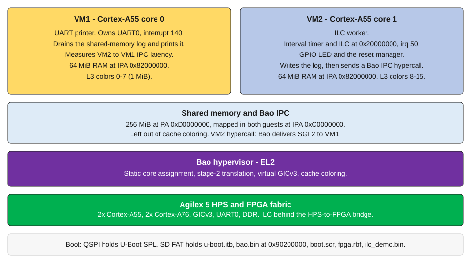
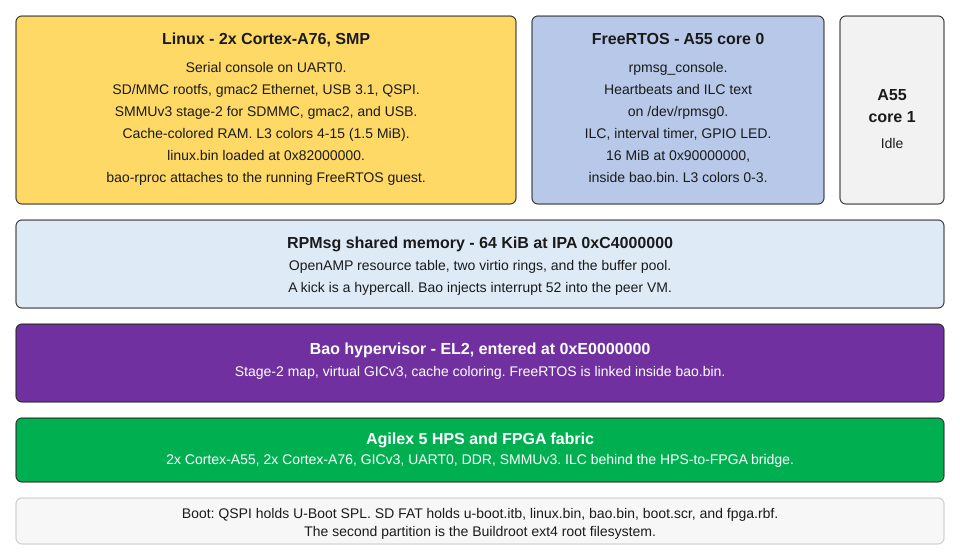
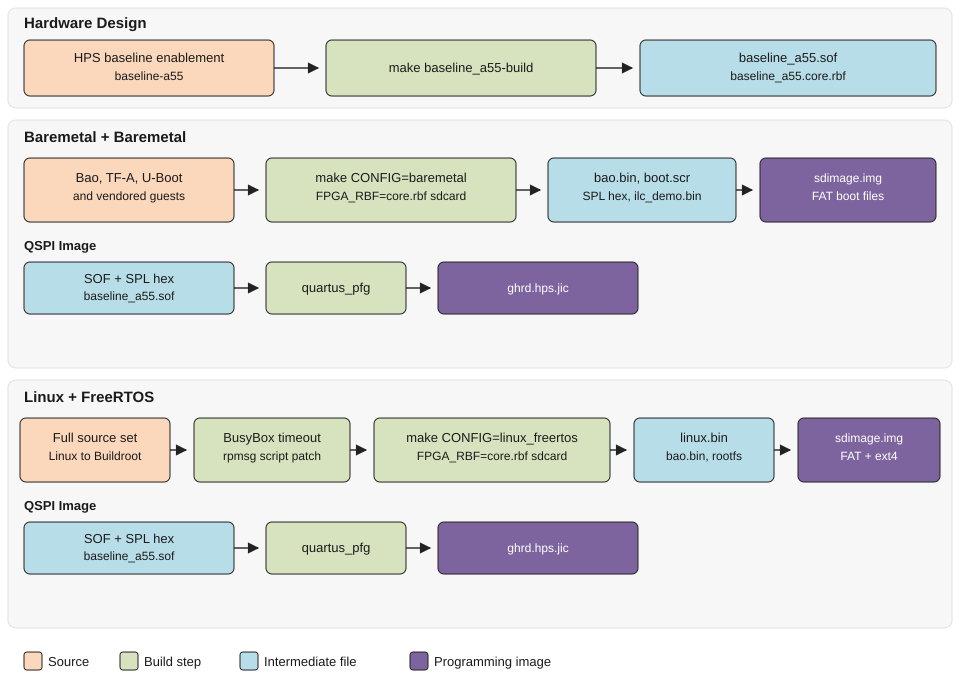

## Introduction

This page presents a couple of Bao hypervisor examples running on the Agilex&trade; 5 FPGA E-Series 013B Development Kit

### Overview

[Bao](https://github.com/bao-project/bao-hypervisor) is an open-source static-partitioning hypervisor. It runs at EL2. A configuration file compiled into the hypervisor image assigns each guest its cores, its memory, and its devices, and the guest keeps that assignment for the life of the boot. Bao installs a stage-2 translation for each guest and a virtual GICv3 for the interrupts named in the configuration. Guests exchange data through a shared-memory region. A hypercall asks Bao to inject an interrupt into the peer guest.

The Agilex 5 port is the patch set in `bao-hypervisor/patches/v2.0.0/`. It adds the HPS platform, PSCI, virtual GICv3 integration, shareability for the IPC region, an SMMUv3 driver, and the cache-coloring fixes the hypervisor needs on this core. Coloring divides the 2 MiB L3 cache into 16 colors of 128 KiB. Each guest receives its own colors, so its cache lines stay in its own slice of the L3. Where coloring makes a guest intermediate address differ from the physical address, the SMMUv3 stage-2 translation keeps that guest's DMA masters on the guest's pages.

These examples build Bao from commit [`0af4a1ab558ad60c9658af4f43756c4536dd3141`](https://github.com/bao-project/bao-hypervisor/tree/0af4a1ab558ad60c9658af4f43756c4536dd3141) (the v2.0-rc7 tree, after the v2.0.0 tag). The [upstream README](https://github.com/bao-project/bao-hypervisor/blob/0af4a1ab558ad60c9658af4f43756c4536dd3141/README.md) describes Bao's configuration language and the upstream build. The rest of this page is how this example uses that language on the Agilex 5 HPS.

### Prerequisites

The following are required to be able to fully exercise the Example Design:

* Altera&reg; Agilex&trade; 5 FPGA E-Series 013B Development Kit, ordering code DK-A5E013BM16AEA. Refer to [board documentation](https://www.altera.com/products/devkit/po-3196/agilex-5-fpga-e-series-013b-development-kit) for more information about the development kit.

* Host PC with:

  * 64 GB of RAM. Less will be fine for only exercising the binaries, and not rebuilding the HPS Baseline System Example Design.
  * Linux OS installed. Ubuntu 22.04LTS was used to create this page, other versions and distributions may work too
  * Serial terminal (for example GtkTerm or Minicom on Linux and TeraTerm or PuTTY on Windows)
  * Altera&reg; Quartus<sup>&reg;</sup> Prime Pro Edition Version 26.3
  
* Internet connection. For downloading the files, especially when rebuilding the HPS Baseline System Example Design.


### Overview of the Examples

This page builds two asymmetric multi-processing configurations from `software/amp_bao/` on the Agilex 5 FPGA E-Series 013B Development Kit. Both use the Quartus project from the [HPS Baseline System Example Design](https://altera-fpga.github.io/rel-26.3/embedded-designs/agilex-5/e-series/013B/gsrd/ug-gsrd-agx5e-013b/). U-Boot SPL is programmed into QSPI together with the FPGA bitstream. U-Boot, Bao, and the guest images are on the SD card. At boot, U-Boot runs `boot.scr`, which programs the fabric from `fpga.rbf`, enables the HPS-to-FPGA bridges, and jumps to Bao. The serial port is HPS UART0 at 115200 baud, 8 data bits, no parity, and 1 stop bit.

| `CONFIG` | Guests | What the console shows | SD card |
| --- | --- | --- | --- |
| `baremetal` | Two baremetal VMs on the Cortex-A55 cores | `[VM1] IPI` latency and `[VM2] ILC` latency on UART0 | FAT only. Both guests are linked inside `bao.bin`. |
| `linux_freertos` | Linux on both Cortex-A76 cores, FreeRTOS on one Cortex-A55 | Linux login on UART0. FreeRTOS heartbeats and ILC lines on `/dev/rpmsg0` | FAT boot files and an ext4 Buildroot root filesystem. FreeRTOS is linked inside `bao.bin`. |

Run `make CONFIG=<name>` from `software/amp_bao/`. The orchestrator reads `sources.yaml`, clones each upstream tree, applies the patch directory named for that component, and builds the pieces that configuration uses. The first build downloads the Arm GNU toolchain 14.3.rel1 into `software/amp_bao/.toolchain/`.

### Architecture

#### Baremetal guests



`configs/baremetal/config.c` is the manifest for this configuration. VM1 runs on Cortex-A55 core 0 and owns UART0, so it is the guest that prints. VM2 runs on Cortex-A55 core 1. It owns the fabric interval timer and the Interrupt Latency Counter (ILC) at `0x20000000`, measures interrupt latency, and writes each result into the shared-memory log. VM2 then issues the Bao IPC hypercall. Bao delivers SGI 2 to VM1, and VM1 prints the line together with the VM2-to-VM1 latency. Those are the `[VM1] IPI` and `[VM2] ILC` lines in the run section below.

Both guests are linked into `bao.bin`. U-Boot loads that image at `0x90200000` and jumps there. Each guest executes at intermediate address `0x82000000` in 64 MiB of RAM. Bao backs the two ranges with different physical pages: VM1 uses L3 colors 0-7 (1 MiB) and VM2 shares colors 8-15 with Bao. The 256 MiB log buffer is pinned at physical address `0xD0000000` and mapped into both guests at `0xC0000000`. That region is left uncolored, so both cores observe the same data.

`ilc_demo.bin` is copied to the FAT partition as its own file. `boot.scr` leaves it there. Loading it from the U-Boot prompt runs the same ILC measurement directly on the core. Compare that result with the `[VM2] ILC` lines to see the virtual-GIC overhead. The commands, including the entry point `0xA0000000`, are in the standalone ILC README linked below.

The Cortex-A76 cores stay idle. Commented affinities in `config.c` move the two VMs onto those cores.

| Resource | VM1 | VM2 |
| --- | --- | --- |
| CPU | Cortex-A55 core 0 | Cortex-A55 core 1 |
| RAM | 64 MiB at IPA `0x82000000` | 64 MiB at IPA `0x82000000` |
| L3 colors | 0-7 | 8-15, shared with Bao |
| Devices | UART0, interrupt 140 | Lightweight HPS-to-FPGA window `0x20000000` (ILC, interrupt 50), GPIO, reset manager |
| IPC | Receives SGI 2 | Sends the IPC hypercall |
| Image | Inside `bao.bin`, entry `0x82000000` | Inside `bao.bin`, entry `0x82000000` |

`configs/baremetal/config.mk` sets `AGX5_MEM_GB=2`, `BAO_LOAD_ADDR=0x90200000`, and the shared-memory base. Keep `config.c`, `config.mk`, and `configs/baremetal/boot.cmd` on the same addresses.

#### Linux and FreeRTOS



`configs/linux_freertos/config.c` assigns both Cortex-A76 cores to one Linux VM and Cortex-A55 core 0 to FreeRTOS. Cortex-A55 core 1 stays idle. Linux owns UART0, the SD/MMC controller, gmac2 Ethernet, USB 3.1, and QSPI. FreeRTOS runs `rpmsg_console`. Its heartbeat and ILC lines arrive in Linux on `/dev/rpmsg0`.

On this kit the Linux configuration sets `AGX5_MEM_GB=2`. Linux receives one 1 GiB region at IPA `0x82000000`. FreeRTOS receives 16 MiB at IPA `0x90000000`.

U-Boot loads `linux.bin` at `0x82000000` and `bao.bin` at `0xE0000000`, then jumps to Bao. `linux.bin` is the lloader stub, the kernel Image, and the guest device tree built from `configs/linux_freertos/linux.dts`. The stub hands that device tree to Linux. Bao starts FreeRTOS from the copy embedded in `bao.bin` and starts Linux at `0x82000000`. By the time the login banner is printed, FreeRTOS is already running. `echo start` on `remoteproc0` attaches the `bao-rproc` driver to that guest.

Linux uses L3 colors 4-15 (1.5 MiB). FreeRTOS and Bao share colors 0-3 (512 KiB), which keeps Bao's interrupt path in the same L3 slice as the real-time guest. Coloring makes the Linux intermediate address differ from the physical address, so Bao binds three SMMUv3 streams to the Linux stage-2 table: SDMMC (stream 5), gmac2 (stream 3), and USB 3 (stream 7). The `smmuv3: stream N -> stage-2` lines in the boot log are those bindings.

The guests share 64 KiB at IPA `0xC4000000`. FreeRTOS publishes the OpenAMP resource table at the start of that window.

| Offset | Size | Contents |
| --- | --- | --- |
| `0x0000` | 1 KiB | OpenAMP resource table |
| `0x1000` | 8 KiB | Virtio ring, Linux to FreeRTOS |
| `0x3000` | 8 KiB | Virtio ring, FreeRTOS to Linux |
| `0x5000` | 16 KiB | Shared RPMsg buffers |
| `0x9000` | Remainder of the 64 KiB | Reserved |

A kick is a hypercall into Bao. Bao injects interrupt 52 into the peer vCPU. In the Linux guest device tree that interrupt is SPI 20 on the `bao-rproc` node. FreeRTOS handles the same interrupt in its OpenAMP port.

| Resource | Linux | FreeRTOS |
| --- | --- | --- |
| CPUs | Both Cortex-A76 cores | Cortex-A55 core 0 |
| RAM | 1 GiB at IPA `0x82000000` | 16 MiB at IPA `0x90000000` |
| L3 colors | 4-15 | 0-3, shared with Bao |
| Console | UART0 | `/dev/rpmsg0` |
| Fabric | | ILC and interval timer at `0x20000000`, interrupt 50, and a GPIO LED |
| Image | `linux.bin` at `0x82000000` | Inside `bao.bin`, entry `0x90000000` |

`configs/linux_freertos/config.mk` holds `AGX5_MEM_GB`, the FreeRTOS load address, and `BAO_LOAD_ADDR`. The guest device tree, the FreeRTOS resource table, and `config.c` have to agree on `0xC4000000`.

### Repositories

The orchestrator, the Bao manifests, and the two baremetal applications are in the baseline repository. `make` clones the other trees at the revisions in `software/amp_bao/sources.yaml`.

| Repository | Revision | Role in this example |
| --- | --- | --- |
| [altera-fpga/agilex5-ed-hps-baseline](https://github.com/altera-fpga/agilex5-ed-hps-baseline/tree/QPDS26.3_REL_BASELINE_PR/dk-a5e013bm16aea/baseline-a55/software/amp_bao) | `QPDS26.3_REL_BASELINE_PR` | `software/amp_bao/`: orchestrator, manifests, vendored guests, patches |
| [bao-project/bao-hypervisor](https://github.com/bao-project/bao-hypervisor/tree/0af4a1ab558ad60c9658af4f43756c4536dd3141) | `0af4a1ab558ad60c9658af4f43756c4536dd3141` | Hypervisor. Agilex 5 patches in `bao-hypervisor/patches/v2.0.0/` |
| [altera-fpga/linux-socfpga](https://github.com/altera-fpga/linux-socfpga/tree/QPDS26.3_REL_BASELINE_PR) | `QPDS26.3_REL_BASELINE_PR` | Kernel. `linux/patches/6.18/` adds the `bao-rproc` driver |
| [altera-fpga/freertos-socfpga](https://github.com/altera-fpga/freertos-socfpga/tree/QPDS26.3_REL_BASELINE_PR) | `QPDS26.3_REL_BASELINE_PR` | FreeRTOS SoC port. `freertos/patches/v26.3/` builds it as a Bao guest |
| [FreeRTOS/FreeRTOS-Kernel](https://github.com/FreeRTOS/FreeRTOS-Kernel/tree/9b777ae5c5b8e9e456065a00294d1e5f5f9facf5) | `9b777ae5c5b8e9e456065a00294d1e5f5f9facf5` | FreeRTOS kernel V11.3.0 |
| [altera-fpga/arm-trusted-firmware](https://github.com/altera-fpga/arm-trusted-firmware/tree/QPDS26.3_REL_BASELINE_PR) | `QPDS26.3_REL_BASELINE_PR` | BL31, packaged in the U-Boot FIT |
| [altera-fpga/u-boot-socfpga](https://github.com/altera-fpga/u-boot-socfpga/tree/QPDS26.3_REL_BASELINE_PR) | `QPDS26.3_REL_BASELINE_PR` | SPL stored in the JIC, U-Boot stored on the SD card |
| [OpenAMP/open-amp](https://github.com/OpenAMP/open-amp/tree/v2025.04.0) | `v2025.04.0` | RPMsg library linked into the FreeRTOS application |
| [OpenAMP/libmetal](https://github.com/OpenAMP/libmetal/tree/v2025.04.0) | `v2025.04.0` | Bao guest port in `libmetal/patches/v2025.04.0/` |
| [buildroot/buildroot](https://github.com/buildroot/buildroot/tree/2024.02) | `2024.02` | ext4 root filesystem for `linux_freertos` |

`bao-baremetal-guest/` and `ilc_baremetal_standalone/` are stored in the baseline tree and are built from there.

### Example Documentation

The pages below are the place to go for file-level detail: every `make` target, the patch list, the RPMsg call chain, and the manual load of `ilc_demo.bin`.

| Document | What it adds |
| --- | --- |
| [amp_bao README](https://github.com/altera-fpga/agilex5-ed-hps-baseline/blob/QPDS26.3_REL_BASELINE_PR/dk-a5e013bm16aea/baseline-a55/software/amp_bao/README.md) | Directory layout, `sources.yaml`, make targets, the patch table, and troubleshooting |
| [Linux and FreeRTOS RPMsg](https://github.com/altera-fpga/agilex5-ed-hps-baseline/blob/QPDS26.3_REL_BASELINE_PR/dk-a5e013bm16aea/baseline-a55/software/amp_bao/docs/linux-freertos-rpmsg.md) | Kick path and the driver, device-tree, and application files behind `/dev/rpmsg0` |
| [Baremetal guest README](https://github.com/altera-fpga/agilex5-ed-hps-baseline/blob/QPDS26.3_REL_BASELINE_PR/dk-a5e013bm16aea/baseline-a55/software/amp_bao/bao-baremetal-guest/README.md) | VM1 and VM2 sources, and how to build one guest on its own |
| [Standalone ILC README](https://github.com/altera-fpga/agilex5-ed-hps-baseline/blob/QPDS26.3_REL_BASELINE_PR/dk-a5e013bm16aea/baseline-a55/software/amp_bao/ilc_baremetal_standalone/README.md) | Building `ilc_demo.bin` and starting it from U-Boot at `0xA0000000` |
| [linux_freertos config README](https://github.com/altera-fpga/agilex5-ed-hps-baseline/blob/QPDS26.3_REL_BASELINE_PR/dk-a5e013bm16aea/baseline-a55/software/amp_bao/configs/linux_freertos/README.md) | CPU assignment for the Linux configuration |
| [lloader README](https://github.com/altera-fpga/agilex5-ed-hps-baseline/blob/QPDS26.3_REL_BASELINE_PR/dk-a5e013bm16aea/baseline-a55/software/amp_bao/linux/lloader/README.md) | How `linux.bin` is assembled from the kernel Image and the guest device tree |

### Prerequisites

The following are required to be able to fully exercise this example:

* Altera&reg; Agilex&trade; 5 FPGA E-Series 013B Development Kit, ordering code DK-A5E013BM16AEA. Refer to [board documentation](https://www.altera.com/products/devkit/po-3196/agilex-5-fpga-e-series-013b-development-kit) for more information about the development kit.

* Host PC with:
  * Linux OS installed. Ubuntu 22.04LTS was used to create this page, other versions and distributions may work too
  * Serial terminal (for example GtkTerm or Minicom on Linux and TeraTerm or PuTTY on Windows)
  * Altera&reg; Quartus<sup>&reg;</sup> Prime Pro Edition Version 26.3. 
 
* Internet connection. For downloading the files, especially when rebuilding the examples.

## Build the Examples


The following diagram shows an overview of how the example design is built:



`make baseline_a55-build` writes `baseline_a55.sof` and `baseline_a55.core.rbf`. Pass that core RBF as `FPGA_RBF`. The SD card step stores it on the FAT partition as `fpga.rbf`. `boot.scr` programs the fabric from that file and enables the HPS-to-FPGA bridges before it jumps to Bao, which is what makes the ILC registers at `0x20000000` reachable.

`make CONFIG=baremetal FPGA_RBF=... sdcard` fetches Bao, Trusted Firmware-A, and U-Boot. It builds VM1 and VM2 from `bao-baremetal-guest/`, links both images into `bao.bin`, builds `ilc_demo.bin`, compiles `configs/baremetal/boot.cmd` into `boot.scr`, and writes a FAT-only `sdimage.img`. `quartus_pfg` then combines `baseline_a55.sof` with that configuration's `u-boot-spl-dtb.hex` into `build/baremetal/out/ghrd.hps.jic`.

`make CONFIG=linux_freertos FPGA_RBF=... sdcard` fetches the full set. It builds Linux and wraps the Image plus `configs/linux_freertos/linux.dts` into `linux.bin` with the lloader stub, builds the FreeRTOS `rpmsg_console` guest and links it into `bao.bin`, and builds a Buildroot ext4 root filesystem. The SD image carries the FAT boot partition and that root filesystem. The steps below add a BusyBox `timeout` applet and a small fix to `rpmsg-bidir-check.sh` before this build, so the check script in the run section is on the root filesystem. `quartus_pfg` writes a separate JIC under `build/linux_freertos/out/` that contains this configuration's U-Boot SPL.

Each configuration writes its own JIC and SD card image. Program the pair for the configuration you want to boot.

### Setup Build Environment


Create a top folder for the example:


```bash
sudo rm -rf agilex5_013b.amp_bao
mkdir agilex5_013b.amp_bao
cd agilex5_013b.amp_bao
export TOP_FOLDER=`pwd`
```


Enable Quartus tools to be called from command line:


```bash
source ~/altera_pro/26.3/qinit.sh
```


### Build Quartus Design

Get the example design files and build the hardware design:


```bash
cd $TOP_FOLDER
rm -rf agilex5_soc_devkit_ghrd && mkdir agilex5_soc_devkit_ghrd && cd agilex5_soc_devkit_ghrd
wget https://github.com/altera-fpga/agilex5-ed-hps-baseline/releases/download/QPDS26.3_REL_BASELINE_PR/dk-a5e013bm16aea-baseline-a55.zip
unzip dk-a5e013bm16aea-baseline-a55.zip
rm -f dk-a5e013bm16aea-baseline-a55.zip
make baseline_a55-build
```


The following files are created:

* `$TOP_FOLDER/agilex5_soc_devkit_ghrd/output_files/baseline_a55.sof`


### Build AMP Bao Baremetal+Baremetal Example


1\. Go to AMP Bao examples folder:


```bash
cd $TOP_FOLDER/agilex5_soc_devkit_ghrd/software/amp_bao
```


2\. Build example software, including the SD card image


```bash
make CONFIG=baremetal \
	FPGA_RBF=../../output_files/baseline_a55.core.rbf \
	sdcard
```


This will create the following relevant files:

* `build/baremetal/out/sdimage.img`
* `build/baremetal/out/u-boot-spl-dtb.hex`

3\. Create the  QSPI flash image:


```bash
quartus_pfg \
	-c ../../output_files/baseline_a55.sof \
	build/baremetal/out/ghrd.jic \
	-o device=MT25QU128 \
	-o flash_loader=A5ED013BM16AE4SCS \
	-o hps_path=build/baremetal/out/u-boot-spl-dtb.hex \
	-o mode=ASX4 \
	-o hps=1
```


This will create the following file:

* `build/baremetal/out/ghrd.hps.jic`


### Build AMP Bao Linux+FreeRTOS Example


1\. Go to AMP Bao examples folder


```bash
cd $TOP_FOLDER/agilex5_soc_devkit_ghrd/software/amp_bao
```


2\. Add timeout package to buildroot instructions, to work around a rpmsg script issue:


```bash
echo 'CONFIG_TIMEOUT=y' > buildroot/configs/busybox-timeout.fragment
echo -e '\nBR2_PACKAGE_BUSYBOX_CONFIG_FRAGMENT_FILES="../configs/busybox-timeout.fragment"' >> buildroot/configs/aarch64.config
```


3\. Fix an issue with the rpmsg script

```bash
base64 -d <<'EOF' | gunzip > rpmsg-bidir-check.patch
H4sIAAAAAAACA51Ta2+bSBT9Pr/ilLVcEMYYP1KlCd6msh1ZSpOVE20qtd0Iw2CuQhlrGGJHbf97
ZyDOa7tdtXyxmbn3cO455yaUpvC8FSlEfk5FtfWlECotPXHDZR7d+lUp/SUVvlx/LlfekhKSXpzx
+LpbZlj+eg+jIuFbjPbjUX+w1+2OhlG8DHoIer294ZB5nvc7TJjrur/F5s0beP39TtCHa36G0AeU
4gNewIthtSbTvy18OoDKeMFgHr7VYgUMKTEwl295jMHhuKlkLsMfmMiICkTFrcqoWCHKJY+SW6x5
kZh3fafRUNOBNCd6ZqGP5IZKrvsg8sTgZDySaskjhThaq0ryBEueCsmx4Sh5ocw3sNYIJTaiyhOU
13zTgG+9hOcq6jLPhqLPXFSatMZRu5nGfsJv/KLKc/TH7QAOvn6FkhVn7vOOw/bgJ+UwVBd6Qi5f
74iiWkMJXM5PJ2eXV+cQ6aNhlIzSlOIn1KzWrtZ6QlL/OTk7nlm7j7Yfs3veVPP8dwcW06PJdHH1
13wStl40fI/phjdC1cRflhDaHrvv1OCGu05Mggip5Drn2rm1oFrwBDlXEAWvozPc7+zBHQWdVyY4
i/dXb6ezs8U0bNnR5hov/X8+fpgtLj5+QraEjy+syZbVuq+0EMJ6Nz8/n58ePwvaNWmxdek9ezPT
vQ1NzSYi9ZMatwmsiei47d3lN84ErNnR/OQ1CvGjkOmApiRLbX8fpQnnTHK+uDg7R1YVqz+1Le1+
g9VY1eh9f3i3IEae0at6s/Z6nWBgBDI7Q2GPYZNRzmslyIKXG5TTevxENCCkJbQJLgLHYd4Db5P2
K9M0xm7lfnTZHjANVdyl89KopBfnkePG4pQK0uaSKh+SustWKcySrbTVusdgHM0uposHtezS6bL/
lf+R9Mykowb573CYx9C0KQwO6DA8nR2Q6zomNHZZLUsl7RZ1gs7ACUNLbkPLwRfoC7t+6VhWp0XO
AW7CFuEb+w6g4+tU3AUAAA==
EOF
patch -p1 < rpmsg-bidir-check.patch
```


4\. Build example software, including the SD card image:


```bash
CMAKE_POLICY_VERSION_MINIMUM=3.5 \
make CONFIG=linux_freertos \
	FPGA_RBF=../../output_files/baseline_a55.core.rbf \
	sdcard
```


This will create the following relevant files:

* `build/linux_freertos/out/sdimage.img`
* `build/linux_freertos/out/u-boot-spl-dtb.hex`

5\. Build the example QSPI image:


```bash
quartus_pfg \
	-c ../../output_files/baseline_a55.sof \
	build/linux_freertos/out/ghrd.jic \
	-o device=MT25QU128 \
	-o flash_loader=A5ED013BM16AE4SCS \
	-o hps_path=build/linux_freertos/out/u-boot-spl-dtb.hex \
	-o mode=ASX4 \
	-o hps=1
```


This will create the following file:

* `build/linux_freertos/out/ghrd.hps.jic`


## Run the Examples

### Run the Baremetal+Baremetal Example

VM1 prints the `[VM1] IPI` lines and VM2 prints the `[VM2] ILC` lines on UART0. The baremetal architecture above is the map of those two streams. `boot.scr` leaves `ilc_demo.bin` on the FAT partition. The standalone ILC README has the U-Boot commands that start it at `0xA0000000`.

1\. Write the SD card image: `$TOP_FOLDER/agilex5_soc_devkit_ghrd/software/amp_bao/build/baremetal/out/sdimage.img`

2\. Write the QSPI flash image: `$TOP_FOLDER/agilex5_soc_devkit_ghrd/software/amp_bao/build/baremetal/out/ghrd.hps.jic`

3\. Power cycle the board.

4\. You will see on the serial console the U-Boot SPL and U-Boot booting, Bao loading and running the two baremetal applications:

```
=== Agilex5 Bao AMP Boot (baremetal) ===
Loading FPGA bitstream (fpga.rbf, if present)...
switch to partitions #0, OK
mmc0 is current device
1593344 bytes read in 27 ms (56.3 MiB/s)
..FPGA reconfiguration OK!
Loading Bao hypervisor (bao.bin)...
299008 bytes read in 13 ms (21.9 MiB/s)
Booting Bao hypervisor...
## Starting application at 0x90200000 ...
Bao Hypervisor
BAO INFO: smmuv3: enabled, 256 stream-table entries, coherent table walks
*** [VM1] — UART printer
[VM1] printer ready
*** [VM2] — ILC worker
[VM2] ILC init done
[VM1] IPI n=5 | min=2645 max=6300 avg=3539 ns
[VM2] ILC n=5 | min=1680 max=3590 avg=2236 ns
[VM2] ILC n=10 | min=1680 max=3590 avg=2089 ns
[VM1] IPI n=10 | min=2522 max=6300 avg=3110 ns
[VM2] ILC n=15 | min=1680 max=3590 avg=2040 ns
[VM1] IPI n=15 | min=2522 max=6300 avg=2971 ns
[VM2] ILC n=20 | min=1680 max=3590 avg=2014 ns
[VM1] IPI n=20 | min=2522 max=6300 avg=2902 ns
[VM2] ILC n=25 | min=1680 max=3590 avg=2000 ns
[VM1] IPI n=25 | min=2522 max=6300 avg=2856 ns
...
```

### Run the Linux+FreeRTOS Example

Bao has already started FreeRTOS when the login banner appears. `echo start` attaches `bao-rproc` to that guest. Heartbeats and ILC lines arrive on `/dev/rpmsg0`. The shared-memory layout is in the Linux and FreeRTOS architecture above.

1\. Write the SD card image: `$TOP_FOLDER/agilex5_soc_devkit_ghrd/software/amp_bao/build/linux_freertos/out/sdimage.img`

2\. Write the QSPI flash image: `$TOP_FOLDER/agilex5_soc_devkit_ghrd/software/amp_bao/build/linux_freertos/out/ghrd.hps.jic`

3\. Power cycle the board.

4\. You will see on the serial console the U-Boot SPL and U-Boot booting, then Bao loading Linux:

```
=== Agilex5 Bao AMP Boot ===
Loading FPGA bitstream (fpga.rbf, if present)...
switch to partitions #0, OK
mmc0 is current device
1593344 bytes read in 27 ms (56.3 MiB/s)
..FPGA reconfiguration OK!
Loading Linux+FreeRTOS binaries...
42527232 bytes read in 508 ms (79.8 MiB/s)
1155080 bytes read in 28 ms (39.3 MiB/s)
Booting Bao hypervisor...
## Starting application at 0xE0000000 ...
Bao Hypervisor
BAO INFO: smmuv3: enabled, 256 stream-table entries, coherent table walksBAO INFO: smmuv3: stream 5 -> stage-2 (vmid 0, s2ttb 0x85264000)BAO INFO: smmuv3: stream 3 -> stage-2 (vmid 0, s2ttb 0x85264000)BAO INFO: smmuv3: stream 7 -> stage-2 (vmid 0, s2ttb 0x85264000)[    0.000000] Booting Linux on physical CPU 0x0000000000 [0x414fd0b1]
```


5\. When prompted, log into Linux using 'root' as username. No password will be required:

```
Altera Agilex5 / Bao AMP
agilex5-bao login: root
#
```

6\. Attach remoteproc (bao-rproc probes as detached; auto_boot is false)

```
# echo start > /sys/class/remoteproc/remoteproc0/state
# cat /sys/class/remoteproc/remoteproc0/state 
attached
```

7\. Check the RPMsg char device exists

```
# ls -l /dev/rpmsg0
crw-------    1 root     root      253,   0 Jan  1 00:00 /dev/rpmsg0
```

8\. Read from the RPMsg device (stop `cat` with CTRL-C):

```
# cat /dev/rpmsg0
[FRT] ilc-init rc=0 intid=50 prio=0
[FRT] hb uptime=15s tx=1 txfail=0 rx=0 last=""
[FRT] ilc n=10 min=2040 max=2360 avg=2120 ns total=10
[FRT] hb uptime=25s tx=2 txfail=0 rx=0 last=""
[FRT] ilc n=10 min=2050 max=2330 avg=2174 ns total=20
...
[FRT] ilc n=10 min=2000 max=2030 avg=2016 ns total=2530
[FRT] hb uptime=2545s tx=254 txfail=0 rx=0 last=""
[FRT] ilc n=10 min=2000 max=2030 avg=2012 ns total=2540
^C
```

9\. Send a message:

```
# echo "Test Ping" > /dev/rpmsg0
```

10\. Check that the message from the previous step has arrived (stop `cat` with CTRL-C)

```
# cat /dev/rpmsg0
[FRT] hb uptime=2565s tx=256 txfail=0 rx=1 last="Test Ping"
[FRT] ilc n=10 min=2010 max=2030 avg=2017 ns total=2560
^C
```

11\. Run the automated test script

```
# /usr/bin/rpmsg-bidir-check.sh
Terminated
rx_before=1 rx_after=4 delta=3 expected=3
--- heartbeat log (/tmp/rpmsg-bidir-check.log) ---
[FRT] hb uptime=2585s tx=258 txfail=0 rx=1 last="Test Ping"
[FRT] hb uptime=2595s tx=259 txfail=0 rx=4 last="ping_3"
[FRT] hb uptime=2605s tx=260 txfail=0 rx=4 last="ping_3"
--- end ---
PASS
#
```

## Notices & Disclaimers

Altera<sup>&reg;</sup> Corporation technologies may require enabled hardware, software or service activation.
No product or component can be absolutely secure. 
Performance varies by use, configuration and other factors.
Your costs and results may vary. 
You may not use or facilitate the use of this document in connection with any infringement or other legal analysis concerning Altera or Intel products described herein. You agree to grant Altera Corporation a non-exclusive, royalty-free license to any patent claim thereafter drafted which includes subject matter disclosed herein.
No license (express or implied, by estoppel or otherwise) to any intellectual property rights is granted by this document, with the sole exception that you may publish an unmodified copy. You may create software implementations based on this document and in compliance with the foregoing that are intended to execute on the Altera or Intel product(s) referenced in this document. No rights are granted to create modifications or derivatives of this document.
The products described may contain design defects or errors known as errata which may cause the product to deviate from published specifications.  Current characterized errata are available on request.
Altera disclaims all express and implied warranties, including without limitation, the implied warranties of merchantability, fitness for a particular purpose, and non-infringement, as well as any warranty arising from course of performance, course of dealing, or usage in trade.
You are responsible for safety of the overall system, including compliance with applicable safety-related requirements or standards. 
<sup>&copy;</sup> Altera Corporation.  Altera, the Altera logo, and other Altera marks are trademarks of Altera Corporation.  Other names and brands may be claimed as the property of others. 

OpenCL* and the OpenCL* logo are trademarks of Apple Inc. used by permission of the Khronos Group™. 