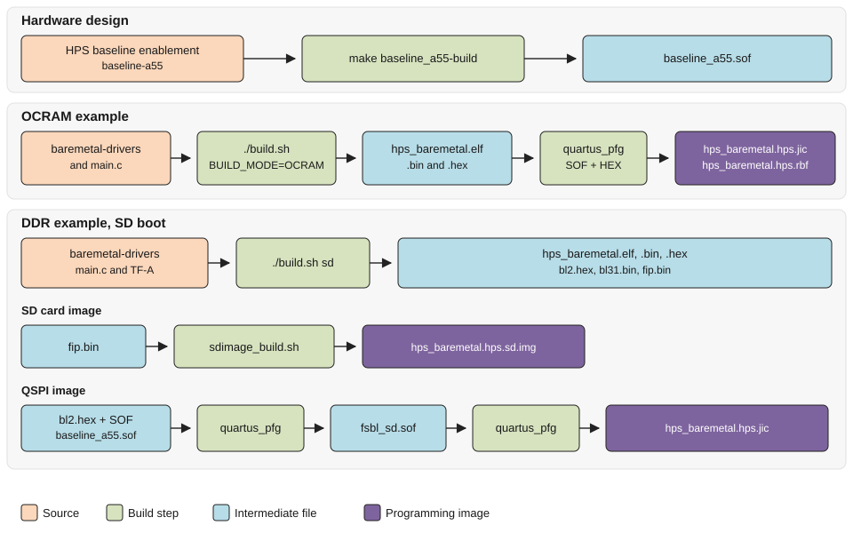

## Introduction

### Overview

This example builds a bare-metal Hello World application for the Hard Processor System (HPS) on the Agilex 5 FPGA E-Series 065A Premium Development Kit. It uses the Quartus hardware design from the [HPS Baseline System Example Design](https://altera-fpga.github.io/rel-26.3/embedded-designs/agilex-5/e-series/premium-065a/gsrd/ug-gsrd-agx5e-premium-065a/) and links a small `main.c` against the [baremetal-drivers](https://github.com/altera-fpga/baremetal-drivers) repository. The application runs directly on a Cortex-A55.

There are two example variants. One resides in the OCRAM, and is part of the configuration bitstream in QSPI. The other resides in DDR, and is loaded by the bootloader from SD card.

| Variant | Where the image runs | How it starts |
| --- | --- | --- |
| OCRAM | HPS on-chip RAM. `linker_ocram.ld` places code at `0x00000000`. | `quartus_pfg` stores `hps_baremetal.hex` in the JIC and RBF programming files. |
| DDR | External DDR. `linker_ddr.ld` places code at `0x80200000`. | TF-A BL2 loads `fip.bin` from the SD card. BL31 hands off to the application at `0x80200000`. |

Both variants use HPS UART0 at 115200 baud, 8 data bits, no parity, and 1 stop bit. `main.c` prints the platform banner from `platform_print_info()`, then prints `Hello, Baremetal World!` once per second. The string comes from `examples/hello/hello_selftest.c` in the bare-metal repository.

The OCRAM `main.c` locks the PLLs, programs the UART from the measured L4_SP clock, and spaces the messages with a CPU spin loop. The DDR `main.c` initializes the clock manager and the GIC, and spaces the messages with the performance counter. The repository README also describes the repository's own bring-up image, which continues from the same banner into a serial command shell. That shell, its commands, and the memory map are documented in the repository links below.

### Prerequisites

The following are required to be able to fully exercise this example:

* Altera&reg; Agilex&trade; 5 FPGA E-Series 065A Premium Development Kit, ordering code DK-A5E065AB32AEA. Refer to [board documentation](https://www.altera.com/products/devkit/po-3285/agilex-5-fpga-e-series-065a-premium-development-kit) for more information.

* Host PC with:
  * Linux OS installed. Ubuntu 22.04LTS was used to create this page, other versions and distributions may work too
  * Serial terminal (for example GtkTerm or Minicom on Linux and TeraTerm or PuTTY on Windows)
  * Altera&reg; Quartus<sup>&reg;</sup> Prime Pro Edition Version 26.3. 
 
* Internet connection. For downloading the files, especially when rebuilding the GSRD.

### Repositories

The Quartus project and the example `main.c` and `build.sh` files come from the Agilex 5 HPS baseline enablement. CMake `FetchContent` clones `baremetal-drivers` at the commit pinned in the example `CMakeLists.txt`. The DDR build also clones Trusted Firmware-A at the commit pinned in `cmake/bm_boot.cmake`.

| Repository | Revision | Role in this example |
| --- | --- | --- |
| [altera-fpga/agilex5-ed-hps-baseline](https://github.com/altera-fpga/agilex5-ed-hps-baseline/tree/QPDS26.3_REL_BASELINE_PR) | `QPDS26.3_REL_BASELINE_PR` | 065A Premium `baseline-a55` hardware design, and the Hello World example under `dk-a5e065ab32aea-enablement/baseline-a55/software/hps_baremetal/`. |
| [altera-fpga/baremetal-drivers](https://github.com/altera-fpga/baremetal-drivers/tree/66bdcc347564c5698a8997169bce83a31647d618) | `66bdcc347564c5698a8997169bce83a31647d618` on `main` (`26.3 Release Update`) | Startup code, HPS drivers, public APIs, the Hello World source, and the SD-image tools. |
| [altera-opensource/arm-trusted-firmware](https://github.com/altera-opensource/arm-trusted-firmware/tree/4a4b4573e12fabd0a88e95952af49840db6b770d) | `4a4b4573e12fabd0a88e95952af49840db6b770d`, tag `QPDS26.1_REL_GSRD_PR`, branch `socfpga_v2.14.0` | BL2, BL31, and `fiptool`, fetched by the DDR build. |

The example folders in the baseline repository have their own build notes:

* [OCRAM example README](https://github.com/altera-fpga/agilex5-ed-hps-baseline/blob/QPDS26.3_REL_BASELINE_PR/dk-a5e065ab32aea-enablement/baseline-a55/software/hps_baremetal/baremetal_ocram/README.md)
* [DDR example README](https://github.com/altera-fpga/agilex5-ed-hps-baseline/blob/QPDS26.3_REL_BASELINE_PR/dk-a5e065ab32aea-enablement/baseline-a55/software/hps_baremetal/baremetal_ddr/README.md)

### Bare-metal Drivers Repository

[baremetal-drivers](https://github.com/altera-fpga/baremetal-drivers/tree/66bdcc347564c5698a8997169bce83a31647d618) is bare-metal software for the HPS on Agilex 5 and Agilex 3 SoC FPGA devices. It runs on the Arm Cortex-A cores with no operating system. The commit used here is organized as follows:

| Path | Contents |
| --- | --- |
| `src/` | `startup.S`, `vectors.S`, and `crt0.c` |
| `platform/` | Agilex 5 and Agilex 3 setup for clocks, UART, and the `BUILD_MODE` linker script |
| `api/` | Public APIs, one directory per module |
| `drivers/` | Register-level drivers |
| `middleware/` | Context and lifecycle code between the APIs and the drivers: bridge, DMA, IOSSM, reset manager, and UART |
| `examples/` | Sample commands, including `examples/hello/hello_selftest.c` |
| `cmake/` | Cross-compile setup (`bm_toolchain.cmake`), ELF/BIN/HEX generation (`bm_artifacts.cmake`), and the TF-A fetch plus BL2/BL31/`fiptool` build (`bm_boot.cmake`) |
| `tools/` | `sdimage_build.sh` and `make_sdimage.sh`, which place `fip.bin` in the SD card A2 partition |
| `linker_ocram.ld`, `linker_ddr.ld` | Memory placement for the two build modes |

The example sets `PLAT=agilex5` and `BUILD_MODE`, then links `main.c` with the `bm_app`, `platform`, and `bm_api` libraries. It also compiles the repository startup files and `examples/hello/hello_selftest.c`. After the ELF is linked, `bm_generate_artifacts()` writes `hps_baremetal.bin`, `hps_baremetal.hex`, and `hps_baremetal.dump`.

`BUILD_MODE` selects the link address and how much early hardware setup the application performs. An OCRAM image brings up the PLLs and the UART itself. A DDR image expects TF-A to have initialized DDR and to enter the application at `0x80200000`, which is the `PRELOADED_BL33_BASE` value in `cmake/bm_boot.cmake`.

### Repository Documentation

These pages match the `baremetal-drivers` commit listed above. The repository [README](https://github.com/altera-fpga/baremetal-drivers/blob/66bdcc347564c5698a8997169bce83a31647d618/README.md) is the entry point for building the repository's own image, from the OCRAM or DDR build through the serial prompt. [DOCUMENTATION.md](https://github.com/altera-fpga/baremetal-drivers/blob/66bdcc347564c5698a8997169bce83a31647d618/DOCUMENTATION.md) indexes the module guides and describes the optional Natural Docs reference (`make docs`).

| Document | What it covers |
| --- | --- |
| [README.md](https://github.com/altera-fpga/baremetal-drivers/blob/66bdcc347564c5698a8997169bce83a31647d618/README.md) | Supported kits, OCRAM and DDR bring-up, UART settings, the command shell, the memory map, and troubleshooting |
| [DOCUMENTATION.md](https://github.com/altera-fpga/baremetal-drivers/blob/66bdcc347564c5698a8997169bce83a31647d618/DOCUMENTATION.md) | Index of the module guides, terminology, and the Natural Docs API reference |
| [BUILD.md](https://github.com/altera-fpga/baremetal-drivers/blob/66bdcc347564c5698a8997169bce83a31647d618/BUILD.md) | Toolchain, `PLAT`, `BUILD_MODE`, `DEBUG`, and build outputs |
| [BUILD_LINUX.md](https://github.com/altera-fpga/baremetal-drivers/blob/66bdcc347564c5698a8997169bce83a31647d618/BUILD_LINUX.md) | How to get the code and build on Linux |
| [BUILD_WINDOWS.md](https://github.com/altera-fpga/baremetal-drivers/blob/66bdcc347564c5698a8997169bce83a31647d618/BUILD_WINDOWS.md) | How to build with VS Code and boot from Windows |
| [RETURN_VALUES.md](https://github.com/altera-fpga/baremetal-drivers/blob/66bdcc347564c5698a8997169bce83a31647d618/RETURN_VALUES.md) | How to read `0`, a negative error code, and output arguments |
| [middleware/README.md](https://github.com/altera-fpga/baremetal-drivers/blob/66bdcc347564c5698a8997169bce83a31647d618/middleware/README.md) | Middleware between the public APIs and the drivers |

Each module has an integration guide at `api/<module>/README.md`. The guide describes the module, what must already be set up, the order of calls, and how to read the example output.

| Module | Guide |
| --- | --- |
| HPS-to-FPGA bridge | [bridge](https://github.com/altera-fpga/baremetal-drivers/blob/66bdcc347564c5698a8997169bce83a31647d618/api/bridge/README.md) |
| CCU | [ccu](https://github.com/altera-fpga/baremetal-drivers/blob/66bdcc347564c5698a8997169bce83a31647d618/api/ccu/README.md) |
| Clock manager | [clk_mngr](https://github.com/altera-fpga/baremetal-drivers/blob/66bdcc347564c5698a8997169bce83a31647d618/api/clk_mngr/README.md) |
| ComboPHY | [combophy](https://github.com/altera-fpga/baremetal-drivers/blob/66bdcc347564c5698a8997169bce83a31647d618/api/combophy/README.md) |
| Console and CLI | [console](https://github.com/altera-fpga/baremetal-drivers/blob/66bdcc347564c5698a8997169bce83a31647d618/api/console/README.md) |
| CRC | [crc](https://github.com/altera-fpga/baremetal-drivers/blob/66bdcc347564c5698a8997169bce83a31647d618/api/crc/README.md) |
| DMA | [dma](https://github.com/altera-fpga/baremetal-drivers/blob/66bdcc347564c5698a8997169bce83a31647d618/api/dma/README.md) |
| ECC | [ecc](https://github.com/altera-fpga/baremetal-drivers/blob/66bdcc347564c5698a8997169bce83a31647d618/api/ecc/README.md) |
| FCS | [fcs](https://github.com/altera-fpga/baremetal-drivers/blob/66bdcc347564c5698a8997169bce83a31647d618/api/fcs/README.md) |
| GIC | [gic](https://github.com/altera-fpga/baremetal-drivers/blob/66bdcc347564c5698a8997169bce83a31647d618/api/gic/README.md) |
| GPIO | [gpio](https://github.com/altera-fpga/baremetal-drivers/blob/66bdcc347564c5698a8997169bce83a31647d618/api/gpio/README.md) |
| I2C | [i2c](https://github.com/altera-fpga/baremetal-drivers/blob/66bdcc347564c5698a8997169bce83a31647d618/api/i2c/README.md) |
| I3C | [i3c](https://github.com/altera-fpga/baremetal-drivers/blob/66bdcc347564c5698a8997169bce83a31647d618/api/i3c/README.md) |
| IOSSM | [iossm](https://github.com/altera-fpga/baremetal-drivers/blob/66bdcc347564c5698a8997169bce83a31647d618/api/iossm/README.md) |
| SDM mailbox | [mailbox](https://github.com/altera-fpga/baremetal-drivers/blob/66bdcc347564c5698a8997169bce83a31647d618/api/mailbox/README.md) |
| MMU | [mmu](https://github.com/altera-fpga/baremetal-drivers/blob/66bdcc347564c5698a8997169bce83a31647d618/api/mmu/README.md) |
| NoC firewall | [noc_firewall](https://github.com/altera-fpga/baremetal-drivers/blob/66bdcc347564c5698a8997169bce83a31647d618/api/noc_firewall/README.md) |
| NoC probe | [noc_probe](https://github.com/altera-fpga/baremetal-drivers/blob/66bdcc347564c5698a8997169bce83a31647d618/api/noc_probe/README.md) |
| Performance monitoring | [perf](https://github.com/altera-fpga/baremetal-drivers/blob/66bdcc347564c5698a8997169bce83a31647d618/api/perf/README.md) |
| Reboot manager | [reboot_mngr](https://github.com/altera-fpga/baremetal-drivers/blob/66bdcc347564c5698a8997169bce83a31647d618/api/reboot_mngr/README.md) |
| Reset manager | [rst_mngr](https://github.com/altera-fpga/baremetal-drivers/blob/66bdcc347564c5698a8997169bce83a31647d618/api/rst_mngr/README.md) |
| SD/MMC | [sdmmc](https://github.com/altera-fpga/baremetal-drivers/blob/66bdcc347564c5698a8997169bce83a31647d618/api/sdmmc/README.md) |
| SEU | [seu](https://github.com/altera-fpga/baremetal-drivers/blob/66bdcc347564c5698a8997169bce83a31647d618/api/seu/README.md) |
| SMMU | [smmu](https://github.com/altera-fpga/baremetal-drivers/blob/66bdcc347564c5698a8997169bce83a31647d618/api/smmu/README.md) |
| SPI | [spi](https://github.com/altera-fpga/baremetal-drivers/blob/66bdcc347564c5698a8997169bce83a31647d618/api/spi/README.md) |
| Timer | [timer](https://github.com/altera-fpga/baremetal-drivers/blob/66bdcc347564c5698a8997169bce83a31647d618/api/timer/README.md) |
| UART | [uart](https://github.com/altera-fpga/baremetal-drivers/blob/66bdcc347564c5698a8997169bce83a31647d618/api/uart/README.md) |

## Build the Examples


The following diagram shows an overview of how the example design is built:




### Setup Build Environment


Create a top folder for the example:


```bash
sudo rm -rf agilex5_065a_pdk.baremetal
mkdir agilex5_065a_pdk.baremetal
cd agilex5_065a_pdk.baremetal
export TOP_FOLDER=`pwd`
```


Download the compiler toolchain, add it to the PATH variable, to be used by the GHRD makefile to build the HPS Debug FSBL:


```bash
cd $TOP_FOLDER
wget https://developer.arm.com/-/media/Files/downloads/gnu/14.3.rel1/binrel/\
arm-gnu-toolchain-14.3.rel1-x86_64-aarch64-none-linux-gnu.tar.xz
tar xf arm-gnu-toolchain-14.3.rel1-x86_64-aarch64-none-linux-gnu.tar.xz
rm -f arm-gnu-toolchain-14.3.rel1-x86_64-aarch64-none-linux-gnu.tar.xz
export PATH=`pwd`/arm-gnu-toolchain-14.3.rel1-x86_64-aarch64-none-linux-gnu/bin/:$PATH
export ARCH=arm64
export CROSS_COMPILE=aarch64-none-linux-gnu-
```

Enable Quartus tools to be called from command line:


```bash
source ~/altera_pro/26.3/qinit.sh
```


### Build Quartus Design

Get the example design files and build the hardware design:


```bash
cd $TOP_FOLDER
rm -rf agilex5_soc_devkit_ghrd && mkdir agilex5_soc_devkit_ghrd && cd agilex5_soc_devkit_ghrd
wget https://github.com/altera-fpga/agilex5-ed-hps-baseline/releases/download/QPDS26.3_REL_BASELINE_PR/dk-a5e065ab32aea-enablement-baseline-a55.zip
unzip dk-a5e065ab32aea-enablement-baseline-a55.zip
rm -f dk-a5e065ab32aea-enablement-baseline-a55.zip
make baseline_a55-build
```


The following files are created:

* `$TOP_FOLDER/agilex5_soc_devkit_ghrd/output_files/baseline_a55.sof`


### Build the OCRAM Example


1\. Go to the example folder:


```bash
cd $TOP_FOLDER/agilex5_soc_devkit_ghrd/software/hps_baremetal/baremetal_ocram
```


2\. Run the build script:


```bash
chmod +x *.sh
./build.sh
```


This will create the following files in the folder `$TOP_FOLDER/agilex5_soc_devkit_ghrd/software/hps_baremetal/baremetal_ocram/build/`:

* `hps_baremetal.elf`
* `hps_baremetal.bin`
* `hps_baremetal.hex`

3\. Go to the `build` folder:


```bash
cd build/
```


4\. Create the JIC image for running form QSPI flash:


```bash
quartus_pfg -c ../../../../output_files/baseline_a55.sof hps_baremetal.jic \
-o device=QSPI128 \
-o flash_loader=A5ED065AB32AE1V \
-o hps_path=hps_baremetal.hex \
-o mode=ASX4 \
-o hps=1
```


This will create the following files in the folder `$TOP_FOLDER/agilex5_soc_devkit_ghrd/software/hps_baremetal/baremetal_ocram/build`:

* `hps_baremetal.hps.jic` : qspi programming file, including the configuration bitstream and the baremetal program
* `hps_baremetal.core.rbf`: Fabric configuration file. Not used by this example.

5\. Create the RBF file for running through JTAG:


```bash
quartus_pfg -c ../../../../output_files/baseline_a55.sof hps_baremetal.rbf \
-o hps_path=hps_baremetal.hex \
-o hps=1
```


This will create the following files in the folder `$TOP_FOLDER/agilex5_soc_devkit_ghrd/software/hps_baremetal/baremetal_ocram/build`:

* `hps_baremetal.hps.rbf` : JTAG configuration file, including the configuration bitstream and the baremetal program
* `hps_baremetal.core.rbf`: Fabric configuration file. Not used by this example.


### Build the DDRAM Example


1\. Go to the example folder:


```bash
cd $TOP_FOLDER/agilex5_soc_devkit_ghrd/software/hps_baremetal/baremetal_ddr
```


2\. Run the build script:


```bash
chmod +x *.sh
SOF_PATH="$(cd ../../../output_files && pwd)/baseline_a55.sof" \
SOF_NAME=baseline_a55.sof \
./build.sh sd
```


This will create the following files in the folder `$TOP_FOLDER/agilex5_soc_devkit_ghrd/software/hps_baremetal/baremetal_ddr/build_sd`:

* `sd_binaries/fsbl_sd.sof`: SOF file with BL2 bootloader inside
* `hps_baremetal.elf`: application ELF file
* `hps_baremetal.bin`: application BIN file
* `hps_baremetal.hex`: application HEX file
* `hps_baremetal.hps.sd.img`: SD card image 

3\. Go to the `build_sd` folder:


```bash
cd build_sd
```


4\. Build the QSPI image file


```bash
quartus_pfg -c sd_binaries/fsbl_sd.sof hps_baremetal.jic \
-o device=QSPI128 \
-o flash_loader=A5ED065AB32AE1V \
-o mode=ASX4 \
-o hps=1
```


This will create the following files in the folder `$TOP_FOLDER/agilex5_soc_devkit_ghrd/software/hps_baremetal/baremetal_ddr/build_sd`:

* `hps_baremetal.hps.jic`: QSPI programming file created from `fsbl_sd.sof`. It contains the FPGA bitstream and TF-A BL2. The bare-metal application is in `hps_baremetal.hps.sd.img`.
* `hps_baremetal.core.rbf`: Fabric configuration file. Not used by this example.


## Run the Examples

### Run the OCRAM Example

1\. Write the QSPI image: `$TOP_FOLDER/agilex5_soc_devkit_ghrd/software/hps_baremetal/baremetal_ocram/build/hps_baremetal.hps.jic`

2\. Power cycle the board.

3\. See the program output on the console:

```
Welcome to SoCFPGA Baremetal World for Agilex5 Platform
Built: 20:47:11 Nov  9 2026
Commit: 
Running on Core 0
Type 'help' for commands.
Hello, Baremetal World!
Hello, Baremetal World!
Hello, Baremetal World!
```

The hello message will continue to be displayed until board is powered down.

### Run the DDRAM Example

1\. Write the SD card image: `$TOP_FOLDER/agilex5_soc_devkit_ghrd/software/hps_baremetal/baremetal_ddr/hps_baremetal.hps.sd.img`

2\. Write the QSPI image: `$TOP_FOLDER/agilex5_soc_devkit_ghrd/software/hps_baremetal/baremetal_ddr/build_sd/hps_baremetal.hps.jic`

3\. Power cycle the board.

4\. See the program output on the console. It will show U-Boot SPL, then U-Boot, then the baremetal program output:

```
Welcome to SoCFPGA Baremetal World for Agilex5 Platform
Built: 20:44:09 Nov  9 2026
Commit: 
Running on Core 0
Type 'help' for commands.
Hello, Baremetal World!
Hello, Baremetal World!
Hello, Baremetal World!
```
The hello message will continue to be displayed until board is powered down.

## Notices & Disclaimers

Altera<sup>&reg;</sup> Corporation technologies may require enabled hardware, software or service activation.
No product or component can be absolutely secure. 
Performance varies by use, configuration and other factors.
Your costs and results may vary. 
You may not use or facilitate the use of this document in connection with any infringement or other legal analysis concerning Altera or Intel products described herein. You agree to grant Altera Corporation a non-exclusive, royalty-free license to any patent claim thereafter drafted which includes subject matter disclosed herein.
No license (express or implied, by estoppel or otherwise) to any intellectual property rights is granted by this document, with the sole exception that you may publish an unmodified copy. You may create software implementations based on this document and in compliance with the foregoing that are intended to execute on the Altera or Intel product(s) referenced in this document. No rights are granted to create modifications or derivatives of this document.
The products described may contain design defects or errors known as errata which may cause the product to deviate from published specifications.  Current characterized errata are available on request.
Altera disclaims all express and implied warranties, including without limitation, the implied warranties of merchantability, fitness for a particular purpose, and non-infringement, as well as any warranty arising from course of performance, course of dealing, or usage in trade.
You are responsible for safety of the overall system, including compliance with applicable safety-related requirements or standards. 
<sup>&copy;</sup> Altera Corporation.  Altera, the Altera logo, and other Altera marks are trademarks of Altera Corporation.  Other names and brands may be claimed as the property of others. 

OpenCL* and the OpenCL* logo are trademarks of Apple Inc. used by permission of the Khronos Group™. 