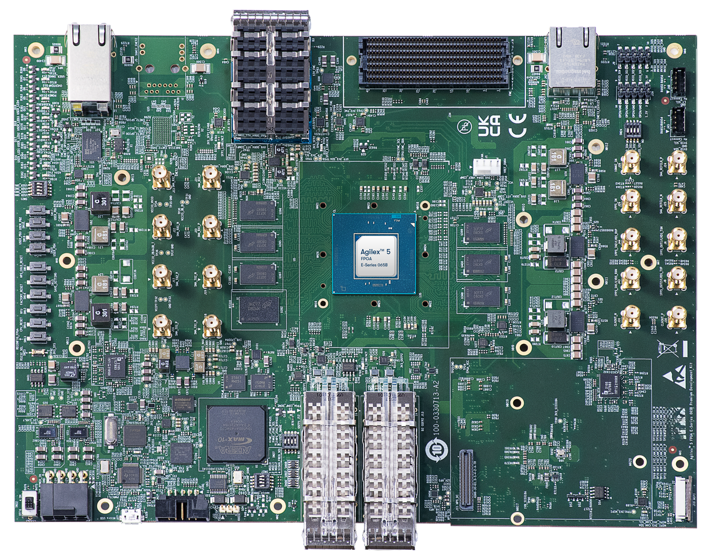
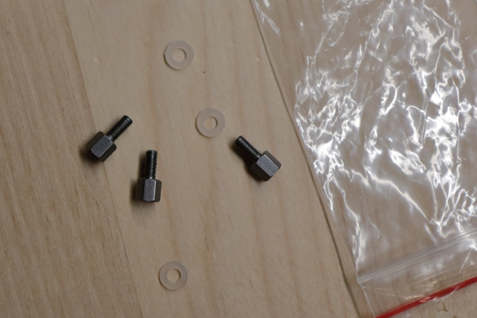
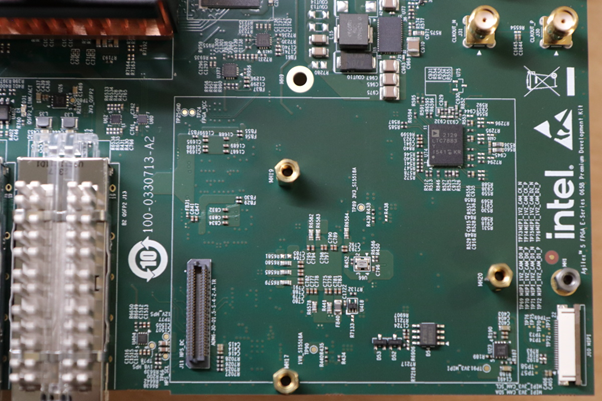
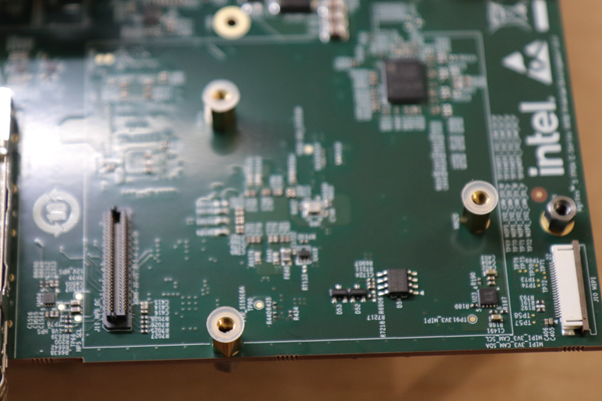
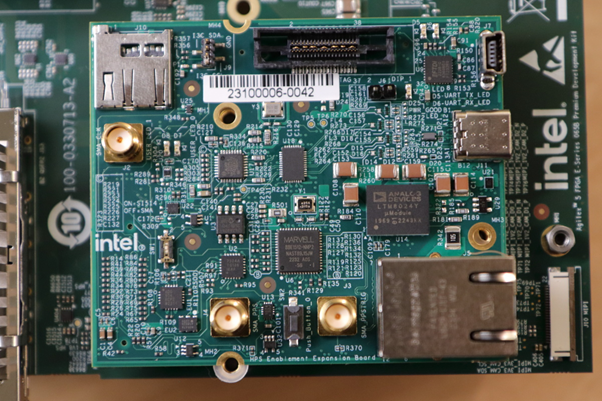
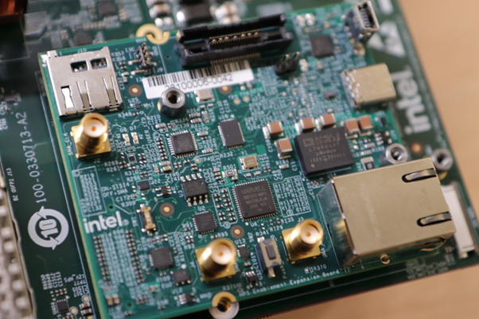
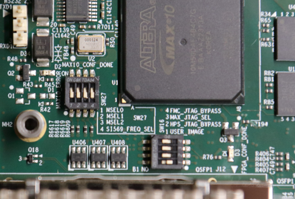
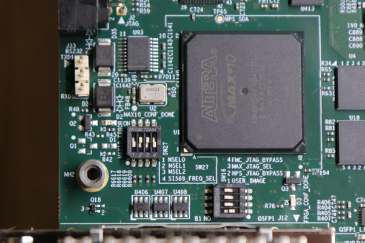

## Introduction

This example design demonstrates how to extend the [Altera® Agilex™ 5 FPGA E-Series 065A HPS baseline system example design](https://altera-fpga.github.io/rel-26.3/embedded-designs/agilex-5/e-series/premium-065a/gsrd/ug-gsrd-agx5e-premium-065a/) with Docker container support in Yocto, walking through Yocto image generation and deploying simple test containers to validate the runtime environment.

The Docker-enabled configuration builds upon the baseline system example design by using KAS configuration manifests to merge container support layers cleanly into the Yocto build system. Understanding this data flow enables developers to modify kernel configuration fragments, target recipes, and bundled container workloads without breaking baseline Board Support Package (BSP) dependencies.

The base KAS definition (`kas.yml`) defines the target machine architecture and core BSP layers. The configuration extension (`docker_enable.yml`) overlays the `meta-virtualization` and `meta-filesystems` layers, appends required Linux kernel fragments (enabling cgroups, namespaces, and virtual network interfaces), and pulls in the `docker-container-support` recipe.

``` text
kas.yml (Base BSP, Machine, Compilers)
   │
   ├── [+] docker_enable.yml (Overlay Extension)
   │         │
   │         ├── meta-virtualization & meta-filesystems
   │         ├── linux-socfpga-lts bbappend (Kernel cgroups, veth, bridge)
   │         └── docker-container-support recipe
   │                   │
   ▼                   ▼
 BitBake Engine ─────────► gsrd-console-image-agilex5e.rootfs.wic
```

During the initial system power-on, an automated one-shot systemd service unpacks and registers container into the Docker runtime storage, with an option to launch selected application containers immediately. By default, the reference design packages the standard `hello-world` image from Docker Hub without launching it automatically.

Follow [Exercise Prebuilt Binaries](#exercise-prebuilt-binaries) if you want to quickly validate your physical board setup using pre-compiled images without running Quartus synthesis or BitBake builds. If you need to rebuild the FPGA hardware design, generate bootloader binaries, or customize the root filesystem, follow [Build Binaries from Scratch](#build-binaries-from-scratch). Both paths converge at [Boot and Verify on Target](#boot-and-verify-on-target). To package custom containers into the build, refer to [Optional: Pack and Run Additional Images](#optional-pack-and-run-additional-images).

### KAS Configuration Map

The hierarchical tree below list the configuration files involved in the Docker integration.

``` text
software/
└── docker_linux/
    ├── README.md
    ├── Kconfig                      # Top-level configuration interface
    ├── kas.yml                      # Base KAS/Yocto machine configuration
    ├── docker_enable.yml            # KAS extension manifest for Docker
    │
    ├── kas/
    │   └── virtualization/
    │       ├── Kconfig              # Kconfig definitions for container lists
    │       ├── docker-images.cfg    # Default packaged image selections
    │       └── docker-images-override.cfg.example
    │
    └── meta-custom/
        └── recipes-features/
            └── docker/
                ├── docker-container-support.bb   # Filesystem packaging & service logic
                ├── linux-socfpga-lts_%.bbappend  # Kernel fragments (DOCKER_BUILD=1)
                ├── configs/
                │   ├── docker.scc
                │   └── config_kernel_docker.cfg
                └── files/
                    ├── download-frozen-image.py  # Host script: pull OCI images
                    └── expand-root-partition     # Target script: resize rootfs
```

---

## Prerequisites

Before assembling hardware or compiling software, verify that your host system meets all toolchain requirements, operating system dependencies, and storage capacity baselines. 

### Hardware Requirements

- [Altera® Agilex™ 5 FPGA E-Series 065A Premium Development Kit](https://www.altera.com/products/devkit/po-3285/agilex-5-fpga-e-series-065a-premium-development-kit) (Ordering Code: `DK-A5E065AB32AEA`):
  - HPS Enablement Expansion Board (included with kit)
  - Mini-USB cable (for HPS UART serial terminal, included with kit)
  - Micro-USB cable (for Intel FPGA Download Cable II / JTAG, included with kit)
  - MicroSD card and USB card reader (included with kit)
  - RJ-45 Ethernet cable (included with kit)
- Local Ethernet network equipped with an active DHCP server

### Host PC Requirements

- **Operating System:** Ubuntu 22.04 LTS (x86_64)
- **Hardware Resources:**
  - Minimum 64 GB RAM (essential for Quartus synthesis and parallel Yocto tasks)
  - Minimum 200 GB available disk space (SSD recommended)
- **Software Tools:**
  - Altera® Quartus® Prime Pro Edition Version Quartus<sup>&reg;</sup> Prime Pro Edition Version 26.3
  - Serial terminal emulator (e.g., Minicom, GtkTerm, PuTTY)
  - Reliable high-speed Internet access for pulling Yocto layers and container layers

### Board Setup

!!! warning
    The Agilex 5 FPGA development kit contains static-sensitive digital components and precision power regulation circuitry. Always review the handling and power-up instructions in the **[Getting Started](https://docs.altera.com/r/docs/d554638/current/agilex-5-fpga-e-series-065a-premium-development-kit-user-guide/getting-started)** guide before applying power to avoid hardware damage.

{:style="width:60%; display:block; margin-left:auto; margin-right:auto"}

**Installing the HPS Enablement Expansion Board**

The Hard Processor System (HPS) Enablement Expansion Board bridges the Agilex 5 SoC processing subsystem to essential off-board interfaces, including the dedicated UART console and Ethernet PHY. Proper physical mounting prevents intermittent pin contact on high-density headers and prevents mechanical strain on the board assembly. 

Ensure the main development kit is unpowered and placed on an ESD-safe mat before proceeding with mechanical installation.

1. **Retrieve Mounting Hardware:**  
   Locate the plastic accessory bag containing the knurled thumb screws and non-conductive plastic washers.  
   {:style="width:60%; display:block; margin-left:auto; margin-right:auto"}

2. **Locate Expansion Headers:**  
   Identify the HPS daughtercard footprint and expansion connectors on the primary development board.  
   {:style="width:60%; display:block; margin-left:auto; margin-right:auto"}

3. **Position Washers:**  
   Place one plastic washer onto each of the three threaded hex standoffs.  
   {:style="width:60%; display:block; margin-left:auto; margin-right:auto"}

4. **Align and Seat the Daughtercard:**  
   Carefully align the daughtercard mating connectors with the primary board headers and press down evenly until fully seated on the standoffs.  
   {:style="width:60%; display:block; margin-left:auto; margin-right:auto"}

5. **Fasten the Board:**  
   Install and hand-tighten the thumb screws on the two upper standoffs shown below. Leave the bottom standoff unfastened, as tightening this position can introduce board flex and twist the mating connector. Secure the thumb screw adjacent to the Ethernet receptacle carefully using small pliers if finger clearance is limited. Ensure the daughtercard sits flat and does not shift.  
   {:style="width:60%; display:block; margin-left:auto; margin-right:auto"}

**Configuring the MSEL Boot Mode Switches**

The Mode Select (MSEL) pins configure the FPGA configuration controller for specific boot sources, clocking topologies, and bus widths. This design relies on two modes: JTAG mode to write the Flash Loader and secondary bootloader to non-volatile QSPI flash, and Active Serial (ASx4) mode to read the bitstream autonomously upon system reset. Set the 4-position DIP switch `SW27` strictly while the board is powered down to prevent indeterminate configuration latching.

!!! warning
    Always turn off the main DC power from the board before changing `SW27` DIP switch settings. Adjusting MSEL switches while power rails are energized can corrupt active flash transactions or lead to configuration sequencing errors.

**JTAG Configuration Mode (`SW27`: OFF / OFF / OFF / OFF)**

Set all four switch actuators on `SW27` to the **OFF** position to route the configuration state machine directly to the JTAG scan chain. Use this configuration when programming non-volatile bitstreams (`.jic`) to QSPI flash using `quartus_pgm`.

{:style="width:60%; display:block; margin-left:auto; margin-right:auto"}

**Active Serial x4 (QSPI) Mode (`SW27`: OFF / ON / ON / OFF)**

Set switch actuators 1 and 4 to **OFF**, and actuators 2 and 3 to **ON**. Use this configuration for normal standalone boot, allowing the Agilex 5 Secure Device Manager (SDM) to load the initial bootloader and configuration bitstream directly from onboard QSPI memory via Active Serial x4.

{:style="width:60%; display:block; margin-left:auto; margin-right:auto"}

### Prebuilt Binaries

Prebuilt binaries for evaluation are hosted in the following [link](https://releases.rocketboards.org/2026.10/docker/agilex5_dk_a5e065ab32aea_docker.baseline-a55/)

**Primary Artifacts:**

| File Name                                                                                                                           | Description                             |
|:------------------------------------------------------------------------------------------------------------------------------------|:----------------------------------------|
| [`ghrd.hps.jic`](https://releases.rocketboards.org/2026.10/docker/agilex5_dk_a5e065ab32aea_docker.baseline-a55/ghrd.hps.jic)        | HPS initial configuration file.         |
| [`sdimage.tar.gz `](https://releases.rocketboards.org/2026.10/docker/agilex5_dk_a5e065ab32aea_docker.baseline-a55/sdimage.tar.gz  ) | SD bootable multi-partition disk image. |

---

## Exercise Prebuilt Binaries

Using prebuilt binaries lets you quickly verify board health, peripheral routing, serial console communication, and the default Docker environment before spending time on a complete rebuild. In this workflow, you flash a verified disk image directly to a MicroSD card and monitor initial boot execution over the HPS serial UART. Before starting, make sure the board is completely powered off and disconnected from main power.

1. **Verify Default Jumper and Switch Positions:**
   Leave all jumpers and switches in their factory default states as documented in the [Development Kit User Guide](https://docs.altera.com/r/docs/d554638/current/agilex-5-fpga-e-series-065a-premium-development-kit-user-guide/default-settings).

2. **Install the HPS Enablement Expansion Board:**
   Carefully mount the HPS Enablement Expansion Board onto the primary development board expansion header according to [Board Setup](#board-setup) section of this document.

3. **Connect Interface Cables:**
   - Connect the Mini-USB cable between the vertical USB connector on the HPS Enablement Expansion Board and the host PC (HPS UART console).
   - Connect the Micro-USB cable between the primary development board and the host PC (JTAG communication).
   - Connect the RJ-45 Ethernet cable between the HPS Enablement Expansion Board and your local network switch.

4. **Download the Bootable Image:**
   Download the SD card image (`gsrd-console-image-agilex5e.rootfs.tar.gz`) and FPGA bitstream (`ghrd.hps.jic`) from the release URL listed in [Prebuilt Binaries](#prebuilt-binaries).

   ```bash
   mkdir docker_bin && cd docker_bin
   wget https://releases.rocketboards.org/2026.10/docker/agilex5_dk_a5e065ab32aea_docker.baseline-a55/ghrd.hps.jic
   wget https://releases.rocketboards.org/2026.10/docker/agilex5_dk_a5e065ab32aea_docker.baseline-a55/sdimage.tar.gz  
   tar -xvf sdimage.tar.gz
   rm -f sdimage.tar.gz
   ```

5. **Flash and Boot Target Media:**
   Proceed to [Boot and Verify on Target](#boot-and-verify-on-target) for instructions on how to write the image to a micro SD card and monitor serial boot execution.

---

## Build Binaries from Scratch


Building the complete software stack from source gives you full visibility and control over the FPGA fabric design, intermediate bootloader stages, Linux kernel fragments, and root filesystem assembly. This process involves three main phases: setting up host dependencies, compiling the hardware design in Quartus Prime, and building the Linux system image with BitBake and KAS.

### Step 1: Install Host Packages and Prepare Environment

Set up your Ubuntu 22.04 LTS host with 32-bit runtime libraries, build automation packages, and core Yocto dependencies.

```bash
# Enable 32-bit architecture for Quartus utility dependencies
sudo dpkg --add-architecture i386
sudo apt-get update
sudo apt-get upgrade -y
# Install build dependencies
sudo apt-get install -y \
  build-essential gcc bc bison flex diffstat gawk texinfo chrpath socat \
  cpio file fakeroot swig device-tree-compiler u-boot-tools mtd-utils \
  git wget curl unzip xz-utils zstd liblz4-tool mtools p7zip-full \
  python3 python3-pip python3-pexpect python3-git python3-jinja2 \
  python3-subunit python3-newt python3.10-venv pylint \
  libgmp3-dev libmpc-dev libssl-dev libelf-dev libacl1 ncurses-dev \
  mesa-common-dev libegl1-mesa libsdl1.2-dev xterm \
  openssh-server mc net-tools iputils-ping debianutils \
  tftp tftpd nfs-kernel-server xinetd \
  libc6:i386 libstdc++6:i386 libgcc-s1:i386 lib32z1 libncurses5
# Configure required locale
sudo locale-gen en_US.UTF-8
# Configure bash as default system shell
sudo ln -sf /bin/bash /bin/sh
```

Add Quartus® Prime Pro Edition binaries to your system environment variables. Update the path if your Quartus installation resides outside `$HOME/intelFPGA_pro`:

```bash
source ~/altera_pro/26.3/qinit.sh
```

### Step 2: Checkout and Compile the Hardware Design


Clone the baseline hardware repository configured for Arm Cortex-A55 Core 0 and run Quartus synthesis:


```bash
# Clone repository with sparse checkout targeting baseline A55
mkdir agilex5_soc_devkit_ghrd && cd agilex5_soc_devkit_ghrd
wget https://github.com/altera-fpga/agilex5e-ed-gsrd/releases/download/QPDS26.3_REL_BASELINE_PR/dk-a5e065ab32aea-enablement-baseline-a55.zip
unzip dk-a5e065ab32aea-enablement-baseline-a55.zip
rm -f dk-a5e065ab32aea-enablement-baseline-a55.zip
CWD=$(pwd)
# Compile the hardware design
make baseline_a55-build
```


This build produces `$CWD/output_files/baseline_a55.sof`.

### Step 3: Generate the First Stage Bootloader (FSBL) Placeholder

Agilex 5 configuration bitstreams require a First Stage Bootloader (FSBL) payload embedded directly into the peripheral configuration bitstream. To break the circular dependency between hardware design compilation and Yocto bootloader generation, compile an intermediate placeholder ("wipe") FSBL:


```bash
pushd software/hps_debug && ./build.sh && popd
```


This outputs `$CWD/software/hps_debug/hps_wipe.ihex`, which is used by Quartus Programming File Generator (`quartus_pfg`) to generate the HPS peripheral partition.

### Step 4: Integrate the FPGA Programming Files

Merge the placeholder FSBL into the SOF and convert the output into a Raw Binary File (`.rbf`) containing fabric logic configuration data:


```bash
# Merge wipe FSBL into SOF
quartus_pfg -c output_files/baseline_a55.sof output_files/baseline_a55_hps_debug.sof \
  -o hps_path=software/hps_debug/hps_wipe.ihex
# Generate raw binary bitstream for the HPS bootloader
quartus_pfg -c output_files/baseline_a55_hps_debug.sof output_files/baseline_a55_hps_debug.rbf \
  -o hps=1
```


This step generates `$CWD/output_files/baseline_a55_hps_debug.core.rbf`. This fabric configuration binary must be passed to the Yocto build system to ensure the kernel FIT image bundles the correct hardware bitstream.

### Step 5: Build the Docker Image via KAS


With the hardware bitstream generated, invoke KAS to fetch Yocto layers, apply kernel configuration fragments, and build the target Linux filesystem.

!!! warning
    Building KAS using `kas.yml` alone produces a generic baseline image without Docker support. You must append `docker_enable.yml` to inject the virtualization layers and kernel configuration fragments.

1. **Stage the Core RBF:**
   Copy the generated core RBF into the bitstream recipe location, matching the filename defined by `FPGA_RBF_FILE` in `kas.yml`:

   
   ```bash
   cd $CWD/software/docker_linux
   cp $CWD/output_files/baseline_a55_hps_debug.core.rbf \
      ./meta-custom/recipes-fpga/fpga-bitstream/files/baseline_a55.core.rbf
   ```
   

2. **Initialize the Python Virtual Environment:**
   Isolate KAS toolchain dependencies within a dedicated Python virtual environment:

   
   ```bash
   cd $CWD/software/docker_linux
   python3 -m venv venv --system-site-packages
   source venv/bin/activate
   pip install --upgrade pip
   pip install kas kconfiglib
   ```
   

3. **Add `expand-root-partition` Dependencies to the Linux Build (Optional):**
   Add `parted`, `partprobe`, and `resize2fs` utilities to the LInux image. For more information refer to [Root Filesystem Partition Expansion](#root-filesystem-partition-expansion) for more information.
   
   ```bash
   sed -i 's/^RDEPENDS:\${PN} = "docker bash coreutils"$/RDEPENDS:${PN} = "docker bash coreutils parted e2fsprogs-resize2fs"/' \
    $CWD/software/docker_linux/meta-custom/recipes-features/docker/docker-container-support.bb
   ```
   

4. **Parse and Validate Configuration:**
   Verify layer parsing across the merged KAS manifests:

   ```bash
   kas shell kas.yml:docker_enable.yml -c "bitbake -p"
   grep -n -E 'IMAGE_INSTALL:append|DOCKER_BUILD|VIRTUALIZATION_PROFILE|virtualization' build/conf/local.conf
   grep -n -E 'meta-virtualization|meta-filesystems' build/conf/bblayers.conf
   ```

   As a result, the command returns the following configuration snippet:

   ```text
   VIRTUALIZATION_PROFILE = "docker"
   DISTRO_FEATURES:append = " virtualization"
   IMAGE_INSTALL:append = " docker docker-container-support"
   DOCKER_BUILD = "1"
       ${TOPDIR}/../meta-openembedded/meta-filesystems \
       ${TOPDIR}/../meta-virtualization \
   ```

5. **Compile the System Image:**
   Compile the full console image using BitBake:

   
   ```bash
   kas shell kas.yml:docker_enable.yml -c "bitbake gsrd-console-image"
   ```
   

   Upon completion, BitBake writes the build deliverables to `$CWD/software/docker_linux/build/tmp/deploy/images/agilex5e/`, generating `gsrd-console-image-agilex5e.rootfs.wic` (Complete SD card image) and `u-boot-spl-dtb.hex` (Production FSBL), which are required for the subsequent steps.
  
   Exit the python virtual environment:

   
   ```bash
   deactivate
   ```
   

!!! tip
    To re-enter the build environment in future terminal sessions, run `source $CWD/software/docker_linux/venv/bin/activate`.


### Step 6: Generate Production QSPI Flash Image


Update the HPS bitstream by replacing the placeholder FSBL with the production bootloader (`u-boot-spl-dtb.hex`) generated by the Yocto build, creating a JTAG Indirect Configuration (`.jic`) file:


```bash
cd $CWD
quartus_pfg -c output_files/baseline_a55.sof output_files/baseline_a55.jic \
  -o device=MT25QU128 \
  -o flash_loader=A5ED065BB32AE4S \
  -o hps_path=software/docker_linux/build/tmp/deploy/images/agilex5e/u-boot-spl-dtb.hex \
  -o mode=ASX4 \
  -o hps=1
```


!!! note
    When executing `quartus_pfg` with `-o hps=1`, the tool automatically appends the `.hps.jic` extension to the primary HPS configuration binary, yielding `$CWD/output_files/baseline_a55.hps.jic`.


---

## Boot and Verify on Target

Boot Linux on the target development kit and verify that Docker services are running by completing the following steps.

!!! note "Exercise Prebuilt Binaries"
    If you are testing the prebuild binaries from [Exercise Prebuilt Binaries](#exercise-prebuilt-binaries), replace the paths in the following sections with the path where the binaries are stored.

### Step 1: Write the SD Card Image

Insert the MicroSD card into your host card reader. Identify the assigned block device node using kernel diagnostics:

```bash
dmesg | tail -n 20
```

!!! warning
    Double-check the target block device (e.g., `/dev/sdX`). Writing a raw image to the wrong device will permanently overwrite existing partitions and destroy data.

Write the WIC image directly to the raw block device using `dd`:

```bash
sudo dd if=$CWD/software/docker_linux/build/tmp/deploy/images/agilex5e/gsrd-console-image-agilex5e.rootfs.wic of=/dev/sdX bs=1M status=progress
sync
```

Remove the MicroSD card from your workstation and insert it into the MicroSD card slot on the development board.

### Step 2: Establish Serial Console Connection

Connect the Mini-USB cable between the vertical connector on the HPS Enablement Expansion Board and your host PC. Launch your serial terminal emulator configured with the following communication parameters:

- **Baud Rate:** 115,200
- **Data Bits:** 8
- **Stop Bits:** 1
- **Parity:** None
- **Flow Control:** None

### Step 3: Program the QSPI Flash Memory

The Agilex 5 boot ROM reads initial clocking, memory timing, and the FSBL from non-volatile QSPI flash.

1. Power off the development board.
2. Set the MSEL DIP switch (`SW27`) to **JTAG Mode**: `OFF / OFF / OFF / OFF`.
3. Power on the development board.
4. Program `baseline_a55.hps.jic` into the onboard QSPI memory via JTAG:

   ```bash
   jtagconfig --setparam 1 JtagClock 16M
   quartus_pgm -c 1 -m jtag -o "pvi;$CWD/output_files/baseline_a55.hps.jic"
   ```
  
### Step 4: Boot Linux

1. Power off the board.
2. Set the MSEL DIP switch (`SW27`) to **Active Serial x4 (ASx4) Mode**: `OFF / ON / ON / OFF`.
3. Power on the board.
4. Monitor the terminal console through U-Boot SPL, U-Boot proper, and Linux kernel initialization.
5. At the login prompt, enter username `root` (no password is required).

### Step 5: Verify Runtime Docker Services

During the first boot, `docker-boot.service` executes in the background. It initializes the daemon, loads pre-staged container tarballs, creates a tracking file at `/var/lib/docker/first-boot-done`, and unregisters itself.

Run the following diagnostic sequence to verify initial boot setup:

```bash
# Inspect the initialization log
cat /tmp/docker-first-boot.log
# Verify the completion marker token
test -f /var/lib/docker/first-boot-done && echo "first-boot-complete"
# Verify systemd service status
systemctl status docker --no-pager
# Check loaded images
docker images
```

Expected output from `docker images`:

``` text
REPOSITORY   TAG       IMAGE ID       CREATED        SIZE
hello-world  latest    68e776661b94   14 months ago  13.8kB
```

### Step 6: Run the Hello-World Container

Run the default container interactively to verify container execution, namespaces, and cgroup management:

```bash
docker run --rm hello-world
```

Upon successful initialization, the container writes confirmation text to stdout and exits cleanly:

``` text
Hello from Docker!
This message shows that your installation appears to be working correctly.
```

---

## Optional: Pack and Run Additional Images

By default, the reference build bundles only the lightweight `hello-world` image. You can customize the build to pre-stage up to four container images from public registries, internal repositories, or local tarballs, and optionally set them to launch as persistent background services on first boot. 

This section describes the configuration syntax, precedence rules, and verification steps for bundling multi-container image.

Configuration options are applied in a strict hierarchy, where downstream definitions take precedence over upstream ones:

1. Default values set within `docker-container-support.bb`
2. Saved options from `kas menu` stored in `.config.yaml`
3. Exported environment variables on the build host
4. Local parameter assignments inside `/tmp/docker-images-override.cfg` (if present)

`DOCKER_LIST_IMAGES` list the docker images to be included with Linux. The environmental variable follow the next syntax:

```text
[source]:[tag],[source]:[tag] 
```

Where:

- `[source]`: The domain name of the container registry hosting the image (e.g., docker.io, ghcr.io, quay.io) or tarball path.
- `[tag]`: The version, release, or build label identifying the exact image release (e.g., 3.19, latest). This field is not used for tarballs.

Supported image URI sources include:

- **Docker Hub:** `docker.io/library/<image>:<tag>`
- **Google Container Registry / Mirrors:** `gcr.io/<project-id>/<image>:<tag>`
- **Local Host Tarball:** `file:///path/to/archive.tar`

The example below adds Alpine and Busybox images to the Yocto compile.

```bash
export DOCKER_LIST_IMAGES="docker.io/library/alpine:3.19,docker.io/library/busybox:1.36"
```

`DOCKER_LIST_RUN_ARGS` controls container behavior using a comma-separated format that maps 1:1 to entries in `DOCKER_LIST_IMAGES`. `DOCKER_LIST_RUN_ARGS` variable follows the next syntax:

``` text
<docker run arguments>[#command]|yes
<docker run arguments>[#command]|no
```

Where:

- `|yes` executes the container automatically as a background service on initial boot.
- `|no` stages the image into the local cache but leaves it in an unstarted state.
- `#[command]` overrides the default container entrypoint command.

The example below adds Alpine and Busybox defines the run arguments.

```bash
export DOCKER_LIST_RUN_ARGS="--name=alpine --network=host --restart=unless-stopped alpine:3.19#sleep infinity|yes,--name=busyhttp -d -v /www/pages:/www -p 8084:80 --restart=unless-stopped busybox:1.36#httpd -f -p 80 -h /www|yes"
```

### Example: Staging Alpine and Busybox Workloads

This procedure configures three container slots using environment variables, rebuilds the target image, and confirms runtime execution on target hardware.

!!! note
    This procedure assumes that you have already executed the initial setup and build workflow in [Build Binaries from Scratch](#build-binaries-from-scratch) at least once. If you are starting from a clean environment without an existing build directory, follow the complete baseline build instructions before applying recipe overrides.

1. **Define Container Configurations on the Build Host:**
   Export the updated image lists and execution parameters with enironmental variables:

   ```bash
   export DOCKER_LIST_IMAGES="docker.io/library/alpine:3.19,docker.io/library/busybox:1.36,docker.io/library/hello-world:latest"
   export DOCKER_LIST_RUN_ARGS="--name=alpine --network=host --restart=unless-stopped alpine:3.19#sleep infinity|yes,--name=busyhttp -d -v /www/pages:/www -p 8084:80 --restart=unless-stopped busybox:1.36#httpd -f -p 80 -h /www|yes,--name=hello|no"
   export DOCKER_STATE_START_DAEMON=1
   ```
  
   *Mapping breakdown:*  

   **Slot 0 (`alpine:3.19`):** Starts automatically (`|yes`), runs `sleep infinity` on the host network.  
   **Slot 1 (`busybox:1.36`):** Starts automatically (`|yes`), runs an HTTP daemon on port 80 mapped to target port 8084.  
   **Slot 2 (`hello-world:latest`):** Loads into the image cache without starting (`|no`).  

2. **Trigger Recipe Clean and Recompilation:**
   Clear BitBake shared-state cache for the `docker-container-support` recipe to force re-execution of the fetch and staging tasks, start a the recompile task after:

   ```bash
   cd $CWD/software/docker_linux
   source ./venv/bin/activate
   kas shell kas.yml:docker_enable.yml -c "bitbake -c cleansstate docker-container-support"
   # Start the docker-container-support recipe recompile
   kas shell kas.yml:docker_enable.yml -c "bitbake gsrd-console-image"
   deactivate
   ```
  
3. **Verify Host-Side Image Staging:**
   Confirm BitBake successfully pulled and staged all three images:

   ```bash
   grep DOCKER_CONTAINER_BUILD_REPORT build/tmp/work/*/docker-container-support/*/temp/log.do_fetch_images \
        build/tmp/work/*/docker-container-support/*/temp/log.do_install
   ```
  
   Expected output:

   ``` text
   ...temp/log.do_fetch_images:NOTE: DOCKER_CONTAINER_BUILD_REPORT: Total 3/4 images specified
   ...temp/log.do_fetch_images:NOTE: DOCKER_CONTAINER_BUILD_REPORT: Total 3/3 images obtained (2 from registry, 1 from DL_DIR cache, 0 from local tar-ball)
   ...temp/log.do_install:NOTE: DOCKER_CONTAINER_BUILD_REPORT: Total 3 image tarballs laid out in root filesystem
   ```
  
4. **Re-flash Target Hardware:**
   Update the secondary bootloader JIC if the SPL changed:

   ```bash
   cd $CWD
   quartus_pfg -c output_files/baseline_a55.sof output_files/baseline_a55.jic \
     -o device=MT25QU128 \
     -o flash_loader=A5ED065BB32AE4S \
     -o hps_path=software/docker_linux/build/tmp/deploy/images/agilex5e/u-boot-spl-dtb.hex \
     -o mode=ASX4 \
     -o hps=1
   ```
  
   Flash the newly generated WIC image to the MicroSD card and program the updated `.hps.jic` file to onboard QSPI flash by following the instructions in [Boot and Verify on Target](#boot-and-verify-on-target) (Steps 1 through 4). Once the board boots into Linux, verify the loaded containers and active services via the serial console:

   ```bash
   docker images
   docker ps
   ```
  
   Expected runtime processes:

   ``` text
   CONTAINER ID   IMAGE          COMMAND                  STATUS              PORTS                                     NAMES
   d11a952c4691   busybox:1.36   "httpd -f -p 80 -h /…"   Up About a minute   0.0.0.0:8084->80/tcp, [::]:8084->80/tcp   busyhttp
   75610879036a   alpine:3.19    "sleep infinity"         Up About a minute                                             alpine
   ```
  
5. **Verify Network and Interactive Container Execution:**
   Query the web service served from the BusyBox container over the local loopback interface:

   ```bash
   DOCKER_IP=$(ip addr show docker0 | awk '/inet / { split($2, a, "/"); print a[1]; exit }')
   wget -O index.html "http://${DOCKER_IP}:8084"
   cat index.html
   ```
  
   Launch an interactive shell within the running Alpine container:

   ```bash
   docker run -it --rm alpine:3.19 sh
   ```
  
---

## Customization References

This section provides reference information on configuration variables, storage considerations, BitBake targets, and output files to assist with custom Board Support Package (BSP) development. Use these references when modifying default container configurations or adding custom packages to Linux builds. Review these details before integrating the Docker layer into BSP workflows.

### Integrating Custom Local Tarballs

To package container images built outside public registries, stage the exported image archive (`.tar`) on your build workstation and supply the location using a `file://` URI in `DOCKER_LIST_IMAGES`. The archive must contain either a standard OCI/Docker `manifest.json` with valid `RepoTags` or a legacy `repositories` manifest.

For example, the command below inserts the bookworm-image.tar archive into slot 4 of the Linux image.

```bash
export DOCKER_LIST_IMAGES="docker.io/library/alpine:3.19,docker.io/library/busybox:1.36,docker.io/library/hello-world:latest,file:///tmp/bookworm-image.tar"
```

### Root Filesystem Partition Expansion

Standard Yocto generated WIC images size the root filesystem partition to match the packaged image footprint rather than the maximum capacity of your MicroSD card. A target helper script is provided at `/home/root/expand-root-partition` to expand the secondary partition across the remaining media capacity.

!!! warning
    The target helper script requires the `parted`, `partprobe`, and `resize2fs` utilities. These utilities are not included by default in minimalist BSP builds. You must add these dependencies to the `RDEPENDS` declaration in `meta-custom/recipes-features/docker/docker-container-support.bb` before image compilation, or install them into your build layer:

    ```bash
    sed -i 's/^RDEPENDS:\${PN} = "docker bash coreutils"$/RDEPENDS:${PN} = "docker bash coreutils parted e2fsprogs-resize2fs"/' \
    $CWD/software/docker_linux/meta-custom/recipes-features/docker/docker-container-support.bb
    ```

    If these utilities are missing from the target, `/home/root/expand-root-partition` exits without resizing the disk.

Execute partition expansion on target hardware:

```bash
/home/root/expand-root-partition
df -h /
```

### Build System Environment Variables

The `docker_enable.yml` KAS configuration merges and forwards these environment variables from your host terminal into the BitBake processing environment:

| Variable                                 | Default Value                          | Description                                                                           |
|:-----------------------------------------|:---------------------------------------|:--------------------------------------------------------------------------------------|
| `DOCKER_LIST_IMAGES`                     | `docker.io/library/hello-world:latest` | Comma-delimited list of container images to fetch (maximum 4 slots).                  |
| `DOCKER_LIST_RUN_ARGS`                   | `--name=hello\|no`                     | Comma-delimited container execution flags, matching slots 1:1.                        |
| `DOCKER_STATE_START_DAEMON`              | `1`                                    | Automatically starts `docker.service` on boot when set to `1`, `y`, `yes`, or `true`. |
| `DOCKER_BOOT_WAIT_ITER`                  | `60`                                   | Number of poll cycles waiting for the Docker daemon during first boot (2 s/cycle).    |
| `DOCKER_IMAGES_OVERRIDE_FILE`            | `/tmp/docker-images-override.cfg`      | File path overriding the three primary Docker parameters above.                       |
| `DOCKER_CREDENTIALS_FILE`                | `/tmp/docker-credentials`              | Optional `KEY=value` file containing registry authentication credentials.             |
| `DOCKER_USERNAME`, `DOCKER_PASSWORD`     | *(empty)*                              | Optional Docker Hub authentication credentials.                                       |
| `REGISTRY_USERNAME`, `REGISTRY_PASSWORD` | *(empty)*                              | Optional third-party container registry credentials.                                  |
| `http_proxy`, `https_proxy`, `ftp_proxy` | *(empty)*                              | Host network proxy forwarded to image download tasks.                                 |
| `DOCKER_BUILD`                           | `1`                                    | Selects Docker-specific kernel fragments (`1` when `docker_enable.yml` is active).    |

### BitBake Target Reference

Execute compilation commands via `kas shell`:

| Command                                                                  | Build Output Scope                                                                    |
|:-------------------------------------------------------------------------|:--------------------------------------------------------------------------------------|
| `kas shell kas.yml:docker_enable.yml -c "bitbake gsrd-console-image"`    | Full HPS Baseline System Example Design console image with Docker integration.        |
| `kas shell kas.yml:docker_enable.yml -c "bitbake console-image-minimal"` | Minimalist console image containing the Docker engine without GSRD demo applications. |

### Deployed Artifact Reference

Generated compilation artifacts are written to `$CWD/software/docker_linux/build/tmp/deploy/images/agilex5e/`:

| File Name                                   | Functional Description                                                          |
|:--------------------------------------------|:--------------------------------------------------------------------------------|
| `gsrd-console-image-agilex5e.rootfs.wic`    | Raw multi-partition image for MicroSD storage deployment.                       |
| `kernel.itb`                                | Flattened Image Tree combining Linux kernel, DTB, and the FPGA fabric core RBF. |
| `Image`                                     | Uncompressed AArch64 Linux kernel binary.                                       |
| `socfpga_agilex5_socdk.dtb`                 | Compiled Flattened Device Tree representation for target board peripherals.     |
| `u-boot.itb`                                | U-Boot proper FIT payload.                                                      |
| `u-boot-spl-dtb.bin` / `.hex`               | First Stage Bootloader (FSBL) binaries targeting HPS initialization.            |
| `uboot.env`                                 | Non-volatile U-Boot runtime environment sector.                                 |
| `boot.scr.uimg`                             | U-Boot initial boot execution script.                                           |
| `bl31.bin`                                  | Arm Trusted Firmware-A (TF-A) runtime binary.                                   |

### External Documentation & Upstream Resources

- [Agilex 5 E-Series 065A Premium Development Kit HPS GSRD User Guide](https://altera-fpga.github.io/rel-26.3/embedded-designs/agilex-5/e-series/premium-065a/gsrd/ug-gsrd-agx5e-premium-065a/)
- [KAS Build Tool Documentation](https://kas.readthedocs.io/en/latest/)
- [Yocto Project Reference Manual](https://docs.yoctoproject.org/brief-yoctoprojectqs/index.html)
- [Project Moby Architecture](https://github.com/moby/moby)
- [OpenEmbedded meta-virtualization Layer](https://git.yoctoproject.org/meta-virtualization)

---

## Notices & Disclaimers

Altera<sup>&reg;</sup> Corporation technologies may require enabled hardware, software or service activation.
No product or component can be absolutely secure. 
Performance varies by use, configuration and other factors.
Your costs and results may vary. 
You may not use or facilitate the use of this document in connection with any infringement or other legal analysis concerning Altera or Intel products described herein. You agree to grant Altera Corporation a non-exclusive, royalty-free license to any patent claim thereafter drafted which includes subject matter disclosed herein.
No license (express or implied, by estoppel or otherwise) to any intellectual property rights is granted by this document, with the sole exception that you may publish an unmodified copy. You may create software implementations based on this document and in compliance with the foregoing that are intended to execute on the Altera or Intel product(s) referenced in this document. No rights are granted to create modifications or derivatives of this document.
The products described may contain design defects or errors known as errata which may cause the product to deviate from published specifications.  Current characterized errata are available on request.
Altera disclaims all express and implied warranties, including without limitation, the implied warranties of merchantability, fitness for a particular purpose, and non-infringement, as well as any warranty arising from course of performance, course of dealing, or usage in trade.
You are responsible for safety of the overall system, including compliance with applicable safety-related requirements or standards. 
<sup>&copy;</sup> Altera Corporation.  Altera, the Altera logo, and other Altera marks are trademarks of Altera Corporation.  Other names and brands may be claimed as the property of others. 

OpenCL* and the OpenCL* logo are trademarks of Apple Inc. used by permission of the Khronos Group™. 