## Overview

This user guide demonstrates how to build, package, and execute the Zephyr Real-Time Operating System (RTOS) on an Altera Agilex™ 5 E-Series Hard Processor System (HPS) in the [Agilex® 5 FPGA E-Series 065B Premium Development Kit](https://www.altera.com/products/devkit/po-3284/agilex-5-fpga-e-series-065b-premium-development-kit).

The Agilex 5 E-Series architecture pairs high-performance Arm Cortex-A55 and Cortex-A76 cores with rich HPS peripherals. Zephyr provides a modular RTOS footprint suited for real-time determinism applications.

The Arm Trusted Firmware (ATF) acts as the First-Stage Bootloader (FSBL) and Second-Stage Bootloader (SSBL) for Zephyr, as illustrated below:

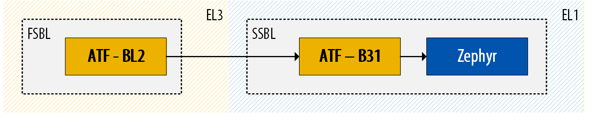{:style="width:60%; display:block; margin-left:auto; margin-right:auto"}

Zephyr leverage the [HPS Baseline System Example Design](https://altera-fpga.github.io/rel-26.3/embedded-designs/agilex-5/e-series/premium-065b/gsrd/ug-gsrd-agx5e-premium-065b/) hardware project. A high-level block diagram fo the HPS Baseline hardware project is shown below:

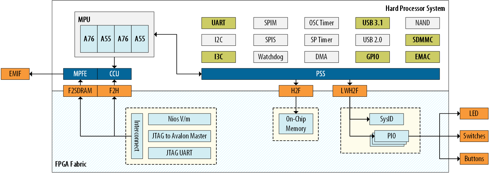{:style="width:80%; display:block; margin-left:auto; margin-right:auto"}

For a complete description of the Quartus hardware project refer to the "GHRD Overview" section of the [HPS GSRD User Guide for the Agilex™ 5 FPGA E-Series 065B Modular Development Kit](https://altera-fpga.github.io/rel-26.3/embedded-designs/agilex-5/e-series/modular-065b/gsrd/ug-gsrd-agx5e-modular-065b/#ghrd-overview)

**What you will learn**

- Setting up the Zephyr development environment and target the Agilex® 5 FPGA E-Series 065B Premium Development Kit.
- Compiling Zephyr images and boot components for the Agilex® 5 HPS target.
- Booting compiled images from the onboard QSPI memory and a serial console.

## Prerequisites

The following items are required to be able to fully exercise this System Example Design:

- [**Altera® Agilex™ 5 FPGA E-Series 065B Premium Development Kit**](https://www.altera.com/products/devkit/po-3284/agilex-5-fpga-e-series-065b-premium-development-kit), ordering code **DK-A5E065BB32AEA**. Refer to board [documentation](https://docs.altera.com/r/docs/814550/current/agilex-5-fpga-e-series-065b-premium-development-kit-user-guide) for more information about the development kit.
  - HPS Enablement Expansion Board. Included with the development kit.
  - Mini USB Cable. Included with the development kit.
  - Micro USB Cable. Included with the development kit.
  - Ethernet Cable. Included with the development kit.
  - Micro SD card and USB card writer. Included with the development kit.
- Host PC with:
  - 64 GB of RAM. Less will be fine for only exercising the binaries, and not rebuilding the System Example Design.
  - Linux OS installed. Ubuntu 22.04 LTS was used to create this page, other versions and distributions may work too
  - Serial terminal (for example GtkTerm or Minicom on Linux and TeraTerm or PuTTY on Windows)
  - Altera&reg; Quartus<sup>&reg;</sup> Prime Pro Edition Version 26.3

### Development Kit Setup

This design targets the **Altera&reg; Agilex&trade; 5 FPGA E-Series 065B Premium Development Kit**, ordering code **DK-A5E065BB32AEA**. Refer to the [board documentation](https://www.altera.com/products/devkit/po-3284/agilex-5-fpga-e-series-065b-premium-development-kit) for more information.

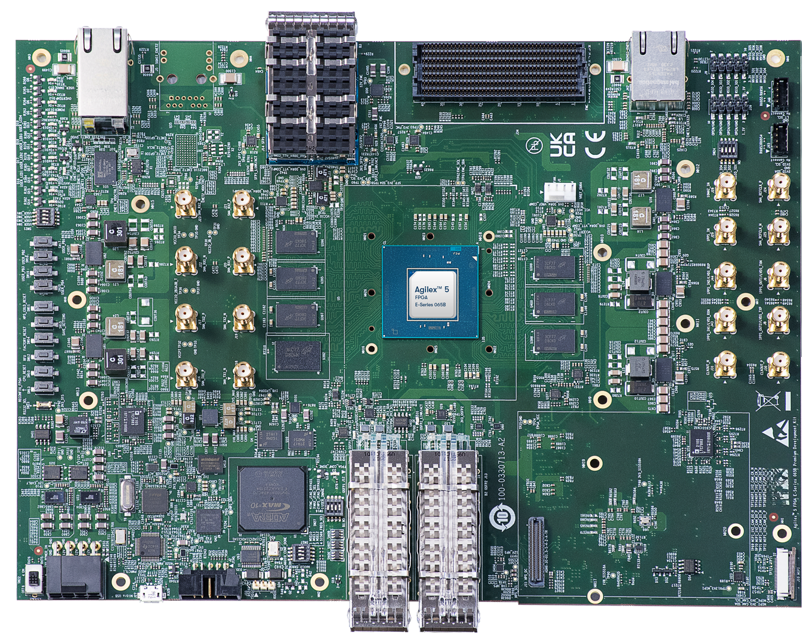{:style="width:80%; display:block; margin-left:auto; margin-right:auto"}

**Installing the HPS Enablement Expansion Board**

This section shows how to install the included HPS Enablement Daughtercard.

1. **Identify Mounting Hardware:** Identify the correct thumb screws and washers needed, they are in a plastic bag:
   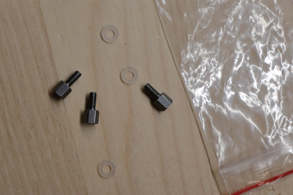{:style="width:60%; display:block; margin-left:auto; margin-right:auto"}

2. **Locate Installation Area:** Locate the area on the development board where the HPS Daughtercard needs to be installed:
   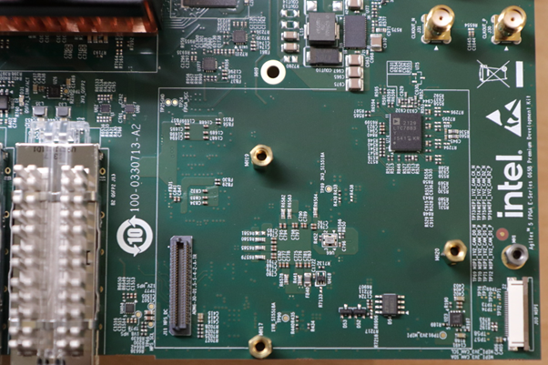{:style="width:60%; display:block; margin-left:auto; margin-right:auto"}

3. **Place Plastic Washers:** Place the plastic washers on top of the three hex mounting posts:
   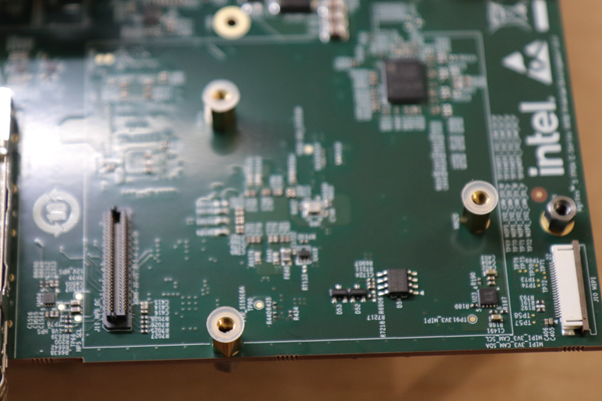{:style="width:60%; display:block; margin-left:auto; margin-right:auto"}

4. **Position the HPS Board:** Place HPS Board on top of the posts and washers:
   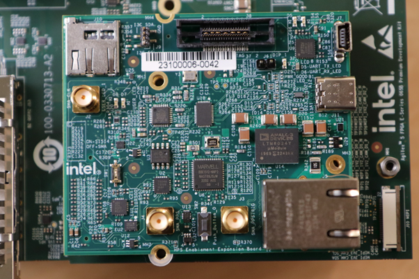{:style="width:60%; display:block; margin-left:auto; margin-right:auto"}

5. **Secure the Thumb Screws:** Place the hex thumb screws on the two posts, as shown below. Note the 3rd one on the bottom is best unplaced as fully screwing that in may move the board. Also note the thumb screw close to the Ethernet connector is hard to screw, recommend to use small pliers and patience to make it secure. It is important that the HPS Board is secure, and does not move:
   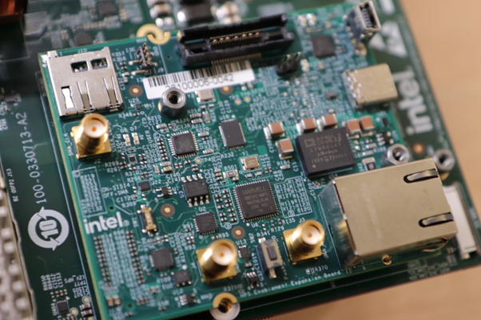{:style="width:60%; display:block; margin-left:auto; margin-right:auto"}

**Changing MSEL**

MSEL signals instruct the FPGA device on which configuration scheme to use. Configuration schemes used by the scenarios presented in this guide are JTAG and QSPI. MSEL is changed through dipswitch SW27. Only change the settings while the board is powered off.

Configuration `OFF-OFF-OFF-OFF` corresponds to JTAG:

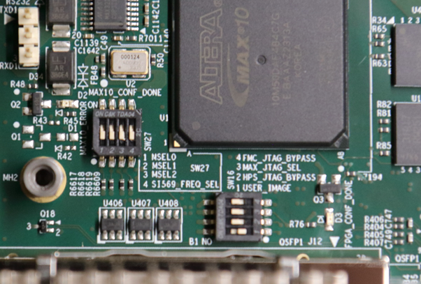{:style="width:60%; display:block; margin-left:auto; margin-right:auto"}

Configuration `OFF-ON-ON-OFF` corresponds to QSPI:

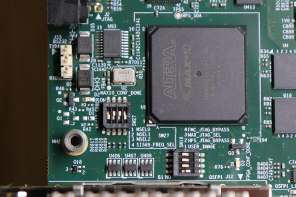{:style="width:60%; display:block; margin-left:auto; margin-right:auto"}

---

## Release Contents

This section outlines the pre-built binary packages, source repositories, and peripheral driver support included with this release.

### Pre-built Binaries

Pre-built binaries are available in the following [link](https://releases.rocketboards.org/2026.10/zephyr/agilex5_dk_a5e065bb32aea_zephyr/).

Binaries for a `Hello World` application and the `Shell Subsystem` (CLI) are provided in the release package under their respective folders (`hello_world` and `cli`). Both folders contain an identical layout described below:

| File Name                           | Description                                                                                                                                         |
|:------------------------------------|:----------------------------------------------------------------------------------------------------------------------------------------------------|
| `bl31.bin`                          | Arm Trusted Firmware (TF-A) Stage 3-1 raw binary (EL3 Runtime Firmware / PSCI implementation).                                                      |
| `zephyr.bin`                        | Final compiled raw binary executable of the Zephyr RTOS application.                                                                                |
| `qspi_boot/`                        | Directory containing boot images and configuration binaries for QSPI flash memory boot.                                                             |
| `baseline_a55.sof`                  | Quartus SRAM Object File containing the compiled FPGA fabric configuration bitstream for the Agilex 5 baseline design.                              |
| `baseline_a55_hps_auto.sof`         | Intermediate SRAM Object File automatically generated by Quartus PFG with the HPS First Stage Bootloader (`bl2.hex`) integrated into the bitstream. |
| `bl2.bin`                           | Arm Trusted Firmware (TF-A) Stage 2 raw binary (First Stage Bootloader / FSBL for the HPS).                                                         |
| `bl2.hex`                           | Intel HEX representation of `bl2.bin` generated via `objcopy`, consumed by Quartus PFG to embed BL2 into the SOF and flash image.                   |
| `fip.bin`                           | Firmware Image Package binary generated by `fiptool`, packaging the TF-A BL31 runtime firmware and Zephyr OS (`bl31.bin` + `zephyr.bin`).           |
| `qspi_flash_image_agilex5_boot.pfg` | Quartus Programming File Generator XML configuration specifying flash partitions, source bitstreams, raw binary payloads, and output targets.       |
| `qspi_image.jic`                    | JTAG Indirect Configuration file used by the Quartus Prime Programmer to write the complete boot image into target QSPI flash memory via JTAG.      |
| `qspi_image_jic.map`                | Memory map text file generated by Quartus PFG detailing flash partition boundaries, start/end byte addresses, and layout.                           |
| `qspi_image_jic.rpd`                | Raw Programming Data binary containing the full byte-level flash memory image for direct QSPI flash writers or flash emulators.                     |

### Source Repositories

Altera&reg; Quartus<sup>&reg;</sup> Prime Pro Edition Version 26.3 and the following software component versions integrate the 26.3 release. 

| Component            | Location                                                                                                   | Branch                     | Commit ID/Tag             |
|:---------------------|:-----------------------------------------------------------------------------------------------------------|:---------------------------|:--------------------------|
| Agilex 5 Design      | [https://github.com/altera-fpga/agilex5e-ed-gsrd](https://github.com/altera-fpga/agilex5e-ed-gsrd)         | main                       | QPDS26.3_REL_BASELINE_PR       |
| Zephyr RTOS          | [https://github.com/zephyrproject-rtos/zephyr](https://github.com/zephyrproject-rtos/zephyr)               | main                       | v4.3.0 |
| Altera Zephyr RTOS   | [https://github.com/altera-fpga/zephyr-socfpga](https://github.com/altera-fpga/zephyr-socfpga)             | socfpga_v4.3.0   | QPDS26.3_REL_BASELINE_PR       |
| Arm Trusted Firmware | [https://github.com/altera-fpga/arm-trusted-firmware](https://github.com/altera-fpga/arm-trusted-firmware) | socfpga_v2.15.0 | QPDS26.3_REL_BASELINE_PR       |

!!! note
    The combination of the component versions indicated in the table above has been validated through the use cases described in this page and it is strongly recommended to use these versions together. If you decided to use any component with different version than the indicated, there is not warranty that this will work.

### Zephyr Driver Availability

The table below lists the support status for the Hard Processor System (HPS) peripheral drivers included in this Zephyr RTOS release for Agilex 5:

| HPS Peripheral         | Supported Status |
|:-----------------------|:-----------------|
| SD Card driver         | Yes - CLI App    |
| GPIO Driver            | Yes              |
| I2C Driver             | Yes - CLI App    |
| UART Driver            | Yes              |
| Timer Driver           | Yes              |
| WatchDog Driver        | Yes              |
| SMP Driver             | Yes              |
| QSPI Driver            | Yes              |
| Ethernet Driver        | Yes              |
| SDM Mailbox Driver     | Yes              |
| HPS DMA Driver         | Yes              |
| I3C driver             | No               |
| EDAC/RAS drivers       | No               |
| Clock Driver driver    | Yes              |
| Warm/Cold Reset driver | Yes - CLI App    |

!!! note
    Drivers with support status 'No' have not completed their validation in hardware.
    Drivers with support status `Yes - \<Application\>` have been validation in hardware under the specified application only.

---

## Testing Pre-Compiled Binaries

This section describes how to test the pre-built Zephyr images and Arm Trusted Firmware binaries in the Agilex® 5 FPGA E-Series 065B Premium Development Kit. Use this flow to confirm the board configuration, OS bring-up and verify console output without building the target software stack from source.

### Development Kit Configuration

Complete the following physical connections and switch checks before powering on the board:

1. Leave all jumpers and switches in their [default configuration](https://docs.altera.com/r/docs/814550/current/agilex-5-fpga-e-series-065b-premium-development-kit-user-guide/default-settings).
2. Install the HPS Enablement Expansion Board
3. Connect mini USB cable from vertical connector on HPS Daughtercard to host PC. This is used for the HPS serial console.
4. Connect micro USB cable from development board to host PC. This is used by the tools for JTAG communication.

### Serial Console Setup

Configure the host serial terminal application to communicate with the HPS UART interface before booting the target:

The HPS Enablement Daughtercard has a built-in FTDI USB to Serial converter chip that allows the host computer to see the board as a virtual serial port. Ubuntu and other modern Linux distributions have built-in drivers for the FTDI USB to Serial converter chip, so no driver installation is necessary on those platforms. Microsoft Windows 10 and 11 automatically install the necessary drivers.

The serial communication parameters are:

- Baud-rate: **115,200**
- Parity: **none**
- Flow control: **none**
- Stop bits: **1**

On Windows, utilities such as TeraTerm and PuTTY can be used to connect to the board. They are easily configured from the tool menus.

On Linux, the minicom utility can be used. Here is how to configure it:

The virtual serial port is usually named /dev/ttyUSB0. In order to determine the device name associated with the virtual serial port on your host PC, please perform the following:

- Use the following command to determine which USB serial devices are already installed: `ls /dev/ttyUSB*`
- Connect mini USB cable from J7 to the PC. This will enable the PC to communicate with the board, even if the board is not powered yet.
- Use the `ls /dev/ttyUSB*` command command again to determine which new USB serial device appeared.
- Install **minicom** application on host PC, if not installed:
  - On Ubuntu, use `sudo apt-get install minicom`
- Configure minicom with the next command:

```bash
$ sudo minicom -s
```

Under **Serial Port Setup** choose the following:

- Serial Device: **/dev/ttyUSB0** (edit to match the system as necessary)
- Bps/Par/Bits: **115200 8N1**
- Hardware Flow Control: **No**
- Software Flow Control: **No**
- Hit **[ESC]** to return to the main configuration menu

Select **Save Setup as dfl** to save the default setup. Then select **Exit**.

### Test Zephyr Pre-compiled Images

Precompiled test applications for Zephyr OS include `Hello World` and a command-line interface (`CLI`).

Run the command for the application you want to test:

=== "Hello World"
  
    **Step 1: Download Prebuild Binaries -** Download the *Hello World* QSPI image for testing.

    ```bash
    mkdir agilex5_zbaseline
    cd agilex5_zbaseline
    export CWD=$(pwd)
    cd $CWD 
    mkdir qspi_bin_prebuilt-hello
    cd qspi_bin_prebuilt-hello
    wget https://releases.rocketboards.org/2026.10/zephyr/agilex5_dk_a5e065bb32aea_zephyr/hello_world/qspi_boot/qspi_image.jic
    ```

    **Step 2: Flash the Pre-built Binary to Onboard QSPI Memory -** Prepare the board for JTAG programming and write the JIC image into QSPI flash.  

    - Power down the board.
    - Set MSEL dipswitch (`SW27`) to **JTAG**: `OFF`-`OFF`-`OFF`-`OFF`.
    - Power up the board.
    - Write JIC image to the QSPI memory.

    Run the following commands to program the flash memory:

    ```bash
    jtagconfig --setparam 1 JtagClock 16M
    quartus_pgm -c 1 -m jtag -o "pvi;$CWD/qspi_bin_prebuilt-hello/qspi_image.jic"
    ```

    **Step 3: Boot Zephyr OS -** Switch the configuration mode to QSPI and verify the serial console output.  

    - Power down the board.
    - Set MSEL dipswitch (`SW27`) to **ASX4 (QSPI)**: `OFF`-`ON`-`ON`-`OFF`.
    - Power up the board.
    - Wait for the Zephyr to boot.
    - Verify the boot log matches the expected output below.

    ```bash
    NOTICE:  DDR: Reset type is 'Power-On'
    NOTICE:  IOSSM: Calibration success status check...
    NOTICE:  IOSSM: All EMIF instances within the IO96 have calibrated successfully!
    NOTICE:  DDR: Calibration success
    NOTICE:  DDR: ECC is enabled
    NOTICE:  IOSSM: Memory initialized successfully on IO96B
    NOTICE:  ###DDR:init success###
    NOTICE:  DFI interface selected successfully to SDEMMC
    NOTICE:  SOCFPGA: QSPI boot
    NOTICE:  BL2: v2.15.1(release):09c4dc6
    NOTICE:  BL2: Built : 19:06:44, Oct 27 2026
    NOTICE:  BL2: Booting BL31
    NOTICE:  SOCFPGA: Boot Core = 0
    NOTICE:  SOCFPGA: CPU ID = 0
    NOTICE:  SOCFPGA: Setting CLUSTERECTRL_EL1
    NOTICE:  BL31: v2.15.1(release):09c4dc6
    NOTICE:  BL31: Built : 19:06:44, Oct 27 2026
    *** Booting Zephyr OS build v4.3.0-30-g91f336578525 ***
    Secondary CPU core 1 (MPID:0x100) is up
    Secondary CPU core 2 (MPID:0x200) is up
    Secondary CPU core 3 (MPID:0x300) is up
    Hello World! intel_socfpga_agilex5_socdk/agilex5
    ```

=== "CLI"

    **Step 1: Download Prebuild Binaries -** Download the *CLI* QSPI image for testing.

    ```bash
    mkdir agilex5_zbaseline
    cd agilex5_zbaseline
    export CWD=$(pwd)
    cd $CWD 
    mkdir qspi_bin_prebuilt-cli
    cd qspi_bin_prebuilt-cli
    wget https://releases.rocketboards.org/2026.10/zephyr/agilex5_dk_a5e065bb32aea_zephyr/cli/qspi_boot/qspi_image.jic
    ```

    **Step 2: Flash the Pre-built Binary to Onboard QSPI Memory -** Prepare the board for JTAG programming and write the JIC image into QSPI flash.  

    - Power down the board.
    - Set MSEL dipswitch (`SW27`) to **JTAG**: `OFF`-`OFF`-`OFF`-`OFF`.
    - Power up the board.
    - Write JIC image to the QSPI memory.

    Run the following commands to program the flash memory:

    ```bash
    jtagconfig --setparam 1 JtagClock 16M
    quartus_pgm -c 1 -m jtag -o "pvi;$CWD/qspi_bin_prebuilt-cli/qspi_image.jic"
    ```

    **Step 3: Boot Zephyr OS -** Switch the configuration mode to QSPI and verify the serial console output.  

    - Power down the board.
    - Set MSEL dipswitch (`SW27`) to **ASX4 (QSPI)**: ``OFF`-`ON`-`ON`-`OFF`.
    - Power up the board.
    - Wait for the Zephyr to boot.
    - Verify the boot log matches the expected output below.

    ```bash
    NOTICE:  DDR: Reset type is 'Power-On'
    NOTICE:  IOSSM: Calibration success status check...
    NOTICE:  IOSSM: All EMIF instances within the IO96 have calibrated successfully!
    NOTICE:  DDR: Calibration success
    NOTICE:  DDR: ECC is enabled
    NOTICE:  IOSSM: Memory initialized successfully on IO96B
    NOTICE:  ###DDR:init success###
    NOTICE:  DFI interface selected successfully to SDEMMC
    NOTICE:  SOCFPGA: QSPI boot
    NOTICE:  BL2: v2.15.1(release):09c4dc6
    NOTICE:  BL2: Built : 19:06:44, Oct 27 2026
    NOTICE:  BL2: Booting BL31
    NOTICE:  SOCFPGA: Boot Core = 0
    NOTICE:  SOCFPGA: CPU ID = 0
    NOTICE:  SOCFPGA: Setting CLUSTERECTRL_EL1
    NOTICE:  BL31: v2.15.1(release):09c4dc6
    NOTICE:  BL31: Built : 19:06:44, Oct 27 2026
    *** Booting Zephyr OS build v4.3.0-30-g91f336578525 ***
    Secondary CPU core 1 (MPID:0x100) is up
    Secondary CPU core 2 (MPID:0x200) is up
    Secondary CPU core 3 (MPID:0x300) is up
    intel_socfpga_agilex5_socdk: Starting Command Line Interface...
    agilex5$
    ```

---

## Compiling from Source and Testing

Follow the steps in this section to set up the toolchain, compile Zephyr and Arm Trusted Firmware (ATF) from source, and package an RTOS application into a bootable QSPI flash image using the Quartus Programming File Generator.

The build process is shown in the image below.

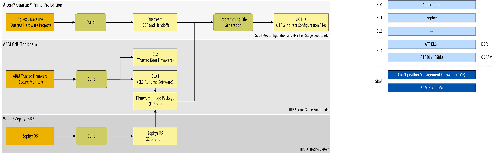{:style="width:85%; display:block; margin-left:auto; margin-right:auto"}

### Environment Setup for Source Compilation


Prepare the Linux host environment, Quartus tools, cross-compilation toolchain, FPGA hardware bitstream, and Zephyr SDK before compiling the software stack.

1. **Install System Dependencies:** Execute the command below.

   ```bash
   sudo apt-get install --no-install-recommends \
    git cmake ninja-build gperf ccache dfu-util device-tree-compiler wget \
    python3-dev python3-pip python3-setuptools python3-tk python3-wheel \
    python3-venv xz-utils file libpython3-dev make gcc gcc-multilib \
    g++-multilib libsdl2-dev libmagic1 libguestfs-tools libssl-dev
   ```

2. **Setup the Quartus Toolchain:** The command below assume that Altera&reg; Quartus<sup>&reg;</sup> Prime Pro Edition Version 26.3 is installed in your home directory. Adjust the path if necessary.

   ```bash
   source ~/altera_pro/26.3/qinit.sh
   ```

3. **Establish Workspace Staging Area:** Create the top-level working directory and export the `CWD` environment variable.

   
   ```bash
   mkdir -p agilex5_zgsrd
   cd agilex5_zgsrd
   export CWD=$(pwd)
   ```
   

1. **Download and Register the Arm GNU Toolchain:** Configure the Arm64 cross-compiler environment required to build Arm Trusted Firmware.

   
   ```bash
   cd $CWD
   wget https://developer.arm.com/-/media/Files/downloads/gnu/14.3.rel1/binrel/\
   arm-gnu-toolchain-14.3.rel1-x86_64-aarch64-none-linux-gnu.tar.xz
   tar xf arm-gnu-toolchain-14.3.rel1-x86_64-aarch64-none-linux-gnu.tar.xz
   rm -f arm-gnu-toolchain-14.3.rel1-x86_64-aarch64-none-linux-gnu.tar.xz
   export PATH=`pwd`/arm-gnu-toolchain-14.3.rel1-x86_64-aarch64-none-linux-gnu/bin/:$PATH
   export ARCH=arm64
   export CROSS_COMPILE=aarch64-none-linux-gnu-
   ```
   

2. **Compile the Agilex 5 Baseline FPGA Bitstream:** Set up the workspace for the Quartus hardware project compilation:
   
   ```bash
   cd $CWD
   rm -rf agilex5_065b_base.qspi
   mkdir agilex5_065b_base.qspi
   cd agilex5_065b_base.qspi
   export HW_CWD=`pwd`
   ```
   

   Download and build the Quartus hardware design.
   
   ```bash
   cd $HW_CWD
   rm -rf agilex5_soc_devkit_ghrd && mkdir agilex5_soc_devkit_ghrd && cd agilex5_soc_devkit_ghrd
   wget https://github.com/altera-fpga/agilex5-ed-hps-baseline/releases/download/QPDS26.3_REL_BASELINE_PR/dk-a5e065bb32aea-enablement-baseline-a55.zip
   unzip dk-a5e065bb32aea-enablement-baseline-a55.zip
   rm -f dk-a5e065bb32aea-enablement-baseline-a55.zip
   make baseline_a55-build
   ```
   

   Once the build completes, the generated SRAM Object File (`.sof`) will be located at `$HW_CWD/agilex5_soc_devkit_ghrd/output_files/baseline_a55.sof`

3. **Install and Initialize the Zephyr SDK:** Download, verify, and unpack the Zephyr SDK:
   
   ```bash
   cd $CWD
   wget https://github.com/zephyrproject-rtos/sdk-ng/releases/download/v0.17.4/zephyr-sdk-0.17.4_linux-x86_64.tar.xz
   wget -O - https://github.com/zephyrproject-rtos/sdk-ng/releases/download/v0.17.4/sha256.sum | shasum --check --ignore-missing 
   tar xvf zephyr-sdk-0.17.4_linux-x86_64.tar.xz
   rm -rf zephyr-sdk-0.17.4_linux-x86_64.tar.xz
   cd zephyr-sdk-0.17.4
   # Run the SDK setup script to configure toolchains, host tools, and CMake integration
   ./setup.sh -t all
   ```
   
   Register the toolchain environment variables in your active shell:
   
   ```bash
   export ZEPHYR_SDK_INSTALL_DIR=$(pwd)
   export ZEPHYR_TOOLCHAIN_VARIANT=zephyr
   ```
   


### Compile Arm Trusted Firmware (ATF)


Build the Arm Trusted Firmware First-Stage Bootloader (`bl2`), EL3 runtime firmware (`bl31`), and Firmware Image Package utility (`fiptool`) configured for QSPI boot.

1. **Clone and Compile the ATF Source Tree:** Clone the Altera Arm Trusted Firmware repository and build the `bl2` and `bl31` targets for the Agilex 5 platform.

   
   ```bash
   cd $CWD
   git clone -b QPDS26.3_REL_BASELINE_PR https://github.com/altera-fpga/arm-trusted-firmware arm-trusted-firmware-qspi
   cd arm-trusted-firmware-qspi
   make realclean
   make PLAT=agilex5 SOCFPGA_BOOT_SOURCE_QSPI=1 SOCFPGA_SIP_SVC_V3=0 bl2 bl31 PRELOADED_BL33_BASE=0x80100000 -j$(nproc)
   ```
   

2. **Compile the ATF Firmware Image Package Utility (`fiptool`):** Build the `fiptool` host executable and copy it to the top-level working directory.
   
   ```bash
   make fiptool
   cp tools/fiptool/fiptool $CWD
   ```
   

   The compilation produces the following output build artifacts:

   - `$CWD/arm-trusted-firmware-qspi/build/agilex5/release/bl2.bin`
   - `$CWD/arm-trusted-firmware-qspi/build/agilex5/release/bl31.bin`
   - `$CWD/fiptool`

### Compile Zephyr Kernel and Applications

Zephyr build trees are managed using the [`west` meta-tool](https://docs.zephyrproject.org/latest/develop/west/index.html). In this flow, the upstream Zephyr repository is initialized, dependencies are fetched, and the core tree is substituted with the Altera downstream branch supporting Agilex 5 HPS peripherals.

The Altera downstream Zephyr repository provides sample applications to validate Hard Processor System (HPS) peripherals, as detailed in the following table.  

| Component / Feature | Application Path                                                     | Description                                                                                                                                               |
|:--------------------|:---------------------------------------------------------------------|:----------------------------------------------------------------------------------------------------------------------------------------------------------|
| HelloWorld          | `samples/hello_world/`                                               | Basic sanity test that prints "Hello World!" and board target information to verify toolchain, boot flow, and serial console output.                      |
| GPIO                | `samples/basic/blinky/`                                              | Demonstrates the GPIO driver API by toggling an LED (`led0` devicetree alias) on and off at 1-second intervals and printing the status.                   |
| Timer/Counter       | `samples/drivers/counter/alarm/`                                     | Demonstrates the counter driver API by starting a hardware timer, setting an alarm callback, and updating the alarm interval upon interrupt.              |
| Watchdog            | `samples/drivers/watchdog/`                                          | Configures the watchdog timer to reset the SoC upon expiration, feeds the watchdog 5 times, and then allows it to expire to test reset behavior.          |
| UART                | `samples/drivers/uart/echo_bot`                                      | Implements an interrupt-driven UART echo bot that buffers incoming characters in a message queue and echoes completed lines back to the console.          |
| QSPI                | `samples/drivers/soc_flash_qspi`                                     | Validates the QSPI NOR flash driver by retrieving geometry, erasing flash blocks, writing test data, and verifying the readback and erase data integrity. |
| SDM Mailbox         | `samples/subsys/sip_svc/`                                            | Uses the SiP SVC subsystem to communicate with the Secure Device Manager (SDM) via ARM EL3 SMC calls, sending mailbox commands to query chip voltage.     |
| HPS DMA             | `samples/drivers/dma/mem_to_mem/`                                    | Demonstrates asynchronous memory-to-memory transfers using the Synopsys DesignWare AXI DMA controller with linked-list descriptors and cache maintenance. |
| CLI                 | `subsys/shell/`                                                      | Implements Zephyr's interactive command-line shell, reading input and executing registered commands.                                                      |

The build procedure in this section demonstrates targeting the HPS General-Purpose I/O (GPIO) block using the blinky application.  

1. **Initialize Python Virtual Environment and Checkout Repositories:** Create a Python virtual environment, install `west`, and initialize the upstream Zephyr workspace.
   
   ```bash
   cd $CWD
   python3 -m venv ~/.zephyrproject/.venv
   source ~/.zephyrproject/.venv/bin/activate
   pip3 install wheel west
   west init -m https://github.com/zephyrproject-rtos/zephyr --mr v4.3.0 zephyrproject
   cd $CWD/zephyrproject
   west update
   west zephyr-export
   pip install -r $CWD/zephyrproject/zephyr/scripts/requirements.txt
   ```
   

2. **Switch to the Altera Downstream Zephyr Repository:** Replace the default `zephyr` directory with the Altera `socfpga_v4.3.0` branch and update workspace modules.
   
   ```bash
   cd $CWD/zephyrproject
   rm -rf zephyr 
   git clone -b QPDS26.3_REL_BASELINE_PR --single-branch https://github.com/altera-fpga/zephyr-socfpga.git zephyr
   west update
   west zephyr-export
   ```
   

3. **Build the Zephyr GPIO Application Image:** Compile the `blinky` sample application targeting the Agilex 5 SoC Development Kit.
   
   ```bash
   cd $CWD/zephyrproject/zephyr
   west build -b intel_socfpga_agilex5_socdk samples/basic/blinky -d agilex5
   ```
   

   Once the build completes, the generated target executable is located at `$CWD/zephyrproject/zephyr/agilex5/zephyr/zephyr.bin`.

### Create the Zephyr Boot Artifacts

This example design boots from the QSPI flash. To construct the boot image, `fiptool` packages the Secure Monitor (`bl31.bin`) and non-secure OS (`zephyr.bin`) into a single Firmware Image Package (`fip.bin`). The Quartus Programming File Generator then maps `bl2.hex` into initial boot sectors and places `fip.bin` at offset `0x03C00000`.

1. **Stage ATF and Zephyr Payloads into a Unified FIP Container:** Create the `qspi_bin` packaging directory, copy `bl2.bin`, and generate `fip.bin` combining `bl31.bin` and `zephyr.bin`.
   
   ```bash
   cd $CWD
   mkdir -p qspi_bin && cd qspi_bin
   cp $CWD/arm-trusted-firmware-qspi/build/agilex5/release/bl2.bin .
   $CWD/fiptool create --soc-fw $CWD/arm-trusted-firmware-qspi/build/agilex5/release/bl31.bin --nt-fw $CWD/zephyrproject/zephyr/agilex5/zephyr/zephyr.bin fip.bin
   ```
   

2. **Create the Quartus Programming File Generator Specification (`qspi_flash_image_agilex5_boot.pfg`):** Write the XML configuration file defining the QSPI flash layout and partition assignments.
   
   ```bash
   cd $CWD/qspi_bin
   base64 -d <<'EOF' | gunzip > "qspi_flash_image_agilex5_boot.pfg"
   H4sICERJ62oCA3FzcGlfZmxhc2hfaW1hZ2VfYWdpbGV4NV9ib290LnBmZwCtU9uO2yAQfc9XID4g
   drLrPtmWcnO1ldqkyVbqGyJh7CD5ViDZpF9fsONg3NVuVypPMDDnHObMhHWaoTMIyasywhMcjxAK
   JSjFy0yiw0mqqiBsTxgXER57GBUVgwjPdj8fsdc8rk6qPimS8hykCZjVD6KSFjrjl6w54QXNACMN
   BgdViauGxEhda33/5WmBu/QGwuSSqlZamPScGwmHqmRUXFv8Nv/rbIP/purnvYPqubDvM+5WC7Ld
   LD/KivZcyRdam2r/u4I0p/JIGJz5AQhncdKcl+15EnrD+84Ir+dEY5c39Cs0epQAWlj77iHEWYTn
   3YlMXItqqo7oWEtiNhHe59PxES443lMJOS+B0CAYyyoNPfPAarrDt4pcAaGgL4Nu6iL90t1M2M4T
   3Ijc6jeJKbPWmPJ6vOdl6HWJLY8D7FTUUvWjXWc9T4PvP/zp55bIrfywIEJx4zISIEGcgTVSU34B
   RiShjIkm0G39i39bGEEvNknM6hLBJjZ2rNfP5OlbstY4/LcW6A/66DUV/lCFb1XQk6osf3tymf2W
   eTP5X5T6kw+LwcffINaGvsLsdv3AwryiDEQ8C1ZL/1Mwnz9MZ6vHXZdyux0NQdrWoFLyrCygVLYx
   bAzVesYbafdfk1t1nJrc29rMY2+Geg3vTKpl+ACpqYzD2jW5gbYzYZv/Dcr+WX9cT22axaM/aEP3
   CiIGAAA=
   EOF
   ```
   
3. **Convert `bl2.bin` to HEX Format:** Use `objcopy` to convert the raw `bl2.bin` binary into an Intel HEX image (`bl2.hex`).
   
   ```bash
   cd $CWD/qspi_bin
   aarch64-none-linux-gnu-objcopy -v -I binary -O ihex --change-addresses 0x00000000 bl2.bin bl2.hex
   ```
   
4. **Generate the QSPI RPD Boot Image:** Link the compiled FPGA `.sof` bitstream and run `quartus_pfg` to generate the final QSPI flash programming files.
   
   ```bash
   cd $CWD/qspi_bin
   ln -sf $HW_CWD/agilex5_soc_devkit_ghrd/output_files/baseline_a55.sof baseline_a55.sof
   quartus_pfg -c qspi_flash_image_agilex5_boot.pfg
   deactivate
   ```
   

   This command generates the final programming image at `$CWD/qspi_bin/qspi_image.jic` along with `qspi_image.rpd` and `qspi_image.map`.


### Compilation Artifacts Summary

Once the build completes, the `$CWD/qspi_bin/` directory contains the following files:

| File                 | Description                                                       |
|:---------------------|:------------------------------------------------------------------|
| `bl2.bin`            | ATF FSBL raw binary executed first by Simics.                     |
| `bl2.hex`            | ATF FSBL translated to Intel HEX format for PFG packaging.        |
| `bl31.bin`           | ATF BL31 EL3 runtime monitor binary.                              |
| `zephyr.bin`         | Compiled Zephyr kernel and application binary.                    |
| `fip.bin`            | Combined Firmware Image Package containing BL31 and Zephyr.       |
| `qspi_image.jic`     | QSPI flash memory raw programming data image for Development Kit. |

### Testing the GPIO Application

Program the generated QSPI image onto the development kit and verify that the GPIO blinky application executes as expected.

1. **Flash the Compiled Binary to Onboard QSPI Memory:** Configure the board for JTAG mode and write the generated `qspi_image.jic` file to QSPI flash.
   - Power down the board.
   - Set MSEL dipswitch `SW27` to JTAG: `OFF`-`OFF`-`OFF`-`OFF`.
   - Power up the board.
   - Write JIC image to the QSPI memory.

   Execute the following commands to program the QSPI flash:

   ```bash
   jtagconfig --setparam 1 JtagClock 16M
   quartus_pgm -c 1 -m jtag -o "pvi;$CWD/qspi_bin/qspi_image.jic"
   ```

2. **Boot Zephyr OS:** Switch the board to QSPI configuration mode and observe the LED and serial console output.
   - Power down the board.
   - Set MSEL dipswitch `SW27` to ASX4 (QSPI): `OFF`-`ON`-`ON`-`OFF`.
   - Power up the board.
   - Wait for the Zephyr to boot.

   Upon succesful execution HPS LED starts blinking. Refer to the transcript below for a serial session output after succesful execution.

   ```text
   NOTICE:  DDR: Reset type is 'Power-On'
   NOTICE:  IOSSM: Calibration success status check...
   NOTICE:  IOSSM: All EMIF instances within the IO96 have calibrated successfully!
   NOTICE:  DDR: Calibration success
   NOTICE:  DDR: ECC is enabled
   NOTICE:  IOSSM: Memory initialized successfully on IO96B
   NOTICE:  ###DDR:init success###
   NOTICE:  DFI interface selected successfully to SDEMMC
   NOTICE:  SOCFPGA: QSPI boot
   NOTICE:  BL2: v2.15.1(release):QPDS26.3_REL_BASELINE_PR
   NOTICE:  BL2: Built : 09:51:25, Nov  4 2026
   NOTICE:  BL2: Booting BL31
   NOTICE:  SOCFPGA: Boot Core = 0
   NOTICE:  SOCFPGA: CPU ID = 0
   NOTICE:  SOCFPGA: Setting CLUSTERECTRL_EL1
   NOTICE:  BL31: v2.15.1(release):QPDS26.3_REL_BASELINE_PR
   NOTICE:  BL31: Built : 09:51:25, Nov  4 2026
   *** Booting Zephyr OS build QPDS26.3_REL_BASELINE_PR ***
   Secondary CPU core 1 (MPID:0x100) is up
   Secondary CPU core 2 (MPID:0x200) is up
   Secondary CPU core 3 (MPID:0x300) is up
   LED state: OFF
   LED state: ON
   LED state: OFF
   LED state: ON
   ```

---

## Troubleshooting

This section provides reference solutions for common environment and build configuration errors encountered when setting up or recompiling the Zephyr software stack.

### Sphinx Dependency Conflict During Environment Setup

Installing Sphinx packages on non-standard host Python environments can trigger version incompatibility conflicts with `docutils`:

```text
ERROR: sphinx-tabs 3.4.1 has requirement docutils~=0.18.0, but you'll have docutils 0.19 which is incompatible.
ERROR: sphinx-rtd-theme 1.2.2 has requirement docutils<0.19, but you'll have docutils 0.19 which is incompatible
```

Resolve the dependency pin by reinstalling the core documentation packages within the active Python environment:

```bash
pip install sphinx-rtd-theme sphinx
```

### Stale Build Artifacts When Recompiling Applications

Rebuilding alternate Zephyr applications inside an existing build directory causes configuration mismatch errors:

```text
ERROR: Build directory ".../zephyr/agilex5" is for application ".../hello_world", but source directory ".../blinky" was specified; please clean it, use --pristine, or use --build-dir to set another build directory
```

Force a clean build using the `-p always` flag:

```bash
west build -p always -b intel_socfpga_agilex5_socdk samples/hello_world -d agilex5
```

## Documentation & Upstream Resources

- [Altera Zephyr Drivers](https://altera-fpga.github.io/rel-26.3/driver-list_zephyr/)
- [Agilex 5 E-Series 065B Premium Development Kit HPS GSRD User Guide](https://altera-fpga.github.io/rel-26.3/embedded-designs/agilex-5/e-series/premium-065b/gsrd/ug-gsrd-agx5e-premium-065b/)

---
## Notices & Disclaimers

Altera<sup>&reg;</sup> Corporation technologies may require enabled hardware, software or service activation.
No product or component can be absolutely secure. 
Performance varies by use, configuration and other factors.
Your costs and results may vary. 
You may not use or facilitate the use of this document in connection with any infringement or other legal analysis concerning Altera or Intel products described herein. You agree to grant Altera Corporation a non-exclusive, royalty-free license to any patent claim thereafter drafted which includes subject matter disclosed herein.
No license (express or implied, by estoppel or otherwise) to any intellectual property rights is granted by this document, with the sole exception that you may publish an unmodified copy. You may create software implementations based on this document and in compliance with the foregoing that are intended to execute on the Altera or Intel product(s) referenced in this document. No rights are granted to create modifications or derivatives of this document.
The products described may contain design defects or errors known as errata which may cause the product to deviate from published specifications.  Current characterized errata are available on request.
Altera disclaims all express and implied warranties, including without limitation, the implied warranties of merchantability, fitness for a particular purpose, and non-infringement, as well as any warranty arising from course of performance, course of dealing, or usage in trade.
You are responsible for safety of the overall system, including compliance with applicable safety-related requirements or standards. 
<sup>&copy;</sup> Altera Corporation.  Altera, the Altera logo, and other Altera marks are trademarks of Altera Corporation.  Other names and brands may be claimed as the property of others. 

OpenCL* and the OpenCL* logo are trademarks of Apple Inc. used by permission of the Khronos Group™. 