## Introduction

This tutorial demonstrates how to extend the [HPS Baseline System Example Design](https://www.google.com/search?q=https://altera-fpga.github.io/%24%7B%7Benv.ALTERA_RELEASE%7D%7D/embedded-designs/agilex-5/e-series/premium-065b/gsrd/ug-gsrd-agx5e-premium-065b/%23hardware-design-overview) Quartus project by adding an IP core to the fabric subsystem and enabling it through the software stack. You will integrate a [Lightweight UART Core](https://docs.altera.com/r/docs/683130/26.1/embedded-peripherals-ip-user-guide/lightweight-uart-core) to simulate a custom IP that lacks a native Linux kernel driver. Rather than developing a complex kernel-space driver from scratch, this tutorial highlights the standard hardware-to-software enablement path utilizing the generic User Space I/O (UIO) platform driver.

The hardware architecture interfaces the new UART IP with the Hard Processor System (HPS) via the Lightweight AXI Bridge. To facilitate a self-contained validation process without requiring external wiring, the design incorporates a System ID Peripheral IP—acting as a verifiable hardware fingerprint—and utilizes an internal loopback (TX to RX) within the System Verilog top-level wrapper.

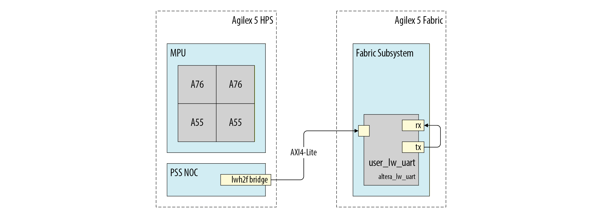{:style="width:80%; display:block; margin-left:auto; margin-right:auto"}

Software enablement is organized into a progressive, three-tier integration and verification stack. This methodology confirms that hardware interfaces and register files are operating correctly before introducing operating system abstraction layers:

| Validation Level         | Boot Environment    | Verification Tool          | Purpose                                                               |
|--------------------------|---------------------|----------------------------|-----------------------------------------------------------------------|
| **Level 1: Low-Level**   | U-Boot (Standalone) | `mw.l` / `md.l` commands   | Verify raw register address space and IP connectivity.                |
| **Level 2: OS-Level**    | Yocto Linux         | `devmem2`                  | Confirm Device Tree mappings and base kernel accessibility.           |
| **Level 3: Application** | Linux User Space    | UIO Driver & C Application | Handle interrupts (IRQ) and mapped memory in a custom user-space app. |

The following figure shows the Yocto Project structure from the HPS Baseline System Example Design, highlighting the hooks and layers where custom recipes and kernel configuration fragments (such as `.scc` configuration files) are applied to bind the new hardware to the UIO driver:

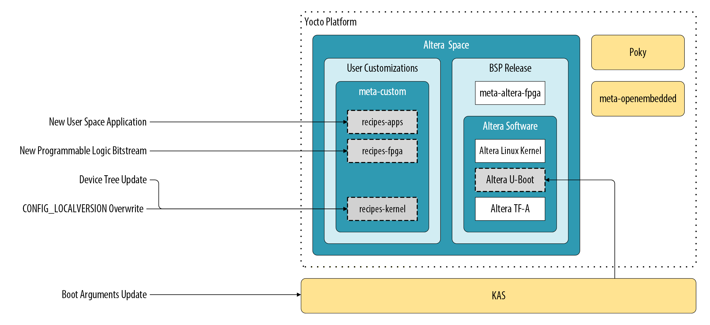{:style="width:80%; display:block; margin-left:auto; margin-right:auto"}

This tutorial utilizes the [HPS Expansion Board (HPS-EB)](https://www.google.com/search?q=https://docs.altera.com/r/docs/814550/current/agilex-5-fpga-e-series-065b-premium-development-kit-user-guide/hps-expansion-board-hps-eb%3FtocId%3DRnMgo4C4EyXZyqa%257ErswC8A) mounted on an [Agilex™ 5 FPGA E-Series 065B Premium Development Kit](https://www.altera.com/products/devkit/po-3284/agilex-5-fpga-e-series-065b-premium-development-kit). It employs an HPS-First, split-boot topology. In this configuration, the HPS configures the FPGA fabric logic. The First Stage Bootloader (FSBL) executes directly from onboard QSPI memory to initialize the system, while the Second Stage Bootloader (SSBL), Linux kernel, device tree, and root filesystem are subsequently loaded from a MicroSD card.

### Tutorial Organization

The tutorial follows a progressive building-block approach, where each section validates a deeper layer of the system:

#### Level 1: Hardware Integration and Low-Level Validation

* **Baseline System Configuration:** Build the initial HPS Baseline System Example Design to validate the toolchain and establish a software baseline.
* **Hardware IP Integration:** Add the Lightweight UART IP in Platform Designer, map its memory space, and route its signals through the SystemVerilog top-level wrapper.
* **U-Boot Enablement:** Use the ["Roll Your Own"](https://www.google.com/search?q=https://altera-fpga.github.io/%24%7B%7Benv.ALTERA_RELEASE%7D%7D/embedded-designs/agilex-5/e-series/premium-065b/gsrd/ug-gsrd-agx5e-premium-065b/%23build-and-exercise-roll-your-own-binaries) (RYO) flow to build a standalone bootloader and verify hardware connectivity before loading an OS.

#### Level 2: Linux Integration and Driver Binding

* **Linux IP Integration and Testing:** Update the Yocto device tree, kernel UIO modules, and kernel boot arguments to bind the custom hardware to the [`uio_pdrv_genirq`](https://www.kernel.org/doc/html/v5.0/driver-api/uio-howto.html) driver.
* **Hardware Verification:** Use the updated Linux image to confirm that the HPS can access the FPGA fabric registers with [`devmem2`](https://github.com/radii/devmem2).

#### Level 3: Application Development and Deployment

* **Application Development:** Configure the Arm GNU Toolchain and develop a C application to perform an integration test on the new hardware module.
* **Deployment and Debugging:** Integrate the application into the Yocto project as a recipe and use the Ashling* RiscFree* IDE for remote hardware debugging.

---

## Prerequisites

Before assembling hardware or compiling software, verify that your host development workstation satisfies all required toolchain versions, operating system dependencies, and storage capacity baselines. The build pipeline combines high-level Yocto cross-compilation with FPGA fabric synthesis, requiring substantial CPU and memory resources. Ensuring your workstation meets these prerequisites avoids compilation bottlenecks and communication errors during target bring-up.

### Hardware Requirements

- [Agilex® 5 FPGA E-Series 065B Premium Development Kit](https://www.altera.com/products/devkit/po-3284/agilex-5-fpga-e-series-065b-premium-development-kit) (Ordering Code: `DK-A5E065BB32AEA`):
  - HPS Enablement Expansion Board (HPS-EB daughtercard)
  - Mini-USB cable (for HPS UART serial terminal)
  - Micro-USB cable (for Intel FPGA Download Cable II / JTAG)
  - MicroSD card and USB card reader
  - Power supply and regional AC cord

### Host PC Requirements

- **Operating System:** Ubuntu 22.04 LTS (x86_64)
- **Hardware Resources:**
  - Minimum 64 GB RAM (essential for Quartus synthesis and parallel BitBake tasks)
  - Minimum 200 GB available disk space (SSD recommended)
- **Software Tools:**
  - Altera® Quartus® Prime Pro Edition Version 26.3
  - Ashling* RiscFree* IDE for Altera Version 26.3
  - Serial terminal emulator (e.g., Minicom, GtkTerm, PuTTY)
  - High-speed Internet access for downloading Yocto layers and dependencies

### Board Setup

!!! warning
    The Agilex 5 FPGA development kit contains static-sensitive digital components and precision power regulation circuitry. Review the handling and power-up instructions in the **[Getting Started](https://docs.altera.com/r/docs/814550/current/agilex-5-fpga-e-series-065b-premium-development-kit-user-guide/getting-started)** guide before applying power to avoid hardware damage.

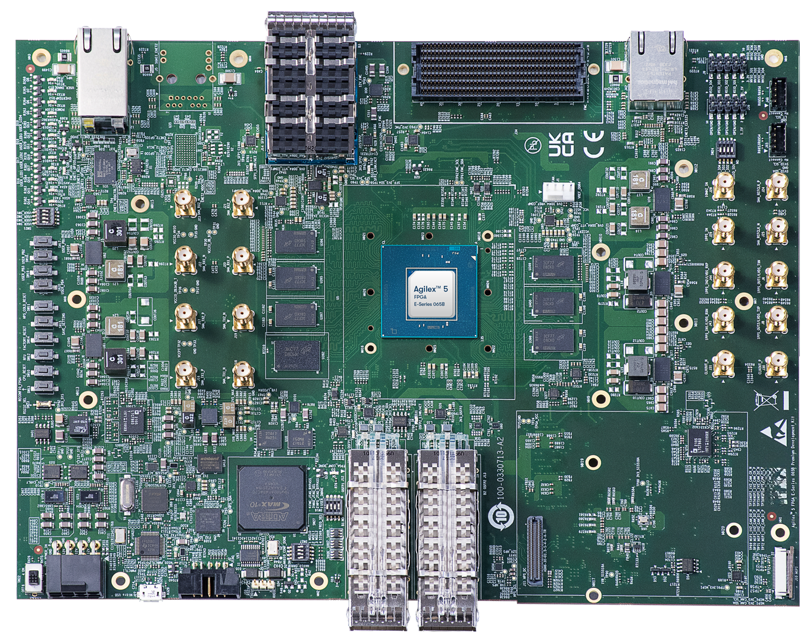{:style="width:60%; display:block; margin-left:auto; margin-right:auto"}

**Installing the HPS Enablement Expansion Board**

The Hard Processor System (HPS) Enablement Expansion Board bridges the Agilex 5 SoC processing subsystem to essential off-board interfaces, including the dedicated UART console and Ethernet PHY. Proper physical mounting prevents intermittent pin contact on high-density headers and prevents mechanical strain on the board assembly. Ensure the main development kit is unpowered and placed on an ESD-safe mat before proceeding with mechanical installation.

1. **Retrieve Mounting Hardware:**  
   Locate the plastic accessory bag containing the knurled thumb screws and non-conductive plastic washers.  
   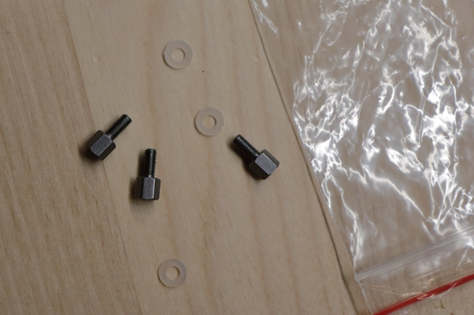{:style="width:60%; display:block; margin-left:auto; margin-right:auto"}

2. **Locate Expansion Headers:**  
   Identify the HPS daughtercard footprint and expansion connectors on the primary development board.  
   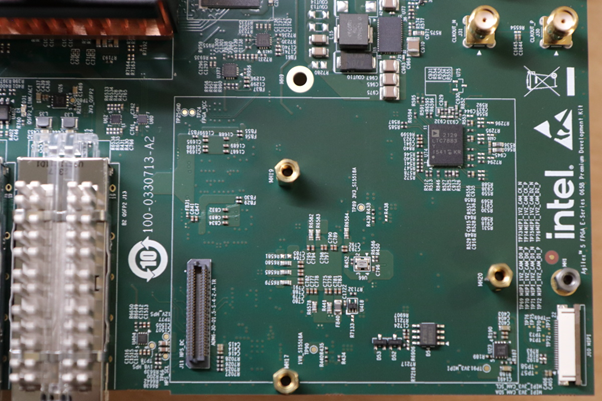{:style="width:60%; display:block; margin-left:auto; margin-right:auto"}

3. **Position Washers:**  
   Place one plastic washer onto each of the three threaded hex standoffs.  
   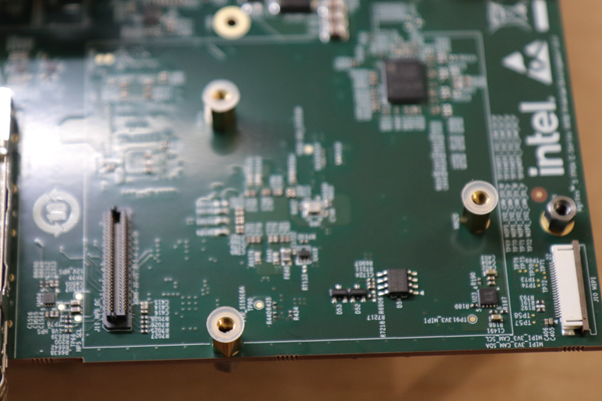{:style="width:60%; display:block; margin-left:auto; margin-right:auto"}

4. **Align and Seat the Daughtercard:**  
   Carefully align the daughtercard mating connectors with the primary board headers and press down evenly until fully seated on the standoffs.  
   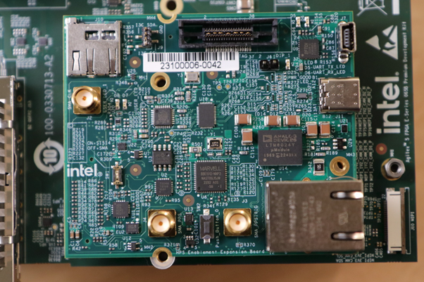{:style="width:60%; display:block; margin-left:auto; margin-right:auto"}

5. **Fasten the Board:**  
   Install and hand-tighten the thumb screws on the two upper standoffs shown below. Leave the bottom standoff unfastened, as tightening this position can introduce board flex and twist the mating connector. Secure the thumb screw adjacent to the Ethernet receptacle carefully using small pliers if finger clearance is limited. Ensure the daughtercard sits flat and does not shift.  
   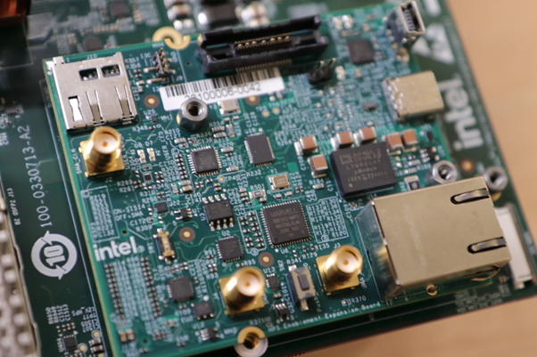{:style="width:60%; display:block; margin-left:auto; margin-right:auto"}

**Configuring the MSEL Boot Mode Switches**

The Mode Select (MSEL) pins configure the FPGA configuration controller for specific boot sources, clocking topologies, and bus widths. This design relies on two modes: JTAG mode to write the Flash Loader and secondary bootloader to non-volatile QSPI flash, and Active Serial (ASx4) mode to read the bitstream autonomously upon system reset. Set the 4-position DIP switch `SW27` strictly while the board is powered down to prevent indeterminate configuration latching.

!!! warning
    Always power off the board before changing `SW27` DIP switch settings. Adjusting MSEL switches while power rails are energized can corrupt active flash transactions or lead to configuration sequencing errors.

**JTAG Configuration Mode (`SW27`: OFF / OFF / OFF / OFF)**

Set all four switch actuators on `SW27` to the **OFF** position to route the configuration state machine directly to the JTAG scan chain. Use this configuration when programming non-volatile bitstreams (`.jic`) to QSPI flash using `quartus_pgm`.

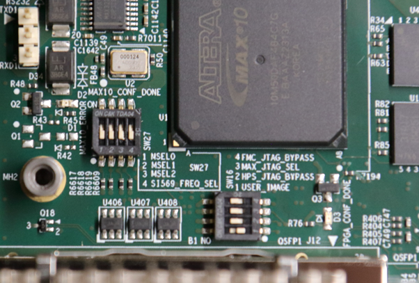{:style="width:60%; display:block; margin-left:auto; margin-right:auto"}

**Active Serial x4 (QSPI) Mode (`SW27`: OFF / ON / ON / OFF)**

Set switch actuators 1 and 4 to **OFF**, and actuators 2 and 3 to **ON**. Use this configuration for normal standalone boot, allowing the Agilex 5 Secure Device Manager (SDM) to load the initial bootloader and configuration bitstream directly from onboard QSPI memory via Active Serial x4.

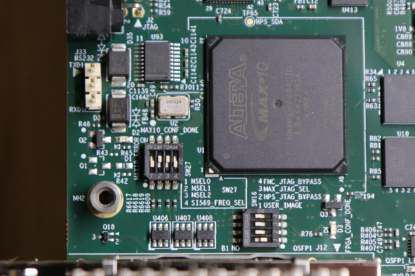{:style="width:60%; display:block; margin-left:auto; margin-right:auto"}

### Host Software and Dependency Configuration

Set up your Ubuntu 22.04 LTS host with 32-bit runtime libraries, build automation packages, and core Yocto dependencies.

```bash
# Enable 32-bit architecture for Quartus utility dependencies
sudo dpkg --add-architecture i386
sudo apt-get update
sudo apt-get upgrade -y
# Install build dependencies
sudo apt-get install -y \
  build-essential gcc bc bison flex diffstat gawk texinfo chrpath socat \
  cpio file fakeroot swig device-tree-compiler u-boot-tools mtd-utils \
  git wget curl unzip xz-utils zstd liblz4-tool mtools p7zip-full \
  python3 python3-pip python3-pexpect python3-git python3-jinja2 \
  python3-subunit python3-newt python3.10-venv pylint \
  libgmp3-dev libmpc-dev libssl-dev libelf-dev libacl1 ncurses-dev \
  mesa-common-dev libegl1-mesa libsdl1.2-dev xterm \
  openssh-server mc net-tools iputils-ping debianutils \
  tftp tftpd nfs-kernel-server xinetd \
  libc6:i386 libstdc++6:i386 libgcc-s1:i386 lib32z1 libncurses5
# Configure required locale
sudo locale-gen en_US.UTF-8
# Configure bash as default system shell
sudo ln -sf /bin/bash /bin/sh
```

Add Quartus® Prime Pro Edition binaries to your system environment variables. Update the paths if your Quartus installation resides outside `$HOME/intelFPGA_pro`:

``` bash
source ~/altera_pro/26.3/qinit.sh
```

---

## Level 1: Baseline System Configuration

Establish a verified hardware and software baseline using the default [HPS Baseline System Example Design](https://altera-fpga.github.io/rel-26.3/embedded-designs/agilex-5/e-series/premium-065b/gsrd/ug-gsrd-agx5e-premium-065b/) prior to integrating custom fabric IP. Compiling the unmodified reference design in Quartus Prime and assembling the Linux image in Yocto confirms that board switch configurations, host toolchains, and serial communication paths are fully operatiosnal before entering custom logic debug.

### Hardware Design Checkout and Build


#### Source Code Initialization and Environment Setup


Clone the reference hardware project from the repository and check out the design configured for Linux execution on **Core 0 (Arm Cortex-A55)** within the HPS:


```bash
# Clone repository with sparse checkout targeting baseline A55
mkdir agilex5_soc_devkit_ghrd && cd agilex5_soc_devkit_ghrd
wget https://github.com/altera-fpga/agilex5e-ed-gsrd/releases/download/QPDS26.3_REL_BASELINE_PR/dk-a5e065ab32aea-enablement-baseline-a55.zip
unzip dk-a5e065ab32aea-enablement-baseline-a55.zip
rm -f dk-a5e065ab32aea-enablement-baseline-a55.zip
CWD=$(pwd)
```


#### FPGA Project Compilation

Compile the Quartus project to generate the initial FPGA configuration bitstream:


```bash
make baseline_a55-build
```


This compilation generates `$CWD/output_files/baseline_a55.sof`.

#### First Stage Bootloader (FSBL) Generation

Agilex 5 configuration bitstreams require a First Stage Bootloader (FSBL) payload embedded directly into the peripheral configuration sector. To break the circular dependency between hardware design compilation and Yocto bootloader generation, compile an intermediate placeholder ("wipe") FSBL:


```bash
pushd software/hps_debug && ./build.sh && popd
```


This outputs `$CWD/software/hps_debug/hps_wipe.ihex`, which is used by Quartus Programming File Generator (`quartus_pfg`) to configure the HPS peripheral partition.

#### FPGA Programming File Integration

Merge the placeholder FSBL into the SOF and convert the output into a Raw Binary File (`.rbf`) containing fabric logic configuration data:


```bash
# Merge placeholder FSBL into SOF
quartus_pfg -c output_files/baseline_a55.sof output_files/baseline_a55_hps_debug.sof \
  -o hps_path=software/hps_debug/hps_wipe.ihex
# Generate raw binary bitstream for the HPS bootloader
quartus_pfg -c output_files/baseline_a55_hps_debug.sof output_files/baseline_a55_hps_debug.rbf \
  -o hps=1
```


This step generates `$CWD/output_files/baseline_a55_hps_debug.core.rbf`. This fabric configuration binary must be passed to the Yocto build system to ensure the kernel FIT image bundles the correct hardware bitstream.


### Yocto Project Build

Build a baseline Linux image matching the compiled Quartus project. The build uses default Yocto settings, customized to bundle the compiled fabric bitstream and append a unique kernel version suffix.

#### Linux Kernel Identification and Modification


Stage the generated core RBF inside the bitstream recipe directory:

```bash
cd $CWD
cp output_files/baseline_a55_hps_debug.core.rbf \
  software/yocto_linux/meta-custom/recipes-fpga/fpga-bitstream/files/baseline_a55.core.rbf
```

!!! warning
    The default recipe expects the filename `baseline_a55.core.rbf`. To use an alternate naming convention, update the KAS configuration as detailed in `software/yocto_linux/README.md`.

Append a custom identifier string to the Linux kernel version. Modify the kernel recipe append file (`linux-socfpga-lts_%.bbappend`) using the `forcevariable` override to set `LINUX_VERSION_EXTENSION` to `-altera-f06d06`:


```bash
cat << 'EOF' >> software/yocto_linux/meta-custom/recipes-kernel/linux/linux-socfpga-lts_%.bbappend 
# Use the forcevariable override to ensure this value sticks
LINUX_VERSION_EXTENSION:forcevariable = "-altera-f06d06" 
EOF
```


#### Build Environment Setup and KAS Tooling

Isolate build dependencies inside a dedicated [Python virtual environment](https://docs.python.org/3/library/venv.html):


```bash
cd $CWD/software/yocto_linux
python3 -m venv venv --system-site-packages
source venv/bin/activate
pip install --upgrade pip
pip install kas kconfiglib
```


!!! tip
    To re-enter the build environment in future terminal sessions, run `source $CWD/software/yocto_linux/venv/bin/activate`.

#### Image Assembly and Artifact Deployment

Compile the baseline system console image using the KAS configuration manifest:

```bash
kas build kas.yml gsrd-console-image
```

Upon completion, BitBake places deployment deliverables into `$CWD/software/yocto_linux/build/tmp/deploy/images/agilex5e/`:

- `gsrd-console-image-agilex5e.rootfs.wic` (Full multi-partition MicroSD card disk image)
- `u-boot-spl-dtb.hex` (Production First Stage Bootloader)

Exit the Python virtual environment:


```bash
deactivate
```


Update the HPS bitstream by replacing the placeholder FSBL with the production bootloader (`u-boot-spl-dtb.hex`) generated by the Yocto build, creating a JTAG Indirect Configuration (`.jic`) file:

```bash
cd $CWD
quartus_pfg -c output_files/baseline_a55.sof output_files/baseline_a55.jic \
  -o device=MT25QU128 \
  -o flash_loader=A5ED065BB32AE4S \
  -o hps_path=software/yocto_linux/build/tmp/deploy/images/agilex5e/u-boot-spl-dtb.hex \
  -o mode=ASX4 \
  -o hps=1
```

This step generates `$CWD/output_files/baseline_a55.hps.jic`.

### Base Linux Boot

#### SD Card Image Deployment

Insert the MicroSD card into your host card reader. Identify the assigned block device node using kernel diagnostics:

``` bash
dmesg | tail -n 20
```

!!! warning
    Double-check the target block device node (e.g., `/dev/sdX`). Writing raw image blocks to an incorrect drive identifier can permanently destroy host filesystem partitions.

Write the WIC image directly to the raw block device using `dd`:

``` bash
sudo dd if=$CWD/software/yocto_linux/build/tmp/deploy/images/agilex5e/gsrd-console-image-agilex5e.rootfs.wic of=/dev/sdX bs=1M status=progress
sync
```

Eject the MicroSD card from your workstation and insert it into the MicroSD card slot on the development board.

#### Serial Console and Hardware Connectivity

Connect the Mini-USB cable between the vertical connector on the HPS Enablement Expansion Board and your host PC. Launch your serial terminal emulator configured with the following communication parameters:

- **Baud Rate:** 115,200
- **Data Bits:** 8
- **Stop Bits:** 1
- **Parity:** None
- **Flow Control:** None

#### QSPI Programming

Flash the production `.jic` bitstream into the onboard QSPI flash memory:

1. Power off the development board.
2. Set the MSEL DIP switch (`SW27`) to **JTAG Mode**: `OFF / OFF / OFF / OFF`.
3. Power on the development board.
4. Program the QSPI flash memory:

```bash
jtagconfig --setparam 1 JtagClock 16M
quartus_pgm -c 1 -m jtag -o "pvi;$CWD/output_files/baseline_a55.hps.jic"
```

#### System Power-Up and Software Validation

Complete the boot sequence:

1. Power off the development board.
2. Set the MSEL DIP switch (`SW27`) to **Active Serial x4 (ASx4) Mode**: `OFF / ON / ON / OFF`.
3. Power on the development board.
4. When the Linux console prompt appears, log in using username `root` (no password is required).

Confirm the running kernel version matches your build configuration:

```bash
uname -r
```

The output string should include `-altera-f06d06`, verifying that the board is executing the custom kernel image assembled by your Yocto build.

---

## Hardware IP Integration


Instantiate the Lightweight UART Core inside the FPGA fabric and interface it with the Hard Processor System (HPS) across the Lightweight AXI Bridge. Using Tool Command Language (TCL) scripts in Visual Designer Studio (VDS), you will map peripheral registers, assign the core interrupt line to the HPS GIC, and close an internal TX-to-RX loopback wire in the top-level SystemVerilog wrapper before re-synthesizing for bootloader verification.

### Adding the Lightweight UART Core to VDS

1. **Add Lightweight UART IP to `fabric_subsys`:**  
   Create and execute `fabric_subsys-vds-edit.tcl`. This script instantiates the IP, maps its Avalon-MM slave interface, connects clocks and resets, exports its external pins and interrupt line, and update the `u_system_id` IP `id` parameter:

   
   ```bash
   cd $CWD
   cat << 'EOF' > $CWD/fabric_subsys-vds-edit.tcl
   load_package vds
   project_open top -r baseline_a55
   vds::open_system fabric_subsys
   # Add Lightweight UART IP to the system
   vds::create_cell -vlnv altera.com:ip:intel_lw_uart:1.0.8 u_lw_uart
   vds::export_interface_pins u_lw_uart|external_connection lw_uart_if 
   vds::export_interface_pins u_lw_uart|irq lw_uart_irq
   # Clock and Reset connections
   vds::connect_net -dest u_system_clock|out_clk -src u_lw_uart|clk
   vds::connect_net -dest u_system_reset|out_reset -src u_lw_uart|reset
   # AVMM connection
   vds::connect_interface_net -dest u_lw_uart|s1 -src u_peripherals_mm_bridge|m0
   # Set base address
   vds::assign_base_address -connection u_peripherals_mm_bridge.m0/u_lw_uart.s1 0x100a0
   # Write 0x0A17_E12A to System ID IP ID parameter
   vds::set_properties {parameters:id 169337130} [vds::get_cells u_system_id]
   vds::validate_system
   vds::save_system fabric_subsys
   vds::close_system fabric_subsys
   project_close
   EOF
   ```
   

   Run the script in your host terminal:

   
   ```bash
   quartus_sh -t $CWD/fabric_subsys-vds-edit.tcl
   ```
   

   Following execution, the Lightweight UART core is interfaced to the Avalon Memory-Mapped Pipeline Bridge as shown below:

   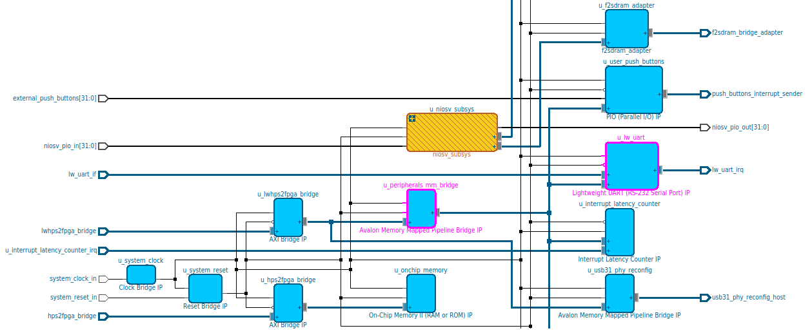{:style="width:60%; display:block; margin-left:auto; margin-right:auto"}

2. **Connect Lightweight UART IP in `baseline_top`:**  
   Create and execute `baseline_top-vds-edit.tcl`. This script exports the serial TX/RX interfaces to the project top-level and routes the interrupt line to HPS fabric interrupt input `f2h_irq0[2]`:

   
   ```bash
   cat << 'EOF' > $CWD/baseline_top-vds-edit.tcl
   load_package vds
   project_open top -r baseline_a55
   vds::open_system baseline_top
   vds::sync_system_info
   # Export Lightweight UART TX/RX interface to top level 
   vds::export_interface_pins u_fabric_subsys|lw_uart_if lw_uart_if
   # Connect interrupt to HPS
   vds::connect_interface_net -dest u_shell_subsys|f2h_irq0_in -src u_fabric_subsys|lw_uart_irq 
   vds::set_interrupt_irq -connection u_shell_subsys.f2h_irq0_in/u_fabric_subsys.lw_uart_irq 2
   vds::validate_system
   vds::save_system baseline_top
   vds::close_system baseline_top
   project_close
   EOF
   ```
   

   Run the script in your host terminal:

   
   ```bash
   quartus_sh -t $CWD/baseline_top-vds-edit.tcl
   ```
   

### Top-Level Wrapper Modification

Modify the top-level SystemVerilog wrapper (`baseline_a55.sv`) to connect an internal loopback wire between the TX and RX channels, allowing verification without external cabling.

1. **Insert Loopback Connections and Port Mappings:**  
   Run the following command to back up `baseline_a55.sv`, declare the internal loopback signals, and wire them to the `baseline_top` instance:

   
   ```bash
   cd $CWD
   cp baseline_a55.sv baseline_a55.sv.bak
   awk '/^[[:space:]]*baseline_top[[:space:]]+u_baseline_top/{print "    // lw_uart ip signals\n    wire fpga_lw_uart_rxd;\n    wire fpga_lw_uart_txd;\n\n    // lightweight uart core loopback\n    assign fpga_lw_uart_rxd = fpga_lw_uart_txd;\n"} /^[[:space:]]*\.niosv_pio_out_export/{sub(/\)/, "),"); print; print "        //\n        // Lightweight Uart\n        .lw_uart_if_rxd                     (fpga_lw_uart_rxd),\n        .lw_uart_if_txd                     (fpga_lw_uart_txd)"; next} {print}' baseline_a55.sv > tmp && mv tmp baseline_a55.sv
   ```
   

   This inserts the internal loopback assignment directly above the `baseline_top` instantiation:

   ```verilog
   // lw_uart ip signals
   wire fpga_lw_uart_rxd;
   wire fpga_lw_uart_txd;
   // lightweight uart core loopback
   assign fpga_lw_uart_rxd = fpga_lw_uart_txd;
   ```

   It also maps the exported interface signals at the bottom of the `u_baseline_top` port list:

   ```verilog
   // Lightweight Uart
   .lw_uart_if_rxd                     (fpga_lw_uart_rxd),
   .lw_uart_if_txd                     (fpga_lw_uart_txd)
   ```

2. **Recompile the Hardware Design:**  
   Clear previous synthesis caches and run a full compilation to generate the updated FPGA configuration bitstream:

   
   ```bash
   # Remove previous compile results
   rm -rf output_files qdb tmp-clearbox dni
   # Recompile the design
   make baseline_a55-build
   ```
   

---

## U-Boot Enablement


Validate the custom hardware design at the lowest software execution layer before loading an operating system. Using the standalone "Roll Your Own" (RYO) flow to build U-Boot and Arm Trusted Firmware, you will package a bare-metal test script to execute raw register writes and reads across the Lightweight AXI Bridge. This low-level verification isolates FPGA timing, address decoding, and loopback routing issues before bringing up Linux memory management and interrupt subsystems.

### Build and Boot U-Boot

#### RYO Toolchain and Environment Setup

Navigate to the RYO directory and configure the Arm64 cross-compiler:


```bash
cd $CWD/software/ryo_linux
wget https://developer.arm.com/-/media/Files/downloads/gnu/14.3.rel1/binrel/\
arm-gnu-toolchain-14.3.rel1-x86_64-aarch64-none-linux-gnu.tar.xz
tar xf arm-gnu-toolchain-14.3.rel1-x86_64-aarch64-none-linux-gnu.tar.xz
rm -f arm-gnu-toolchain-14.3.rel1-x86_64-aarch64-none-linux-gnu.tar.xz
export PATH=$(pwd)/arm-gnu-toolchain-14.3.rel1-x86_64-aarch64-none-linux-gnu/bin/:$PATH
export ARCH=arm64
export CROSS_COMPILE=aarch64-none-linux-gnu-
```


#### Arm Trusted Firmware Compilation

Clone the Altera Arm Trusted Firmware (TF-A) repository and compile the runtime firmware (`bl31.bin`):


```bash
git clone -b QPDS26.3_REL_BASELINE_PR https://github.com/altera-fpga/arm-trusted-firmware arm-trusted-firmware
cd arm-trusted-firmware
make clean
make -j "$(nproc)" PLAT=agilex5 bl31
cd ..
```


#### U-Boot Configuration and Compilation

1. Clone the U-Boot repository and configure debug visibility:
   
   ```bash
   git clone -b QPDS26.3_REL_BASELINE_PR https://github.com/altera-fpga/u-boot-socfpga u-boot-socfpga
   cd u-boot-socfpga
   sed -i 's/PLATFORM_CPPFLAGS += -D__ARM__/PLATFORM_CPPFLAGS += -D__ARM__ -gdwarf-4/g' arch/arm/config.mk
   ```
   

2. Link the compiled Arm Trusted Firmware binary into the U-Boot build directory:
   
   ```bash
   ln -sf "../arm-trusted-firmware/build/agilex5/release/bl31.bin"
   ```
   

3. Configure the device tree to boot from SD card and disable unused NAND controllers:
   
   ```bash
   # Configure for SD card boot
   sed -i 's/u-boot,spl-boot-order.*/u-boot,spl-boot-order = \&mmc;/g' arch/arm/dts/socfpga_agilex5_socdk-u-boot.dtsi
   # Disable NAND in device tree
   sed -i '/&nand {/!b;n;c\\tstatus = "disabled";' arch/arm/dts/socfpga_agilex5_socdk-u-boot.dtsi
   ```
   

4. Create a configuration fragment to define the standalone boot command and expand flash vendor support:
   
   ```bash
   cat > config-fragment << 'EOF'
   CONFIG_BOOTFILE="Image"
   CONFIG_NAND_BOOT=n
   CONFIG_SPL_NAND_SUPPORT=n
   CONFIG_CMD_NAND_TRIMFFS=n
   CONFIG_CMD_NAND_LOCK_UNLOCK=n
   CONFIG_NAND_DENALI_DT=n
   CONFIG_SYS_NAND_U_BOOT_LOCATIONS=n
   CONFIG_SPL_NAND_FRAMEWORK=n
   CONFIG_CMD_NAND=n
   CONFIG_MTD_RAW_NAND=n
   CONFIG_CMD_UBI=n
   CONFIG_CMD_UBIFS=n
   CONFIG_MTD_UBI=n
   CONFIG_ENV_IS_IN_UBI=n
   CONFIG_UBI_SILENCE_MSG=n
   CONFIG_UBIFS_SILENCE_MSG=n
   CONFIG_DISTRO_DEFAULTS=n
   CONFIG_HUSH_PARSER=y
   CONFIG_SYS_PROMPT_HUSH_PS2="> "
   CONFIG_USE_BOOTCOMMAND=y
   CONFIG_BOOTCOMMAND="echo Agilex 5 U-Boot prompt ready"
   CONFIG_BOOTDELAY=1
   CONFIG_CMD_FAT=y
   CONFIG_CMD_FS_GENERIC=y
   CONFIG_DOS_PARTITION=y
   CONFIG_SPL_DOS_PARTITION=y
   CONFIG_CMD_PART=y
   CONFIG_SPL_CRC32=y
   CONFIG_LZO=y
   CONFIG_CMD_DHCP=y
   CONFIG_SPI_FLASH_MACRONIX=y
   CONFIG_SPI_FLASH_GIGADEVICE=y
   CONFIG_SPI_FLASH_WINBOND=y
   CONFIG_SPI_FLASH_ISSI=y
   # Allow 'source' to run a legacy mkimage script instead of requiring a signed FIT
   CONFIG_BOOTSCR_FIT_SIGNATURE=n
   EOF
   ```
   
 
5. Merge the configuration fragment and compile U-Boot:
   
   ```bash
   make clean && make mrproper
   make socfpga_agilex5_defconfig 
   ./scripts/kconfig/merge_config.sh -O . -m .config config-fragment
   make -j "$(nproc)"
   cd ..
   ```
   

#### Boot Artifact Deployment and SD Card Creation

Generate the configuration files for QSPI flash memory (`.jic`) and the FPGA fabric (`.rbf`):


```bash
cd $CWD
quartus_pfg -c output_files/baseline_a55.sof output_files/baseline_a55_u-boot.jic \
  -o device=MT25QU128 \
  -o flash_loader=A5ED065BB32AE4S \
  -o hps_path=software/ryo_linux/u-boot-socfpga/spl/u-boot-spl-dtb.hex \
  -o mode=ASX4 \
  -o hps=1
```


This command generates `$CWD/output_files/baseline_a55_u-boot.core.rbf` and `$CWD/output_files/baseline_a55_u-boot.hps.jic`.

Create an SD card image containing U-Boot proper and the FPGA bitstream:


```bash
cd $CWD/software/ryo_linux
dd if=/dev/zero of=sdcard.img bs=1M count=64
mformat -i sdcard.img :: -F
mcopy -i sdcard.img ./u-boot-socfpga/u-boot.itb ::
mcopy -i sdcard.img ../../output_files/baseline_a55_u-boot.core.rbf ::
```


### Lightweight UART IP Sanity Check

#### Automated Script Preparation

!!! warning "U-Boot Configuration and Compilation - Step 4: config-fragment"
    `CONFIG_BOOTSCR_FIT_SIGNATURE=n` turns off U-Boot's requirement to run only a signed FIT script. The Agilex 5 defconfig enables CONFIG_BOOTSCR_FIT_SIGNATURE, so a legacy `mkimage -T` script image is rejected with `Legacy boot script rejected: signed FIT required` message. With the option cleared, source accepts that legacy script again (`hw_sanity_check.scr`). SPL and kernel FIT signature checks stay enabled.

Unpack and compile the U-Boot verification script `hw_sanity_check.scr`:


```bash
base64 -d <<'EOF' | gunzip > "hw_sanity_check.scr.txt"
H4sICAgewGoAA2h3X3Nhbml0eV9jaGVjay5zY3IudHh0AMVUW2/aMBh996/4Rit1l6YKHbRTWB8Y
gzYSKlFCL2/IJF/AWm5zHEpX8d/nhJALKdrWl/nN9nc55/j4O4Krty5yBP1rfTx8hC7cGJYynSgj
47oP90NTH+mD/lSf3II1MHVjKkONhEdhjBroAROMeuwXQhp+Ct84cxYYnwINHJhiLOCub05BN2Ac
Lpgtc98OkaC9DKGlKAoYN31rCG0t6wqDMHDZIuFUsDAAed8iLhVeSB3wfRtUrQ3HL+mWOg7fwJzG
6LEAZ7TbnSXKPAzFmR1yPONzl7jRgkKWqtaSjl9c5mEsmW4ImWcsAQM695DEHmIE7Ryefjua5LhS
DXJBKko5LSJlKFmca2A9xwJ90L/DPXLmMrtgQmIUuI442EsWzZgDH9X1uaq2VbkIc4EJqfGZBy11
ffySx2xaUmRQ1yptX2L7nBKxxICAXFuE1t1gMLQsTerGEVwq2dgVCD4V9hLel/kfWgS9GCsVhqY5
MauwfRZnae/AROpoUENDXFZn/FnbusISVCQxGByVwRLtHzXCcXY547goOdMvDc5lWEE7WxfqQdrV
3iYumCQh9fWQBinrC/Ug31cTHcbFc5V3FVGDeievMg7DaE4l5Qcu6Wx/Ssq+tLjswwULFtBRHkLu
5IEW/kwwsHHr8lSrYAUr6kn75ZunNG7myfpw4j9JmQrxOtLEMnQD7V7OC7KqsskWeXrZ6sHuBdKy
ecanNGcn/e7w6xV0epCqDDwJKo174LITUj8jFbBNqMUfqonV1cB8hJE+msAYV+jBvfxATvNv8LXL
3HDmrbzSKvOmVcqwulXUzkGr1NtzpPYSHejAk3yR+JBN6kmvfY0qkoZFLvYtkub9jUOyuP0BUphE
KoW2kOgLp0g6Tm6UYsoknGMgZunTl79OLd++GDVl4FbM7HTXI3VR5oudzYx+pmYKsJEtzShlLEJH
fX2swXCHtlb2FK5D8VoFl5W2LYhWEhsGLm/2XFyIUpq4OCL7Wu72FTQNceuPe1mfIiMWUO+/DT+O
IuGBVEqE/zz/OPqUpbl/nn8Vx9qcRUI+LtpJZtBB6Eee5Lx16m99bcKMwAgAAA==
EOF
```


Compile the U-Boot script into a binary and copy it to the SD card filesystem:


```bash
# Wrap plain-text script in U-Boot image header
mkimage -A arm64 -O linux -T script -C none -a 0 -e 0 \
  -n "Hardware Sanity Check Script" -d hw_sanity_check.scr.txt hw_sanity_check.scr
# Stage binary onto FAT partition
mcopy -i sdcard.img ./hw_sanity_check.scr ::
```


!!! tip
    To view the staged files inside the disk image without mounting it, run: `7z l sdcard.img`


#### SD Card Image Deployment and Board Programming

Write `sdcard.img` to your MicroSD card:

```bash
sudo dd if=./sdcard.img of=/dev/sdX bs=1M status=progress
sync
```

Program the updated U-Boot `.jic` bitstream to onboard QSPI flash memory:

1. Power off the development board.
2. Set the MSEL DIP switch (`SW27`) to **JTAG Mode**: `OFF / OFF / OFF / OFF`.
3. Power on the development board.
4. Program the flash memory:

```bash
cd $CWD
jtagconfig --setparam 1 JtagClock 16M
quartus_pgm -c 1 -m jtag -o "pvi;output_files/baseline_a55_u-boot.hps.jic"
```

Boot into the standalone U-Boot environment:

1. Power off the board.
2. Set the MSEL DIP switch (`SW27`) to **Active Serial x4 (ASx4) Mode**: `OFF / ON / ON / OFF`.
3. Power on the board and verify that the message `Agilex 5 U-Boot prompt ready` appears on the serial console.

#### Script Execution and IP Verification

Run the automated verification script from the U-Boot prompt:

```bash
# Load script from SD card into RAM at address 0x90000000
fatload mmc 0:1 0x90000000 hw_sanity_check.scr 
# Execute script
source 0x90000000
```

The script runs the following sequence:

1. Loads `baseline_a55_u-boot.core.rbf` into memory, configures the FPGA fabric, and opens the HPS-to-FPGA bridges.
2. Reads and confirms the System ID peripheral value matches `0x0a17e12a`.
3. Reads the UART status register to confirm an idle state.
4. Writes 4 words into the UART TX FIFO.
5. Reads the RX FIFO fill level to confirm 4 words were captured across the internal loopback.
6. Pops the 4 words from the RX FIFO and verifies data integrity.

Expected output:

```text
## Executing script at 90000000
--- PHASE 1: FPGA Configuration ---
2195456 bytes read in 123 ms (17 MiB/s)
...FPGA reconfiguration OK!
INFO: FPGA and Bridges Initialized
SUCCESS: Core fabric System ID match (0x0a17312a)
SUCCESS: UART Status Register clean (0x60)
--- Starting 4-Word Write Sequence ---
  Writing: 0x1
  Writing: 0x2
  Writing: 0x3
  Writing: 0x4
SUCCESS: RX FIFO Level reached 4 words
--- Starting 4-Word Read Verification ---
  PASS: Read 0x1
  PASS: Read 0x2
  PASS: Read 0x3
  PASS: Read 0x4
SUCCESS: UART Status returned to clean (0x60)
--- Script Execution Complete ---
```

---

## Level 2: Linux Integration and Testing


Now that hardware loopback and address decoding have been verified in U-Boot, this section integrates the peripheral into the Linux kernel environment. You will declare the hardware node in the Linux Device Tree, configure the kernel command line to bind the peripheral to the `uio_pdrv_genirq` driver, compile UIO support as built-in kernel modules, and rebuild the Yocto image. Once booted, you will use `devmem2` to confirm that the operating system maps and addresses the custom registers correctly through kernel virtual memory.

### Updating the Device Tree and Boot Arguments

#### Device Tree Fragment Modification

Navigate to the Yocto directory to begin software integration:


```bash
cd $CWD/software/yocto_linux
```


Add the device tree node for the Lightweight UART to `baseline_a55.dts`:


```bash
sed -i '/dipsw_pio: gpio@20010070/,/^[[:space:]]*};/ {
  /^[[:space:]]*};/ a\
\n\t\t// LW UART\n\t\tlw_uart: lw_uart@200100a0 {\n\t\t\tcompatible = "generic-uio";\n\t\t\treg = <0x200100a0 0x20>;\n\t\t\treg-names = "lw_uart_csr";\n\t\t\tinterrupt-parent = <&intc>;\n\t\t\tinterrupts = <0 19 4>;\n\t\t\tstatus = "okay";\n\t\t};
}' ./meta-custom/recipes-kernel/linux/device-tree/baseline_a55.dts
```


This appends the following node to the device tree:

```dts
    // LW UART
    lw_uart: lw_uart@200100a0 {
        compatible = "generic-uio";
        reg = <0x200100a0 0x20>;
        reg-names = "lw_uart_csr";
        interrupt-parent = <&intc>;
        interrupts = <0 19 4>;
        status = "okay";
    };
```

This configuration uses the `generic-uio` compatible string to bind the peripheral to the kernel's UIO generic platform driver. The `reg` property defines a base address of `0x200100a0` with a `0x20` byte window, and the `interrupts` property defines GIC SPI vector `19`, corresponding to the `f2h_irq0[2]` connection configured in VDS.

#### Boot Argument Configuration via KAS

The Linux kernel platform driver `uio_pdrv_genirq` requires an explicit Open Firmware match string passed via kernel boot arguments to bind to device tree nodes using the generic compatible string. Rather than manually updating dynamic U-Boot environment variables at runtime, define a persistent KAS configuration overlay to inject these kernel parameters during image assembly.

1. **Create the KAS Configuration Overlay:**  
   Write the overlay file `yocto_linux/sd_bootargs.yml` to define the primary boot source and append the required driver identifier (`uio_pdrv_genirq.of_id=generic-uio`) to the default SD/MMC kernel command line:
   
   ```bash
   base64 -d <<'EOF' | gunzip > "sd_bootargs.yml"
   H4sICFLKzmoCA3NkX2Jvb3RhcmdzLnltbAA9jE0LgkAURff+iod7U9sEgos0aVEmOLV+jOOYQ+rY
   84ugH99k0PLec+6tJS8lBRbALGlQugvA31mNFrxBobsK679QaD06g55IyADepgBgLDpjlGVXZNkt
   jxMIwW5b4dkrPSX5JfnxfX5kyA6YpvHXkZyal7mHnndKhI4PZM5Dt5Sza/ZF8/D6LdCy1gtXI0xK
   Y1/SjHfZKXpudIWqDE2QpIRjqG19AHCz0w3LAAAA
   EOF
   ```
   

2. **Validate the Configuration Merge:**  
   Confirm that the KAS tool merges the overlay into the base configuration and sets `KERNEL_BOOTARGS_SD_MMC` correctly before proceeding to image compilation:

   ```bash
   kas dump --skip repos_checkout kas.yml:sd_bootargs.yml | grep -A2 KERNEL_BOOTARGS_SD_MMC
   ```

   Expected output:

   ```text
   KERNEL_BOOTARGS_SD_MMC = "earlycon panic=-1 root=/dev/mmcblk0p2 rw rootwait uio_pdrv_genirq.of_id=generic-uio"
   ```

!!! warning
    All future kas operations must append `kas.yml` and `sd_bootargs.yml`. Building KAS using `kas.yml` produces a generic baseline image without the custom bootargs.

### User Space I/O (UIO) Built-in Kernel Module

Enable the Userspace I/O (UIO) framework to grant userspace applications direct register access and interrupt handling for custom FPGA fabric IP without developing dedicated in-kernel drivers. Compiling `CONFIG_UIO` and `CONFIG_UIO_PDRV_GENIRQ` directly into the kernel image (`=y`) rather than as loadable modules ensures that fabric peripherals automatically match the Device Tree Open Firmware table during early boot, eliminating manual runtime `modprobe` steps.

To integrate UIO driver support directly into the kernel image via Yocto configuration fragments, execute the following steps:

1. **Generate the Kernel Configuration Fragment:**  
   Create the configuration fragment file `fragment.cfg` setting both required UIO symbols to built-in (`=y`):
   
   ```bash
   cat > $CWD/software/yocto_linux/fragment.cfg << 'EOF'
   CONFIG_UIO=y
   CONFIG_UIO_PDRV_GENIRQ=y
   EOF
   ```
   

!!! note
    This configuration fragment defines the delta normally generated by running interactive `bitbake -c menuconfig linux-socfpga-lts` and `bitbake -c diffconfig linux-socfpga-lts` commands. Generating the fragment directly avoids launching an interactive menu configuration session. Refer to `$CWD/software/yocto_linux/meta-custom/recipes-kernel/linux/README.md` for complete kernel configuration workflows.

2. **Stage the Configuration Fragment:**  
   Copy `fragment.cfg` into the `meta-custom` kernel recipe configuration directory:
   
   ```bash
   cp $CWD/software/yocto_linux/fragment.cfg \
      $CWD/software/yocto_linux/meta-custom/recipes-kernel/linux/linux-socfpga-lts/configs/
   ```
   

3. **Create the Kernel Feature Definition:**  
   Generate `fragment.scc` inside the recipe configuration directory to register the configuration fragment with the Yocto kernel tooling:
   
   ```bash
   echo "kconf non-hardware fragment.cfg" > \
      $CWD/software/yocto_linux/meta-custom/recipes-kernel/linux/linux-socfpga-lts/configs/fragment.scc
   ```
   

4. **Append the Feature to the Kernel Recipe:**  
   Locate the active `linux-socfpga-lts_%.bbappend` recipe append file and append `fragment.scc` to `SRC_URI`:
   
   ```bash
   KRX=$(find "$CWD/software/yocto_linux/meta-custom/recipes-kernel" -name "linux-socfpga-lts_%.bbappend") && [ -n "$KRX" ] && echo "$KRX"
   echo 'SRC_URI:append = " file://fragment.scc"' >> "$KRX"
   ```
   

!!! note
    Because these steps apply the kernel configuration fragment directly from your host shell, you do not need to launch an interactive BitBake menu session (`kas shell`) or enter a BitBake subshell.

### Yocto Image Assembly

Integrate the compiled FPGA fabric configuration bitstream and the functional secondary bootloader into the Yocto image before flashing target storage media. This stage copies the updated core Raw Binary File (`.rbf`) into the recipe layer, compiles the complete Linux root filesystem alongside the production First Stage Bootloader (FSBL) via KAS, and regenerates the non-volatile QSPI programming file (`.jic`).

1. **Stage the Core Hardware Bitstream:**  
   Copy the updated core configuration RBF into the FPGA bitstream recipe directory, matching the target filename expected by the recipe layer:
   
   ```bash
   cp $CWD/output_files/baseline_a55_u-boot.core.rbf \
      $CWD/software/yocto_linux/meta-custom/recipes-fpga/fpga-bitstream/files/baseline_a55.core.rbf
   ```
   

2. **Assemble the Linux System Image:**  
   Execute BitBake within the KAS shell environment using the SD boot configuration overlay:
   
   ```bash
   cd $CWD/software/yocto_linux
   source venv/bin/activate
   kas shell kas.yml:sd_bootargs.yml -c "bitbake gsrd-console-image"
   ```
   

   Upon completion, BitBake writes the final deployment deliverables to `$CWD/software/yocto_linux/build/tmp/deploy/images/agilex5e/`:

   - `gsrd-console-image-agilex5e.rootfs.wic` (Complete bootable SD card image)
   - `u-boot-spl-dtb.hex` (Production FSBL)

3. **Deactivate the Python Build Environment:**  
   Exit the isolated virtual environment once image compilation finishes:
   
   ```bash
   deactivate
   ```
   

4. **Generate the Production QSPI Configuration File:**  
   Re-run the Quartus Programming File Generator (`quartus_pfg`) to replace the intermediate dummy FSBL with the production `u-boot-spl-dtb.hex` binary, generating the final `.jic` bitstream for QSPI flash memory:
   
   ```bash
   cd $CWD
   quartus_pfg -c output_files/baseline_a55.sof output_files/baseline_a55.jic \
     -o device=MT25QU128 \
     -o flash_loader=A5ED065BB32AE4S \
     -o hps_path=software/yocto_linux/build/tmp/deploy/images/agilex5e/u-boot-spl-dtb.hex \
     -o mode=ASX4 \
     -o hps=1
   ```
   

!!! note
    When executing `quartus_pfg` with `-o hps=1` for Active Serial x4 (ASX4) configuration, the tool automatically appends the `.hps.jic` extension to produce `$CWD/output_files/baseline_a55.hps.jic` for QSPI programming.


### Hardware Verification

#### Hardware Reprogramming

Flash the updated WIC image to the MicroSD card:

```bash
sudo dd if=./build/tmp/deploy/images/agilex5e/gsrd-console-image-agilex5e.rootfs.wic of=/dev/sdX bs=1M status=progress
sync
```

Program the updated `.jic` file to onboard QSPI flash memory:

1. Power off the development board.
2. Set the MSEL DIP switch (`SW27`) to **JTAG Mode**: `OFF / OFF / OFF / OFF`.
3. Power on the board.
4. Run the programmer:

```bash
jtagconfig --setparam 1 JtagClock 16M
quartus_pgm -c 1 -m jtag -o "pvi;output_files/baseline_a55.hps.jic"
```

Boot the updated system into Linux:

1. Power off the board.
2. Set the MSEL DIP switch (`SW27`) to **Active Serial x4 (ASx4) Mode**: `OFF / ON / ON / OFF`.
3. Power on the board and log in as `root` (no password required).

### Driver and IP Verification

Verify that the FPGA fabric logic is active, memory-mapped peripherals are accessible across the HPS bridges, and Userspace I/O (UIO) drivers are bound correctly. This sequence validates the hardware design identity through the System ID component, checks the UIO sysfs registration for the fabric UART, and confirms the active kernel boot arguments.

1. **Verify FPGA System ID Peripheral:**  
   Confirm the compiled hardware version and fabric design identity by reading the memory-mapped System ID register at address `0x20010000` via `devmem2`:

   ```bash
   devmem2 0x20010000 w
   ```

   The read operation returns the 32-bit hardware fingerprint:

   ```text
   /dev/mem opened.
   Memory mapped at address 0x7fa53f2000.
   Value at address 0x20010000 (0x7fa53f2000): 0x0A17E12A
   ```

   Expected output confirms the fingerprint signature `0x0A17e12A`.

2. **Verify UIO Framework Registration:**  
   Query the sysfs class interface to confirm the kernel has recognized and registered the lightweight UART fabric core under the UIO subsystem:

   ```bash
   cat /sys/class/uio/uio0/name
   ```

   Expected output:

   ```text
   lw_uart@200100a0
   ```

3. **Verify Kernel Boot Arguments:**  
   Check the active kernel command line to ensure the UIO driver ID match string was passed during bootloader handoff:

   ```bash
   cat /proc/cmdline
   ```

   Expected output:

   ```text
   earlycon panic=-1 root=/dev/mmcblk0p2 rw rootwait uio_pdrv_genirq.of_id=generic-uio
   ```

!!! tip
    If `cat /sys/class/uio/uio0/name` returns no file or directory, inspect `dmesg | grep -i uio` to confirm whether the device tree node matching `generic-uio` successfully probed during early kernel initialization.

### Register-Level Loopback Testing

Test 32-bit register reads and writes across the fabric UART loopback using `devmem2` through the Lightweight HPS-to-FPGA (LWH2F) bridge interface. By pushing a test byte into the transmit FIFO and reading it back from the receive FIFO, you verify fabric clocking, address decoding, and data path integrity.

1. **Transmit Test Character Pattern:**  
   Write data byte `0x0E` into the transmit FIFO (`TXFIFO`) register. The register is mapped at base address `0x200100a0` with offset `0x04` (target address `0x200100a4`):

   ```bash
   devmem2 0x200100a4 w 0x0e
   ```

2. **Verify Receive FIFO Fill Level:**  
   Read the receive FIFO fill level register (`RXFIFO_LVL`) at address `0x200100b8` to confirm that the loopback logic captured the transmitted byte:

   ```bash
   devmem2 0x200100b8 w
   ```

   The operation returns a 32-bit word showing a fill depth of one entry:

   ```text
   /dev/mem opened.
   Memory mapped at address 0x7fa5411000.
   Value at address 0x200100B8 (0x7fa54110b8): 0x1
   ```

   Expected value is `0x1`.

3. **Read Captured Character from Receive FIFO:**  
   Read the captured data word from the receive FIFO (`RXFIFO`) register at address `0x200100a0`:

   ```bash
   devmem2 0x200100a0 w
   ```

   The returned value `0xE` (or `0x0000000E`) confirms that data flowed through the fabric loopback and the UIO-mapped register interface is functioning.

---

## Level 3: Application Development & Deployment

Develop, deploy, and debug a userspace C application that interfaces with the custom FPGA fabric UART via the Userspace I/O (UIO) subsystem. By cross-compiling an application that leverages `mmap()` for physical register access and blocking `read()` calls for interrupt servicing, you can validate end-to-end peripheral control, attach a remote GDB session using the Ashling RiscFree IDE, and package the final binary into a deployable Yocto recipe.

### Implementing the UART BIST Application

#### Host Environment and Toolchain Setup

Create an application workspace directory on your host workstation:


```bash
cd $CWD/software
mkdir apps
cd apps
```


Reuse the Arm64 cross-compiler installed in [RYO Toolchain and Environment Setup](#ryo-toolchain-and-environment-setup). Verify that the cross-compiler is active in your environment:


```bash
echo "ARCH:          ${ARCH:-NOT SET}"
echo "CROSS_COMPILE: ${CROSS_COMPILE:-NOT SET}"
echo "PATH Tool:     $(command -v ${CROSS_COMPILE}gcc || echo "TOOL NOT FOUND IN PATH")"
```


If any variable returns `-NOT SET` or the compiler is not found, re-export the toolchain:


```bash
cd $CWD/software/ryo_linux
export PATH=$(pwd)/arm-gnu-toolchain-14.3.rel1-x86_64-aarch64-none-linux-gnu/bin/:$PATH
export ARCH=arm64
export CROSS_COMPILE=aarch64-none-linux-gnu-
cd $CWD/software/apps
```


#### Application Source Files

Create the following three application source files:

1. **`lw-uart-map.h`**:  
   Defines peripheral register offsets and bitmask definitions.
   
   ```bash
   base64 -d <<'EOF' | gunzip > "lw-uart-map.h"
   H4sICIUdwGoAA2x3LXVhcnQtbWFwLmgArZZRb5swEMff8yluilQlD2vJ1rXp1E4iBNaoZDBj2vQJ
   MTCttQwqcNJ+/NkQDMGk66a9hMg/3/3vLn/sDGmSxiQBz7HwnY7MQHddL7DvAl9HOPAXjvy+1N3g
   OhgM+W6akrcHDIY0jdabmMBlwWKasuPHL4PByQkg8kALRnLIkqQgrIAky4E9ErDpwyN7JuITRCbg
   WSEmWxqRY6mPVtbCcgJkfgXtRdPkOt5bP23qxTr2vXp9KtcN5xtGjl0Doytg39ZsMu2KtJhRtbSC
   ecjCprW52E8ZzdICRnMd67MF9uAKpmNwyq6FZktSbOGD827KpizLB+BpZ5RP5/yzJiSuyfqJJ16G
   UZ4By4C8sDyMGMRCN8mzXxDC5Oz9D8ogr6vISRhLEXOFkW7gAK0CoTbiu8YwKh9HrQLGZUP4nxo6
   bQ3q7zt6yslTmBPex3NOGYFtuN4QmdFFpitsh1di9CPRtii/fB7hbv0eC9mmaMrnunstNDVPFafo
   lm/bMJr4cHkJk09jZcMeP1W5b0r6UaGm40r6QaEGH2pNJwqdt7E2HlQDhQugotWC5FsSK3p1wFQt
   FM3va3quUNyiZypd4hqqE8KOVO0ZTwPV6czQTQ3V4VjNXBXmSqZVDvi+odFP0KOIFEXlseqg6ThD
   5ll44s0wly6+r1+N6t1oDWsMV1cifysGvxaDe2Kudf6bIOSg3ghzDO/2tnMzvbKd0zpA9GxkKcuz
   9Vts35x3BkZ2sDjs+h0/ZPod7vd8BQ9YvoSo3/BVYNfvexSjmfTKhSLZ4/pdpf2mr+ABz+9gr+V3
   rNfxO8Vew1es3+8V67V7hRS38wtI3Exgky1Z9//krWuMG902b01bns/ne+fzROs/oB94HnFPr4WI
   TPbVLO+U6mIUWTs3S0tK3i1/rLWxJ/7fteKDteJOrUOSxjQptd78r+c3poVKIFgJAAA=
   EOF
   ```
   

2. **`uio-bist-uart.h`**:  
   Header declaring application prototypes and UIO management structures.
   
   ```bash
   base64 -d <<'EOF' | gunzip > "uio-bist-uart.h"
   H4sICMAdwGoAA3Vpby1iaXN0LXVhcnQuaACdVU1vm0AQvftXjJxLWiW2mx5bVaU2KEjxhwAnUS9o
   DYs9KizW7mLX/fWdXTChxMmhlmzB7sx7bz59hZlIeQbh0ouenMCNndUqjB+e4rUTRPHaX8b38eCK
   LFDw940GVyiSvEo5fFU6RaFHu2+DwXgMAdeVFJCUKVeQlRLIAVCgRpbjH6axFKOWwoD5Cz+K3SBY
   BnD76fVNuJ5O3TCEyaC9c5/p3HP8h3Xgdn3secee1Mx4xqpcQ1GwPZRZprh+YZ/PnVW89LzQjRrz
   H0xZakj5ARMOe6Z3JB7USWXqX9kz9zFeOdE9DMd0O05yptS4wtJ8J8OG3IKgoDQUNnLIMKe0vI24
   cOYuDPNjXDGpv99NJp8mE0ZwXTvPf3Brw54OwQp+wfTRDUJ/uehbH7hUJOmCg/voLqJ4ulwvor4T
   P3Ch6+jmvCjlCUxiJ8C0lripNO/FRBme1L49IHJT5qcXm7V3ZrOg5z0cszSVQzAf4l7tTgoTloPS
   lCcwd1xdog79n+4rKIV/eAsV0gt1BugdN7HsUWxNfTany7E07dKHrFtraACX9hGOqHeEY2D3bMsv
   QLUl7ALZGrbaKKkkx5wBtRduBU+NuFkUjmwNIkJnia4oE8mOSXrk8ty7gibQDqDp/esP/wqY3juB
   KQcxknmnZ/3zpFKbGu12GCRSs4xeplu9Hk/qbVUlCVXhpj/VJeHIIyrKAe2Jz3exhjWWhug6KYXS
   VvrHRnZsRu7DF6vlSSIVARh8vrvdoIYDyysOuqQTybeoTLBN5Tozy7Q92ZJm0Y78ocTUsFrI6+qs
   o76+gfbAUjT0AWfpK/ZMlsV/8FedyA1uX0JDOc1L1U18gyhSqISZGCjs0I3q2iO9V5S/DQeahZx6
   g2VGEz1DuefSrhyKQNJ9WexzrvlLJtzflP+G9pFLzE5E22jvcGOtJj+C2Ujgr2qA2oNgFtSb1+ao
   kzTKT/Ds+d4SaFnQiqiExtzC2EOC5MVen2okL6/ULvjtYVa+kRQLeZZVvGyd886xPUIpKtgvbuwK
   48QODHO2yc36tc5JJSXJAZVQamw99loS1ZbrmNo/JsS43WKdxoSP5sZ05Q10T1tbo/KKixSzembf
   +9f8C7DFMK2ABwAA
   EOF
   ```
   

3. **`uio-bist-uart.c`**:  
   Application source file containing memory-mapping logic, register accessors, and the interrupt service thread.
   
   ```bash
   base64 -d <<'EOF' | gunzip > "uio-bist-uart.c"
   H4sICLMdwGoAA3Vpby1iaXN0LXVhcnQuYwC1WvtT20gS/p2/osNWwCaOMSS7m4JlqxwwG9cRzNkm
   yd3unmssjWxVZEknjTDsXv736+556IF51NUeVTw8munpx9ffdI/Y3/trv7ZgD86HFwO47H8cHMFK
   hHHXg9b1cAQXSZLOhfcVdmAYK5llRapgKnMF/TSNQk+oMInbJIC+zwaT0/HwajocXR7RZ5guwxxE
   ORNuRBT6Qskc1FJCUMQeDeOguoMkAAFRuFiqtaSf0IrWbbjuj6cwvGL54CWZhCIP4wWvvwjj4hau
   c5nlqfAkDPdHrHYb/Cy8kRkEmVjJdZJ97cJQoWFpDunyLkdtIi1wKTJ/LVBoJhdhjgbmEMYqwT1w
   NQvtAAoKgxBV9uVNiLsIpbJwXpARN6GA/C4P8o4WJ2IfsiJGm2GO02TGVrlNcInKuzjzL/3a3/ou
   jL2o8CVsF2Hyeo6GvC5EprrL7cqjaM2Dr9EL9KB88lOaRFF3+XNlJPBi1RjKlR8m94aicN4cyzA6
   jbG7fH+1EnF9tIhRT5/Gtr7zZRDGEjB0s48f+1ezyfCfA+jdHvR6PYD9/caDln7SPkJ8ScjDPyR5
   mQCxkqsEfb4Fj36hQAo3whEjje7oYMxhfofR6cLHMA5XxUpLPYBULOTT0lpv//a+7awYXQ0uZ4Px
   eDSG1wfVaUkq41Yb91ZFhhjBh6gC5lSSbW3h4/Mwkoix3MvCVCUIXvwmo2gZecDgr7uVK0wmj4AK
   wTGt/BRmqkBIC9/PZJ6TTSnliPFKubaEuZPiITphL1XZMSsxjEMVYj7+YVKU13Iydenx2OhOARle
   DqezyfXp6WAyIUvywvNw9075UDshQTnZOsxRc1T5zeFMwXWY0EYtL4mRSrQKWsNZKtSyDX9uscdG
   ZDqpYU0HCOBEO7IyvwOj2fjs87h9jBPCAFo46aQSBy0PIGVntyhLQN6KVYoOx3grHYRtXg4mPg0r
   6NG3La3VR40y9DLr5hjFut+43aU9M8pNI0ZMLmQQuh5NwvxIW5fXFxedOtg7cDUeTWfjQf8M/qP/
   /jweTnGcZ3zojwdnHQg6dZDy8tH5+WQwdT7hfU542Xkf2f6s6RVSAQKBKPStK7woyWUreJ5j9uCD
   sfh1nkoPOdODHJekkC+TIvJhjr6K0GofEBCyC8hcW/elGkQdb31jQH7OQmJaAW8OkdkUnSCFpMQV
   Dsz3cd7duklCn2DGy1uFBV4SBKhSB9wAi3N4Iz6xAcKTyxOITkGbp0lIxx/kCaAOnojJGB+tCPA7
   RpMoknut1k0SYVYhrNwGe232/CuzdbuNweZNrYFjKfx79gVZsnrCwqKSTCSjaaQ2ynj3eapZlU4p
   7HmTO+hwK2I+RDXPMiPwEW8PclgV6DF0DaYDwghEQMrj36iH8PfXFAzK3oyrAbQas8NPYkmCMKRp
   Rs+iO71NldFpbwajrhvqTFlGe3CLpKINt5B/cQKUVrCzA+bj/QxY8X40vZF9bY1uSyovNpFKNUe+
   GQd+opLhDnUVqunFUPs1WgOdxljZaOX1CjThEiuWFg1p+VyX7QUpSWeenBcBYu7Xg8N3vx8bPjro
   lkTJ1QjEKIS9RISZIuICpkyyjQTOqNDrwLahPDYuJXIgTzVpYUC/mHLpSCFLnHRLE5LcPviCyUt+
   vR5bv2n1DruMcVaPlzIf0idti9VgIVXe0kMdPn+TwHxsI8Ol7aaCQYqlhgpaWEWgqmgOh+UIzpnC
   CE8EOp1KL/Pf4m0dXOcAo3xgApg+YUx9pjbtTRcmWPBoqKoMNyYfxXIdUSFA8RIeZUDrNyqSbeyw
   RvLyNHa2bv+WoXbt3zFOPSv5bRdOk1VKCbIO1RKUyNA/7D/jL5KySp0QMu1s8ElbRkjtPeWnMw3I
   VZivhPKWL2Bwi7St0HW7L/NdVBbLi6SI9UdyX+2Mqe7XMZY9DQejyvbw8nx0VE0LBoaptP0jGy8n
   tqRKZMXxl/Ph+QhkrDKiCiQ19j8PYnrJVarudFadR0W+HN+eh0GymR7r+pxGUlD5ijuwtC6FhXRf
   L4lxWpZptQKzi08XeDD/UuX2xoza02MdWV/Oi4Xb2NiCJe3L3uEXLGnpj3df2PpSSEcvHXyZjvun
   WA18mZ31p/2mPjjxldWk7jPLQauycrFdDB+uGOSV+MrkuqJF4gahLOZcHvFir8jwnFOQe0gEfPQg
   WaIvEZMzrKZmKHHm+qJaWUdPdI1WHXVzdRh4MCiiiKf+evj9D7+Tt8p99KlYyY9TEpYVngJacQSy
   u+h2YJ9aDS8Seb6PWtF3b58OLPrR29e+wfV5bNzvtnSE40aQc7Zf5vsvcwxEaUOpNyti2NkRbEVe
   lVxfBE1SLTnKVfdOdKMO7VW59EpkeAYu5a3xSGuJsYvMWb3bu91FYGEXcguiUMmKCnw8fO/almJz
   rFzQRjItukXDdkz5g3Rx8HxaTVkJk6JVjxg9g+qRaKyolTwDzlyuqVzpUDYHdP9QOQEJBO9mpkY/
   j8SiCgM8+k6X0vsKawm61Mb2BbsXe0PgJYhbBEmjjAldl4PlnEkuYB/FiT6xM76BsEvmSaaHqYOn
   Uq9+XJvzYA92NcR27SlPTSX4WMIJrBGxLlJrac5p7Bi5uQR8hrJJqXqfA3vwXnqiQE9zb9DWtVXG
   jOwn61jXwNRvo31O3Jyei+yug+JQCS0INeDCe0UprIEzz0J/YXCzoForgWWobcQjixqV+1cjWq39
   WmJqgzEkm5mAq6n+VW921Z9+QCzp6Rrh5C/Kut0jlSjc0JBTJmK0A2GbeEJpwLEpTp+aj7j81I23
   cTk5wPVgaHBYMQHmKPUrtM6EEh08uoUq+OqGJCGjqCyJOiCV18XsVzKKLIxGE1gma4yAtyzbPX3n
   pMtWhSAr3eO8w7cIz/UNTS49Q23I7hFc2d3eC0RCv95h8t1Y4go/JVd4YuZVzxgcinmeRLhn6UTb
   5fjSS3z08vzOVGR0ARZkQpNrkcmOlpZJJJac3Glcgs8NeGlE57JRy1tiRYQHh/OUbRfu+Ye0eLZ/
   aPK2TrX7ZcRHxHAPrVHIUvmRPbfr86D0JjmSz9roVrMYft64YsSAPbJVT7micqg310wwkG5FdQ1F
   WBtAbGwvQcjOU2zkqZxiKm62ws9n5gqvVVpF6w1HxtXazBa3913qhOmrW3O9g0ecEUjnX6W+cg5x
   Vb9m5pyzzKXgEVKs5nJdd0y/7Jtqa8IMztVbt0HJHSDwaXoaXulrVvmayNj48kN/orsyVxNNpv3p
   9aRRn7lj2Bj7uT++rJWhS+z2WTkI8KTJoUgr3qu7qLLBxuqtfF4rnB/Vj4MBMsJU/3PDlvU2krqb
   O6fet7IlmeLhtaC+G65jREoQIXVpo0w1ZxyOJVklQs7ljiwRUFizBWG2Mv03VseaVZ2HuveQM7GU
   YDbBAt3qoIxefIhuTtFGZf1YWWzmVJz7ZHn+0H7PKb/N19MleBVutgAcXw/+F3gaHa8HFAc/5DRE
   iuMmraPjQZ7mQJQwdbdeGzdp3BQ+agD8y6H4erABnQ8RUl1jKqms1hU1XT336lUVv9j4svYYiV6H
   3gHQj0MGYO/2DZibg2kdwQZrDsKRvJGRBq0BMNdcsE4yumvL6ELb7+p+r5oRT6NZS64huPT3dIMP
   Sf1e77kTD5478fC5E9/wxCKPpExb/Nrksaz7f2ScOesenUjH3tunzjnMOacnEbWIkVykvbTguvYR
   fG2gVWeI80N9A+a6unx95FURYV/ToCaqDowHzscS699XsN4/+HFwcNi/B3C+w+JXsHyR1UQ6Ydy+
   VAX8Iai4kguUevc0mOvzWXkCgNWl7SyxPRg2nmKSSvH1V7qs+pOmco7+SD8HOlX737gEQLe0qCYM
   /duT3jH9+ukt/3r1qt2gqc3YLffCRb9vQLHeBOwu3BbyHz+B28nEu3rdj/OeuqXRmKW5CMuGHkbi
   BoTpr4fA+9Fcs2HDrNvCl0hA7sZNZ10HFsiV+m9OPNyx6YgO2WC0/FbB0g9d/V6eaoTyVX3tDfvD
   gKgvag3Hf2/XoWzvWpIoCnwI/Nyigr0aZv+eYV97Agf3hj1sx5StCftocczXSriDLUa4iTHNF4xt
   7dGidyE/4rzx2T/aVaY7HV1Ox6M6fRDu3vVc6fmeXBFFjfeXlFl0z59/5QehM9fo8cvw1JAVv6ag
   W5IdbZi7HNIf28xWzSELi6eLdKOELrGNEhXOeJy59OVXWeORI7F3w87Mp0CajIbI/N+GWVMPu1lL
   82k5/RMD0g0vZdO73Zo6zvUb8pQ8f36uPW+UO0NSE6Hi3CydzJfYh6gn1QWgwpVMCmVd5uddRNUJ
   vc0uR/CgjVWOo1eji4vhpX1E2Z7xjQOBsbWDUzuAzHPoSMHmL836GZvCnR1okcDMSNwxEtvVXAYm
   Whd0hm0t7jzSbh9XVtS9WuaPJ4rFUr2AKV9rUJz1zkfwstBp7eQ5hY3zBrYocY26CTBpZ1tvjlQr
   u+XffD5wKYgdQebftSsCXSZm0pNU8jyL+zYZN7YCLFHV9OO3HeYlb4yF/lzCxehzl221WzvhBs42
   QieVNxWPZ1DpYAMf22FOwgUSHExFCoi5CpXUYPwAYzeyi003l7QEsPq/BjwsxXTRhP8wZ4pjXnMJ
   kKNTAvrvpQDbai4gnkNqGtIlw5+6V6BlK6jl6Def7m7BqfhUTTXCyKHTVon99yTzHwDPuDR4uE/t
   R5ERloo8R9SUdwfR3QOS3Wt//Rb1vyalqAvkJgAA
   EOF
   ```
   

Compile the test binary with debug symbols enabled:

```bash
${CROSS_COMPILE}gcc -g -o uio-bist-uart uio-bist-uart.c
```


#### Binary Deployment and Execution

Boot the development kit into Linux and log in to the serial console before executing the network verification and deployment sequence:

1. **Verify Target Network Configuration:**  
   Determine the IP address assigned to the board's primary network interface (`eth0`) using `ip addr`.

   ```bash
   ip addr show eth0
   ```

   Expected output confirms active link state and DHCP address assignment:

   ```text
   2: eth0: <BROADCAST,MULTICAST,UP,LOWER_UP> mtu 1500 qdisc mq state UP group default qlen 1000
       link/ether ba:3e:b6:00:6e:17 brd ff:ff:ff:ff:ff:ff
       inet 10.244.157.136/24 metric 10 brd 10.244.157.255 scope global dynamic eth0
          valid_lft 1843sec preferred_lft 1843sec
   ```

2. **Deploy Application Binary to Target:**  
   Transfer the compiled binary from your host workstation to the target board over SSH:

   ```bash
   scp uio-bist-uart root@10.244.157.136:/home/root
   ```

3. **Execute Hardware Self-Test Sequence:**  
   From the target serial console, apply execute permissions and run the diagnostic binary:

   ```bash
   chmod ug+x uio-bist-uart
   ./uio-bist-uart
   ```

   The application maps the UIO register space, exercises the internal loopback FIFOs, and asserts the hardware interrupt line:

   ```text
   INFO: UIO device name verified: lw_uart@200100a0
   INFO: UIO Map 0 details:
   INFO:   Physical Addr: 0x20010000
   INFO:   Offset:        0xa0
   INFO:   Size:          0x1000
   INFO: UIO initialization successful.
   INFO: Clearing RX FIFO.
   INFO: UIO device is ready.
   INFO: Starting RX FIFO underflow trigger test.
   INFO: RXFIFO_LVL_REG (0x18): 0x00000000
   INFO: RXFIFO (0x00): 0x0000000F
   INFO: RUE condition detected, clearing flag.
   INFO: Starting RX FIFO level test.
   INFO: RXFIFO_LVL (0x18): 0x00000004
   INFO: RX_FIFO_LVL has the expected value. Flushing RX FIFO for the next test.
   INFO: Clearing RX FIFO.
   INFO: Starting RX FIFO data integrity test (0x0A17E12A).
   INFO: Starting UIO Interrupt (IRQ) test.
   INFO: Triggering IRQ via TX data write...
   INFO: Interrupt caught! Total UIO events: 1
   INFO: Received 0x0F, hardware IRQ line should now be LOW.
   INFO: All tests passed successfully.
   ```

### Hardware Debugging with RiscFree IDE and GDB

#### Remote GDB Server Initialization

Enable a remote debugging session on the host computer to inspect `uio-bist-uart`. This section requires that you have completed the [Implementing the UART BIST Application](#implementing-the-uart-bist-application) section.

1. **Start a serial session** in the development kit.
2. **Navigate to the root directory** where the binary resides:

  ``` bash
  cd /home/root
  ```

3. **Start a `gdbserver` session** with the `uio-bist-uart` app attached to it by executing the following command:

  ``` bash
  gdbserver localhost:1000 uio-bist-uart
  ```

4. **Return to a Linux host terminal** to proceed with the IDE configuration steps.

#### IDE Project Import and Configuration

Return to the Linux host terminal and launch the RiscFree IDE:

``` bash
cd  $CWD/software/apps
RiscFree -data workspace -nosplash &
```

Import the `uio-bist-uart` binary and source code into the RiscFree workspace:

1. On the RiscFree IDE, go to the **File** menu and select **Import...**.
2. In the Import window, select **C/C++ > C/C++ Executable** and select **Next**.

  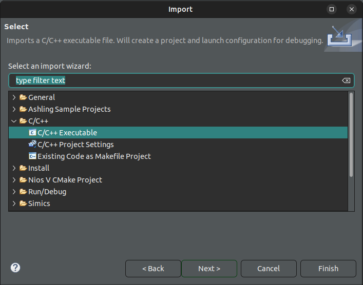{:style="width:45%; display:block; margin-left:auto; margin-right:auto"}

3. In the **Import Executable** window, navigate to **Select executable** and select the **Browse** button.
4. Select the `uio-bist-uart` binary from the file browser.
5. Back in the **Import Executable** window, select **Next**.

  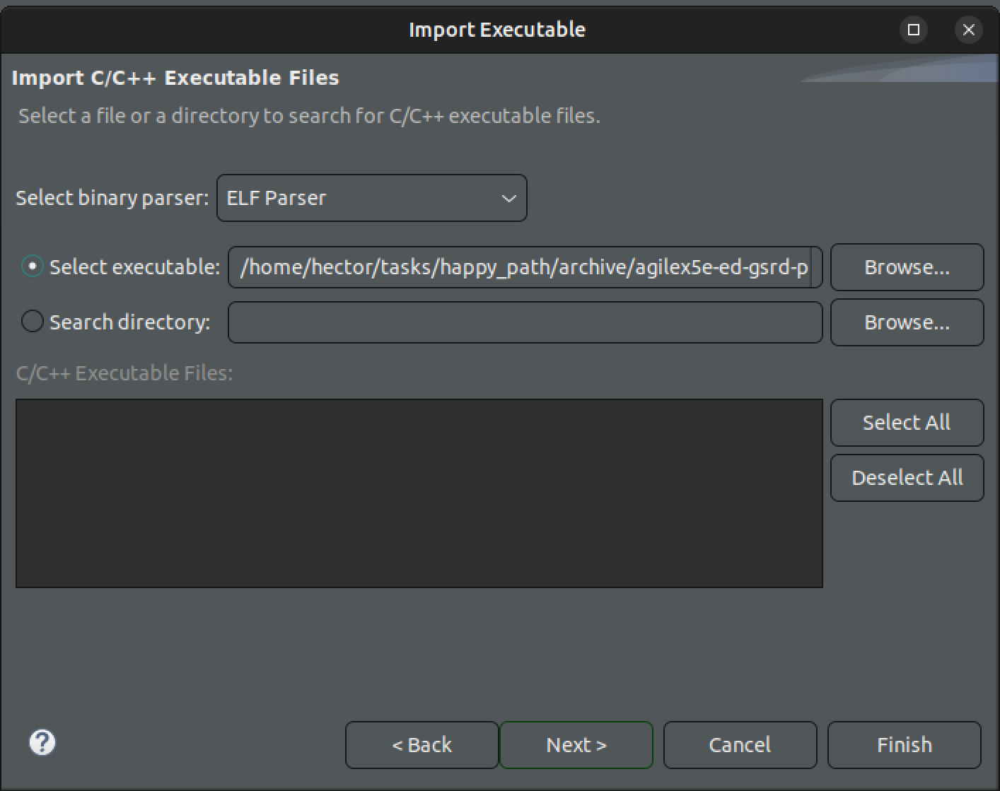{:style="width:45%; display:block; margin-left:auto; margin-right:auto"}

6. Select the **Create Launch Configuration** to be **C/C++ Remote Application**, then select **Finish**.

  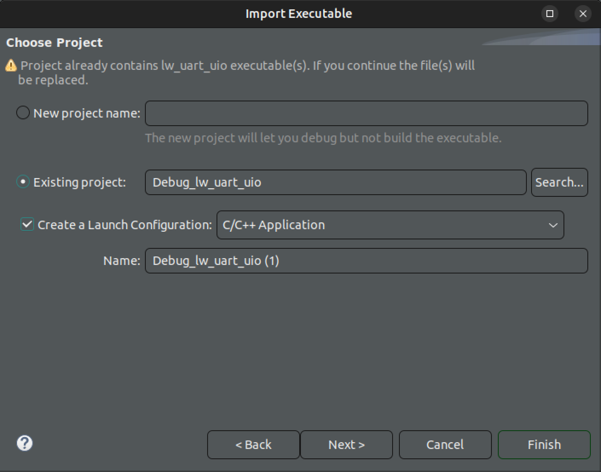{:style="width:45%; display:block; margin-left:auto; margin-right:auto"}

#### Debug Launcher and Target Connection

1. In the **Debug Configurations** window, **Main** tab, select **Select one...** on the **Multiple launchers available** at the bottom left.

  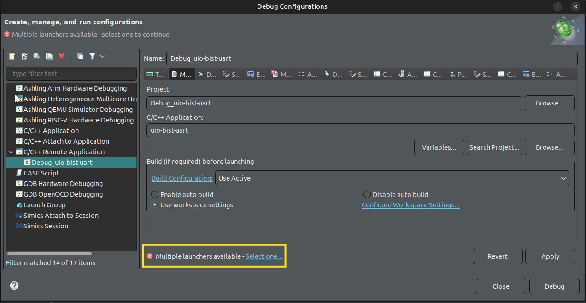{:style="width:45%; display:block; margin-left:auto; margin-right:auto"}

2. In the **Select Preferred Launcher** window, check **Use configuration specific settings**, select the **GDB (DSF) Manual Remote Debugging Launcher**, and select **OK**.

  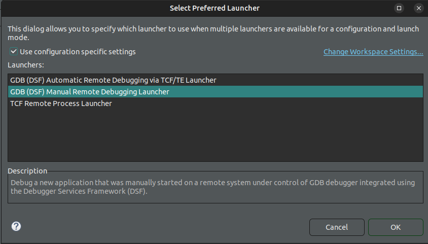{:style="width:45%; display:block; margin-left:auto; margin-right:auto"}

3. In the **Debugger** tab, check **Stop on startup at main**.

  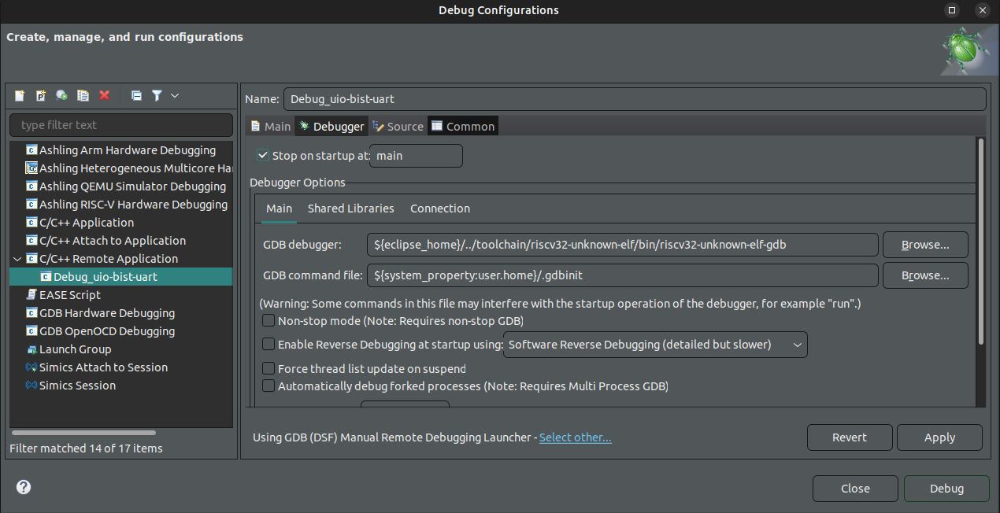{:style="width:45%; display:block; margin-left:auto; margin-right:auto"}

4. Under **Debugger > Main > GDB Debugger**, select **Browse**.
5. Select the **aarch64-none-linux-gdb** debugger shipped with RiscFree, typically installed in the `~/altera_fpga/26.3/riscfree/toolchain/Arm/aarch64-none-linux-gnu/bin/` folder, and select **Open**.

  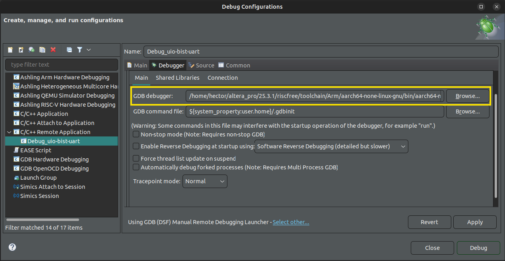{:style="width:45%; display:block; margin-left:auto; margin-right:auto"}

6. Go to the **Connection** tab and update the **Host Name or IP Address** to the IP address of your development kit.
7. Change the **Port number** to `1000`.

  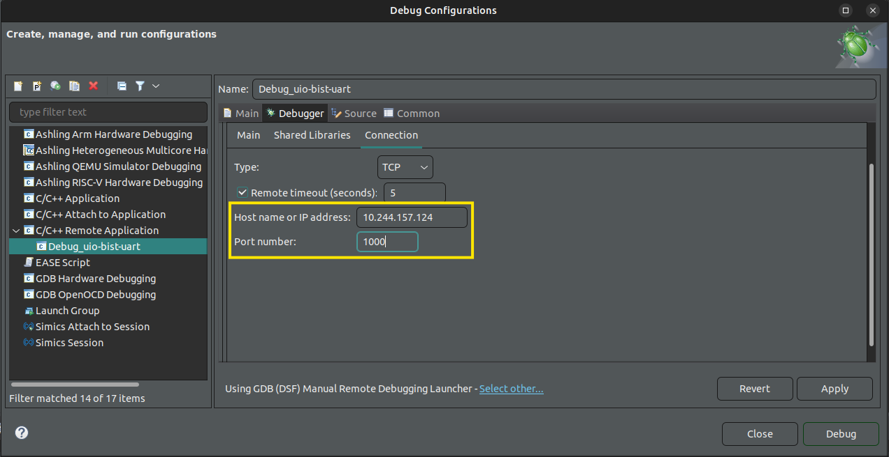{:style="width:45%; display:block; margin-left:auto; margin-right:auto"}

8. Select **Apply** at the bottom of the window, then select **Close**.
9. Select the dropdown next to the **debug** icon in the toolbar and choose **Organize Favorites...**.

  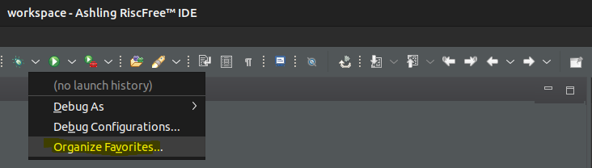{:style="width:45%; display:block; margin-left:auto; margin-right:auto"}

10. Select **Add**, choose **Debug_uio-bist-uart**, and select **OK** to close the dialog boxes.

  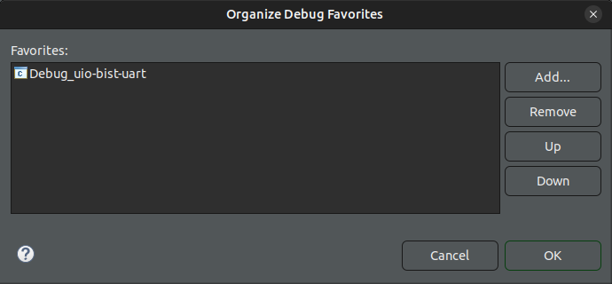{:style="width:45%; display:block; margin-left:auto; margin-right:auto"}

#### Establish Remote Debugging Connection

1. Select the dropdown menu next to the **debug** icon in the toolbar and choose **Debug_uio-bist-uart**.
2. Select **Switch** when prompted to switch perspectives.
3. The debugger will now load the application and stop at the `main()` function, allowing you to begin debugging.

  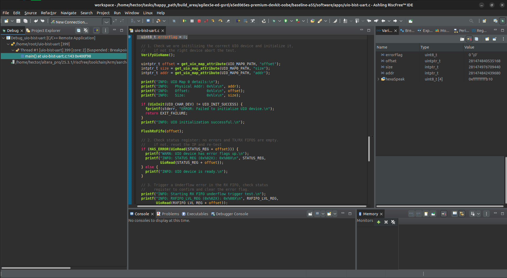{:style="width:45%; display:block; margin-left:auto; margin-right:auto"}

!!! Tip
    Refer to [HPS Linux Application Debuging with Ashling RiscFree](https://altera-fpga.github.io/rel-26.3/embedded-designs/agilex-5/e-series/premium-065b/riscfree-linux-app-debug/ug-riscfree-linux-app-debug-agx5e-premium-065b/) document for additional information on debugging with RiscFree.

### Deploy Linux Application to Linux Image

#### Yocto Recipe Creation


Package the `uio-bist-uart` application directly into the custom Yocto layer to automate cross-compilation and installation into the final target root filesystem. Defining a BitBake recipe alongside your application sources ensures the binary is compiled against target runtime libraries and deployed directly to `/usr/bin/` during image assembly.

1. **Create Recipe Directory Structure:**  
   Create the application recipe directory by copying the baseline `hello-world` template:
   
   ```bash
   cd $CWD/software/yocto_linux/meta-custom/recipes-apps/
   cp -r hello/ uio-bist-uart
   cd uio-bist-uart
   ```
   

2. **Stage Application Source Files:**  
   Remove the template source file and copy your application headers and implementation into the recipe `files/` directory:
   
   ```bash
   rm files/hello.c
   cp $CWD/software/apps/lw-uart-map.h \
      $CWD/software/apps/uio-bist-uart.h \
      $CWD/software/apps/uio-bist-uart.c files/
   ```
   

3. **Configure Recipe Metadata:**  
   Rename the recipe definition file and populate the build and installation tasks for `uio-bist-uart`:
   
   ```bash
   mv hello.bb uio-bist-uart.bb
   cat << 'EOF' > uio-bist-uart.bb
   DESCRIPTION = "UIO-Based sanity check for lightweight UART Altera IP"
   LICENSE = "MIT"
   LIC_FILES_CHKSUM = "file://${COMMON_LICENSE_DIR}/MIT;md5=0835ade698e0bcf8506ecda2f7b4f302"
   SRC_URI = " \
       file://uio-bist-uart.c \
       file://uio-bist-uart.h \
       file://lw-uart-map.h \
   "
   S = "${UNPACKDIR}"
   do_compile() {
       ${CC} ${CFLAGS} ${LDFLAGS} ${S}/uio-bist-uart.c -o ${B}/uio-bist-uart
   }
   do_install() {
       install -d ${D}${bindir}
       install -m 0755 ${B}/uio-bist-uart ${D}${bindir}/uio-bist-uart
   }
   EOF
   ```
   

#### KAS GUI Integration and Final Build

Register the custom application recipe within KAS configuration menus to automate its selection and injection into the target Linux image build. Configuring KAS include fragments and Kconfig menus enables one-step BitBake image generation alongside production bootloader and non-volatile flash artifacts.

1. **Create KAS Application Include File:**  
   Create the KAS include snippet to append the `uio-bist-uart` package to the primary root filesystem image specification:
   
   ```bash
   cd $CWD/software/yocto_linux
   base64 -d <<'EOF' | gunzip > "kas/apps/uio-bist-uart.yaml"
   H4sICNEh6moCA3Vpby1iaXN0LXVhcnQueWFtbABTUFDISE1MSS2y4lIAgbLUouLM/DwrBUNzkEBO
   fnJiTnxyfl5aPIqy0sx83aTM4hLd0sSiEiuFGoiogoKnr6O7a7ynX3CIo4+PVWJBQWpeioKtghKq
   BiUuAD+u/Jx3AAAA
   EOF
   ```
   

   As a result `uio-bist-uart.yaml` is created.

   ```yaml
   header:
     version: 17
   local_conf_header:
     uio-bist-uart: |
       IMAGE_INSTALL:append = " uio-bist-uart"
   ```

2. **Register Application in Kconfig Menu:**
   Inject the configuration entry and conditional YAML include path into `kas/apps/Kconfig`:  
   
   ```bash
   sed -i.bak '/endmenu/i config UIO_BIST_UART_APP\n    bool "UIO Bist Lightweight Uart app"\n    default y\n\nconfig KAS_INCLUDE_UIO_BIST_UART_APP\n    string\n    default "kas/apps/uio-bist-uart.yaml" if UIO_BIST_UART_APP\n' kas/apps/Kconfig
   ```
   

3. **Verify Recipe Selection in KAS Menu:**  
   Activate the Python virtual environment and open the interactive KAS configuration menu:

   ```bash
   source venv/bin/activate
   kas menu
   ```

   Navigate to **Example applications** and confirm that **UIO Bist Lightweight Uart app** is selected.

   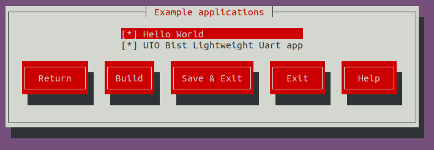{:style="width:65%; display:block; margin-left:auto; margin-right:auto"}

   Select **Exit** to return to the command line.

   Verify that KAS successfully parses and merges the custom application overlay:

   ```bash
   kas dump --skip repos_checkout kas.yml:sd_bootargs.yml:kas/apps/uio-bist-uart.yaml | grep -A2 uio-bist-uart
   ```

   Expected output:

   ```text
   uio-bist-uart: |
     IMAGE_INSTALL:append = " uio-bist-uart"
   ```

4. **Compile the Target System Image:**  
   Compile the console image from the command line using BitBake across the merged KAS manifests. This builds the cross-compiled application binary and installs it to `/usr/bin/uio-bist-uart` within the target root filesystem:  
   
   ```bash
   kas shell kas.yml:sd_bootargs.yml:kas/apps/uio-bist-uart.yaml -c "bitbake gsrd-console-image"
   ```
   

5. **Deactivate Build Environment:**  
   Exit the Python virtual environment:
   
   ```bash
   deactivate
   ```
   

6. **Generate Production QSPI Flash Image:**  
   Assemble the final production JTAG Indirect Configuration (`.jic`) file bundling the updated First Stage Bootloader (FSBL) payload:
   
   ```bash
   cd $CWD
   quartus_pfg -c output_files/baseline_a55.sof output_files/baseline_a55.jic \
     -o device=MT25QU128 \
     -o flash_loader=A5ED065BB32AE4S \
     -o hps_path=software/yocto_linux/build/tmp/deploy/images/agilex5e/u-boot-spl-dtb.hex \
     -o mode=ASX4 \
     -o hps=1
   ```
   

!!! note
    Executing `quartus_pfg` with `-o hps=1` appends the `.hps.jic` extension to the primary output binary, producing `$CWD/output_files/baseline_a55.hps.jic` for QSPI deployment.


#### Deployment Image Checkout

Deploying the final Linux image requires flashing the complete root filesystem to the MicroSD card, updating the non-volatile QSPI flash with the production bootloader, and running the pre-packaged application on the target hardware. This verifies that the Yocto recipe correctly installed the cross-compiled binary to system path `/usr/bin/` and that the platform driver binds the hardware core at boot without manual intervention.

!!! warning
    Double-check the target block device node before issuing the `dd` command. Writing raw image blocks to an incorrect drive identifier permanently destroys existing host storage partitions.

1. **Write the SD Card Image:**
   Insert the MicroSD card into your host card reader. Identify the target block device node using `dmesg` (e.g., `/dev/sdX`), then flash the newly assembled WIC image using `dd`:

   ```bash
   sudo dd if=./build/tmp/deploy/images/agilex5e/gsrd-console-image-agilex5e.rootfs.wic of=/dev/sdX bs=1M status=progress
   sync
   ```

   Eject the MicroSD card from your host workstation and insert it into the MicroSD slot on the development board.

2. **Program the QSPI Flash Memory:**  
   Write the updated production bitstream (`baseline_a55.hps.jic`)—which embeds the production First Stage Bootloader (`u-boot-spl-dtb.hex`)—into onboard QSPI flash memory:
   * Power off the development board.
   * Set the MSEL DIP switch (`SW27`) to **JTAG Mode**: `OFF / OFF / OFF / OFF`.
   * Power on the development board.
   * Run the Quartus Programmer over JTAG:

   ```bash
   cd $CWD
   jtagconfig --setparam 1 JtagClock 16M
   quartus_pgm -c 1 -m jtag -o "pvi;output_files/baseline_a55.hps.jic"
   ```

3. **Boot Linux and Verify Application Execution:**  
   Configure the board for autonomous Active Serial boot:
   * Power off the development board.
   * Set the MSEL DIP switch (`SW27`) to **Active Serial x4 (ASx4) Mode**: `OFF / ON / ON / OFF`.
   * Power on the development board and open your serial terminal emulator.
   * When the Linux login prompt appears, enter `root` (no password required).

   Because the `uio-bist-uart.bb` recipe installed the application directly into `${bindir}` (`/usr/bin`), execute the test binary globally from any directory:

   ```bash
   uio-bist-uart
   ```

   Expected output:

   ```text
   INFO: UIO device name verified: lw_uart@200100a0
   INFO: UIO Map 0 details:
   INFO:   Physical Addr: 0x20010000
   INFO:   Offset:        0xa0
   INFO:   Size:          0x1000
   INFO: UIO initialization successful.
   INFO: Clearing RX FIFO.
   INFO: UIO device is ready.
   INFO: Starting RX FIFO underflow trigger test.
   INFO: RXFIFO_LVL_REG (0x18): 0x00000000
   INFO: RXFIFO (0x00): 0x0000000F
   INFO: RUE condition detected, clearing flag.
   INFO: Starting RX FIFO level test.
   INFO: RXFIFO_LVL (0x18): 0x00000004
   INFO: RX_FIFO_LVL has the expected value. Flushing RX FIFO for the next test.
   INFO: Clearing RX FIFO.
   INFO: Starting RX FIFO data integrity test (0x0A17E12A).
   INFO: Starting UIO Interrupt (IRQ) test.
   INFO: Triggering IRQ via TX data write...
   INFO: Interrupt caught! Total UIO events: 1
   INFO: Received 0x0F, hardware IRQ line should now be LOW.
   INFO: All tests passed successfully.
   ```

---

## Appendix

### IP Address and Register Reference

#### Register Memory Map

The Lightweight UART Core registers are memory-mapped over 32-bit aligned byte boundaries starting from base address `0x200100a0`.

| Register Name | Byte Offset | Absolute Physical Address | Description                       |
|---------------|-------------|---------------------------|-----------------------------------|
| `RXFIFO`      | `0x00`      | `0x200100a0`              | Receive Data FIFO (Read Only)     |
| `TXFIFO`      | `0x04`      | `0x200100a4`              | Transmit Data FIFO (Write Only)   |
| `status`      | `0x08`      | `0x200100a8`              | Core Status Flags                 |
| `control`     | `0x0C`      | `0x200100ac`              | Interrupt and Flow Control Enable |
| `divisor`     | `0x10`      | `0x200100b0`              | Baud Rate Clock Divisor           |
| `endofpacket` | `0x14`      | `0x200100b4`              | End-of-Packet Framing Character   |
| `RXFIFO_LVL`  | `0x18`      | `0x200100b8`              | Current RX FIFO Fill Level        |
| `TXFIFO_LVL`  | `0x1C`      | `0x200100bc`              | Current TX FIFO Fill Level        |

---

### Hierarchical Interconnect Address Translation

Understanding how memory addresses and interrupt vectors are translated across hierarchical system interconnects is essential when integrating custom hardware into the Agilex 5 SoC.

#### Address Translation Breakdown

The absolute physical address accessed by the Arm processor (`0x200100a0`) is the sum of address offsets across three bus levels:

```text
  HPS Lightweight AXI Bridge Base Window
  [ 0x20000000 ]
        │
        └─── [+] Peripheral Subsystem MM Bridge Offset (`u_peripherals_mm_bridge`)
             [ 0x00010000 ]
                   │
                   └─── [+] Lightweight UART Core Slave Offset (`u_lw_uart.s1`)
                        [ 0x000000A0 ]
                              │
                              ▼
                   Target Physical Address: 0x200100A0

```

1. **Lightweight AXI Bridge Window:** The Agilex 5 HPS maps fabric peripherals through its Lightweight HPS-to-FPGA (LWH2F) master bridge, which exposes a 256 MB window starting at physical address `0x20000000`.
2. **Peripheral Subsystem Bridge Offset:** In the baseline design, Platform Designer routes this window into `fabric_subsys` through `u_peripherals_mm_bridge`, which is assigned offset `0x00010000` within the bridge window.
3. **Peripheral Slave Base Offset:** In `fabric_subsys-vds-edit.tcl`, the command `vds::assign_base_address ... 0x100a0` assigns the UART core slave interface `s1` to offset `0x00a0` relative to the subsystem bridge, placing the core's first register at `0x200100a0`.

#### Interrupt Mapping Breakdown

The Agilex 5 Arm Generic Interrupt Controller (GIC-600) handles external hardware events using Shared Peripheral Interrupts (SPIs):

* Platform Designer exports the core interrupt line to `u_shell_subsys.f2h_irq0_in` at connection index `2` (`f2h_irq0[2]`).
* The HPS shell routes fabric interrupt group 0 (`f2h_irq0`) directly into the GIC SPI table.
* Index `0` maps to GIC SPI interrupt 17, index `1` maps to SPI 18, and index `2` maps to SPI 19.
* In the Linux Device Tree, this is declared using the standard GIC interrupt tuple `<0 19 4>`, where `0` designates a Shared Peripheral Interrupt (SPI), `19` specifies the vector index, and `4` configures the trigger type as active-high level sensitive.

Refer to [ GIC Shared Peripheral Interrupts Map for the SoC HPS](https://docs.altera.com/r/docs/814346/26.1.1/hard-processor-system-technical-reference-manual-agilex-5-socs/gic-shared-peripheral-interrupts-map-for-the-soc-hps) for more information.

#### External Documentation & Upstream Resources

- [Agilex 5 E-Series 065A Premium Development Kit HPS GSRD User Guide](https://altera-fpga.github.io/rel-26.3/embedded-designs/agilex-5/e-series/premium-065a/gsrd/ug-gsrd-agx5e-premium-065a/)
- [KAS Build Tool Documentation](https://kas.readthedocs.io/en/latest/)
- [Yocto Project Reference Manual](https://docs.yoctoproject.org/brief-yoctoprojectqs/index.html)

---

## Notices & Disclaimers

Altera<sup>&reg;</sup> Corporation technologies may require enabled hardware, software or service activation.
No product or component can be absolutely secure. 
Performance varies by use, configuration and other factors.
Your costs and results may vary. 
You may not use or facilitate the use of this document in connection with any infringement or other legal analysis concerning Altera or Intel products described herein. You agree to grant Altera Corporation a non-exclusive, royalty-free license to any patent claim thereafter drafted which includes subject matter disclosed herein.
No license (express or implied, by estoppel or otherwise) to any intellectual property rights is granted by this document, with the sole exception that you may publish an unmodified copy. You may create software implementations based on this document and in compliance with the foregoing that are intended to execute on the Altera or Intel product(s) referenced in this document. No rights are granted to create modifications or derivatives of this document.
The products described may contain design defects or errors known as errata which may cause the product to deviate from published specifications.  Current characterized errata are available on request.
Altera disclaims all express and implied warranties, including without limitation, the implied warranties of merchantability, fitness for a particular purpose, and non-infringement, as well as any warranty arising from course of performance, course of dealing, or usage in trade.
You are responsible for safety of the overall system, including compliance with applicable safety-related requirements or standards. 
<sup>&copy;</sup> Altera Corporation.  Altera, the Altera logo, and other Altera marks are trademarks of Altera Corporation.  Other names and brands may be claimed as the property of others. 

OpenCL* and the OpenCL* logo are trademarks of Apple Inc. used by permission of the Khronos Group™. 