## Introduction

This tutorial demonstrates how to extend the [HPS Baseline System Example Design](https://altera-fpga.github.io/rel-26.1.1/embedded-designs/agilex-5/e-series/premium-065b/gsrd/ug-gsrd-agx5e-premium-065b/#hardware-design-overview) Quartus project by adding an IP core to the fabric subsystem and enabling it through the software stack. You will integrate a [Lightweight UART Core](https://docs.altera.com/r/docs/683130/26.1/embedded-peripherals-ip-user-guide/lightweight-uart-core) to simulate a custom IP that lacks a native Linux kernel driver. Rather than developing a complex kernel-space driver from scratch, this tutorial highlights the standard hardware-to-software enablement path utilizing the generic User Space I/O (UIO) platform driver.

The hardware architecture interfaces the new UART IP with the Hard Processor System (HPS) via the Lightweight AXI Bridge. To facilitate a self-contained validation process without requiring external wiring, the design incorporates a System ID Peripheral IP — acting as a verifiable hardware fingerprint — and utilizes an internal loopback (TX to RX) within the SystemVerilog top-level wrapper.

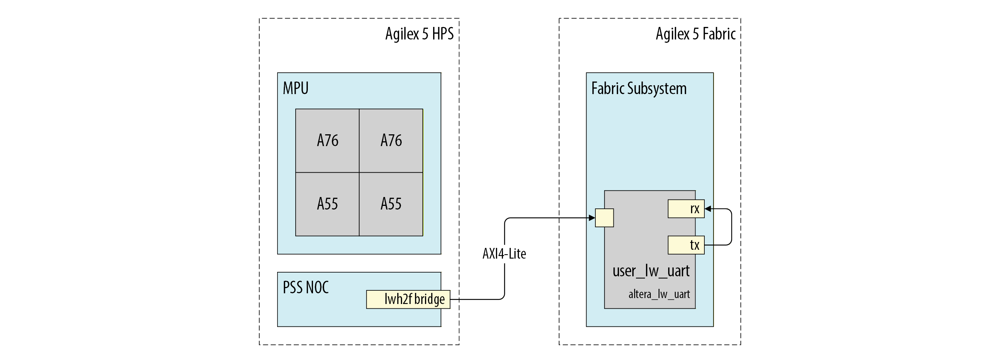

Software enablement is organized into a progressive, three-tier integration/verification stack. This ensures the hardware is fundamentally sound before OS complexity is introduced:

| Validation Level         | Boot Environment    | Verification Tool          | Purpose                                                               |
|:-------------------------|:--------------------|:---------------------------|:----------------------------------------------------------------------|
| **Level 1: Low-Level**   | U-Boot (Standalone) | `mw.l` / `md.l` commands   | Verify raw register address space and IP connectivity.                |
| **Level 2: OS-Level**    | Yocto Linux         | `devmem2`                  | Confirm Device Tree mappings and base kernel accessibility.           |
| **Level 3: Application** | Linux User Space    | UIO Driver & C Application | Handle interrupts (IRQ) and mapped memory in a custom user-space app. |

The following figure shows the Yocto Project structure from the HPS Baseline System Example Design, highlighting the "hooks" or layers where custom recipes and kernel configuration changes (such as .scc configuration files) are performed to bind the new hardware to the UIO driver.

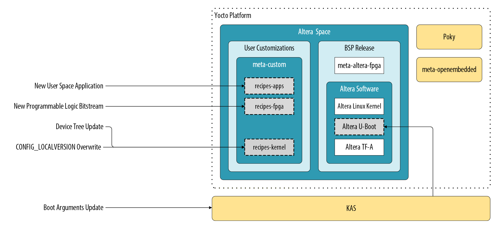{:style="width:60%; display:block; margin-left:auto; margin-right:auto"}

This tutorial utilizes the [HPS Expansion Board (HPS-EB)](https://docs.altera.com/r/docs/814550/current/agilex-5-fpga-e-series-065b-premium-development-kit-user-guide/hps-expansion-board-hps-eb?tocId=RnMgo4C4EyXZyqa%7ErswC8A) mounted on an [Agilex™ 5 FPGA E-Series 065B Premium Development Kit](https://www.altera.com/products/devkit/po-3284/agilex-5-fpga-e-series-065b-premium-development-kit). It employs an HPS-First, split-boot topology. In this configuration, the HPS is responsible for configuring the FPGA fabric logic. The First Stage Bootloader (FSBL) executes directly from onboard QSPI memory to initialize the system, while the Second Stage Bootloader (SSBL), Linux kernel, device tree, and root filesystem are subsequently loaded from a micro SD card.

### Tutorial Organization

The tutorial follows a progressive building-block approach, where each section validates a deeper layer of the system.

#### Level 1: Hardware Integration and Low-Level Validation

- **Baseline System Configuration**: Build the initial HPS Baseline System Example Design to validate the toolchain and establish a software baseline.
- **Hardware IP Integration**: Add the Lightweight UART IP in Platform Designer, map its memory space, and route its signals through the SystemVerilog top-level wrapper.
- **U-Boot Enablement**: Use the ["Roll Your Own"](https://altera-fpga.github.io/rel-26.1.1/embedded-designs/agilex-5/e-series/premium-065b/gsrd/ug-gsrd-agx5e-premium-065b/#build-and-exercise-roll-your-own-binaries) (RYO) flow to build a standalone bootloader and verify hardware connectivity before loading an OS.

#### Level 2: Linux Integration and Driver Binding

- **Linux IP Integration and Testing**: Update the Yocto device tree, the Kernel UIO modules, and Kernel boot arguments to bind the custom hardware to the [`uio_pdrv_genirq`](https://www.kernel.org/doc/html/v5.0/driver-api/uio-howto.html) driver.
- **Hardware Verification**: Use the updated Linux image to confirm that the HPS can access the FPGA fabric registers with [`devmem2`](https://github.com/radii/devmem2).

#### Level 3: Application Development and Deployment

- **Application Development**: Configure the Arm GNU Toolchain and develop a C application to perform an integration test on the new hardware module.
- **Deployment and Debugging**: Integrate the application into the Yocto project as a recipe and use the RiscFree IDE for remote hardware debugging.

### Prerequisites

Ensure you have the following hardware and software:

**Agilex 5 Development Kit**

- [**Agilex® 5 FPGA E-Series 065B Premium Development Kit**](https://www.altera.com/products/devkit/po-3284/agilex-5-fpga-e-series-065b-premium-development-kit) (Ordering code: DK-A5E065BB32AEA).
- **Required Accessories**: HPS-EB daughter card, Mini USB cable, Micro USB cable, Micro SD card, and USB card writer.

**Host PC Requirements**

- **OS**: Linux (Ubuntu 22.04 LTS recommended).
- **Hardware**: Minimum 64 GB RAM and 200 GB free disk space.
- **Software**: Altera® Quartus® Prime Pro Edition Version 26.1.1 and Ashling* RiscFree* IDE for Altera Version 26.1.1.
- **Serial Terminal**: GtkTerm, Minicom, TeraTerm, or PuTTY.
- **Internet Access**: Required for downloading Yocto dependencies.

#### Hardware Components & Layout

To facilitate the identification of physical interfaces and jumpers mentioned throughout this tutorial, refer to the development kit layout below.

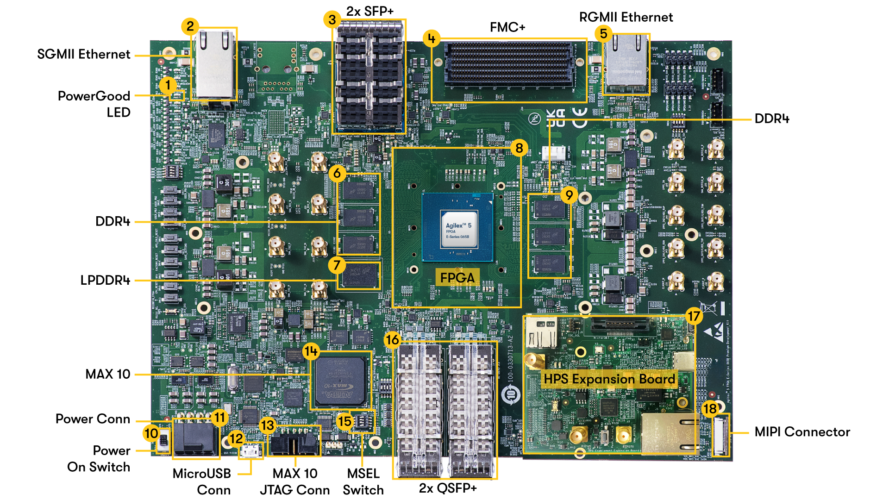{:style="width:60%; display:block; margin-left:auto; margin-right:auto"}

For users new to this hardware, it is critical to follow official handling and power-up procedures to avoid equipment damage. Please consult the following Altera documentation before proceeding:

- **[Development Kit Setup](https://docs.altera.com/r/docs/814550/current/agilex-5-fpga-e-series-065b-premium-development-kit-user-guide/development-kit-setup)**: Provides the essential steps for cabling, power-up, and initial configuration.
- **[Getting Started](https://docs.altera.com/r/docs/814550/current/agilex-5-fpga-e-series-065b-premium-development-kit-user-guide/getting-started)**: Offers critical instructions on **handling the board** safely and includes links to **install required software** dependencies and tools.

#### Host Software and Dependency Configuration

Install the required software dependencies for the Kas and Yocto build system. For Ubuntu 22.04 LTS, execute the following commands:

``` bash
sudo apt-get update
sudo apt-get upgrade
sudo apt-get install openssh-server mc libgmp3-dev libmpc-dev gawk wget git diffstat unzip texinfo gcc \
build-essential chrpath socat cpio python3 python3-pip python3-pexpect xz-utils debianutils iputils-ping \
python3-git python3-jinja2 libegl1-mesa libsdl1.2-dev pylint xterm python3-subunit mesa-common-dev zstd \
liblz4-tool git fakeroot build-essential ncurses-dev xz-utils libssl-dev bc flex libelf-dev bison xinetd \
tftpd tftp nfs-kernel-server libncurses5 libc6-i386 libstdc++6:i386 libgcc++1:i386 lib32z1 \
device-tree-compiler curl mtd-utils u-boot-tools net-tools swig python3-newt python3.10-venv mtools p7zip-full -y
sudo locale-gen en_US.UTF-8
```

Configure Bash as the default system shell:

``` bash
sudo ln -sf /bin/bash /bin/sh
```

Add the Quartus® Prime Pro Edition Version 26.1.1 binaries to your system path. The command below assume that Altera&reg; Quartus<sup>&reg;</sup> Prime Pro Edition Version 26.1.1 is installed in your home directory. Adjust the paths if necessary.

``` bash
source ~/altera_pro/26.1.1/qinit.sh
```

---

## Level 1: Baseline System Configuration

### Hardware Design Checkout and Build

#### Source Code Initialization and Environment Setup

Clone the hardware design project from the [altera-fpga](https://github.com/altera-fpga/) repository. Execute the following commands to check out the project configured for booting Linux on **Core 0 (A55)** within the HPS:

``` bash
git clone --filter=blob:none --sparse https://github.com/altera-fpga/agilex5e-ed-gsrd.git
cd agilex5e-ed-gsrd
git checkout QPDS26.1.1_REL_GSRD_PR
git sparse-checkout set dk-a5e065bb32aea-enablement/baseline-a55
cd  dk-a5e065bb32aea-enablement/baseline-a55
CWD=`pwd`
```

#### FPGA Project Compilation

Compile the Quartus project to generate the FPGA configuration bitstream:

``` bash
make baseline_a55-build
```

As a result, `$CWD/output_files/baseline_a55.sof` bitstream is created.

!!! warning
    `make baseline_a55-build` will fail if Ashling* RiscFree* installation path is not present in your system PATH variable.


#### First Stage Bootloader (FSBL) Generation

A FPGA fabric bitstream is needed for a Yocto Linux build. This process requires an intermediate **dummy [FSBL](https://docs.altera.com/r/docs/813762/26.1/hard-processor-system-booting-user-guide-agilex-3-and-agilex-5-socs/first-stage-bootloader?tocId=wHsT9dAUiMQRMfKF6TnSOQ)** artifact, which you will update with the production bootloader later.

Compile the `hps_debug` source to create this placeholder FSBL:

``` bash
pushd software/hps_debug && ./build.sh && popd
```

As a result `$CWD/software/hps_debug/hps_wipe.ihex`is created, which serves as a mandatory input for the `quartus_pfg` tool when generating the peripheral and core configuration files for the Agilex 5 SoC.

For more information on `hps_debug` contents refer to `$CWD/software/hps_debug/README.md`

#### FPGA Programming File Integration

Merge the FSBL with the FPGA bitstream. Use the Quartus Programming File Generator to integrate `hps_wipe.ihex` into your `baseline_a55.sof`:

``` bash
quartus_pfg -c output_files/baseline_a55.sof output_files/baseline_a55_hps_debug.sof -o hps_path=software/hps_debug/hps_wipe.ihex
```

Process the resulting  `$CWD/output_files/baseline_a55_hps_debug.sof` into a Raw Binary File (`.rbf`) required by the HPS:

``` bash
quartus_pfg -c output_files/baseline_a55_hps_debug.sof output_files/baseline_a55_hps_debug.rbf -o hps=1
```

The build produces `$CWD/output_files/baseline_a55_hps_debug.core.rbf`, which contains the FPGA fabric logic configuration data. This file is a required input for the Yocto build process to ensure the Linux image bundles the correct hardware configuration.

### Yocto Project Build

#### Custom Layer and Recipe Configuration

Build a Linux image for the previously compiled Quartus project. This process uses default Yocto settings, modified only to include the custom FPGA core fabric bitstream and a unique Linux Kernel version suffix.

Customize the Yocto project using the `meta-custom` layer, which provides recipes for modifying Linux image components.

#### Linux Kernel Identification and Modification

Copy the `baseline_a55_hps_debug.core.rbf` to the FPGA bitstream recipe folder:

``` bash
cd $CWD
cp output_files/baseline_a55_hps_debug.core.rbf software/yocto_linux/meta-custom/recipes-fpga/fpga-bitstream/files/baseline_a55_hps_debug.core.rbf
```

!!! warning
    The Yocto build requires the filename `baseline_a55_hps_debug.core.rbf`. To use a different name, update the KAS configuration as described in the `software/yocto_linux/README.md`.

Identify your custom build by appending a unique string to the Linux kernel version. Use the `linux-socfpga-lts_%.bbappend` recipe in the `meta-custom` layer to modify the kernel configuration. Apply the `forcevariable` override to set `LINUX_VERSION_EXTENSION` to `-altera-f06d06`:

``` bash
cat <<EOF >> software/yocto_linux/meta-custom/recipes-kernel/linux/linux-socfpga-lts_%.bbappend 

# Use the forcevariable override to ensure this value sticks
LINUX_VERSION_EXTENSION:forcevariable = "-altera-f06d06" 
EOF
```

#### Build Environment Setup and KAS Tooling

Isolate the KAS build tool dependencies from your system packages by creating a [python virtual environment](https://docs.python.org/3/library/venv.html). Perform this one-time setup:

``` bash
cd $CWD/software/yocto_linux
python3 -m venv venv --system-site-packages
source venv/bin/activate
pip install --upgrade pip
pip install kas
pip install --upgrade kas
pip install kconfiglib
```


!!! tip
    To reactivate the Python virtual environment in a future session, run the following command from the environment's root folder:
    
    ``` bash
    source ./venv/bin/activate
    ```

#### Image Assembly and Artifact Deployment

Use the KAS Command Line Interface (CLI) with the default [`kas.yml` configuration](https://kas.readthedocs.io/en/latest/userguide/project-configuration.html) to build the `gsrd-console-image`:

``` bash
kas build kas.yml gsrd-console-image
```

Upon completion, the build produces the following deployment artifacts:

- `$CWD/software/yocto_linux/build/tmp/deploy/images/agilex5e/gsrd-console-image-agilex5e.rootfs.wic`
- `$CWD/software/yocto_linux/build/tmp/deploy/images/agilex5e/u-boot-spl-dtb.hex`

Exit the Python virtual environment by executing the following command:

``` bash
deactivate
```

Update the HPS and peripheral bitstream using the production FSBL (`u-boot-spl-dtb.hex`) generated by the Yocto build. This command replaces the dummy FSBL with the functional bootloader and generates a JTAG Indirect Configuration (`.jic`) file:

``` bash
cd $CWD
quartus_pfg -c output_files/baseline_a55.sof output_files/baseline_a55.jic -o device=MT25QU128 -o flash_loader=A5ED065BB32AE4S -o hps_path=software/yocto_linux/build/tmp/deploy/images/agilex5e/u-boot-spl-dtb.hex -o mode=ASX4 -o hps=1
```

As a result `$CWD/output_files/baseline_a55.hps.jic` is generated.

### Base Linux Boot

#### SD Card Image Deployment

Connect the USB card writer and micro SD card to your host PC. Locate the assigned system name using `dmesg`:

``` bash
dmesg | tail -n 20
```

!!! warning
    Identify the correct device name (e.g., `sdb`, `sdc`). Writing to the wrong device could result in data loss on your host system.

Flash the Linux image to the micro SD card using the [`dd`](https://man7.org/linux/man-pages/man1/dd.1.html) utility. Replace `sdX` with your specific identifier:

``` bash
# Use dd to write the image to the corresponding device
sudo dd if=./build/tmp/deploy/images/agilex5e/gsrd-console-image-agilex5e.rootfs.wic of=/dev/sdx bs=1M
# Flush the changes to the SD card
sync
```

#### Serial Console and Hardware Connectivity

Remove the micro SD card from the host PC and insert it into the SD card slot on the Agilex™ 5 development kit.

Power down the development kit and connect the mini-USB cable from the HPS Enablement Expansion Board to the host PC. Apply the following connection parameters to your serial terminal emulator:

- **Baud rate**: 115,200
- **Data bits**: 8
- **Stop bits**: 1
- **Parity**: None
- **Flow control**: None

#### QSPI Programming

Flash the `baseline_a55.hps.jic` bitstream to the QSPI memory:

1. Power off the development kit.
2. Set the MSEL dipswitch (SW27) to JTAG mode: **OFF / OFF / OFF / OFF**.
3. Power up the board.
4. Program the QSPI memory:

``` bash
jtagconfig --setparam 1 JtagClock 16M
quartus_pgm -c 1 -m jtag -o "pvi;$CWD/output_files/baseline_a55.hps.jic"
```

#### System Power-Up and Software Validation

Complete the boot sequence:

1. Power off the development kit.
2. Set the MSEL dipswitch (SW27) to ASx4 mode: **OFF / ON / ON / OFF**.
3. Power up the board.
4. Log in to Linux using `root` as the username; no password is required.

Verify your custom build by checking the kernel version string:

``` bash
uname -r
```

The expected output should contain the customized kernel version string `altera-f06d06`. This confirms that the system is running the specific kernel image generated by your Yocto build.

### Hardware IP Integration

#### Adding the Lightweight UART Core to the System

Open the Quartus project using the Quartus graphical interface.

``` bash
cd $CWD
quartus top.qpf &
```

To modify the hardware, open the `u_fabric_subsys` Platform Designer system by double-clicking its instance within the **Project Navigator** panel in Quartus Prime.

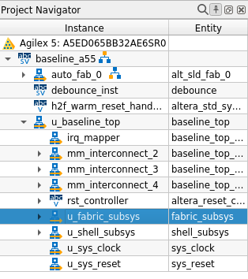{:style="display:block; margin-left:auto; margin-right:auto"}

#### Component Integration in Platform Designer

Add the new IP into the system by following these steps:

1. **Add the Lightweight UART Core**: In the **IP Catalog**, navigate to **Interface Protocols > Serial > Lightweight UART (RS-232 Serial Port)** and double-click it.

  - **HDL Entity Name**: `u_user_lw_uart`.
  - **Parameters**: Retain all default values.
  - Select **Finish**.
  
2. **Connect Clock and Reset Signals**: Synchronize the new components with the rest of the system.

  - **Reset**: Connect `u_user_lw_uart|reset` to `u_system_reset|out_reset`.
  - **Clock**: Connect `u_user_lw_uart|clk` to `u_system_clock|out_clk`.

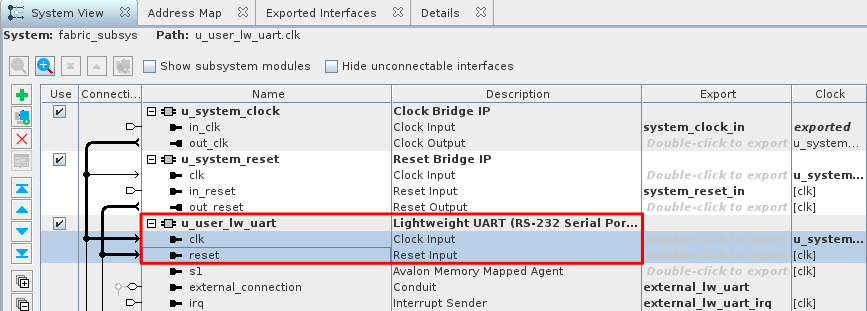{:style="width:45%; display:block; margin-left:auto; margin-right:auto"}

#### Address Mapping and I/O Export

Finalize the IP integration by mapping memory interfaces and exporting signals for the top-level FPGA design:

1. **Map Avalon-MM Interfaces**: Connect the slave port (**s1**) of the UART IP to the master port (**m0**) of the peripheral bridge.

  - Connect `u_user_lw_uart|s1` to `u_peripherals_mm_bridge|m0`.

2. **Export External Signals**: Export I/O and interrupt signals for top-level system connections:

  - **UART Data**: Export `u_user_lw_uart|external_connection` to `external_lw_uart`.
  - **UART Interrupt**: Export `u_user_lw_uart|irq` to `external_lw_uart_irq`.

3. **Assign Base Addresses**: Manually set the base address to `0x0001_00a0`. As the Lightweight UART IP is connected to the HPS thought the Lightweight HPS2FPGA Bridge, the system memory address to the IP is the [Lightweight HPS2FPGA Bridge base address](https://docs.altera.com/r/docs/814346/26.1/hard-processor-system-technical-reference-manual-agilextm-5-socs/total-address-map-tabular) (`0x2000_0000`) plus the Lightweight UART IP offset (`0x0001_00a0`). The resulting address `0x2001_00a0` will be use in the Linux device tree file to indicate where the OS can access the new hardware IP.

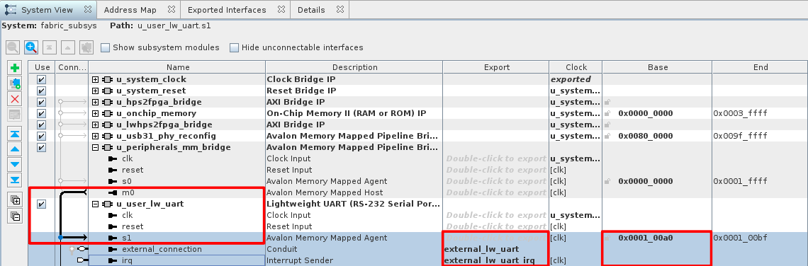{:style="width:45%; display:block; margin-left:auto; margin-right:auto"}

#### Fabric Subsystem Identification Update

Update the hardware identification **System ID Peripheral IP** within `fabric_subsys.qsys` to verify the hardware matches the expected design version.

1. Select the **u_system_id** instance and change the **32-bit System ID** to `0x0a17e12a`.
2. Click on `Sync System Infos` and **Save** `fabric_subsys.qsys`.
3. Click on **Generate HDL...**.
4. Close Platform Designer.

#### Top-Level System Interrupt Configuration

Configure the top-level system to export the UART signals and route interrupts to the HPS.

1. Open `baseline_top.qsys`.
2. Export the I/O signals for top-level connectivity:

  - **UART Data**: Export `u_fabric_subsys|external_lw_uart` as `user_lw_uart`.

3. Locate the **`f2h_irq0_in`** (FPGA-to-HPS Interrupt) receiver port on the **`u_shell_subsys`** instance.
4. Connect the **`external_lw_uart_irq`** port (exported from `u_fabric_subsys`) to the **`f2h_irq0_in`** port.
5. **Save** `baseline_top.qsys` and select **Generate HDL...**.

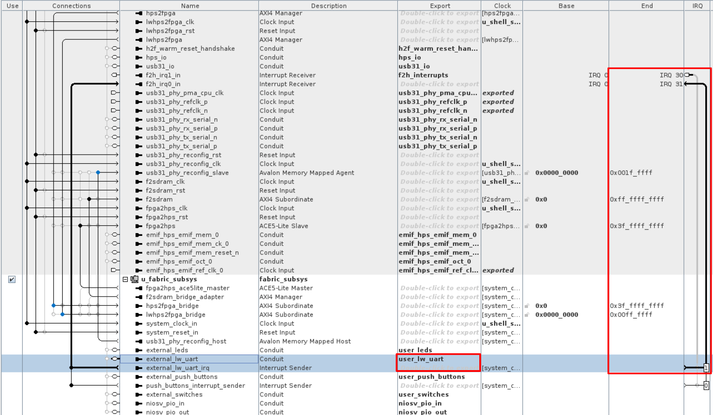{:style="width:45%; display:block; margin-left:auto; margin-right:auto"}

#### Top-Level Wrapper Modification

Update the top-level System Verilog wrapper, `baseline_a55.sv`, to loopback the TX and RX signals within the core fabric.

1. **Define Internal Wires and Integrate Port Mappings***: Execute the command below to insert the wire definitions, add the internal loopback and update the baseline_top instance ports:

  ``` bash
  cd $CWD
  cp baseline_a55.sv baseline_a55.sv.bak
  awk '/^[[:space:]]*baseline_top[[:space:]]+u_baseline_top/{print "    // lw_uart ip signals\n    wire fpga_lw_uart_rxd;\n    wire fpga_lw_uart_txd;\n\n    // lightweight uart core loopback\n    assign fpga_lw_uart_rxd = fpga_lw_uart_txd;\n"} /^[[:space:]]*\.niosv_pio_out_export/{sub(/\)/, "),"); print; print "        //\n        // Lightweight Uart\n        .user_lw_uart_rxd                     (fpga_lw_uart_rxd),\n        .user_lw_uart_txd                     (fpga_lw_uart_txd)"; next} {print}' baseline_a55.sv > tmp && mv tmp baseline_a55.sv
  ```

  The wire and loopback definition is added before the baseline_top instance.

  ``` verilog
      // lw_uart ip signals
      wire fpga_lw_uart_rxd;
      wire fpga_lw_uart_txd;

      // lightweight uart core loopback
      assign fpga_lw_uart_rxd = fpga_lw_uart_txd;
  ```
  
  The next ports are added at the bottom of baseline_top instance.

  ``` verilog
      // 
      // Lightweight Uart
      .user_lw_uart_rxd                     (fpga_lw_uart_rxd),
      .user_lw_uart_txd                     (fpga_lw_uart_txd)
  ```

2. **Generate Bitstream**: Save the file, close Quartus Prime and run a full compilation:

  ``` bash
  # Delete previous Quartus project compile results
  rm -rf output_files qdb tmp-clearbox dni
  # Trigger a new compile
  make baseline_a55-build
  ```

---

## Level 1: U-Boot Enablement

### Build and Boot U-Boot

#### RYO Toolchain and Environment Setup

Set up a minimal software environment to validate the basic functionality of the IP integrated into the Quartus project. The "[Roll Your Own](https://altera-fpga.github.io/rel-26.1/embedded-designs/agilex-5/e-series/premium-065b/gsrd/ug-gsrd-agx5e-premium-065b/#build-and-exercise-roll-your-own-binaries)" (RYO) flow facilitates the build of U-Boot and Arm Trusted Firmware for rapid bring-up.

Navigate to the RYO folder:

``` bash
cd $CWD/software/ryo_linux
```

Download a ARM64 toolchain and configure your environment to use it as the preferred ARM cross-compiler:

``` bash
wget https://developer.arm.com/-/media/Files/downloads/gnu/14.3.rel1/binrel/\
arm-gnu-toolchain-14.3.rel1-x86_64-aarch64-none-linux-gnu.tar.xz
tar xf arm-gnu-toolchain-14.3.rel1-x86_64-aarch64-none-linux-gnu.tar.xz
rm -f arm-gnu-toolchain-14.3.rel1-x86_64-aarch64-none-linux-gnu.tar.xz
export PATH=`pwd`/arm-gnu-toolchain-14.3.rel1-x86_64-aarch64-none-linux-gnu/bin/:$PATH
export ARCH=arm64
export CROSS_COMPILE=aarch64-none-linux-gnu-
```

#### Arm Trusted Firmware Compilation

Clone the Altera Arm Trusted Firmware repository and compile the binary for the Agilex 5 platform:

``` bash
git clone -b QPDS26.1.1_REL_GSRD_PR https://github.com/altera-fpga/arm-trusted-firmware arm-trusted-firmware
cd arm-trusted-firmware
make clean
make -j "$(nproc)" PLAT=agilex5 bl31
cd ..
```

#### U-Boot Configuration and Compilation

Clone the Altera U-Boot repository and enable debug messages within the compiler output to assist with potential troubleshooting:

``` bash
git clone -b QPDS26.1.1_REL_GSRD_PR https://github.com/altera-fpga/u-boot-socfpga u-boot-socfpga
cd u-boot-socfpga
sed -i 's/PLATFORM_CPPFLAGS += -D__ARM__/PLATFORM_CPPFLAGS += -D__ARM__ -gdwarf-4/g' arch/arm/config.mk
```

Create a soft link to the Arm Trusted Firmware binary previously compiled.

``` bash
ln -sf "../arm-trusted-firmware/build/agilex5/release/bl31.bin"
```

Modify the Agilex 5 device tree to set the SD card as the default boot device for the Secondary Program Loader (SPL) and disable NAND memory:

``` bash
# Configure for SD card boot
sed -i 's/u-boot,spl-boot-order.*/u-boot,spl-boot-order = \&mmc;/g' arch/arm/dts/socfpga_agilex5_socdk-u-boot.dtsi
# Disable NAND in device tree
sed -i '/&nand {/!b;n;c\\tstatus = "disabled";' arch/arm/dts/socfpga_agilex5_socdk-u-boot.dtsi
```

Create a configuration fragment to overwrite the Agilex 5 default values. Define a custom message with `CONFIG_BOOTCOMMAND` to validate the environment changes at the U-Boot prompt.

``` bash
# Create SD card specific U-Boot configuration
cat > config-fragment << 'EOF'
# Use Image instead of kernel.itb
CONFIG_BOOTFILE="Image"
# Disable NAND/UBI related settings
CONFIG_NAND_BOOT=n
CONFIG_SPL_NAND_SUPPORT=n
CONFIG_CMD_NAND_TRIMFFS=n
CONFIG_CMD_NAND_LOCK_UNLOCK=n
CONFIG_NAND_DENALI_DT=n
CONFIG_SYS_NAND_U_BOOT_LOCATIONS=n
CONFIG_SPL_NAND_FRAMEWORK=n
CONFIG_CMD_NAND=n
CONFIG_MTD_RAW_NAND=n
CONFIG_CMD_UBI=n
CONFIG_CMD_UBIFS=n
CONFIG_MTD_UBI=n
CONFIG_ENV_IS_IN_UBI=n
CONFIG_UBI_SILENCE_MSG=n
CONFIG_UBIFS_SILENCE_MSG=n
CONFIG_DISTRO_DEFAULTS=n
CONFIG_HUSH_PARSER=y
CONFIG_SYS_PROMPT_HUSH_PS2="> "
CONFIG_USE_BOOTCOMMAND=y
# User configurable prompt message
CONFIG_BOOTCOMMAND="echo Agilex 5 U-Boot prompt ready"
CONFIG_BOOTDELAY=1
CONFIG_CMD_FAT=y
CONFIG_CMD_FS_GENERIC=y
CONFIG_DOS_PARTITION=y
CONFIG_SPL_DOS_PARTITION=y
CONFIG_CMD_PART=y
CONFIG_SPL_CRC32=y
CONFIG_LZO=y
CONFIG_CMD_DHCP=y
# Enable more QSPI flash manufacturers
CONFIG_SPI_FLASH_MACRONIX=y
CONFIG_SPI_FLASH_GIGADEVICE=y
CONFIG_SPI_FLASH_WINBOND=y
CONFIG_SPI_FLASH_ISSI=y
EOF
```

Apply a configuration fragment to customize the U-Boot environment and build the bootloader artifacts:

``` bash
make clean && make mrproper
make socfpga_agilex5_defconfig 
./scripts/kconfig/merge_config.sh -O . -m .config config-fragment
make -j "$(nproc)"
cd ..
```

#### Boot Artifact Deployment and SD Card Creation

Generate the JTAG Indirect Configuration (`.jic`) file for the QSPI memory and the Raw Binary File (`.rbf`) for the FPGA core logic:

``` bash
cd $CWD
quartus_pfg -c output_files/baseline_a55.sof  output_files/baseline_a55_u-boot.jic -o device=MT25QU128 -o flash_loader=A5ED065BB32AE4S -o hps_path=software/ryo_linux/u-boot-socfpga/spl/u-boot-spl-dtb.hex -o mode=ASX4 -o hps=1
```

As a result `$CWD/output_files/baseline_a55_u-boot.core.rbf` and `$CWD/output_files/baseline_a55_u-boot.hps.jic` are created.

Create an SD card image containing the SSBL and the FPGA core logic bitstream:

``` bash
cd software/ryo_linux
dd if=/dev/zero of=sdcard.img bs=1M count=64
mformat -i sdcard.img :: -F
mcopy -i sdcard.img ./u-boot-socfpga/u-boot.itb ::
mcopy -i sdcard.img ../../output_files/baseline_a55_u-boot.core.rbf ::
```

### Lightweight UART IP Sanity Check

#### Automated Script Preparation

Create a U-Boot script named `hw_sanity_check.scr.txt` on your host machine to automate IP verification. Run the command below to generate the source file.

<details>
<summary>
  <span style="color: #0056b3; font-weight: bold; cursor: pointer;">
  ⚠️Click for instructions to generate `hw_sanity_check.scr.txt` from encoded data
  </span>
</summary>

```bash
base64 -d <<'EOF' | gunzip > "hw_sanity_check.scr.txt"
H4sICAgewGoAA2h3X3Nhbml0eV9jaGVjay5zY3IudHh0AMVUW2/aMBh996/4Rit1l6YKHbRTWB8Y
gzYSKlFCL2/IJF/AWm5zHEpX8d/nhJALKdrWl/nN9nc55/j4O4Krty5yBP1rfTx8hC7cGJYynSgj
47oP90NTH+mD/lSf3II1MHVjKkONhEdhjBroAROMeuwXQhp+Ct84cxYYnwINHJhiLOCub05BN2Ac
Lpgtc98OkaC9DKGlKAoYN31rCG0t6wqDMHDZIuFUsDAAed8iLhVeSB3wfRtUrQ3HL+mWOg7fwJzG
6LEAZ7TbnSXKPAzFmR1yPONzl7jRgkKWqtaSjl9c5mEsmW4ImWcsAQM695DEHmIE7Ryefjua5LhS
DXJBKko5LSJlKFmca2A9xwJ90L/DPXLmMrtgQmIUuI442EsWzZgDH9X1uaq2VbkIc4EJqfGZBy11
ffySx2xaUmRQ1yptX2L7nBKxxICAXFuE1t1gMLQsTerGEVwq2dgVCD4V9hLel/kfWgS9GCsVhqY5
MauwfRZnae/AROpoUENDXFZn/FnbusISVCQxGByVwRLtHzXCcXY547goOdMvDc5lWEE7WxfqQdrV
3iYumCQh9fWQBinrC/Ug31cTHcbFc5V3FVGDeievMg7DaE4l5Qcu6Wx/Ssq+tLjswwULFtBRHkLu
5IEW/kwwsHHr8lSrYAUr6kn75ZunNG7myfpw4j9JmQrxOtLEMnQD7V7OC7KqsskWeXrZ6sHuBdKy
ecanNGcn/e7w6xV0epCqDDwJKo174LITUj8jFbBNqMUfqonV1cB8hJE+msAYV+jBvfxATvNv8LXL
3HDmrbzSKvOmVcqwulXUzkGr1NtzpPYSHejAk3yR+JBN6kmvfY0qkoZFLvYtkub9jUOyuP0BUphE
KoW2kOgLp0g6Tm6UYsoknGMgZunTl79OLd++GDVl4FbM7HTXI3VR5oudzYx+pmYKsJEtzShlLEJH
fX2swXCHtlb2FK5D8VoFl5W2LYhWEhsGLm/2XFyIUpq4OCL7Wu72FTQNceuPe1mfIiMWUO+/DT+O
IuGBVEqE/zz/OPqUpbl/nn8Vx9qcRUI+LtpJZtBB6Eee5Lx16m99bcKMwAgAAA==
EOF
```

</details>

Compile the script into a U-Boot binary format and copy it to the SD card image:

``` bash
# Compile the text script into a U-Boot image
mkimage -A arm64 -O linux -T script -C none -a 0 -e 0 -n "Hardware Sanity Check Script" -d hw_sanity_check.scr.txt hw_sanity_check.scr

# Copy the binary to the SD card image
mcopy -i sdcard.img ./hw_sanity_check.scr ::
```

!!! tip
    Run the command below to list the contents of the SD card image
    ``` bash
    7z l sdcard.img
    ```

#### SD Card Image Deployment

Connect the USB card writer and micro SD card to your host PC. 

Flash the U-Boot image to the micro SD card using the `dd` utility. Replace `sdX` with your specific identifier:

``` bash
# Use dd to write the image to the corresponding device
sudo dd if=./sdcard.img of=/dev/sdx bs=1M 
# Flush the changes to the SD card
sync
```

This utility displays the partition structure and file details without needing to mount the image to your file system.

#### QSPI Programming And System Power-Up

Flash the `.jic` bitstream to the QSPI memory:

1. Power off the development kit.
2. Set the MSEL dipswitch (SW27) to JTAG mode: **OFF / OFF / OFF / OFF**.
3. Power up the board.
4. Program the QSPI memory:

``` bash
cd $CWD
jtagconfig --setparam 1 JtagClock 16M
quartus_pgm -c 1 -m jtag -o "pvi;output_files/baseline_a55_u-boot.hps.jic"
```

Complete the boot sequence:

1. Power off the development kit.
2. Set the MSEL dipswitch (SW27) to ASx4 mode: **OFF / ON / ON / OFF**.
3. Power up the board.
4. Wait for the U-Boot prompt and "Agilex 5 U-Boot prompt ready" message to appear.

#### Script Execution and IP Verification

Execute the verification script to perform register-level checks and loopback testing on the UART IP. On the U-Boot console execute:

``` bash
# load hw_sanity_check.scr from the SD card to memory (address 0x90000000)
fatload mmc 0:1 0x90000000 hw_sanity_check.scr 
# Execute hw_sanity_check.scr
source 0x90000000
```

The script executes the following steps:

1. Get `baseline_a55_u-boot.core.rbf` bitstream file from the SD card into memory and configure the FPGA fabric. Enable the HPS to FPGA bridges.
2. Read and compare the FPGA System ID IP fingerprint with hardware assigned value (`0x0a17e12a`).
3. Read the Lightweight UART IP status register and verify that it is in a clean state.
4. Write 4 characters into the UART TX FIFO.
5. Read the UART IP RX FIFO level register and verify that the 4 characters from the previous steps are registered. All the characters are now in the RX FIFO after traveling through the IP fabric loopback.
6. Read the 4 characters out of the RX FIFO and verify the characters data integrity.
7. Look for errors in the IP status register and exit the test.

Verify the output confirms a successful System ID match (`0x0a17312a`) and a clean data round-trip through the FIFO.

``` bash
## Executing script at 90000000
--- PHASE 1: FPGA Configuration ---
2195456 bytes read in 123 ms (17 MiB/s)
...FPGA reconfiguration OK!
INFO: FPGA and Bridges Initialized
SUCCESS: Core fabric System ID match (0x0a17312a)
SUCCESS: UART Status Register clean (0x60)
--- Starting 4-Word Write Sequence ---
  Writing: 0x1
  Writing: 0x2
  Writing: 0x3
  Writing: 0x4
SUCCESS: RX FIFO Level reached 4 words
--- Starting 4-Word Read Verification ---
  PASS: Read 0x1
  PASS: Read 0x2
  PASS: Read 0x3
  PASS: Read 0x4
SUCCESS: UART Status returned to clean (0x60)
--- Script Execution Complete ---
```

---

## Level 2: Linux Integration and Testing

### Updating the Device Tree and Boot Arguments

#### Device Tree Fragment Modification

Navigate to the `software/yocto_linux` directory to begin the software integration phase.

```bash
cd $CWD/software/yocto_linux
```

Add the binding for the new `u_user_lw_uart` core to the `meta-custom/recipes-kernel/linux/device-tree/baseline_a55.dts` file. 

``` bash
sed -i '/dipsw_pio: gpio@20010070/,/^[[:space:]]*};/ {
  /^[[:space:]]*};/ a\
\n\t\t// LW UART\n\t\tlw_uart: lw_uart@200100a0 {\n\t\t\tcompatible = "generic-uio";\n\t\t\treg = <0x200100a0 0x20>;\n\t\t\treg-names = "lw_uart_csr";\n\t\t\tinterrupt-parent = <&intc>;\n\t\t\tinterrupts = <0 18 4>;\n\t\t\tstatus = "okay";\n\t\t};
}' ./meta-custom/recipes-kernel/linux/device-tree/baseline_a55.dts
```

After running the command, `meta-custom/recipes-kernel/linux/device-tree/baseline_a55.dts` contains the Lightweight UART node:

``` yaml
    // LW UART
    lw_uart: lw_uart@200100a0 {
        compatible = "generic-uio";
        reg = <0x200100a0 0x20>;
        reg-names = "lw_uart_csr";
        interrupt-parent = <&intc>;
        interrupts = <0 18 4>;
        status = "okay";
    };
```

This configuration uses the `generic-uio` compatible string to delegate interrupt and memory mapping control to [UIO generic driver](https://www.kernel.org/doc/html/v4.14/driver-api/uio-howto.html). The `reg` property targets base address `0x200100a0` with a `0x20` byte span, and the `interrupts` property uses number `18`, corresponding to the `f2h_irq0[1]` connection in Platform Designer.

#### Boot Argument Configuration via KAS

Configure the Linux boot arguments to bind the `uio_pdrv_genirq` driver to your custom hardware IP. Setting the `of_id` variable to `generic-uio` matches the `compatible` string defined in your device tree.

1. Initialize the Python environment and launch the KAS interface:

  ``` bash
  python3 -m venv venv --system-site-packages
  source venv/bin/activate
  pip install --upgrade pip
  pip install kas
  pip install --upgrade kas
  pip install kconfiglib
  kas menu
  ```

2. Navigate to **FPGA Options** and select **Linux kernel bootargs**.
3. Replace the existing string with the following command line:

  ``` bash
  earlycon panic=-1 root=/dev/mmcblk0p2 rw rootwait uio_pdrv_genirq.of_id=generic-uio
  ```

  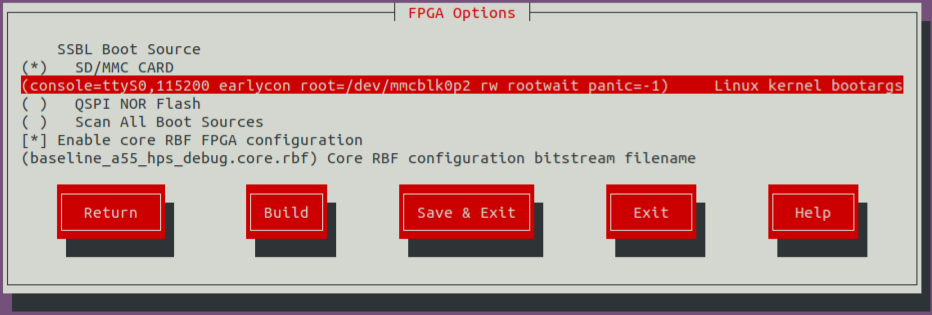{:style="width:45%; display:block; margin-left:auto; margin-right:auto"}

4. Select **Ok**, then choose **Save & Exit**. 

Verify the update in `$CWD/software/yocto_linux/.config.yaml`, `KERNEL_BOOTARGS_SD_MMC` variable must matches your input.

#### User Space I/O (UIO) Built-in Kernel Module

!!! info
    The User Space I/O (UIO) interface Kernel support depends on [CONFIG_UIO](https://www.kernelconfig.io/CONFIG_UIO) and [CONFIG_UIO_PDRV_GENIRQ](https://www.kernelconfig.io/CONFIG_UIO_PDRV_GENIRQ) parameters. These configurations are pre-enabled as a loading module in the Baseline System Example Design kernel. `CONFIG_UIO` and `CONFIG_UIO_PDRV_GENIRQ` need to be compile as built-in modules in the Kernel to be able to bind the driver after boot without user intervention.

Copy `baseline_a55_u-boot.core.rbf` to the Yocto bitstream recipe folder to include the latest Quartus project compile that includes the Lightweight UART IP.

``` bash
cp $CWD/output_files/baseline_a55_u-boot.core.rbf $CWD/software/yocto_linux/meta-custom/recipes-fpga/fpga-bitstream/files/baseline_a55_hps_debug.core.rbf
```

Configure the Yocto Linux Kernel (`linux-socfpga-lts`) to include UIO support as a built-in module through a Kernel configuration Fragment.

1. Launch the Kernel configuration tool. After executing the commands below, you will transition to a bitbake environment and the active directory change to `$CWD/software/yocto_linux/build`.

  ``` bash
  cd $CWD/software/yocto_linux
  kas shell kas.yml
  ```

!!! info
    `$CWD` and other environment variables are no longer accessible after executing the command, because the session transitions into a BitBake build environment.
  
  On the bitbake environment execute:

  ``` bash
  bitbake -c menuconfig linux-socfpga-lts
  ```

2. Navigate to `Device Drivers --->` and hit enter.

  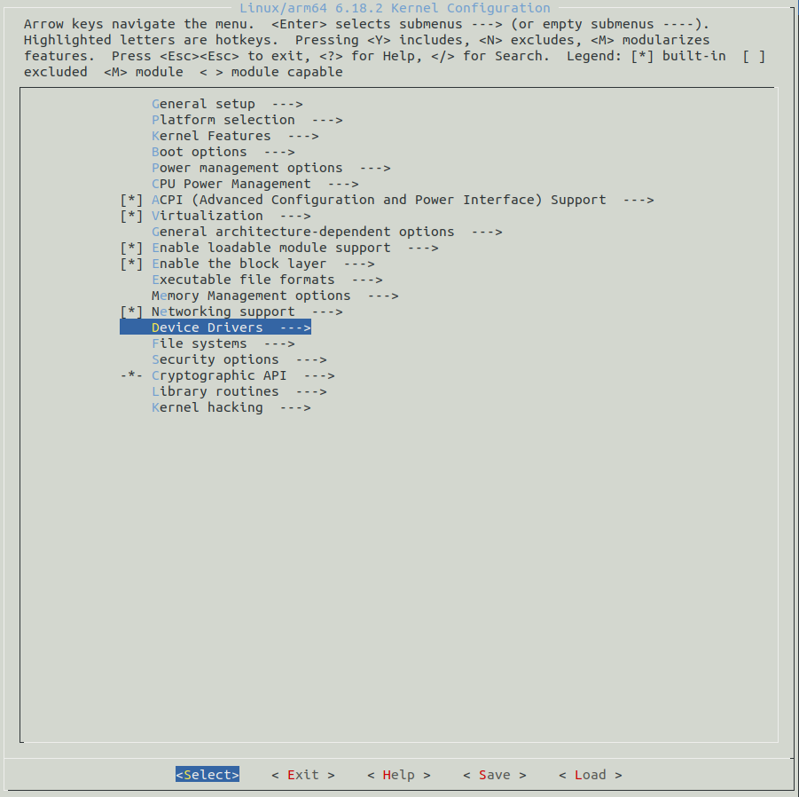{:style="width:45%; display:block; margin-left:auto; margin-right:auto"}

3. Navigate to `Userspace I/O drivers --->` and hit the space bar. `Userspace I/O drivers` are now tagged `<*>` to be compiled as a built-in module.

  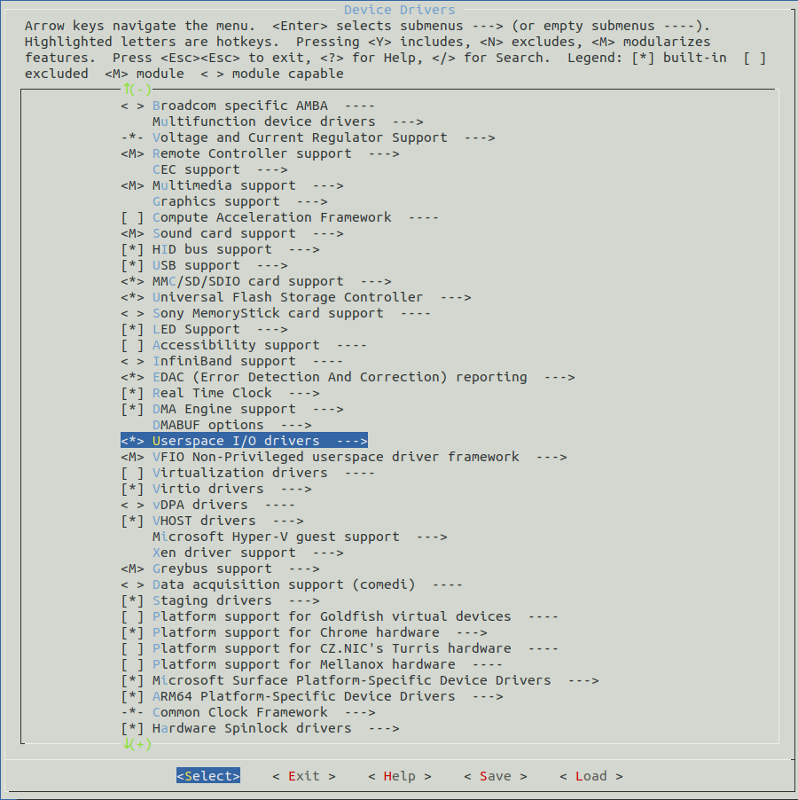{:style="width:45%; display:block; margin-left:auto; margin-right:auto"}

4. Navigate to `Userspace I/O drivers --->` and hit enter. Go to `userspace I/O platform driver with generic IRQ handling` and hit the space bar. `userspace I/O platform driver with generic IRQ handling` is now tagged '<*>' to be compiled as a built-in module.

  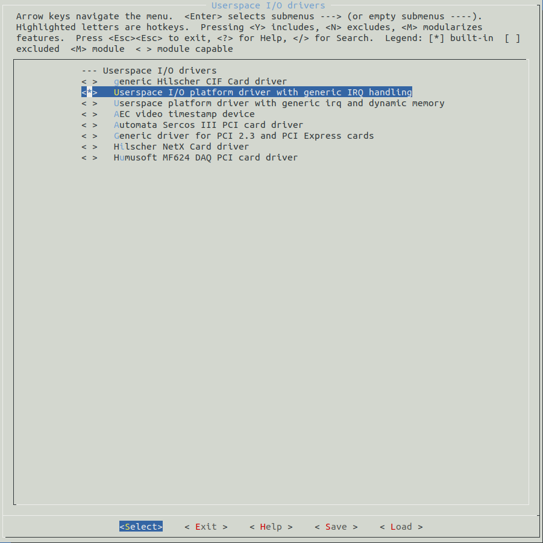{:style="width:45%; display:block; margin-left:auto; margin-right:auto"}

5. Navigating to `Save` and hit enter. When prompted, keep the `.config` file name, navigate to `Ok` and hit enter.
6. Navigate to `Exit` and hit enter. Repeat this step until you exit from the Kernel configuration tool.
7. Generate a Kernel configuration fragment (`fragment.cfg`). This file contain the Kernel parameter changes compared to the Kernel base configuration.

  ``` bash
  KCFG=$(bitbake -c diffconfig linux-socfpga-lts 2>&1 | sed -n 's/.*[[:blank:]]\(\/[^[:blank:]]*fragment\.cfg\).*/\1/p' | tail -n 1)
  echo "Captured path: $KCFG"
  ```
  
  The path to fragment.cfg is saved in the $KCFG environment variable, and its contents are shown below:

  ``` txt
  CONFIG_UIO=y
  CONFIG_UIO_PDRV_GENIRQ=y
  ```

8. Copy the configuration fragment to `../meta-custom/recipes-kernel/linux/linux-socfpga-lts/configs/`

  ``` bash
  cp $KCFG ../meta-custom/recipes-kernel/linux/linux-socfpga-lts/configs/
  ```

9. Create `fragment.scc` file in `../meta-custom/recipes-kernel/linux/linux-socfpga-lts/configs/`. Add `kconf non-hardware fragment.cfg` as `fragment.scc` content.

  ``` bash
  echo "kconf non-hardware fragment.cfg"  >> ../meta-custom/recipes-kernel/linux/linux-socfpga-lts/configs/fragment.scc
  ```

10. Add `fragment.scc` to `linux-socfpga-lts_%.bbappend` recipe.

  ``` bash
  KRX=$(find "$PWD/../meta-custom/recipes-kernel" -name "linux-socfpga-lts_%.bbappend") && [ -n "$KRX" ] && echo "$KRX"
  echo 'SRC_URI:append = " file://fragment.scc"' >> $KRX
  ```

11. Execute the `exit` command in the terminal to exit the bitbake shell and return to the virtual python environment.

#### Yocto Image Assembly

Launch the KAS graphical interface to begin the final image assembly:

``` bash
kas menu
```

Highlight the **Build** button and press **Enter** to trigger the Yocto build. This process integrates your custom FPGA bitstream, updated device tree, Kernel configuration, and kernel boot arguments into a single deployment package.

After the build process completes, exit the Python virtual environment by executing the next command:

``` bash
deactivate
```

Update the FPGA HPS and peripheral bitstream using the production FSBL (`u-boot-spl-dtb.hex`) generated by the Yocto build. This command replaces the dummy FSBL with the functional bootloader and generates a JTAG Indirect Configuration (`.jic`) file:

``` bash
cd $CWD
quartus_pfg -c output_files/baseline_a55.sof output_files/baseline_a55.jic -o device=MT25QU128 -o flash_loader=A5ED065BB32AE4S -o hps_path=software/yocto_linux/build/tmp/deploy/images/agilex5e/u-boot-spl-dtb.hex -o mode=ASX4 -o hps=1
```

As a result `output_files/baseline_a55.hps.jic` is generated.

### Hardware Verification

#### Hardware Reprogramming

You must re-flash the QSPI and SD card because these recent edits modified the Linux kernel environment. Re-write the updated `.wic` image to your SD card and re-generate the `.jic` file from your new `baseline_a55.sof`.

Connect the USB card writer and micro SD card to your host PC. Locate the assigned system name using `dmesg`:

Flash the Linux image to the micro SD card using the `dd` utility. Replace `sdX` with your specific identifier:

``` bash
# Use dd to write the image to the corresponding device
sudo dd if=./build/tmp/deploy/images/agilex5e/gsrd-console-image-agilex5e.rootfs.wic of=/dev/sdx bs=1M
# Flush the changes to the SD card
sync
```

Flash the `.jic` bitstream to the QSPI memory:

1. Power off the development kit.
2. Set the MSEL dipswitch (SW27) to JTAG mode: **OFF / OFF / OFF / OFF**.
3. Power up the board.
4. Program the QSPI memory:

  ``` bash
  jtagconfig --setparam 1 JtagClock 16M
  quartus_pgm -c 1 -m jtag -o "pvi;output_files/baseline_a55.hps.jic"
  ```

Complete the boot sequence:

1. Power off the development kit.
2. Set the MSEL dipswitch (SW27) to ASx4 mode: **OFF / ON / ON / OFF**.
3. Power up the board.
4. Log in to Linux using `root` as the username; no password is required.

#### Driver and IP Verification

Once the system boots, confirm the hardware bitstream by reading the System ID fingerprint in the Linux console executing:

``` bash
devmem2 0x20010000 w
```

The expected output is **0x0A17e12A**, verifying the correct hardware version is active. Verify that the Linux kernel initialized the UIO interface for the UART core executing:

``` bash
cat /sys/class/uio/uio0/name
```

The command returns `lw_uart@200100a0`.

Verify the boot arguments by executing:

``` bash
cat /proc/cmdline
```

The expected output is:

``` bash
earlycon panic=-1 root=/dev/mmcblk0p2 rw rootwait uio_pdrv_genirq.of_id=generic-uio
```

#### Register-Level Loopback Testing

Verify the `user_lw_uart` hardware registers using `devmem2`. Write `0xE` to the `TXFIFO` register (offset `0xA4`) to trigger a transmission through the fabric loopback:

``` bash
devmem2 0x200100a4 w 0xe
```

Read the `RXFIFO_LVL` register at address `0x200100b8` to confirm character capture; the expected value is `0x1`:

``` bash
devmem2 0x200100b8 w
```

Retrieve the character from the `RXFIFO` register at `0x200100a0`; the expected value is `0xe`:

``` bash
devmem2 0x200100a0 w
```

The successful data round-trip confirms the Lightweight UART core IP is operational.

---

## Level 3: Application Development & Deployment

### Implementing the UART BIST Application

#### Host Environment and Toolchain Setup

Create a [UIO](https://www.kernel.org/doc/html/v4.14/driver-api/uio-howto.html#writing-a-driver-in-userspace) based application to verify lightweight UART IP access and operation. On the host machine, create `apps` as the working directory:

``` bash
cd  $CWD/software
mkdir apps
cd apps
```

Download the Arm **GNU Toolchain** and configure your terminal to use it as the preferred ARM cross-compiler. This toolchain is essential for building applications compatible with the Agilex 5 HPS architecture:

```bash
wget https://developer.arm.com/-/media/Files/downloads/gnu/14.3.rel1/binrel/\
arm-gnu-toolchain-14.3.rel1-x86_64-aarch64-none-linux-gnu.tar.xz
tar xf arm-gnu-toolchain-14.3.rel1-x86_64-aarch64-none-linux-gnu.tar.xz
rm -f arm-gnu-toolchain-14.3.rel1-x86_64-aarch64-none-linux-gnu.tar.xz
export PATH=`pwd`/arm-gnu-toolchain-14.3.rel1-x86_64-aarch64-none-linux-gnu/bin/:$PATH
export ARCH=arm64
export CROSS_COMPILE=aarch64-none-linux-gnu-
```

#### Application Source Files

Create the following three source files:

**lw-uart-map.h**: Defines the IP address map and bit masks for register field access. Run the command below to generate the source file.

<details>
<summary>
  <span style="color: #0056b3; font-weight: bold; cursor: pointer;">
  ⚠️Click for command to generate `lw-uart-map.h` from encoded data
  </span>
</summary>

```bash
base64 -d <<'EOF' | gunzip > "lw-uart-map.h"
H4sICIUdwGoAA2x3LXVhcnQtbWFwLmgArZZRb5swEMff8yluilQlD2vJ1rXp1E4iBNaoZDBj2vQJ
MTCttQwqcNJ+/NkQDMGk66a9hMg/3/3vLn/sDGmSxiQBz7HwnY7MQHddL7DvAl9HOPAXjvy+1N3g
OhgM+W6akrcHDIY0jdabmMBlwWKasuPHL4PByQkg8kALRnLIkqQgrIAky4E9ErDpwyN7JuITRCbg
WSEmWxqRY6mPVtbCcgJkfgXtRdPkOt5bP23qxTr2vXp9KtcN5xtGjl0Doytg39ZsMu2KtJhRtbSC
ecjCprW52E8ZzdICRnMd67MF9uAKpmNwyq6FZktSbOGD827KpizLB+BpZ5RP5/yzJiSuyfqJJ16G
UZ4By4C8sDyMGMRCN8mzXxDC5Oz9D8ogr6vISRhLEXOFkW7gAK0CoTbiu8YwKh9HrQLGZUP4nxo6
bQ3q7zt6yslTmBPex3NOGYFtuN4QmdFFpitsh1di9CPRtii/fB7hbv0eC9mmaMrnunstNDVPFafo
lm/bMJr4cHkJk09jZcMeP1W5b0r6UaGm40r6QaEGH2pNJwqdt7E2HlQDhQugotWC5FsSK3p1wFQt
FM3va3quUNyiZypd4hqqE8KOVO0ZTwPV6czQTQ3V4VjNXBXmSqZVDvi+odFP0KOIFEXlseqg6ThD
5ll44s0wly6+r1+N6t1oDWsMV1cifysGvxaDe2Kudf6bIOSg3ghzDO/2tnMzvbKd0zpA9GxkKcuz
9Vts35x3BkZ2sDjs+h0/ZPod7vd8BQ9YvoSo3/BVYNfvexSjmfTKhSLZ4/pdpf2mr+ABz+9gr+V3
rNfxO8Vew1es3+8V67V7hRS38wtI3Exgky1Z9//krWuMG902b01bns/ne+fzROs/oB94HnFPr4WI
TPbVLO+U6mIUWTs3S0tK3i1/rLWxJ/7fteKDteJOrUOSxjQptd78r+c3poVKIFgJAAA=
EOF
```

</details>

**uio-bist-uart.h**: Application header file containing function declarations and UIO data structures. Run the command below to generate the source file.

<details>
<summary>
  <span style="color: #0056b3; font-weight: bold; cursor: pointer;">
  ⚠️Click for command to generate `uio-bist-uart.h` from encoded data
  </span>
</summary>

```bash
base64 -d <<'EOF' | gunzip > "uio-bist-uart.h"
H4sICMAdwGoAA3Vpby1iaXN0LXVhcnQuaACdVU1vm0AQvftXjJxLWiW2mx5bVaU2KEjxhwAnUS9o
DYs9KizW7mLX/fWdXTChxMmhlmzB7sx7bz59hZlIeQbh0ouenMCNndUqjB+e4rUTRPHaX8b38eCK
LFDw940GVyiSvEo5fFU6RaFHu2+DwXgMAdeVFJCUKVeQlRLIAVCgRpbjH6axFKOWwoD5Cz+K3SBY
BnD76fVNuJ5O3TCEyaC9c5/p3HP8h3Xgdn3secee1Mx4xqpcQ1GwPZRZprh+YZ/PnVW89LzQjRrz
H0xZakj5ARMOe6Z3JB7USWXqX9kz9zFeOdE9DMd0O05yptS4wtJ8J8OG3IKgoDQUNnLIMKe0vI24
cOYuDPNjXDGpv99NJp8mE0ZwXTvPf3Brw54OwQp+wfTRDUJ/uehbH7hUJOmCg/voLqJ4ulwvor4T
P3Ch6+jmvCjlCUxiJ8C0lripNO/FRBme1L49IHJT5qcXm7V3ZrOg5z0cszSVQzAf4l7tTgoTloPS
lCcwd1xdog79n+4rKIV/eAsV0gt1BugdN7HsUWxNfTany7E07dKHrFtraACX9hGOqHeEY2D3bMsv
QLUl7ALZGrbaKKkkx5wBtRduBU+NuFkUjmwNIkJnia4oE8mOSXrk8ty7gibQDqDp/esP/wqY3juB
KQcxknmnZ/3zpFKbGu12GCRSs4xeplu9Hk/qbVUlCVXhpj/VJeHIIyrKAe2Jz3exhjWWhug6KYXS
VvrHRnZsRu7DF6vlSSIVARh8vrvdoIYDyysOuqQTybeoTLBN5Tozy7Q92ZJm0Y78ocTUsFrI6+qs
o76+gfbAUjT0AWfpK/ZMlsV/8FedyA1uX0JDOc1L1U18gyhSqISZGCjs0I3q2iO9V5S/DQeahZx6
g2VGEz1DuefSrhyKQNJ9WexzrvlLJtzflP+G9pFLzE5E22jvcGOtJj+C2Ujgr2qA2oNgFtSb1+ao
kzTKT/Ds+d4SaFnQiqiExtzC2EOC5MVen2okL6/ULvjtYVa+kRQLeZZVvGyd886xPUIpKtgvbuwK
48QODHO2yc36tc5JJSXJAZVQamw99loS1ZbrmNo/JsS43WKdxoSP5sZ05Q10T1tbo/KKixSzembf
+9f8C7DFMK2ABwAA
EOF
```

</details>

**uio-bist-uart.c**: Main application source file containing the hardware validation routine. Run the command below to generate the source file.

<details>
<summary>
  <span style="color: #0056b3; font-weight: bold; cursor: pointer;">
  ⚠️Click for command to generate `uio-bist-uart.c` from encoded data
  </span>
</summary>

```bash
base64 -d <<'EOF' | gunzip > "uio-bist-uart.c"
H4sICLMdwGoAA3Vpby1iaXN0LXVhcnQuYwC1WvtT20gS/p2/osNWwCaOMSS7m4JlqxwwG9cRzNkm
yd3unmssjWxVZEknjTDsXv736+556IF51NUeVTw8munpx9ffdI/Y3/trv7ZgD86HFwO47H8cHMFK
hHHXg9b1cAQXSZLOhfcVdmAYK5llRapgKnMF/TSNQk+oMInbJIC+zwaT0/HwajocXR7RZ5guwxxE
ORNuRBT6Qskc1FJCUMQeDeOguoMkAAFRuFiqtaSf0IrWbbjuj6cwvGL54CWZhCIP4wWvvwjj4hau
c5nlqfAkDPdHrHYb/Cy8kRkEmVjJdZJ97cJQoWFpDunyLkdtIi1wKTJ/LVBoJhdhjgbmEMYqwT1w
NQvtAAoKgxBV9uVNiLsIpbJwXpARN6GA/C4P8o4WJ2IfsiJGm2GO02TGVrlNcInKuzjzL/3a3/ou
jL2o8CVsF2Hyeo6GvC5EprrL7cqjaM2Dr9EL9KB88lOaRFF3+XNlJPBi1RjKlR8m94aicN4cyzA6
jbG7fH+1EnF9tIhRT5/Gtr7zZRDGEjB0s48f+1ezyfCfA+jdHvR6PYD9/caDln7SPkJ8ScjDPyR5
mQCxkqsEfb4Fj36hQAo3whEjje7oYMxhfofR6cLHMA5XxUpLPYBULOTT0lpv//a+7awYXQ0uZ4Px
eDSG1wfVaUkq41Yb91ZFhhjBh6gC5lSSbW3h4/Mwkoix3MvCVCUIXvwmo2gZecDgr7uVK0wmj4AK
wTGt/BRmqkBIC9/PZJ6TTSnliPFKubaEuZPiITphL1XZMSsxjEMVYj7+YVKU13Iydenx2OhOARle
DqezyfXp6WAyIUvywvNw9075UDshQTnZOsxRc1T5zeFMwXWY0EYtL4mRSrQKWsNZKtSyDX9uscdG
ZDqpYU0HCOBEO7IyvwOj2fjs87h9jBPCAFo46aQSBy0PIGVntyhLQN6KVYoOx3grHYRtXg4mPg0r
6NG3La3VR40y9DLr5hjFut+43aU9M8pNI0ZMLmQQuh5NwvxIW5fXFxedOtg7cDUeTWfjQf8M/qP/
/jweTnGcZ3zojwdnHQg6dZDy8tH5+WQwdT7hfU542Xkf2f6s6RVSAQKBKPStK7woyWUreJ5j9uCD
sfh1nkoPOdODHJekkC+TIvJhjr6K0GofEBCyC8hcW/elGkQdb31jQH7OQmJaAW8OkdkUnSCFpMQV
Dsz3cd7duklCn2DGy1uFBV4SBKhSB9wAi3N4Iz6xAcKTyxOITkGbp0lIxx/kCaAOnojJGB+tCPA7
RpMoknut1k0SYVYhrNwGe232/CuzdbuNweZNrYFjKfx79gVZsnrCwqKSTCSjaaQ2ynj3eapZlU4p
7HmTO+hwK2I+RDXPMiPwEW8PclgV6DF0DaYDwghEQMrj36iH8PfXFAzK3oyrAbQas8NPYkmCMKRp
Rs+iO71NldFpbwajrhvqTFlGe3CLpKINt5B/cQKUVrCzA+bj/QxY8X40vZF9bY1uSyovNpFKNUe+
GQd+opLhDnUVqunFUPs1WgOdxljZaOX1CjThEiuWFg1p+VyX7QUpSWeenBcBYu7Xg8N3vx8bPjro
lkTJ1QjEKIS9RISZIuICpkyyjQTOqNDrwLahPDYuJXIgTzVpYUC/mHLpSCFLnHRLE5LcPviCyUt+
vR5bv2n1DruMcVaPlzIf0idti9VgIVXe0kMdPn+TwHxsI8Ol7aaCQYqlhgpaWEWgqmgOh+UIzpnC
CE8EOp1KL/Pf4m0dXOcAo3xgApg+YUx9pjbtTRcmWPBoqKoMNyYfxXIdUSFA8RIeZUDrNyqSbeyw
RvLyNHa2bv+WoXbt3zFOPSv5bRdOk1VKCbIO1RKUyNA/7D/jL5KySp0QMu1s8ElbRkjtPeWnMw3I
VZivhPKWL2Bwi7St0HW7L/NdVBbLi6SI9UdyX+2Mqe7XMZY9DQejyvbw8nx0VE0LBoaptP0jGy8n
tqRKZMXxl/Ph+QhkrDKiCiQ19j8PYnrJVarudFadR0W+HN+eh0GymR7r+pxGUlD5ijuwtC6FhXRf
L4lxWpZptQKzi08XeDD/UuX2xoza02MdWV/Oi4Xb2NiCJe3L3uEXLGnpj3df2PpSSEcvHXyZjvun
WA18mZ31p/2mPjjxldWk7jPLQauycrFdDB+uGOSV+MrkuqJF4gahLOZcHvFir8jwnFOQe0gEfPQg
WaIvEZMzrKZmKHHm+qJaWUdPdI1WHXVzdRh4MCiiiKf+evj9D7+Tt8p99KlYyY9TEpYVngJacQSy
u+h2YJ9aDS8Seb6PWtF3b58OLPrR29e+wfV5bNzvtnSE40aQc7Zf5vsvcwxEaUOpNyti2NkRbEVe
lVxfBE1SLTnKVfdOdKMO7VW59EpkeAYu5a3xSGuJsYvMWb3bu91FYGEXcguiUMmKCnw8fO/almJz
rFzQRjItukXDdkz5g3Rx8HxaTVkJk6JVjxg9g+qRaKyolTwDzlyuqVzpUDYHdP9QOQEJBO9mpkY/
j8SiCgM8+k6X0vsKawm61Mb2BbsXe0PgJYhbBEmjjAldl4PlnEkuYB/FiT6xM76BsEvmSaaHqYOn
Uq9+XJvzYA92NcR27SlPTSX4WMIJrBGxLlJrac5p7Bi5uQR8hrJJqXqfA3vwXnqiQE9zb9DWtVXG
jOwn61jXwNRvo31O3Jyei+yug+JQCS0INeDCe0UprIEzz0J/YXCzoForgWWobcQjixqV+1cjWq39
WmJqgzEkm5mAq6n+VW921Z9+QCzp6Rrh5C/Kut0jlSjc0JBTJmK0A2GbeEJpwLEpTp+aj7j81I23
cTk5wPVgaHBYMQHmKPUrtM6EEh08uoUq+OqGJCGjqCyJOiCV18XsVzKKLIxGE1gma4yAtyzbPX3n
pMtWhSAr3eO8w7cIz/UNTS49Q23I7hFc2d3eC0RCv95h8t1Y4go/JVd4YuZVzxgcinmeRLhn6UTb
5fjSS3z08vzOVGR0ARZkQpNrkcmOlpZJJJac3Glcgs8NeGlE57JRy1tiRYQHh/OUbRfu+Ye0eLZ/
aPK2TrX7ZcRHxHAPrVHIUvmRPbfr86D0JjmSz9roVrMYft64YsSAPbJVT7micqg310wwkG5FdQ1F
WBtAbGwvQcjOU2zkqZxiKm62ws9n5gqvVVpF6w1HxtXazBa3913qhOmrW3O9g0ecEUjnX6W+cg5x
Vb9m5pyzzKXgEVKs5nJdd0y/7Jtqa8IMztVbt0HJHSDwaXoaXulrVvmayNj48kN/orsyVxNNpv3p
9aRRn7lj2Bj7uT++rJWhS+z2WTkI8KTJoUgr3qu7qLLBxuqtfF4rnB/Vj4MBMsJU/3PDlvU2krqb
O6fet7IlmeLhtaC+G65jREoQIXVpo0w1ZxyOJVklQs7ljiwRUFizBWG2Mv03VseaVZ2HuveQM7GU
YDbBAt3qoIxefIhuTtFGZf1YWWzmVJz7ZHn+0H7PKb/N19MleBVutgAcXw/+F3gaHa8HFAc/5DRE
iuMmraPjQZ7mQJQwdbdeGzdp3BQ+agD8y6H4erABnQ8RUl1jKqms1hU1XT336lUVv9j4svYYiV6H
3gHQj0MGYO/2DZibg2kdwQZrDsKRvJGRBq0BMNdcsE4yumvL6ELb7+p+r5oRT6NZS64huPT3dIMP
Sf1e77kTD5478fC5E9/wxCKPpExb/Nrksaz7f2ScOesenUjH3tunzjnMOacnEbWIkVykvbTguvYR
fG2gVWeI80N9A+a6unx95FURYV/ToCaqDowHzscS699XsN4/+HFwcNi/B3C+w+JXsHyR1UQ6Ydy+
VAX8Iai4kguUevc0mOvzWXkCgNWl7SyxPRg2nmKSSvH1V7qs+pOmco7+SD8HOlX737gEQLe0qCYM
/duT3jH9+ukt/3r1qt2gqc3YLffCRb9vQLHeBOwu3BbyHz+B28nEu3rdj/OeuqXRmKW5CMuGHkbi
BoTpr4fA+9Fcs2HDrNvCl0hA7sZNZ10HFsiV+m9OPNyx6YgO2WC0/FbB0g9d/V6eaoTyVX3tDfvD
gKgvag3Hf2/XoWzvWpIoCnwI/Nyigr0aZv+eYV97Agf3hj1sx5StCftocczXSriDLUa4iTHNF4xt
7dGidyE/4rzx2T/aVaY7HV1Ox6M6fRDu3vVc6fmeXBFFjfeXlFl0z59/5QehM9fo8cvw1JAVv6ag
W5IdbZi7HNIf28xWzSELi6eLdKOELrGNEhXOeJy59OVXWeORI7F3w87Mp0CajIbI/N+GWVMPu1lL
82k5/RMD0g0vZdO73Zo6zvUb8pQ8f36uPW+UO0NSE6Hi3CydzJfYh6gn1QWgwpVMCmVd5uddRNUJ
vc0uR/CgjVWOo1eji4vhpX1E2Z7xjQOBsbWDUzuAzHPoSMHmL836GZvCnR1okcDMSNwxEtvVXAYm
Whd0hm0t7jzSbh9XVtS9WuaPJ4rFUr2AKV9rUJz1zkfwstBp7eQ5hY3zBrYocY26CTBpZ1tvjlQr
u+XffD5wKYgdQebftSsCXSZm0pNU8jyL+zYZN7YCLFHV9OO3HeYlb4yF/lzCxehzl221WzvhBs42
QieVNxWPZ1DpYAMf22FOwgUSHExFCoi5CpXUYPwAYzeyi003l7QEsPq/BjwsxXTRhP8wZ4pjXnMJ
kKNTAvrvpQDbai4gnkNqGtIlw5+6V6BlK6jl6Def7m7BqfhUTTXCyKHTVon99yTzHwDPuDR4uE/t
R5ERloo8R9SUdwfR3QOS3Wt//Rb1vyalqAvkJgAA
EOF
```

</details>

Generate the application binary using the Arm cross-compiler:

``` bash
${CROSS_COMPILE}gcc -g -o uio-bist-uart uio-bist-uart.c
```

#### Binary Deployment and Execution

Identify the assigned IP address of the development kit by executing the `ip addr` command. Locate the `inet` address associated with the primary Ethernet interface (`eth0`). In the transcript below, the assigned IP address is '10.244.157.136'.

``` bash
root@agilex5e:~# ip addr
1: lo: <LOOPBACK,UP,LOWER_UP> mtu 65536 qdisc noqueue state UNKNOWN group default qlen 1000
    link/loopback 00:00:00:00:00:00 brd 00:00:00:00:00:00
    inet 127.0.0.1/8 scope host lo
       valid_lft forever preferred_lft forever
    inet6 ::1/128 scope host noprefixroute 
       valid_lft forever preferred_lft forever
2: eth0: <BROADCAST,MULTICAST,UP,LOWER_UP> mtu 1500 qdisc mq state UP group default qlen 1000
    link/ether ba:3e:b6:00:6e:17 brd ff:ff:ff:ff:ff:ff
    inet 10.244.157.136/24 metric 10 brd 10.244.157.255 scope global dynamic eth0
       valid_lft 1843sec preferred_lft 1843sec
    inet6 fe80::b83e:b6ff:fe00:6e17/64 scope link proto kernel_ll 
       valid_lft forever preferred_lft forever
3: sit0@NONE: <NOARP> mtu 1480 qdisc noop state DOWN group default qlen 1000
    link/sit 0.0.0.0 brd 0.0.0.0
```

From the Linux host, transfer the binary using `scp`, substituting the target IP address accordingly:

``` bash
scp uio-bist-uart root@10.244.157.136:/home/root
```

On the development kit, grant execution permissions and run the application:

``` bash
chmod ug+x uio-bist-uart
./uio-bist-uart
```

See the expected output below:

``` bash
root@agilex5e:/home/root# ./uio-bist-uart 
INFO: UIO device name verified: lw_uart@200100a0
INFO: UIO Map 0 details:
INFO:   Physical Addr: 0x20010000
INFO:   Offset:        0xa0
INFO:   Size:          0x1000
INFO: UIO initialization successful.
INFO: Clearing RX FIFO.
INFO: UIO device is ready.
INFO: Starting RX FIFO underflow trigger test.
INFO: RXFIFO_LVL_REG (0x18): 0x00000000
INFO: RXFIFO (0x00): 0x0000000F
INFO: RUE condition detected, clearing flag.
INFO: Starting RX FIFO level test.
INFO: RXFIFO_LVL (0x18): 0x00000004
INFO: RX_FIFO_LVL has the expected value. Flushing RX FIFO for the next test.
INFO: Clearing RX FIFO.
INFO: Starting RX FIFO data integrity test (0x0A17E12A).
INFO: Starting UIO Interrupt (IRQ) test.
INFO: Triggering IRQ via TX data write...
INFO: Interrupt caught! Total UIO events: 1
INFO: Received 0x0F, hardware IRQ line should now be LOW.
INFO: All tests passed successfully.
```

### Hardware Debugging with RiscFree IDE and GDB

#### Remote GDB Server Initialization

Enable a remote debugging session on the host computer to inspect `uio-bist-uart`. This section requires that you have completed the [Implementing the UART BIST Application](#implementing-the-uart-bist-application).

1. **Start a serial session** in the development kit.
2. **Navigate to the root directory** where the binary resides:

  ``` bash
  cd /home/root
  ```

3. **Start a `gdbserver` session** with the `uio-bist-uart` app attached to it by executing the following command:

  ``` bash
  gdbserver localhost:1000 uio-bist-uart
  ```

4. **Return to a Linux host terminal** to proceed with the IDE configuration steps.

#### IDE Project Import and Configuration

Return to the Linux host terminal and launch the RiscFree IDE:

``` bash
cd  $CWD/software/apps
RiscFree -data workspace -nosplash &
```

Import the `uio-bist-uart` binary and source code into the RiscFree workspace:

1. On the RiscFree IDE, go to the **File** menu and select **Import...**.
2. In the Import window, select **C/C++ > C/C++ Executable** and select **Next**.

  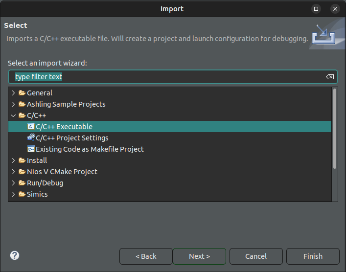{:style="width:45%; display:block; margin-left:auto; margin-right:auto"}

3. In the **Import Executable** window, navigate to **Select executable** and select the **Browse** button.
4. Select the `uio-bist-uart` binary from the file browser.
5. Back in the **Import Executable** window, select **Next**.

  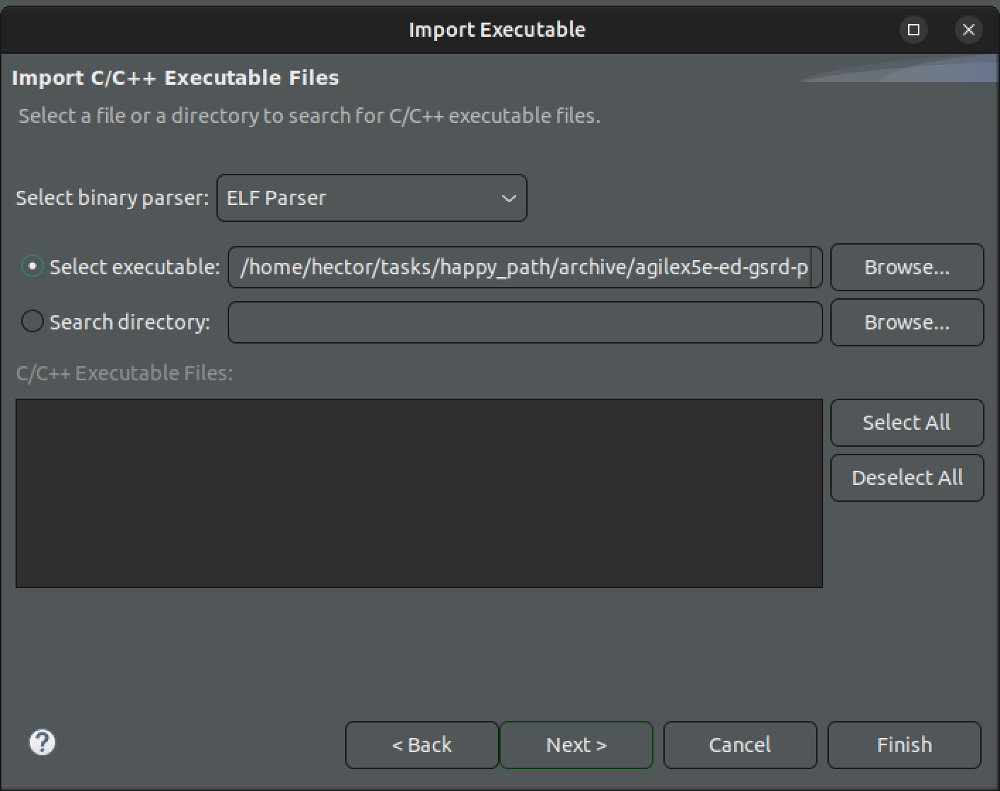{:style="width:45%; display:block; margin-left:auto; margin-right:auto"}

6. Select the **Create Launch Configuration** to be **C/C++ Remote Application**, then select **Finish**.

  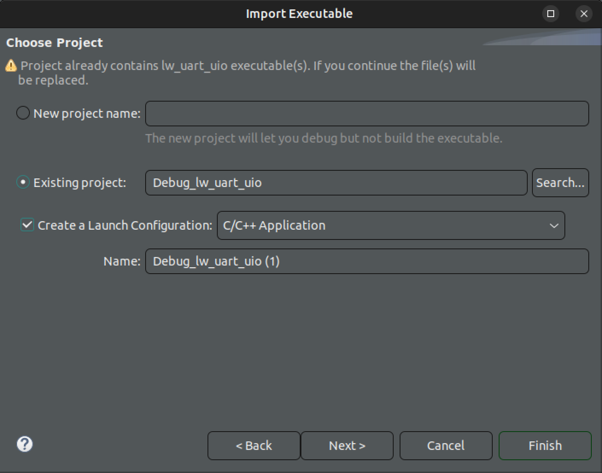{:style="width:45%; display:block; margin-left:auto; margin-right:auto"}

#### Debug Launcher and Target Connection

1. In the **Debug Configurations** window, **Main** tab, select **Select one...** on the **Multiple launchers available** at the bottom left.

  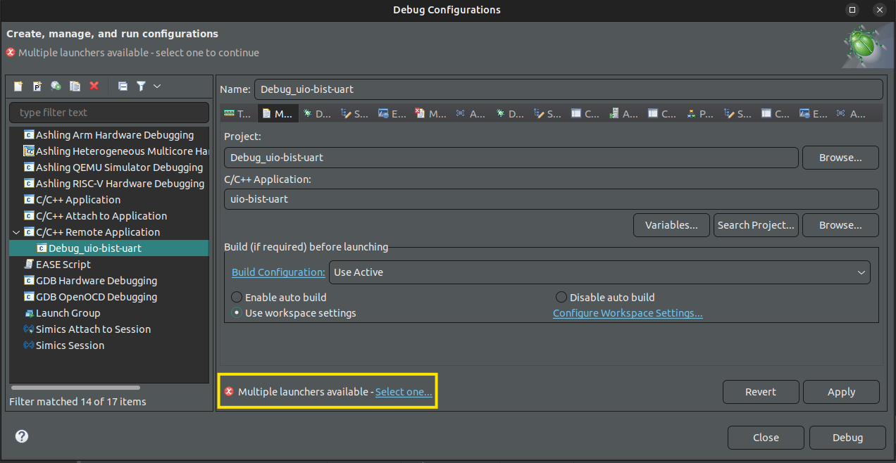{:style="width:45%; display:block; margin-left:auto; margin-right:auto"}

2. In the **Select Preferred Launcher** window, check **Use configuration specific settings**, select the **GDB (DSF) Manual Remote Debugging Launcher**, and select **OK**.

  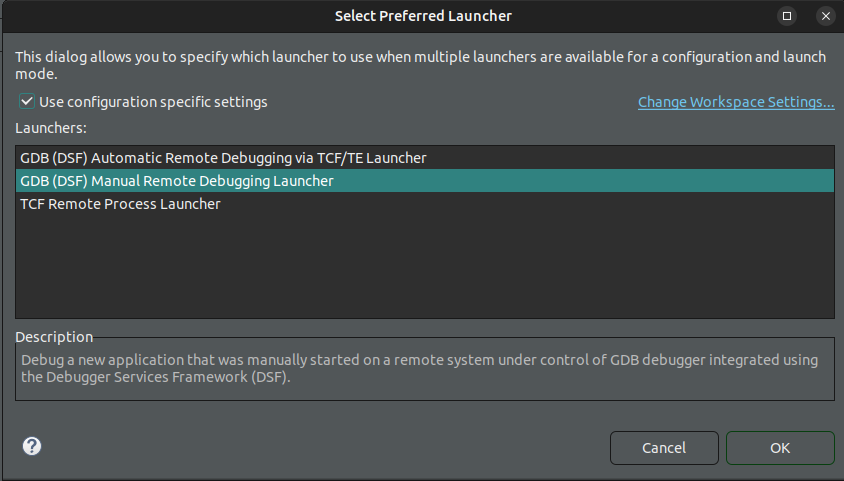{:style="width:45%; display:block; margin-left:auto; margin-right:auto"}

3. In the **Debugger** tab, check **Stop on startup at main**.

  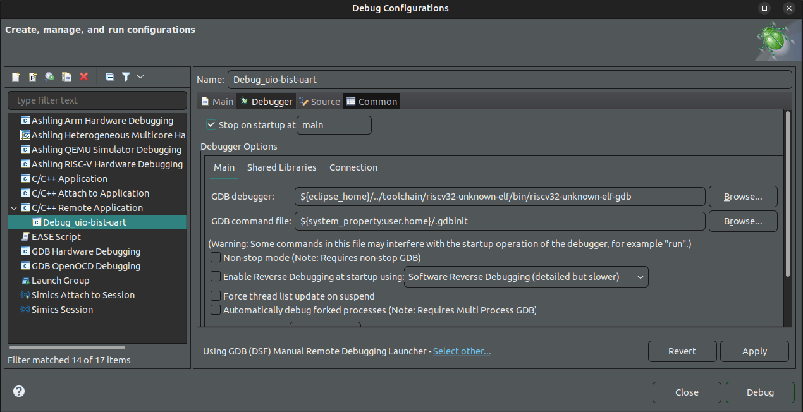{:style="width:45%; display:block; margin-left:auto; margin-right:auto"}

4. Under **Debugger > Main > GDB Debugger**, select **Browse**.
5. Select the **aarch64-none-linux-gdb** debugger shipped with RiscFree, typically installed in the `~/altera_fpga/26.1/riscfree/toolchain/Arm/aarch64-none-linux-gnu/bin/` folder, and select **Open**.

  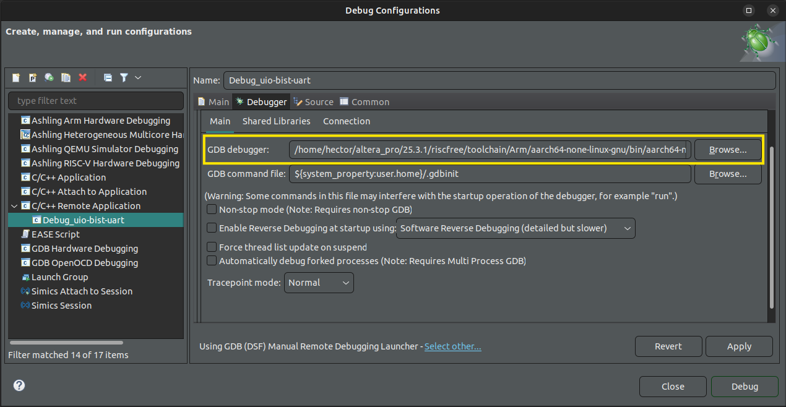{:style="width:45%; display:block; margin-left:auto; margin-right:auto"}

6. Go to the **Connection** tab and update the **Host Name or IP Address** to the IP address of your development kit.
7. Change the **Port number** to `1000`.

  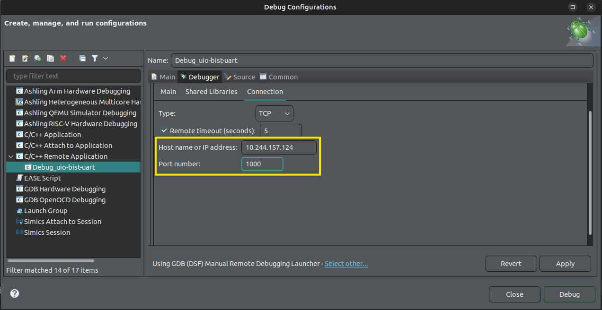{:style="width:45%; display:block; margin-left:auto; margin-right:auto"}

8. Select **Apply** at the bottom of the window, then select **Close**.
9. Select the dropdown next to the **debug** icon in the toolbar and choose **Organize Favorites...**.

  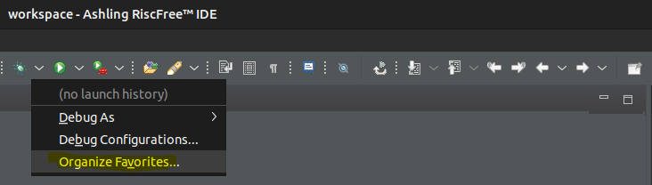{:style="width:45%; display:block; margin-left:auto; margin-right:auto"}

10. Select **Add**, choose **Debug_uio-bist-uart**, and select **OK** to close the dialog boxes.

  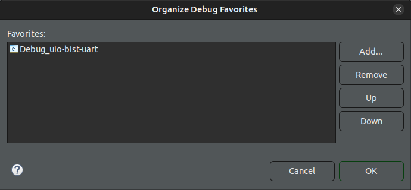{:style="width:45%; display:block; margin-left:auto; margin-right:auto"}

#### Establish Remote Debugging Connection

1. Select the dropdown menu next to the **debug** icon in the toolbar and choose **Debug_uio-bist-uart**.
2. Select **Switch** when prompted to switch perspectives.
3. The debugger will now load the application and stop at the `main()` function, allowing you to begin debugging.

  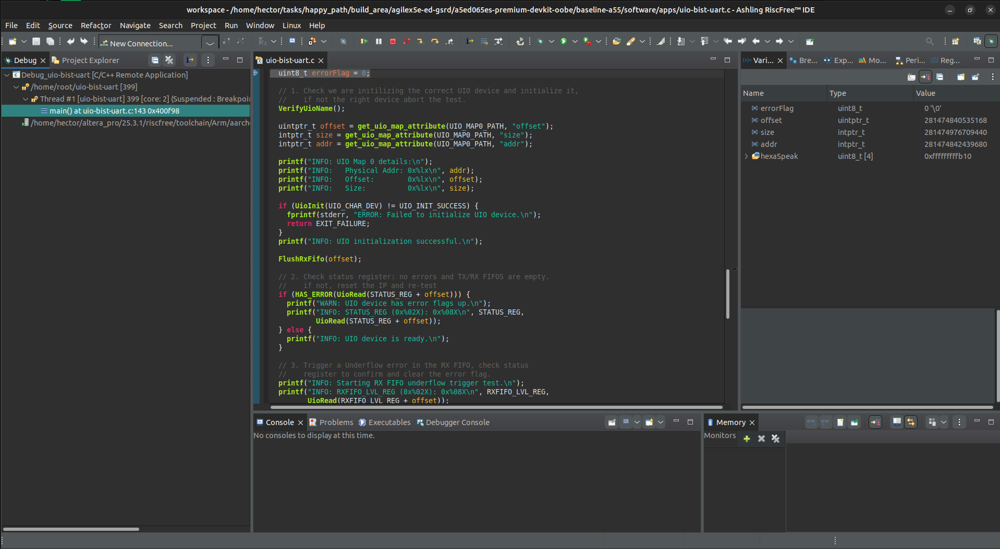{:style="width:45%; display:block; margin-left:auto; margin-right:auto"}

> Refer to [HPS Linux Application Debuging with Ashling RiscFree](https://altera-fpga.github.io/rel-26.1/embedded-designs/agilex-5/e-series/premium-065b/riscfree-linux-app-debug/ug-riscfree-linux-app-debug-agx5e-premium-065b/) document for additional information on debugging with RiscFree.

### Deploy Linux Application to Linux Image

#### Yocto Recipe Creation

The Baseline System Example Design Yocto project includes a hook to add custom applications. Follow these steps to integrate `uio-bist-uart` into the Yocto build process.

Create a new recipe by copying the `hello-world` example:

```  bash
cd $CWD/software/yocto_linux/meta-custom/recipes-apps/
cp -r hello/ uio-bist-uart
cd uio-bist-uart
```

Replace the example files with your `uio-bist-uart` source files in the `files` directory. 

``` bash
rm files/hello.c
cp $CWD/software/apps/lw-uart-map.h $CWD/software/apps/uio-bist-uart.h $CWD/software/apps/uio-bist-uart.c files/.
```

Rename the recipe file to `uio-bist-uart.bb` and update its content to instruct the build system on how to compile and install the binary:

```  bash
mv hello.bb uio-bist-uart.bb && cat << 'EOF' > uio-bist-uart.bb
DESCRIPTION = "UIO-Based sanity check for lightweight UART Altera IP"
LICENSE = "MIT"
LIC_FILES_CHKSUM = "file://${COMMON_LICENSE_DIR}/MIT;md5=0835ade698e0bcf8506ecda2f7b4f302"

SRC_URI = " \
    file://uio-bist-uart.c \
    file://uio-bist-uart.h \
    file://lw-uart-map.h \
"

S = "${UNPACKDIR}"

do_compile() {
    ${CC} ${LDFLAGS} ${S}/uio-bist-uart.c -o ${B}/uio-bist-uart
}

do_install() {
    install -d ${D}${bindir}
    install -m 0755 ${B}/uio-bist-uart ${D}${bindir}/uio-bist-uart
}
EOF
```

#### KAS GUI Integration and Final Build

Register the application in the 'kas' folder to enable it in the build system GUI. Create `kas/apps/uio-bist-uart.yaml` to include the application in the image installation list:

``` bash
cd $CWD/software/yocto_linux
cat << 'EOF' > kas/apps/uio-bist-uart.yaml
header:
  version: 17
local_conf_header:
  uio-bist-uart: |
    IMAGE_INSTALL:append = " uio-bist-uart"
EOF
```

Add a menu entry to `kas/apps/Kconfig`:

``` bash
sed -i.bak '/endmenu/i config UIO_BIST_UART_APP\n    bool "UIO Bist Lightweight Uart app"\n    default y\n\nconfig KAS_INCLUDE_UIO_BIST_UART_APP\n    string\n    default "kas/apps/uio-bist-uart.yaml" if UIO_BIST_UART_APP\n' kas/apps/Kconfig
```

Launch `kas menu`, navigate to **Example applications**, and ensure the application is enabled.

``` bash
cd $CWD/software/yocto_linux
python3 -m venv venv --system-site-packages
source venv/bin/activate
pip install --upgrade pip
pip install kas
pip install --upgrade kas
pip install kconfiglib
kas menu
```

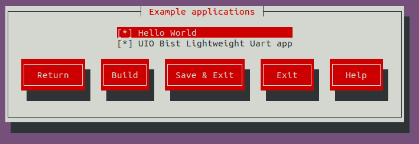{:style="width:45%; display:block; margin-left:auto; margin-right:auto"}

After enabling the **uio-bist-uart.bb** recipe in the configuration menu, launch the compilation to generate the final Yocto image. In the Kas GUI, navigate to the **Build** button and press **Enter** to start the build process. This integrates the `uio-bist-uart` binary as a user-executable installed in the `/usr/bin` directory of the Linux image.

Update the FPGA HPS and peripheral bitstream using the production FSBL (`u-boot-spl-dtb.hex`) generated by the Yocto build. 

``` bash
cd $CWD
quartus_pfg -c output_files/baseline_a55.sof output_files/baseline_a55.jic -o device=MT25QU128 -o flash_loader=A5ED065BB32AE4S -o hps_path=software/yocto_linux/build/tmp/deploy/images/agilex5e/u-boot-spl-dtb.hex -o mode=ASX4 -o hps=1
```

#### Deployment Image Checkout

You must re-flash the QSPI and SD card as these edits modified the Yocto environment. Re-write the updated `.wic` image to your SD card and re-generate the `.jic` file from `baseline_a55.sof`.

Connect the USB card writer and micro SD card to your host PC. Locate the assigned system name using `dmesg`:

Flash the Linux image to the micro SD card using the `dd` utility. Replace `sdX` with your specific identifier:

``` bash
# Use dd to write the image to the corresponding device
sudo dd if=./build/tmp/deploy/images/agilex5e/gsrd-console-image-agilex5e.rootfs.wic of=/dev/sdx bs=1M
# Flush the changes to the SD card
sync
```

Flash the `.jic` bitstream to the QSPI memory:

1. Power off the development kit.
2. Set the MSEL dipswitch (SW27) to JTAG mode: **OFF / OFF / OFF / OFF**.
3. Power up the board.
4. Program the QSPI memory:

  ``` bash
  jtagconfig --setparam 1 JtagClock 16M
  quartus_pgm -c 1 -m jtag -o "pvi;output_files/baseline_a55.hps.jic"
  ```

Complete the boot sequence:

1. Power off the development kit.
2. Set the MSEL dipswitch (SW27) to ASx4 mode: **OFF / ON / ON / OFF**.
3. Power up the board.
4. Log in to Linux using `root` as the username; no password is required.

Execute `uio-bist-uart` from the console. The executable is located in the `/usr/bin` directory.

## Appendix

### IP Address and Register Reference

#### Register Memory Map

Calculate Lightweight UART IP addresses using the formula: $Address = Base + Offset + (Reg \times 4)$.

| **Register Name** | **IP Register Offset** | **Platform Designer Register Offset** | **Description**              |
| ----------------- | ---------------------- | ------------------------------------- | ---------------------------- |
| `RXFIFO`          | 0x0                    | 0xA0                                  | Receive data FIFO            |
| `TXFIFO`          | 0x1                    | 0xA4                                  | Transmit data FIFO           |
| `status`          | 0x2                    | 0xA8                                  | Status register              |
| `control`         | 0x3                    | 0xAC                                  | Control register             |
| `divisor`         | 0x4                    | 0xB0                                  | Divisor register             |
| `endofpacket`     | 0x5                    | 0xB4                                  | End-of-packet register       |
| `RXFIFO_LVL`      | 0x6                    | 0xB8                                  | RXFIFO filled level register |
| `TXFIFO_LVL`      | 0x7                    | 0xBC                                  | TXFIFO filled level register |

---

## Notices & Disclaimers

Altera<sup>&reg;</sup> Corporation technologies may require enabled hardware, software or service activation.
No product or component can be absolutely secure. 
Performance varies by use, configuration and other factors.
Your costs and results may vary. 
You may not use or facilitate the use of this document in connection with any infringement or other legal analysis concerning Altera or Intel products described herein. You agree to grant Altera Corporation a non-exclusive, royalty-free license to any patent claim thereafter drafted which includes subject matter disclosed herein.
No license (express or implied, by estoppel or otherwise) to any intellectual property rights is granted by this document, with the sole exception that you may publish an unmodified copy. You may create software implementations based on this document and in compliance with the foregoing that are intended to execute on the Altera or Intel product(s) referenced in this document. No rights are granted to create modifications or derivatives of this document.
The products described may contain design defects or errors known as errata which may cause the product to deviate from published specifications.  Current characterized errata are available on request.
Altera disclaims all express and implied warranties, including without limitation, the implied warranties of merchantability, fitness for a particular purpose, and non-infringement, as well as any warranty arising from course of performance, course of dealing, or usage in trade.
You are responsible for safety of the overall system, including compliance with applicable safety-related requirements or standards. 
<sup>&copy;</sup> Altera Corporation.  Altera, the Altera logo, and other Altera marks are trademarks of Altera Corporation.  Other names and brands may be claimed as the property of others. 

OpenCL* and the OpenCL* logo are trademarks of Apple Inc. used by permission of the Khronos Group™.  