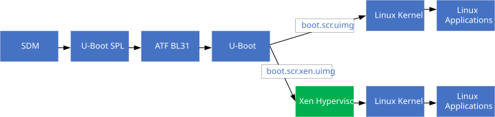
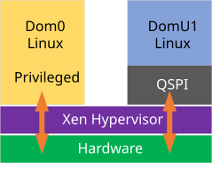
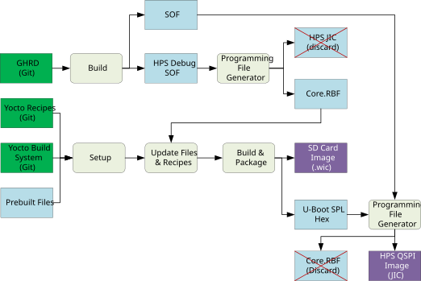

## Overview

This page presents the Xen System Example Design, which is based on the HPS Baseline System Example design.

### Prerequisites

The following are required in order to be able to fully exercise the Xen System Example Design:

- [Agilex™ 7 FPGA F-Series Transceiver-SoC Development Kit (P-Tile and E-Tile)](https://www.altera.com/products/devkit/po-3003/agilex-7-fpga-f-series-transceiver-soc-development-kit-p-tile-and-e-tile) ordering code DK-SI-AGF014EB
- SD/MMC HPS Daughtercard
  - SDM QSPI Bootcard
  - Mini USB cable for serial output
  - Micro USB cable for on-board Altera® FPGA Download Cable II
  - Micro SD card (4GB or greater)
- Host PC with
  - Linux - Ubuntu 22.04LTS was used to create this page, other versions and distributions may work too
  - Serial terminal (for example Minicom on Linux and TeraTerm or PuTTY on Windows)
  - Micro SD card slot or Micro SD card writer/reader
  - Altera&reg; Quartus<sup>&reg;</sup> Prime Pro Edition Version 26.3
  - Local Ethernet network, with DHCP server (will be used to provide IP address to the board)

You can determine your board version by referring to the following table from [https://www.intel.com/content/www/us/en/docs/programmable/683752/current/overview.html](https://www.intel.com/content/www/us/en/docs/programmable/683752/current/overview.html)

| Development Kit Version | Ordering Code | Device Part Number | Starting Serial Number |
| :-- | :-- | :-- | --: |
| Altera® Agilex™ 7 FPGA F-Series Transceiver-SoC Development Kit (Production 2 P-Tiles & E-Tiles) | DK-SI-AGF014EB | AGFB014R24B2E2V (Power Solution 2) | 00205001 |
| Altera® Agilex™ 7 FPGA F-Series Transceiver-SoC Development Kit (Production 1 P-Tiles & E-Tiles) | DK-SI-AGF014EA | AGFB014R24B2E2V (Power Solution 1) | 0001101 |
| Altera® Agilex™ 7 FPGA F-Series Transceiver-SoC Development Kit (ES P-Tiles & E-Tiles) | DK-SI-AGF014E3ES | AGFB014E3ES (Power Solution 1) | 0001001 |

The DK-SI-AGF014E3ES and DK-SI-AGF014EA are deprecated, and not supported anymore.

The U-Boot and Linux compilation, Yocto compilation and creating the SD card image require a Linux host PC. The rest of the operations can be performed on either a Windows or Linux host PC.

### Release Notes

See [https://github.com/altera-fpga/gsrd-socfpga/releases/tag/QPDS26.3_REL_BASELINE_PR](https://github.com/altera-fpga/gsrd-socfpga/releases/tag/QPDS26.3_REL_BASELINE_PR).

### Prebuilt Binaries

The release files are accessible at [https://releases.rocketboards.org/2026.10/xen/agilex7_dk_si_agf014eb_xen/](https://releases.rocketboards.org/2026.10/xen/agilex7_dk_si_agf014eb_xen/)

The source code is also included on the SD card in the Linux rootfs path `/home/root`:

| File | Description |
| :-- | :-- |
| linux-socfpga-v6.18.37-lts-src.tar.gz | Source code for Linux kernel |
| u-boot-socfpga-v2026.07-src.tar.gz | Source code for U-Boot |
| arm-trusted-firmware-v2.15.0-src.tar.gz | Source code for Arm Trusted Firmware |

#### Component Versions

Altera&reg; Quartus<sup>&reg;</sup> Prime Pro Edition Version 26.3 and the following software component versions integrate the 26.3 release. 

**Note:** Regarding the Hardware Design components in the following table, only the device-specific one is used in this page.

| Component                             | Location                                                     | Branch                       | Commit ID/Tag       |
| :------------------------------------ | :----------------------------------------------------------- | :--------------------------- | :------------------ |
| Agilex 27 Design  | [https://github.com/altera-fpga/agilex27-ed-hps-baseline](https://github.com/altera-fpga/agilex27-ed-hps-baseline)|           main           | QPDS26.3_REL_BASELINE_PR |
| Agilex 3 Hardware Design | [https://github.com/altera-fpga/agilex3c-ed-gsrd](https://github.com/altera-fpga/agilex3c-ed-gsrd)    | main  | QPDS26.3_REL_BASELINE_PR |
| Agilex 5 Hardware Design - Include HPS Baseline System Example Design 2.0 baseline design + meta_custom | [https://github.com/altera-fpga/agilex5-ed-hps-baseline](https://github.com/altera-fpga/agilex5-ed-hps-baseline) | main | QPDS26.3_REL_BASELINE_PR |
| Agilex 7 Hardware Design          | [https://github.com/altera-fpga/agilex7-ed-hps-baseline](https://github.com/altera-fpga/agilex7-ed-hps-baseline) | main | QPDS26.3_REL_BASELINE_PR |
| Stratix 10 Hardware Design         | [https://github.com/altera-fpga/stratix10-ed-hps-baseline](https://github.com/altera-fpga/stratix10-ed-hps-baseline) | main | QPDS26.3_REL_BASELINE_PR |
| Arria 10 Hardware Design          | [https://github.com/altera-fpga/arria10-ed-hps-baseline](https://github.com/altera-fpga/arria10-ed-hps-baseline)  | main | QPDS26.3_REL_BASELINE_PR |
| Linux                                 | [https://github.com/altera-fpga/linux-socfpga](https://github.com/altera-fpga/linux-socfpga) | socfpga-6.18.37-lts | QPDS26.3_REL_BASELINE_PR |
| Arm Trusted Firmware                  | [https://github.com/altera-fpga/arm-trusted-firmware](https://github.com/altera-fpga/arm-trusted-firmware) | socfpga_v2.15.0   | QPDS26.3_REL_BASELINE_PR |
| U-Boot                                | [https://github.com/altera-fpga/u-boot-socfpga](https://github.com/altera-fpga/u-boot-socfpga) | socfpga_v2026.07 | QPDS26.3_REL_BASELINE_PR |
| Yocto Project                         | [https://git.yoctoproject.org/poky](https://git.yoctoproject.org/poky) | wrynose | latest              |
| Yocto Project: meta-altera-fpga (for HPS Baseline System Example Design 2.0) | [https://github.com/altera-fpga/meta-altera-fpga](https://github.com/altera-fpga/meta-altera-fpga) | wrynose | QPDS26.3_REL_BASELINE_PR |
| Yocto Project: meta-intel-fpga (for HPS Legacy System Example Design) | [https://git.yoctoproject.org/meta-intel-fpga](https://git.yoctoproject.org/meta-intel-fpga) | wrynose | latest |
| Yocto Project: meta-intel-fpga-refdes (for HPS Legacy System Example Design) | [https://github.com/altera-fpga/meta-intel-fpga-refdes](https://github.com/altera-fpga/meta-intel-fpga-refdes) | wrynose | QPDS26.3_REL_BASELINE_PR |
| HPS Legacy System Example Design | [https://github.com/altera-fpga/gsrd-socfpga](https://github.com/altera-fpga/gsrd-socfpga) | wrynose | QPDS26.3_REL_BASELINE_PR |
| KAS | [https://github.com/siemens/kas/](https://github.com/siemens/kas/) | master | 5.4 |

**Note:** The combination of the component versions indicated in the table above has been validated through the use cases described in this page and it is strongly recommended to use these versions together. If you decided to use any component with different version than the indicated, there is not warranty that this will work.

**Note:** Starting from 26.3 Quartus release, the build of the Quartus projects in the System Example Designs are based only on Visual Designer Studio (VDS).<br>
Please review the following KDB if you face Quartus design build problems when the RTL was generated with VDS:<br>
[Why do Quartus® Prime Pro 26.3 and earlier fail to build a Agilex® 5/Agilex® 3/Agilex® 7 FPGA M-Series VDS based design whose RTL has been generated with VDS?](https://community.altera.com/kb/knowledge-base/why-do-quartus%C2%AE-prime-pro-26-3-and-earlier-fail-to-build-a-agilex%C2%AE-5agilex%C2%AE-3agi/357511).

## Exercise Prebuilt Binaries

This section presents how to use the prebuilt binaries included with the Xen System Example Design.

Refer to the associated HPS Baseline System Example Design User guide for additional help on getting started.

### Write Binaries

This section shows presents downloading and flashing the SD card image and JIC files, and downloading the xen rootfs cpio archive to be used by DomUs VMs.

1\. Download and write to SD card the image [https://releases.rocketboards.org/2026.10/xen/agilex7_dk_si_agf014eb_xen/sdimage.tar.gz](https://releases.rocketboards.org/2026.10/xen/agilex7_dk_si_agf014eb_xen/sdimage.tar.gz)

2\. Download and write to QSPI flash the JIC file [https://releases.rocketboards.org/2026.10/xen/agilex7_dk_si_agf014eb_xen/ghrd_agfb014r24b2e2v.hps.jic.tar.gz](https://releases.rocketboards.org/2026.10/xen/agilex7_dk_si_agf014eb_xen/ghrd_agfb014r24b2e2v.hps.jic.tar.gz)

3\. Set MSEL to QSPI, and power cycle the board to boot to Linux.

4\. On the host computer, download the xen rootf cpio archive:

```bash
wget https://releases.rocketboards.org/2026.10/xen/agilex7_dk_si_agf014eb_xen/xen-image-minimal-agilex7.cpio.gz
```

5\. On the Linux on target board, copy over the above downloaded file in 'xen' folder:

```bash
cd xen
scp <host_user>@<host-ip>:/<host-folder>/xen-image-minimal-agilex7.cpio.gz .
```

### Boot Xen

This section shows how to boot the Xen System Example Design. By default, if no other operation is done, the board boots without using Xen, on a power cycle. In order to boot with the Xen Hypervisor, you need to stop the U-Boot countdown, and boot Linux manually using the commands shown in the below sections. This is provided for convenience, and when used in a real production system, U-Boot can be configured to boot the required Xen configuration automatically.



<h4>Boot Without Passthrough</h4>

1\. Set MSEL to QSPI, and power cycle the board

2\. Press any key during U-Boot countdown to stop it

3\. Run the following U-Boot commands:

```bash
fatls mmc 0:1
fatload mmc 0:1 $loadaddr boot.scr.xen.uimg
source $loadaddr
booti 0x0a000000 - 0x08000000
```

4\. Xen console messages will be shown, then regular Linux boot console messages.

5\. Log into Linux as usual with 'root' login and no passoword will be requested

<h4>Boot With Passthrough</h4>

The instructions are the same as without passthrough, just that the following command needs to be added befote the 'booti' command:

| Device Passthrough | Command |
| :- | :- |
| QSPI | fdt set /soc/spi@ff8d2000 xen,passthrough |
| Ethernet | fdt set /soc/ ethernet@ff800000 xen,passthrough |
| USB | fdt set /soc/usb@ffb00000 xen,passthrough |
| SD/eMMC | fdt set /soc/ ethernet@ff808000 xen,passthrough |

### Manage VMs

This section shows how to use the 'xl' Xen utility to manage VMs running on DomUs. Only a few options are used, refer to 'xl' command help for more options.

1\. Boot Xen as shown above. It can be either with or without passthrough

2\. Create VM1 configuration file:

```bash
cat << EOT > test_vm_1.cfg
# Guest name
name = "DomU1"

# Kernel image to boot
kernel = "/boot/Image"

ramdisk = "xen-image-minimal-agilex7.cpio.gz"

extra = "root=/dev/ram0 init=/bin/sh console=hvc0 rdinit=/sbin/init"

# Initial memory allocation (MB)
memory = 1024
EOT
```

3\. Start VM1:

```bash
xl create test_vm_1.cfg
```

4\. List running VMs:

```bash
xl list
```

5\. Connect to VM1 console:

```bash
xl console DomU1
```

6\. Run some commands in VM1:

```bash
pwd
ls -la
```

7\. Exit from VM1 console by pressing CTRL + ]. Note this works only from serial console, and not over SSH connection.

8\. Create VM2 configuration file:

```bash
cat << EOT > test_vm_2.cfg
# Guest name
name = "DomU2"

# Kernel image to boot
kernel = "/boot/Image"

ramdisk = "xen-image-minimal-agilex7.cpio.gz"

extra = "root=/dev/ram0 init=/bin/sh console=hvc0 rdinit=/sbin/init"

# Initial memory allocation (MB)
memory = 1024
EOT
```

9\. Start VM2:

```bash
xl create test_vm_2.cfg
```

10\. List running VMs:

```bash
xl list
```

11\. Shutdown VM1:

```bash
xl shutdown DomU1
```

The above command politely asks DomU1 to shut down by using the ACPI shutdown signal and letting the OS shut down.

Alternatively, when needed, you can also use 'destroy' commands which acts as a hard power cycle:

```bash
xl destroy DomU1
```

12\. List VMs again, it will not show VM1 anymore

```bash
xl list
```

### QSPI Passthrough

This section shows an example of how to assign the QSPI IP to a DomU VM, instead of being used by Dom0, which is the default.



1\. Write binaries

2\. Boot to U-Boot prompt by interrupting the U-Boot countdown

3\. Run the following U-Boot commands:

```bash
fatls mmc 0:1
fatload mmc 0:1 $loadaddr boot.scr.xen.uimg
source $loadaddr
fdt set /soc/spi@ff8d2000 xen,passthrough
booti 0x0a000000 - 0x08000000
```

4\. Xen console messages will be shown, then regular Linux boot console messages.

5\. Log into Linux as usual with 'root' login and no passoword will be requested

6\. Go to xen folder and look at the provided QSPI passthrough files (dtb file and VM configuration file):

```bash
root@agilex7dksiagf014eb:~/# cd xen
root@agilex7dksiagf014eb:~/xen# ls *spi*
spi@ff8d2000.cfg  spi@ff8d2000.dtb
root@agilex7dksiagf014eb:~/xen# cat spi@ff8d2000.cfg
# SPDX-License-Identifier: MIT-0
# Guest name
name = "DomU1"

# Kernel image to boot
kernel = "/boot/Image"

ramdisk = "/home/root/xen/xen-image-minimal-agilex7.cpio.gz"

extra = "root=/dev/ram0 init=/bin/sh console=hvc0 rdinit=/sbin/init"

# Initial memory allocation (MB)
memory = 1024

# Optional incase any passthrough or share mem
device_tree = "spi@ff8d2000.dtb"
iomem = [ "0xff8d2,1", "0xff900,100" ]
irqs = [ 35 ]
```

7\. Start the VM, and connect to its console

```bash
xl create spi@ff8d2000.cfg
xl console DomU1
```

8\. In the VM console, login with 'root' account, then run a couple of commands to see QSPI is enabled:

```bash
root@agilex7dksiagf014eb:~# cat /proc/mtd 
dev:    size   erasesize  name
mtd0: 04200000 00010000 "u-boot"
mtd1: 0be00000 00010000 "root"
root@agilex7dksiagf014eb:~# mtdinfo       
Count of MTD devices:           2
Present MTD devices:            mtd0, mtd1
Sysfs interface supported:      yes
```

## Rebuild Xen System Example Design


#### Build Flow

The following diagram illustrates the full build flow for the Xen System Example Design based on source code from GitHub.

The instructions are the same as for the HPS Baseline System Example Design, except that the environment variable BUILD_HYP=1 needs to be set for building the Xen ersion. This environment variable is only used by the build script.




#### Set up Environment


Create a top folder for this example, as the rest of the commands assume this location:


```bash
sudo rm -rf agilex7f_gsrd.xen
mkdir agilex7f_gsrd.xen
cd agilex7f_gsrd.xen
export TOP_FOLDER=$(pwd)
```


Enable Quartus tools to be called from command line:


```bash
source ~/altera_pro/26.3/qinit.sh
```


#### Build Quartus Design


Use the following commands to build the Quartus Design:


```bash
cd $TOP_FOLDER
rm -rf dk-si-agf014eb-oobe-baseline
mkdir dk-si-agf014eb-oobe-baseline
cd dk-si-agf014eb-oobe-baseline
wget https://github.com/altera-fpga/agilex7-ed-hps-baseline/releases/download/QPDS26.3_REL_BASELINE_PR/dk-si-agf014eb-oobe-baseline.zip
unzip dk-si-agf014eb-oobe-baseline.zip
rm -f dk-si-agf014eb-oobe-baseline.zip
make baseline-install
```


The following files are created:

- `$TOP_FOLDER/dk-si-agf014eb-oobe-baseline/install/binaries/baseline.sof` - FPGA configuration file, without HPS FSBL
- `$TOP_FOLDER/dk-si-agf014eb-oobe-baseline/install/binaries/ghrd.core.rbf` - FPGA fabric configuration file


#### Build Yocto Using Kas


1\. Create and enter a new Python virtual environment:


```bash
cd $TOP_FOLDER/dk-si-agf014eb-oobe-baseline/software/yocto_linux
python3 -m venv venv --system-site-packages
source venv/bin/activate
pip install --upgrade pip
pip install kas
pip install --upgrade kas
pip install kconfiglib
```


2\. Copy the core.rbf file to where Kas expects it to be:


```bash
cp $TOP_FOLDER/dk-si-agf014eb-oobe-baseline/install/binaries/ghrd.core.rbf meta-custom/recipes-fpga/fpga-bitstream/files/baseline_hps_debug.core.rbf
```


3\. Build Yocto with Kas:


```bash
kas build kas.yml:xen_enable.yml gsrd-console-image xen-image-minimal
```


The following relevant files are created in `$TOP_FOLDER/dk-si-agf014eb-oobe-baseline/software/yocto_linux/build/tmp/deploy/images/agilex7/`:

* `gsrd-console-image-agilex7.rootfs.wic`
* `console-image-minimal-agilex7.rootfs_nor.ubifs`
* `u-boot-spl-dtb.hex`

> **Note**: If you experience build failures related to file-locks, you can work around these by reducing the parallelism of your build by running the following commands before running `kas`:

```bash
export PARALLEL_MAKE="-j 8"
export BB_NUMBER_THREADS="8"
export BB_ENV_PASSTHROUGH_ADDITIONS="$BB_ENV_PASSTHROUGH_ADDITIONS PARALLEL_MAKE BB_NUMBER_THREADS"
```


#### Create QSPI Image


The QSPI image will contain the FPGA configuration data and the HPS FSBL and it can be built using the following command:


```bash
cd $TOP_FOLDER
rm -f *jic* *rbf*
quartus_pfg -c $TOP_FOLDER/dk-si-agf014eb-oobe-baseline/install/binaries/baseline.sof \
 ghrd.jic \
 -o hps_path=$TOP_FOLDER/dk-si-agf014eb-oobe-baseline/software/yocto_linux/build/tmp/deploy/images/agilex7/u-boot-spl-dtb.hex \
 -o device=MT25QU02G \
 -o flash_loader=AGFB014R24B2E2V \
 -o mode=ASX4 \
 -o hps=1
```


The following files will be created:

- $TOP_FOLDER/ghrd.hps.jic - Flash image for HPS First configuration bitstream, phase 1: HPS and DDR
- $TOP_FOLDER/ghrd.core.rbf - HPS First configuration bitstream, phase 2: FPGA fabric, discarded, as we already have it on the SD card


## Notices & Disclaimers

Altera<sup>&reg;</sup> Corporation technologies may require enabled hardware, software or service activation.
No product or component can be absolutely secure. 
Performance varies by use, configuration and other factors.
Your costs and results may vary. 
You may not use or facilitate the use of this document in connection with any infringement or other legal analysis concerning Altera or Intel products described herein. You agree to grant Altera Corporation a non-exclusive, royalty-free license to any patent claim thereafter drafted which includes subject matter disclosed herein.
No license (express or implied, by estoppel or otherwise) to any intellectual property rights is granted by this document, with the sole exception that you may publish an unmodified copy. You may create software implementations based on this document and in compliance with the foregoing that are intended to execute on the Altera or Intel product(s) referenced in this document. No rights are granted to create modifications or derivatives of this document.
The products described may contain design defects or errors known as errata which may cause the product to deviate from published specifications.  Current characterized errata are available on request.
Altera disclaims all express and implied warranties, including without limitation, the implied warranties of merchantability, fitness for a particular purpose, and non-infringement, as well as any warranty arising from course of performance, course of dealing, or usage in trade.
You are responsible for safety of the overall system, including compliance with applicable safety-related requirements or standards. 
<sup>&copy;</sup> Altera Corporation.  Altera, the Altera logo, and other Altera marks are trademarks of Altera Corporation.  Other names and brands may be claimed as the property of others. 

OpenCL* and the OpenCL* logo are trademarks of Apple Inc. used by permission of the Khronos Group™.  