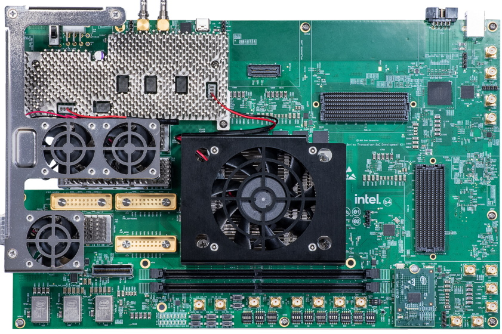
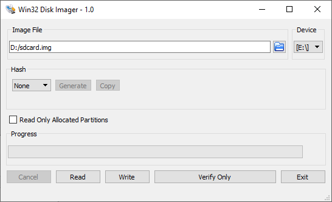
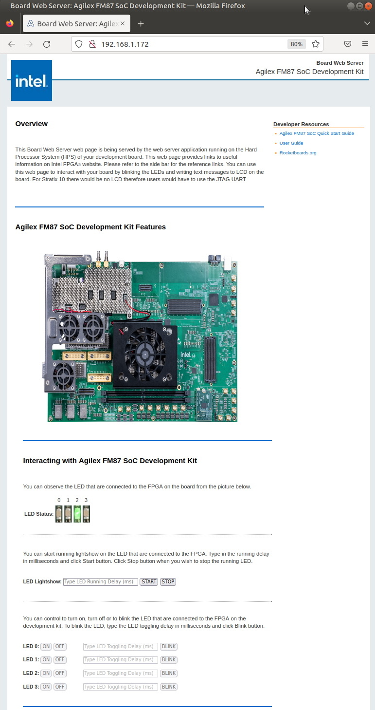
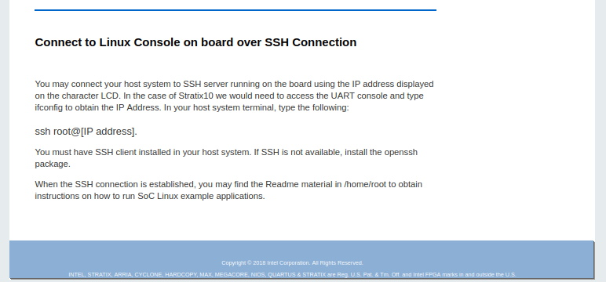
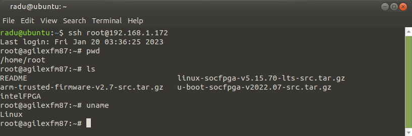
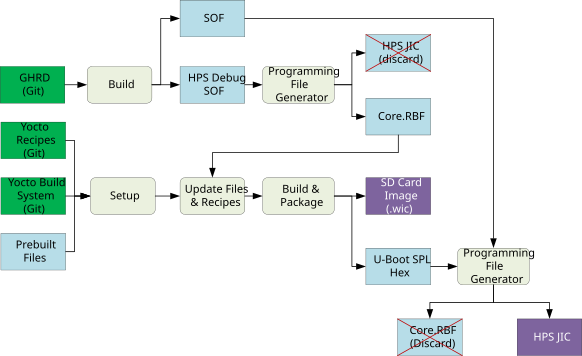
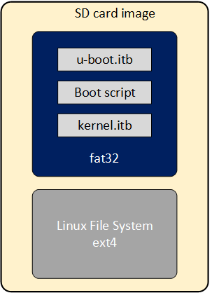

## Overview 

The HPS Baseline System Example Design (formerly known as "GSRD" or "Golden System Reference Design") demonstrates basic HPS functionality on the Agilex™ 7 FPGA F-Series Development Kit (2x F-Tile, Rev D)

The design is comprised of the following components:

- Quartus Design
  - LEDs connected to GPIO soft IP modules 
  - DIP switches and push buttons connected to GPIO soft IP modules 
- HPS Software
  - Linux, booted by U-Boot
  - Board web server 
  - Sample driver 
  - Reacting to FPGA DIP switches and push buttons 
  - Sample applications 
  - Hello world 
  - Controlling FPGA LEDs: blink, scroll, toggle 
  - System check application

### Prerequisites 

The following are required in order to be able to fully exercise the System Example Design:

- [Altera Agilex™ 7 FPGA I-Series Transceiver-SoC Development Kit (4x F-Tile, Rev D)](https://www.altera.com/products/devkit/po-3248/agilex-7-fpga-i-series-transceiver-soc-development-kit-4x-f-tile) ordering code DK-SI-AGI027FD
  - SD/MMC HPS Daughtercard 
  - Mini USB cable for serial output 
  - USB Type B cable for on-board Altera® FPGA Download Cable II 
  - Micro SD card (4GB or greater)  
- Host PC with:
  - Linux - Ubuntu 22.04LTS was used to create this page, other versions and distributions may work too 
  - Serial terminal (for example Minicom on Linux and TeraTerm or PuTTY on Windows) 
  - Micro SD card slot or Micro SD card writer/reader 
  - Altera Quartus Prime Pro Edition 
  - Altera&reg; Quartus<sup>&reg;</sup> Prime Pro Edition Version 26.3 
- Local Ethernet network, with DHCP server (will be used to provide IP address to the board) 

This page applies to the latest version of the Development Kit, with ordering code DK-SI-AGI027FD. You can identify your board by reviewing the the table in [Agilex™ 7 FPGA I-Series Transceiver-SoC Development Kit User Guide](https://docs.altera.com/r/docs/721605/current/agilextm-7-fpga-i-series-transceiver-soc-development-kit-user-guide/overview): 

| Development Kit Version | Ordering Code | Device Part Number | Serial Number Identifier | Suppported by System Example Design |
| :-- | :-- | :-- | :-- | :-- | 
| Agilex™ 7 FPGA I-Series Transceiver-SoC Development Kit (Production 2 4× F-Tile) | DK-SI-AGI027FD (Power Solution 2) | AGIB027R31B1E1VC | AGI87TS4000001 | Yes: this document |
| Altera Agilex™ 7 FPGA I-Series Transceiver-SoC Development Kit (Production 2) | DK-SI-AGI027FD (Power Solution 2) | AGIB027R31B1E1VC | 3000001 | Yes: separate document |
| Altera Agilex™ 7 FPGA I-Series Transceiver-SoC Development Kit (Production 1 4x F-Tile) | DK-SI-AGI027FA (Power Solution 2) | AGIB027R31B1E1V | 2000001 | No |
| Altera Agilex™ 7 FPGA I-Series Transceiver-SoC Development Kit (ES1 4x F-Tile) | DK-SI-AGI027FB (Power Solution 1) | AGIB027R31B1E1VAA | 0001001 | No |
| Altera Agilex™ 7 FPGA I-Series Transceiver-SoC Development Kit (ES) | DK-SI-AGI027FES (Power Solution 1) | AGIB027R31B1E2VR0 | 0000001 | No | 


The U-Boot and Linux compilation, Yocto compilation and creating the SD card image require a Linux host PC. The rest of the operations can be performed on either a Windows or Linux host PC. 

### Release Notes 

The Altera® FPGA HPS Embedded Software release notes can be accessed from the following link: [https://github.com/altera-fpga/gsrd-socfpga/releases/tag/QPDS26.3_REL_BASELINE_PR](https://github.com/altera-fpga/gsrd-socfpga/releases/tag/QPDS26.3_REL_BASELINE_PR)

### Binaries

The prebuilt binaries are available at [https://releases.rocketboards.org/2026.10/gsrd/agilex7_dk_si_agi027fd_gsrd/](https://releases.rocketboards.org/2026.10/gsrd/agilex7_dk_si_agi027fd_gsrd/).

The source code is included on the SD card in the Linux rootfs path `/home/root`: 

| File | Description | 
| :-- | :-- | 
| linux-socfpga-v6.18.37-lts-src.tar.gz | Source code for Linux kernel | 
| u-boot-socfpga-v2026.07-src.tar.gz | Source code for U-Boot | 
| arm-trusted-firmware-v2.15.0-src.tar.gz | Source code for Arm Trusted Firmware | 

### Component Versions

Altera&reg; Quartus<sup>&reg;</sup> Prime Pro Edition Version 26.3 and the following software component versions integrate the 26.3 release. 

| Component                             | Location                                                     | Branch                       | Commit ID/Tag       |
| :------------------------------------ | :----------------------------------------------------------- | :--------------------------- | :------------------ |
| HPS Baseline System Example Design | [https://github.com/altera-fpga/agilex7-ed-hps-baseline](https://github.com/altera-fpga/agilex7-ed-hps-baseline) | main | QPDS26.3_REL_BASELINE_PR |
| Linux                                 | [https://github.com/altera-fpga/linux-socfpga](https://github.com/altera-fpga/linux-socfpga) | socfpga-6.18.37-lts | QPDS26.3_REL_BASELINE_PR |
| Arm Trusted Firmware                  | [https://github.com/altera-fpga/arm-trusted-firmware](https://github.com/altera-fpga/arm-trusted-firmware) | socfpga_v2.15.0   | QPDS26.3_REL_BASELINE_PR |
| U-Boot                                | [https://github.com/altera-fpga/u-boot-socfpga](https://github.com/altera-fpga/u-boot-socfpga) | socfpga_v2026.07 | QPDS26.3_REL_BASELINE_PR |
| Yocto Project                         | [https://git.yoctoproject.org/poky](https://git.yoctoproject.org/poky) | wrynose | latest              |
| Yocto meta-altera-fpga Layer | [https://github.com/altera-fpga/meta-altera-fpga](https://github.com/altera-fpga/meta-altera-fpga) | wrynose | QPDS26.3_REL_BASELINE_PR |
| KAS | [https://github.com/siemens/kas/](https://github.com/siemens/kas/) | master | 5.4 |

**Note:** The combination of the component versions indicated in the table above has been validated through the use cases described in this page and it is strongly recommended to use these versions together. If you decided to use any component with different version than the indicated, there is not warranty that this will work.

**Note:** Starting from 26.3 Quartus release, the build of the Quartus projects in the System Example Designs are based only on Visual Designer Studio (VDS).<br>
Please review the following KDB if you face Quartus design build problems when the RTL was generated with VDS:<br>
[Why do Quartus® Prime Pro 26.3 and earlier fail to build a Agilex® 5/Agilex® 3/Agilex® 7 FPGA M-Series VDS based design whose RTL has been generated with VDS?](https://community.altera.com/kb/knowledge-base/why-do-quartus%C2%AE-prime-pro-26-3-and-earlier-fail-to-build-a-agilex%C2%AE-5agilex%C2%AE-3agi/357511).

## Exercise Prebuilt Binaries 

### Boot Linux 

#### Configure Board 

 

Set up the board default settings, as listed by the the [Altera Agilex™ 7 I-Series Transceiver-SoC Development Kit User Guide](https://docs.altera.com/r/docs/721605/current/agilextm-7-fpga-i-series-transceiver-soc-development-kit-user-guide), "Default Settings" section: 

| Switch | Default Position | 
| :-- | :-- | 
| S19 [1:4] | OFF/OFF/ON/ON | 
| S20 [1:4] | ON/ON/ON/ON | 
| S9 [1:4] | ON/OFF/OFF/X | 
| S10 [1:4] | ON/ON/ON/ON | 
| S15 [1:4] | ON/ON/ON/OFF | 
| S1 [1:4] | OFF/OFF/OFF/OFF | 
| S6 [1:4] | OFF/OFF/OFF/OFF | 
| S22 [1:4] | ON/ON/ON/ON | 
| S23 [1:4] | ON/ ON / ON / ON | 
| S4 [1:4] | ON/ ON / ON / ON | 

#### Write SD Card 

This section explains how to create the SD card necessary to boot Linux, using the SD card image available with the pre-built Linux binaries package. Once the SD card has been created, insert the card into the SD slot of the Micro SD daughter card. 

<h5> Write SD Card on Linux </h5>

1\. Download the SD card image and extract it: 

```bash 
wget https://releases.rocketboards.org/2026.10/gsrd/agilex7_dk_si_agi027fd_gsrd/sdimage.tar.gz 
tar xf sdimage.tar.gz 
```

The extracted file is named `gsrd-console-image-agilex7.rootfs.wic`. 

2\. Determine the device associated with the SD card on the host by running the following command before and after inserting the card. 

```bash 
$ cat /proc/partitions 
```

Let's assume it is /dev/sdx. 

3\. Use *dd* utility to write the SD image to the SD card. 

```bash 
$ sudo dd if=gsrd-console-image-agilex7.rootfs.wic of=/dev/sdx bs=1M 
```

Note we are using *sudo* to be able to write to the card. 

4\. Use *sync* utility to flush the changes to the SD card. 

```bash 
$ sudo sync 
```

<h5> Write SD Card on Windows </h5>

1\. Download the SD card from [https://releases.rocketboards.org/2026.10/gsrd/agilex7_dk_si_agi027fd_gsrd/sdimage.tar.gz](https://releases.rocketboards.org/2026.10/gsrd/agilex7_dk_si_agi027fd_gsrd/sdimage.tar.gz) and extract it. The extracted file is named `gsrd-console-image-agilex7.rootfs.wic`. 

2\. Rename the wic file as `sdcard.img` 

3\. Use Win32DiskImager to write the image to the SD card. The tool can be downloaded from [https://sourceforge.net/projects/win32diskimager/files/latest/download](https://sourceforge.net/projects/win32diskimager/files/latest/download)



#### Configure Serial Connection 

The OOBE Daughter Card has a built-in FTDI USB to Serial converter chip that allows the host computer to see the board as a virtual serial port. Ubuntu and other modern Linux distributions have built-in drivers for the FTDI USB to Serial converter chip, so no driver installation is necessary on those platforms. On Windows, you need to install thhe FTDI drivers from  [https://ftdichip.com/drivers/](https://ftdichip.com/drivers/) 

The serial communication parameters are: 

- Baud-rate: 115,200 
- Parity: none 
- Flow control: none 
- Stop bits: 1 

On Windows, utilities such as TeraTerm and PuTTY can be used to connect to the board. They are easily configured from the tool menus. 

On Linux, the minicom utility can be used. Here is how to configure it: 

1\. The virtual serial port is usually named /dev/ttyUSB0. In order to determine the device name associated with the virtual serial port on your host PC, please perform the following: 

- Use the following command to determine which USB serial devices are already installed: ls /dev/ttyUSB* 
- Connect mini USB cable from J7 to the PC. This will enable the PC to communicate with the board, even if the board is not powered yet. 
- Use the ls /dev/ttyUSB* command command again to determine which new USB serial device appeared. 
- Install **minicom** application on host PC, if not installed. 

- On Ubuntu, use *sudo apt-get install minicom* 
- Configure minicom. 

```bash 
$ sudo minicom -s 
```

Under **Serial Port Setup** choose the following: 

- Serial Device: **/dev/ttyUSB0** (edit to match the system as necessary) 
- Bps/Par/Bits: **115200 8N1** 
- Hardware Flow Control: **No** 
- Software Flow Control: **No** 
- Hit **[ESC]** to return to the main configuration menu 

Select **Save Setup as dfl** to save the default setup. Then select **Exit**. 

#### Write JIC Image to QSPI

The QSPI JIC image contains the FPGA configuration bitstream, and the U-Boot SPL. 

1\. Download and extract the image file: 

For DK-SI-AGI027FD board: 

```bash 
wget https://releases.rocketboards.org/2026.10/gsrd/agilex7_dk_si_agi027fd_gsrd/ghrd.hps.jic
```

2\. Configure MSEL to JTAG: 

| Switch | Setting |
| :-- | :-- | 
| S9 [1:4] | ON/ON/ON/X | 

3\. Power cycle the board 

4\. Connect the Type B USB cable from the development kit to the host for JTAG access. Write the image using the following commands: 

For DK-SI-AGI027FD board: 

```bash 
quartus_pgm -c 1 -m jtag -o "pvi;ghrd.hps.jic" 
```

5\. Configure MSEL back to QSPI: 

| Switch | Setting |
| :-- | :-- | 
| S9 [1:4] | ON/OFF/OFF/X | 

#### Boot Linux 

1\. Make sure to have the SD card inserted in the board slot. 

2\. Start serial terminal (when using Minicom it will connect using the selected settings, for others connect manually). 

3\. Power up the board 

4\. The device will be configured from QSPI, HPS will be loaded with the U-Boot SPL, which will then load ATF and U-Boot proper, then Linux will be booted. Login using 'root' and no password. 

5\. Run 'ifconfig' command to determine the IP of the board: 

```bash 
root@agilexfm87:~# ifconfig 
eth0: flags=4163 mtu 1500 
 inet 192.168.1.172 netmask 255.255.255.0 broadcast 192.168.1.255 
 inet6 fe80::54c0:6cff:fe8e:fbac prefixlen 64 scopeid 0x20 
 ether 56:c0:6c:8e:fb:ac txqueuelen 1000 (Ethernet) 
 RX packets 100 bytes 7640 (7.4 KiB) 
 RX errors 0 dropped 0 overruns 0 frame 0 
 TX packets 52 bytes 7830 (7.6 KiB) 
 TX errors 0 dropped 0 overruns 0 carrier 0 collisions 0 
 device interrupt 21 base 0x2000 
 
lo: flags=73 mtu 65536 
 inet 127.0.0.1 netmask 255.0.0.0 
 inet6 ::1 prefixlen 128 scopeid 0x10 
 loop txqueuelen 1000 (Local Loopback) 
 RX packets 100 bytes 8468 (8.2 KiB) 
 RX errors 0 dropped 0 overruns 0 frame 0 
 TX packets 100 bytes 8468 (8.2 KiB) 
 TX errors 0 dropped 0 overruns 0 carrier 0 collisions 0 
```

### Running Sample Applications 

The System Example Design includes a number of sample Linux applications that help demonstrate some of the features of the platform: 

- Display Hello World message 
- Control LEDs 
- Detect interrupts from push buttons and DIP switches 

The sample applications can be used as a starting point for users to write their own applications that interact with software IP through Linux drivers. 

#### Prerequisites 

1\. Boot Linux on the target board as described in [Boot Linux](#boot-linux). You will not need to use the serial terminal if you plan on using ssh connection. 

2\. Connect to the board using one of the following options: 

- Connect using serial console, as described in [Boot Linux](#boot-linux) 
- Connect using SSH

3\. In serial console, or ssh client console, change current folder to be */home/root/alteraFPGA*. This is where the application binaries are stored. 

```bash 
root@agilexfm87:~# cd /home/root/alteraFPGA/ 
```

#### Display Hello World Message 

Run the following command to display the Hello World message on the console: 

```bash 
root@agilexfm87:~/alteraFPGA# ./hello 
Hello SoC FPGA!%ENDCOLOR 
```

#### Exercise Soft PIO Driver for LED Control 

The following green LEDs are exercised: 

- USER LED0 
- USER LED1 
- USER LED2 
- USER LED4 

Note: USER LED3 is always on, red colored, and cannot be controlled from software. 

1\. In order to blink an LED in a loop, with a specific delay in ms, run the following command: 

```bash 
./blink <led_number> <delay_ms> 
```

- The **led_number** specifies the desired LED, and is a value between 0 and 3. 
- The **delay_ms** is a number that specifies the desired delay in ms between turning the LED on and off. 

2\. In order to turn an individual LED on or off, run the following command: 

```bash 
./toggle <led_number> <state> 
```

- The **led_number** specifies the desired LED, and is a value between 0 and 3. 
- The **state** needs to be 0 to turn the LED off, and 1 to turn the LED on. 

3\. In order to scroll the FPGA LEDs with a specific delay, please run the following command: 

```bash 
./scroll_client <delay> 
```

The **delay** specifies the desired scrolling behavior: 

- **delay > 0** - specify new scrolling delay in ms, and start scrolling 
- **delay < 0** - stop scrolling 
- **delay = 0** - display current scroll delay 

#### Register Interrupts and Call Interrupt Service Routine 

The following are exercised: 

- User FPGA DIP switches 
 - USER_SW0 
 - USER_SW1 
 - USER_SW2 
 - USER_SW3 
- User FPGA push buttons 
 - USER_PB0 
 - USER_PB1 

In order to register an interrupt handler to a specific GPIO, you will first need to determine the GPIO number used. 

1\. Open the Linux Device Tree [socfpga_agilex7_ghrd.dtsi](https://raw.githubusercontent.com/altera-fpga/meta-intel-fpga-refdes/nanbield/recipes-bsp/device-tree/files/socfpga_agilex7_ghrd.dtsi) file and look up the labels for the DIP switches and Push button GPIOs: 

```bash 
 button_pio: gpio@f9001060 { 
 compatible = "altr,pio-1.0"; 
 reg = <0xf9001060 0x10>; 
 interrupt-parent = <&intc>; 
 interrupts = <0 18 4>; 
 altr,gpio-bank-width = <4>; 
 altr,interrupt-type = <2>; 
 #gpio-cells = <2>; 
 gpio-controller; 
 }; 
 
 dipsw_pio: gpio@f9001070 { 
 compatible = "altr,pio-1.0"; 
 reg = <0xf9001070 0x10>; 
 interrupt-parent = <&intc>; 
 interrupts = <0 17 4>; 
 altr,gpio-bank-width = <4>; 
 altr,interrupt-type = <3>; 
 #gpio-cells = <2>; 
 gpio-controller; 
 }; 
```

2\. Run the following to determine the GPIO numbers for the DIP switches 

```bash 
root@agilexfm87:~/alteraFPGA# grep -r "gpio@f9001070" /sys/class/gpio/gpiochip*/label 
/sys/class/gpio/gpiochip1928/label:/soc/gpio@f9001070 
```

This means that the GPIOs 1928 .. 1931 are allocated to the DIP switches (there are 4 of them). 

3\. Run the followinig to determine the GPIO numbers for the pushbuttons 

```bash 
root@agilexfm87:~/alteraFPGA# grep -r "gpio@f9001060" /sys/class/gpio/gpiochip*/label 
/sys/class/gpio/gpiochip1960/label:/soc/gpio@f9001060 
```

This means that the GPIOs 1960, 1961 are allocated to the push buttons (there are 2 of them). 

4\. Register interrupt for one of the dipswiches, using the appropriate GPIO number, as determined in a previous step: 

```bash 
root@agilexfm87:~/alteraFPGA# modprobe gpio_interrupt gpio_number=1928 intr_type=3 
[ 893.594901] gpio_interrupt: loading out-of-tree module taints kernel. 
[ 893.602212] Interrupt for GPIO:1928 
[ 893.602212] registered 
```

5\. Toggle the USER_SW0/SW1.1 dipswitch a few times, you will see messages from the interrupt handler 

```bash 
[ 933.872016] Interrupt happened at gpio:1928 
[ 936.630233] Interrupt happened at gpio:1928 
[ 938.737038] Interrupt happened at gpio:1928 
[ 939.951513] Interrupt happened at gpio:1928 
```

6\. Remove the driver 

```bash 
root@agilexfm87:~/alteraFPGA# rmmod gpio_interrupt 
```

7\. Register the pushbutton interrupt, using the appropriate GPIO number as determine on a previous step 

```bash 
root@agilexfm87:~/alteraFPGA# modprobe gpio_interrupt gpio_number=1960 intr_type=2 
[ 1138.025297] Interrupt for GPIO:1960 
[ 1138.025297] registered 
```

8\. Push the pusbutton USER_PB0/S2 a few times, you will see interrupt handler messages 

```bash 
[ 1141.672192] Interrupt happened at gpio:1960 
[ 1142.110673] Interrupt happened at gpio:1960 
[ 1142.499468] Interrupt happened at gpio:1960 
[ 1142.884199] Interrupt happened at gpio:1960 
```

9\. Once done, remove the handler 

```bash 
root@agilexfm87:~/alteraFPGA# rmmod gpio_interrupt 
```

**Note**: If you are on the ssh console, you will need to run the program *dmesg* after pressing the button in order to see the messages: 

```bash 
root@stratix10:~/alteraFPGA# dmesg 
```

#### System Check Application 

System check application provides a glance of system status of basic peripherals such as: 

- **USB**: USB device driver 
- **Network IP (IPv4)**: Network IP address 
- **HPS LEDs**: HPS LED state 
- **FPGA LEDs**: FPGA LED state 

Run the application by issuing the following command: 

```bash 
root@agilexfm87:~/alteraFPGA# ./syschk 
```

The window will look as shown below - press 'q' to exit: 

```bash 
 ALTERA SYSTEM CHECK 
 
lo : 127.0.0.1 usb1 : DWC OTG Controller 
eth0 : 192.168.1.172 
 serial@ffc02100 : disabled 
fpga_led2 : ON serial@ffc02000 : okay 
hps_led2 : OFF 
fpga_led0 : OFF 
hps_led0 : OFF 
fpga_led3 : OFF 
fpga_led1 : OFF 
hps_led1 : OFF 
```

### Connect to Board Web Server and SSH Client 

#### Connect to Web Server 

1\. Boot Linux as described in [Boot Linux](#boot-linux). 

2\. Determine the IP address of the board using 'ifconfig' as shown above. Note there will be network interfaces of them, either can be used. 

3\. Open a web browser on the host PC and type *http://* on the address box, then type the IP of your board and hit Enter. 

 

4\. In the section named **Interacting with Agilex™ SoC Development Kit** you can perform the following actions: 

- See which LEDs are ON and which are off in the **LED Status**. Note that if the LEDs are setup to be scrolling, the displayed scrolling speed will not match the actual scrolling speed on the board. 
- Stop LEDs from scrolling, by clicking **START** and **STOP** buttons. The delay between LEDs turning ON and OFF is set in the **LED Lightshow** box. 
- Turn individual LEDs ON and OFF with the **ON** and **OFF** buttons. Note that this action is only available when the LED scrolling/lightshow is stopped. 
- Blink individual LEDs by typing a delay value in ms then clicking the corresponding **BLINK** button. Note that this action is only available when the LED scrolling/lightshow is stopped. 

#### Connect Using SSH 

1\. The lower bottom of the web page presents instructions on how to connect to the board using an SSH connection. 

 

2\. If the SSH client is not installed on your host computer, you can install it by running the following command on CentOS: 

```bash 
$ sudo yum install openssh-clients 
```

or the following command on Ubuntu: 

```bash 
$ sudo apt-get install openssh-client 
```

3\. Connect to the board, and run some commands, such as **pwd**, **ls** and **uname** to see Linux in action: 

 

## Rebuild the System Example Design

The embedded software for this System Example Design is built with Yocto, using KAS.

[Kas](https://github.com/siemens/kas) is a Python-based lightweight build orchestration layer on top of BitBake/Yocto. Kas allows you to define your build environment in a YAML manifest, so you can perform checkout, environment setup, configuration, and build invocation with a single command. Kas provides a more maintainable build description, it offers improved reproducibility, reduced setup friction, and a clearer abstraction for managing multiple layers, revisions, and configuration fragments. 

The software source code for this System Example Design is released inside the [software/yocto_linux](https://github.com/altera-fpga/agilex3c-ed-gsrd/tree/QPDS26.3_REL_BASELINE_PR/dk-a3w135bm16aea/baseline/software/yocto_linux) directory. Accessing the link will display a README page with details regarding the software.

For more details about Kas, refer to the official documentation at [https://kas.readthedocs.io/en/latest/](https://kas.readthedocs.io/en/latest/).

### Kas Build Prerequisites

Firtst, the same [prerequisites](#yocto-build-prerequisites) as for regular Yocto build are required. 

1\. Make sure you have Yocto system requirements met: [https://docs.yoctoproject.org/scarthgap/ref-manual/system-requirements.html#supported-linux-distributions](https://docs.yoctoproject.org/scarthgap/ref-manual/system-requirements.html#supported-linux-distributions).

The command to install the required packages on Ubuntu 22.04 is:

```bash
sudo apt-get update
sudo apt-get upgrade
sudo apt-get install openssh-server mc libgmp3-dev libmpc-dev gawk wget git diffstat unzip texinfo gcc \
build-essential chrpath socat cpio python3 python3-pip python3-pexpect xz-utils debianutils iputils-ping \
python3-git python3-jinja2 libegl1-mesa libsdl1.2-dev pylint xterm python3-subunit mesa-common-dev zstd \
liblz4-tool git fakeroot build-essential ncurses-dev xz-utils libssl-dev bc flex libelf-dev bison xinetd \
tftpd tftp nfs-kernel-server libncurses5 libc6-i386 libstdc++6:i386 libgcc++1:i386 lib32z1 \
device-tree-compiler curl mtd-utils u-boot-tools net-tools swig -y
```

On Ubuntu 22.04 you will also need to point the /bin/sh to /bin/bash, as the default is a link to /bin/dash:

```bash
 sudo ln -sf /bin/bash /bin/sh
```

**Note**: You can also use a Docker container to build the Yocto recipes, refer to https://rocketboards.org/foswiki/Documentation/DockerYoctoBuild for details. When using a Docker container, it does not matter what Linux distribution or packages you have installed on your host, as all dependencies are provided by the Docker container.

In addition to the above, you must also install `python3-newt`, and `python3.10-venv` with a command like this:

```bash
sudo apt-get install python3-newt python3.10-venv
```


### Build Flow 

The following diagram illustrates the build flow, based on source code from GitHub. 

 

### Set up Environment 


Create a top folder for this example, as the rest of the commands assume this location: 


```bash 
sudo rm -rf baseline.dk_si_agi027fd 
mkdir baseline.dk_si_agi027fd 
cd baseline.dk_si_agi027fd 
export TOP_FOLDER=$(pwd) 
```


Enable Quartus tools to be called from command line:


```bash
source ~/altera_pro/26.3/qinit.sh
```


#### Build Quartus Design


Use the following commands to build the Quartus Design:


```bash
cd $TOP_FOLDER
rm -rf dk-si-agi027fd-oobe-baseline
mkdir dk-si-agi027fd-oobe-baseline
cd dk-si-agi027fd-oobe-baseline
wget https://github.com/altera-fpga/agilex7-ed-hps-baseline/releases/download/QPDS26.3_REL_BASELINE_PR/dk-si-agi027fd-oobe-baseline.zip
unzip dk-si-agi027fd-oobe-baseline.zip
rm -f dk-si-agi027fd-oobe-baseline.zip
make baseline-install
```


The following files are created:

- `$TOP_FOLDER/dk-si-agi027fd-oobe-baseline/install/binaries/baseline.sof` - FPGA configuration file, without HPS FSBL
- `$TOP_FOLDER/dk-si-agi027fd-oobe-baseline/install/binaries/ghrd.core.rbf` - FPGA fabric configuration file


#### Build Yocto Using Kas


1\. Create and enter a new Python virtual environment:


```bash
cd $TOP_FOLDER/dk-si-agi027fd-oobe-baseline/software/yocto_linux
python3 -m venv venv --system-site-packages
source venv/bin/activate
pip install --upgrade pip
pip install kas
pip install --upgrade kas
pip install kconfiglib
```


2\. Copy the core.rbf file to where Kas expects it to be:


```bash
cp $TOP_FOLDER/dk-si-agi027fd-oobe-baseline/install/binaries/ghrd.core.rbf meta-custom/recipes-fpga/fpga-bitstream/files/baseline_hps_debug.core.rbf
```


3\. Build Yocto with Kas:


```bash
kas build kas.yml gsrd-console-image
```


The following relevant files are created in `$TOP_FOLDER/dk-si-agi027fd-oobe-baseline/software/yocto_linux/build/tmp/deploy/images/agilex7/`:

* `gsrd-console-image-agilex7.rootfs.wic`
* `u-boot-spl-dtb.hex`

> **Note**: If you experience build failures related to file-locks, you can work around these by reducing the parallelism of your build by running the following commands before running `kas`:

```bash
export PARALLEL_MAKE="-j 8"
export BB_NUMBER_THREADS="8"
export BB_ENV_PASSTHROUGH_ADDITIONS="$BB_ENV_PASSTHROUGH_ADDITIONS PARALLEL_MAKE BB_NUMBER_THREADS"
```


### Build QSPI Image 


The QSPI image will contain the FPGA configuration data and the HPS FSBL and it can be built using the following command: 


```bash 
cd $TOP_FOLDER 
rm -f *jic* *rbf* 
quartus_pfg -c $TOP_FOLDER/dk-si-agi027fd-oobe-baseline/install/binaries/baseline.sof \
 ghrd.jic \
 -o hps_path=$TOP_FOLDER/dk-si-agi027fd-oobe-baseline/software/yocto_linux/build/tmp/deploy/images/agilex7/u-boot-spl-dtb.hex \
 -o device=MT25QU02G \
 -o flash_loader=AGIB027R31B1E1VC \
 -o mode=ASX4 \
 -o hps=1
```


The following files will be created: 

- `$TOP_FOLDER/ghrd.hps.jic` - Flash image for HPS First configuration bitstream, phase 1: HPS and DDR 
- `$TOP_FOLDER/ghrd.core.rbf` - HPS First configuration bitstream, phase 2: FPGA fabric, discarded, as we already have it on the SD card


### How to Manually Update the kernel.itb file


The **kernel.itb** file is a Flattattened Image Tree (FIT) file that includes the following components:

* Linux kernel.
* Board configurations* that indicate what components from the **kernel.itb** (Linux kernel, device tree and Phase 2 FPGA configuration bitstream) should be used for a specific board.
* Linux device tree*.
* Phase 2 FPGA configuration bitstream*.

 \* One or more of these components to support the different board configurations.

The **kernel.itb** is created from a **.its** (Image Tree Source file) that describes its structure. In the HPS Baseline System Example Design, the  **kernel.itb** file is generated in the following directory. In this directory you can also find the **.its** files and all other the components needed to create the **kernel.itb** :

* **$TOP_FOLDER/<*gsrd-directory*>/<*project-directory*>/software/yocto_linux/build/tmp*/work/<*device*>-poky-linux/linux-socfpga-lts/<*linux-branch*>+git/linux-<*device*>-standard-build/**

As an example of this path, for the Agilex 5 device you will find this directory as
$TOP_FOLDER/a5ed065es-premium-devkit-oobe/baseline-a55/software/yocto_linux/build/tmp*/work/agilex5e-poky-linux/linux-socfpga-lts/6.12.43-lts+git/linux-agilex5e-standard-build

If you want to modify the **kernel.itb** by replacing one of the component or modifying any board configuration, you can do the following:

1. Install **mtools** package in your Linux machine.
   ```bash
   $ sudo apt update
   $ sudo apt install mtools
   ```
   
2. Go to the folder in which the **kernel.itb** is being created under the HPS Baseline System Example Design.
   ```bash
   $ cd $TOP_FOLDER/<gsrd-directory>/<project-directory>/software/yocto_linux/build/tmp*/work/<device>-poky-linux/linux-socfpga-lts/<linux-branch>+git/linux-<device>-standard-build/
   $ ls *.its
   fit_<device>_kernel_.its
   ```
   
3. In the **.its** file, observe the components that integrates the kernel.itb identifying the nodes as indicated next:

   **images** node:<br>
   - **kernel** node - Linux kernel defined with the **data** parameter in the node.<br>
   - **fdt-X** node    - Device tree X defined with the **data** parameter in the node.<br>
   - **fpga-X** node -  Phase 2 FPGA configuration bitstream .rbf defined with the **data** parameter in the node. 

   **configurations** node:<br>
   - **board-X** node - Board configuration with the name defined with the **description** parameter. The components for a specific board configuration are defined with the **kernel**, **fdt** and **fpga** parameters.   

4. In this directory, you can replace any of the file components that integrate the **kernel.itb**, or you can also modify the **.its** to change the structure and components of the kernel.itb.

5. Finally, you need to re-generate the new **kernel.itb** running the following command in the same **linux-<device>-standard-build/** directory.
   ```bash
   $ rm kernel.itb
   $ mkimage -f fit_<device>_kernel.its kernel.itb
   ```

Once that you have completed this procedure, you can use the new **kernel.itb** as needed. Some options could be:

* Use U-Boot to load this into the SDRAM board through TFTP to boot Linux or to write it to a flash device
* Directly update the flash image in your board (QSPI, SD Card, eMMC or NAND) from your working machine.


### How to Manually Update the SD Card Content file


As part of the Yocto HPS Baseline System Example Designbuild flow, the SD Card image is built for the SD Card boot flow. This image includes a couple of partitions. One of these partition (a FAT32) includes the U-Boot proper, the Distroboot boot script, U-Boot environment and the Linux **.itb** - which includes the Linux kernel image, the Linux device tree, the phase 2 FPGA configuration bitstream and board configuration (there may be several versions of these last 3 components). The 2nd partition (an EXT3 or EXT4 ) includes the Linux file system. 

{: style="height:500px"}

If you want to replace any the components or add a new item in any of these partitions, without having to run again the Yocto build flow. 

This can be done through the **wic** script available on the **Poky** repository that is included as part of the HPS Baseline System Example Design build directory:

* **$TOP_FOLDER/<*gsrd-directory*>/<*project-directory*>/software/yocto_linux/poky/scripts/wic** 

The **wic** command requires to be run in the Yocto build environment that can be setup as shown next in a Linux terminal:

  ```bash
  cd $TOP_FOLDER/<gsrd-directory>/<project-directory>/software/yocto_linux/
  source poky/oe-init-build-env build
  ```
You can verify that the Yocto environment has been setup using the **which bitbake**  command, which will respond with the path of the **bitbake** command located at **poky/bitbake/bin/bitbake**.

The **wic** command allows you to inspect the content of a SD Card image, delete, add or replace any component inside of the image. This command is also provided with help support:

   ```bash
   $ $TOP_FOLDER/<gsrd-directory>/<project-directory>/software/yocto_linux/poky/scripts/wic help
   
   Creates a customized OpenEmbedded image.

   Usage:  wic [--version]
           wic help [COMMAND or TOPIC]
           wic COMMAND [ARGS]

       usage 1: Returns the current version of Wic
       usage 2: Returns detailed help for a COMMAND or TOPIC
       usage 3: Executes COMMAND

   COMMAND:

    list   -   List available canned images and source plugins
    ls     -   List contents of partitioned image or partition
    rm     -   Remove files or directories from the vfat or ext* partitions
    help   -   Show help for a wic COMMAND or TOPIC
    write  -   Write an image to a device
    cp     -   Copy files and directories to the vfat or ext* partitions
    create -   Create a new OpenEmbedded image
    :
    :
   ```

   The following steps show you how to replace the **kernel.itb** file inside of the fat32 partition in a .wic image.

1. The **wic ls** command allows you to inspect or navigate over the directory structure inside of the SD Card image. For example you can observe the partitions  in the SD Card image in this way.

  ```bash   
  # Here you can inspect the content a wic image see the 2 partitions inside of the SD Card image
  $ $TOP_FOLDER/<gsrd-directory>/<project-directory>/software/yocto_linux/poky/scripts/wic ls my_image.wic
   Num     Start        End          Size      Fstype
   1       1048576    525336575    524288000  fat32
   2     525336576   2098200575   1572864000  ext4

   
  # Here you can naviagate inside of the partition 1
   $ $TOP_FOLDER/<gsrd-directory>/<project-directory>/software/yocto_linux/poky/scripts/wic ls my_image.wic:1
  Volume in drive : is boot       
  Volume Serial Number is 8F65-ACE9
  Directory for ::/

  BOOTSC~1 UIM      2739 2011-04-05  23:00  boot.scr.uimg
  kernel   itb  12885831 2011-04-05  23:00 
  uboot    env      8192 2011-04-05  23:00 
  u-boot   itb    938816 2011-04-05  23:00 
        4 files          13 835 578 bytes
                        509 370 368 bytes free

  ```

2. The **wic rm** command allows you to delete any of the components in the selected partition. For example, you can delete the **kernel.itb** image from the partition 1(fat32 partition).

   ```bash
   $ $TOP_FOLDER/<gsrd-directory>/<project-directory>/software/yocto_linux/poky/scripts/wic rm my_image.wic:1/kernel.itb
   ```

3. The **wic cp** command allows you to copy any new item or file from your Linux machine to a specific partition and location inside of the SD Card image. For example, you can copy a new **kernel.itb** to the partition 1.

   ```bash
   $ $TOP_FOLDER/<gsrd-directory>/<project-directory>/software/yocto_linux/poky/scripts/wic cp <path_new_kernel.itb> my_image.wic:1/kernel.itb
   ```

**NOTE**: The **wic** application also allows you to modify any image with compatible vfat and ext* type partitions which also covers images used for **eMMC** boot flow.

## Notices & Disclaimers

Altera<sup>&reg;</sup> Corporation technologies may require enabled hardware, software or service activation.
No product or component can be absolutely secure. 
Performance varies by use, configuration and other factors.
Your costs and results may vary. 
You may not use or facilitate the use of this document in connection with any infringement or other legal analysis concerning Altera or Intel products described herein. You agree to grant Altera Corporation a non-exclusive, royalty-free license to any patent claim thereafter drafted which includes subject matter disclosed herein.
No license (express or implied, by estoppel or otherwise) to any intellectual property rights is granted by this document, with the sole exception that you may publish an unmodified copy. You may create software implementations based on this document and in compliance with the foregoing that are intended to execute on the Altera or Intel product(s) referenced in this document. No rights are granted to create modifications or derivatives of this document.
The products described may contain design defects or errors known as errata which may cause the product to deviate from published specifications.  Current characterized errata are available on request.
Altera disclaims all express and implied warranties, including without limitation, the implied warranties of merchantability, fitness for a particular purpose, and non-infringement, as well as any warranty arising from course of performance, course of dealing, or usage in trade.
You are responsible for safety of the overall system, including compliance with applicable safety-related requirements or standards. 
<sup>&copy;</sup> Altera Corporation.  Altera, the Altera logo, and other Altera marks are trademarks of Altera Corporation.  Other names and brands may be claimed as the property of others. 

OpenCL* and the OpenCL* logo are trademarks of Apple Inc. used by permission of the Khronos Group™. 