## Overview 

This page presents the HPS Baseline System Example Design (formerly known as "GSRD" or "Golden System Reference Design") for the Agilex™ 7 FPGA M-Series Development Kit - HBM2e Edition (3x F-Tile & 1x R-Tile).

- Quartus Design
  - LEDs connected to GPIO soft IP modules 
  - DIP switches and push buttons connected to GPIO soft IP modules 
- HPS Software
  - Linux, booted by U-Boot
  - Board web server 
  - Sample driver 
  - Reacting to FPGA DIP switches and push buttons 
  - Sample applications 
  - Hello world 
  - Controlling FPGA LEDs: blink, scroll, toggle 
  - System check application

### Prerequisites 

The following are required in order to be able to fully exercise the System Example Design: 

- [Agilex™ 7 FPGA M-Series Development Kit - HBM2e Edition (3x F-Tile & 1x R-Tile)](https://www.altera.com/products/devkit/po-3207/agilex-7-fpga-m-series-development-kit-hbm2e-edition-3x-f-tile-1x-r-tile), ordering code DK-DEV-AGM039EA
  - SD/MMC HPS Daughtercard 
  - Mini USB cable for serial output 
  - Micro USB cable for on-board Intel FPGA Download Cable II 
  - Micro SD card (4GB or greater) 
- Host PC with 
  - Linux - Ubuntu 22.04LTS was used to create this page, other versions and distributions may work too 
  - Serial terminal (for example Minicom on Linux and TeraTerm or PuTTY on Windows) 
  - Micro SD card slot or Micro SD card writer/reader 
  - Altera&reg; Quartus<sup>&reg;</sup> Prime Pro Edition Version 26.3
- Local Ethernet network, with DHCP server (will be used to provide IP address to the board) 

This page covers the DK-DEV-AGM039EA version of the board. You can identify your board type by looking at the serial number identifier, as shown below:

| Development Kit Version | Ordering Code | Device Part Number | Serial Number Identifier |
| :-- | :-- |  :-- |  :-- |
| Agilex™ 7 FPGA M-Series Development Kit - HBM2e Edition (3x F-Tile and 1x R-Tile) | DK-DEV-AGM039EA | AGMF039R47A1E1VC | AGM82DK0001001 |
| Agilex™ 7 FPGA M-Series Development Kit - HBM2e Edition (3x F-Tile and 1x R-Tile) ES1 | DK-DEV-AGM039FES | AGMF039R47A1E2VR0 | AGM82DK0000001 |

The main difference between the boards, in addition to the FPGA part number, is that they use different memory type for HPS:

* DK-DEV-AGM039EA uses HBM memory for HPS
* DK-DEV-AGM039FES uses DDR5 memory for HPS

The U-Boot and Linux compilation, Yocto compilation and creating the SD card image require a Linux host PC. The rest of the operations can be performed on either a Windows or Linux host PC. 

### Release Notes 

The Intel FPGA HPS Embedded Software release notes can be accessed from the following link: [https://github.com/altera-fpga/gsrd-socfpga/releases/tag/QPDS26.3_REL_BASELINE_PR](https://github.com/altera-fpga/gsrd-socfpga/releases/tag/QPDS26.3_REL_BASELINE_PR)

### Binary Release Contents 

The binary release files are accessible at [https://releases.rocketboards.org/2026.10/gsrd/agilex7_dk_dev_agm039ea_gsrd/](https://releases.rocketboards.org/2026.10/gsrd/agilex7_dk_dev_agm039ea_gsrd/).

The source code is also included on the SD card in the Linux rootfs path `/home/root`: 

| File | Description | 
| :-- | :-- | 
| linux-socfpga-v6.18.37-lts-src.tar.gz | Source code for Linux kernel | 
| u-boot-socfpga-v2026.07-src.tar.gz | Source code for U-Boot | 
| arm-trusted-firmware-v2.15.0-src.tar.gz | Source code for Arm Trusted Firmware | 


#### Component Versions

Altera&reg; Quartus<sup>&reg;</sup> Prime Pro Edition Version 26.3 and the following software component versions integrate the 26.3 release. 

| Component                             | Location                                                     | Branch                       | Commit ID/Tag       |
| :------------------------------------ | :----------------------------------------------------------- | :--------------------------- | :------------------ |
| HPS Baseline System Example Design | [https://github.com/altera-fpga/agilex7-ed-hps-baseline](https://github.com/altera-fpga/agilex7-ed-hps-baseline) | main | QPDS26.3_REL_BASELINE_PR |
| Linux                                 | [https://github.com/altera-fpga/linux-socfpga](https://github.com/altera-fpga/linux-socfpga) | socfpga-6.18.37-lts | QPDS26.3_REL_BASELINE_PR |
| Arm Trusted Firmware                  | [https://github.com/altera-fpga/arm-trusted-firmware](https://github.com/altera-fpga/arm-trusted-firmware) | socfpga_v2.15.0   | QPDS26.3_REL_BASELINE_PR |
| U-Boot                                | [https://github.com/altera-fpga/u-boot-socfpga](https://github.com/altera-fpga/u-boot-socfpga) | socfpga_v2026.07 | QPDS26.3_REL_BASELINE_PR |
| Yocto Project                         | [https://git.yoctoproject.org/poky](https://git.yoctoproject.org/poky) | wrynose | latest              |
| Yocto meta-altera-fpga Layer | [https://github.com/altera-fpga/meta-altera-fpga](https://github.com/altera-fpga/meta-altera-fpga) | wrynose | QPDS26.3_REL_BASELINE_PR |
| KAS | [https://github.com/siemens/kas/](https://github.com/siemens/kas/) | master | 5.4 |

**Note:** The combination of the component versions indicated in the table above has been validated through the use cases described in this page and it is strongly recommended to use these versions together. If you decided to use any component with different version than the indicated, there is not warranty that this will work.

**Note:** Starting from 26.3 Quartus release, the build of the Quartus projects in the System Example Designs are based only on Visual Designer Studio (VDS).<br>
Please review the following KDB if you face Quartus design build problems when the RTL was generated with VDS:<br>
[Why do Quartus® Prime Pro 26.3 and earlier fail to build a Agilex® 5/Agilex® 3/Agilex® 7 FPGA M-Series VDS based design whose RTL has been generated with VDS?](https://community.altera.com/kb/knowledge-base/why-do-quartus%C2%AE-prime-pro-26-3-and-earlier-fail-to-build-a-agilex%C2%AE-5agilex%C2%AE-3agi/357511).

## Development Kit 

The Agilex™ 7 M-Series HBM Development Kit is shown below: 

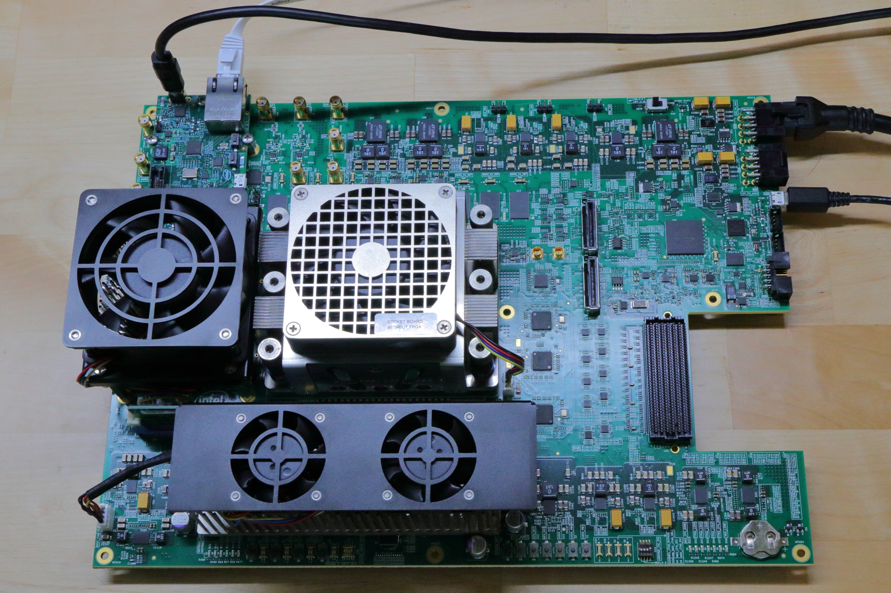 

Refer to the following for more information about the Development Kit: [https://www.altera.com/products/devkit/po-3207/agilex-7-fpga-m-series-development-kit-hbm2e-edition-3x-f-tile-1x-r-tile](https://www.altera.com/products/devkit/po-3207/agilex-7-fpga-m-series-development-kit-hbm2e-edition-3x-f-tile-1x-r-tile).

## Exercise Prebuilt Binaries

### Boot Linux 

1\. Connect the following cables to the board: 

- Power: from board to power supply 
- HPS UART Console: from vertical mini USB connector on the HPS daughtercard to host PC 
- JTAG: from micro USB cable on edge of the board to host PC 

2\. Download, extract and write to SD card the following SD card image: [https://releases.rocketboards.org/2026.10/gsrd/agilex7_dk_dev_agm039ea_gsrd/sdimage.tar.gz](https://releases.rocketboards.org/2026.10/gsrd/agilex7_dk_dev_agm039ea_gsrd/sdimage.tar.gz). Note the filename is `gsrd-console-image-agilex7m.rootfs.wic`.

Then insert SD card into the HPS OOBE Daughtercard socket. 

3\. Configure board to the default settings, making sure set S24 dipswitch to OFF-OFF-OFF-ON, to select MSEL=JTAG, so that board does not configure on power up. 

4\. Power up the board 

5\. Download the HPS RBF file and configure the HPS RBF file over JTAG: 

```bash 
wget https://releases.rocketboards.org/2026.10/gsrd/agilex7_dk_dev_agm039ea_gsrd/ghrd.hps.rbf 
quartus_pgm -c 1 -m jtag -o "p;ghrd.hps.rbf" 
```

6\. Linux will boot, use 'root' as username to log in, no password will be required. 

### Run Hello World Application 

Change to IntelFPGA folder, and run the hello application, which will display a meesage as shown below: 

```bash 
root@agilex7dkdevagm039:~# cd alteraFPGA/ 
root@agilex7dkdevagm039:~/alteraFPGA# ./hello 
Hello SoC FPGA! 
```

### Run SysCheck Application 

Run the SysCheck application: 

```bash 
root@agilex7dkdevagm039:~/alteraFPGA# ./syschk 
```

It will display some system information: 

```bash 
 ALTERA SYSTEM CHECK 
 
lo : 127.0.0.1 usb1 : DWC OTG Controller 
eth0 : 192.168.1.52 
 serial@ffc02100 : disabled 
hps_led2 : OFF serial@ffc02000 : okay 
hps_led0 : OFF 
hps_led1 : OFF 
```

Press **Q** to exit the appplication. 

### Connect to Web Server 

1\. Boot Linux as described in previous section. 

2\. Determine the IP address of the board using 'ifconfig' as shown above. Note there will be network interfaces of them, either can be used. 

3\. Open a web browser on the host PC and type *http://* on the address box, then type the IP of your board and hit Enter. 

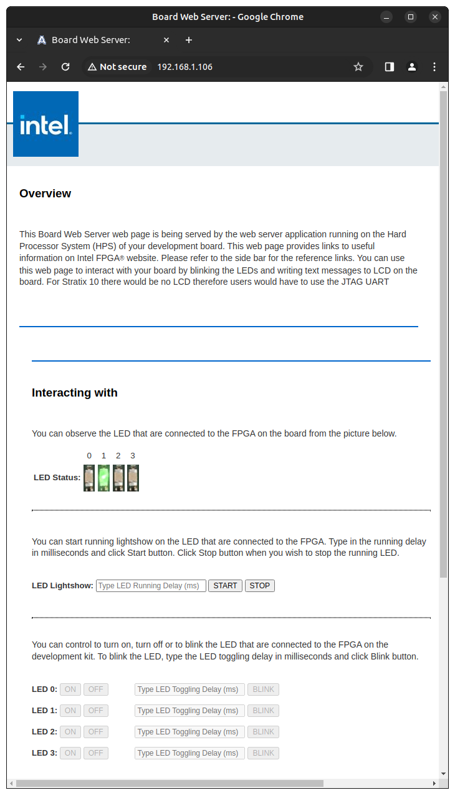 

**Caution**: The web server is intended to allow users to control FPGA connected LEDs on the board. Due to an issue in this release, this functionality is not yet enabled. It will be enabled in the next release. 

### Connect over SSH 

1\. The lower bottom of the web page presents instructions on how to connect to the board using an SSH connection. 

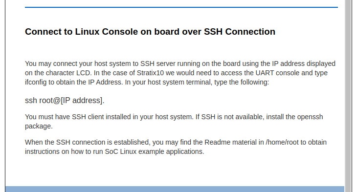 

2\. If the SSH client is not installed on your host computer, you can install it by running the following command on CentOS: 

```bash 
$ sudo yum install openssh-clients 
```

or the following command on Ubuntu: 

```bash 
$ sudo apt-get install openssh-client 
```

3\. Connect to the board, and run some commands, such as **pwd**, **ls** and **uname** to see Linux in action: 

```bash 
ssh root@192.168.1.106 
```

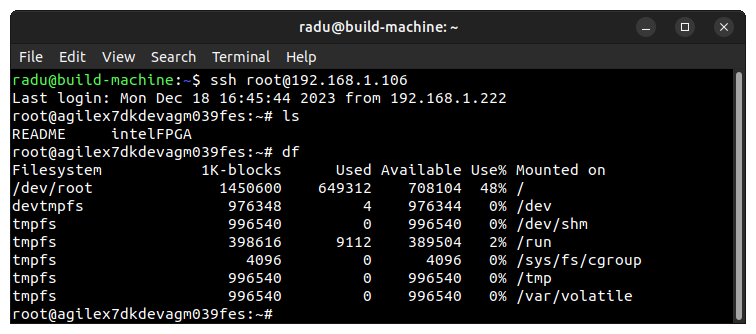 

## Rebuild the System Example Design

The embedded software for this System Example Design is built with Yocto, using KAS.

[Kas](https://github.com/siemens/kas) is a Python-based lightweight build orchestration layer on top of BitBake/Yocto. Kas allows you to define your build environment in a YAML manifest, so you can perform checkout, environment setup, configuration, and build invocation with a single command. Kas provides a more maintainable build description, it offers improved reproducibility, reduced setup friction, and a clearer abstraction for managing multiple layers, revisions, and configuration fragments. 

The software source code for this System Example Design is released inside the [software/yocto_linux](https://github.com/altera-fpga/agilex3c-ed-gsrd/tree/QPDS26.3_REL_BASELINE_PR/dk-a3w135bm16aea/baseline/software/yocto_linux) directory. Accessing the link will display a README page with details regarding the software.

For more details about Kas, refer to the official documentation at [https://kas.readthedocs.io/en/latest/](https://kas.readthedocs.io/en/latest/).

### Kas Build Prerequisites

Firtst, the same [prerequisites](#yocto-build-prerequisites) as for regular Yocto build are required. 

1\. Make sure you have Yocto system requirements met: [https://docs.yoctoproject.org/scarthgap/ref-manual/system-requirements.html#supported-linux-distributions](https://docs.yoctoproject.org/scarthgap/ref-manual/system-requirements.html#supported-linux-distributions).

The command to install the required packages on Ubuntu 22.04 is:

```bash
sudo apt-get update
sudo apt-get upgrade
sudo apt-get install openssh-server mc libgmp3-dev libmpc-dev gawk wget git diffstat unzip texinfo gcc \
build-essential chrpath socat cpio python3 python3-pip python3-pexpect xz-utils debianutils iputils-ping \
python3-git python3-jinja2 libegl1-mesa libsdl1.2-dev pylint xterm python3-subunit mesa-common-dev zstd \
liblz4-tool git fakeroot build-essential ncurses-dev xz-utils libssl-dev bc flex libelf-dev bison xinetd \
tftpd tftp nfs-kernel-server libncurses5 libc6-i386 libstdc++6:i386 libgcc++1:i386 lib32z1 \
device-tree-compiler curl mtd-utils u-boot-tools net-tools swig -y
```

On Ubuntu 22.04 you will also need to point the /bin/sh to /bin/bash, as the default is a link to /bin/dash:

```bash
 sudo ln -sf /bin/bash /bin/sh
```

**Note**: You can also use a Docker container to build the Yocto recipes, refer to https://rocketboards.org/foswiki/Documentation/DockerYoctoBuild for details. When using a Docker container, it does not matter what Linux distribution or packages you have installed on your host, as all dependencies are provided by the Docker container.

In addition to the above, you must also install `python3-newt`, and `python3.10-venv` with a command like this:

```bash
sudo apt-get install python3-newt python3.10-venv
```


### Set up Environment 


Create a top folder for this example, as the rest of the commands assume this location: 


```bash 
sudo rm -rf agilex7m_prod.gsrd 
mkdir agilex7m_prod.gsrd 
cd agilex7m_prod.gsrd 
export TOP_FOLDER=`pwd` 
```


Enable Quartus tools to be called from command line:


```bash
source ~/altera_pro/26.3/qinit.sh
```


#### Build Quartus Design


Use the following commands to build the Quartus Design:


```bash
cd $TOP_FOLDER
rm -rf dk-dev-agm039ea-oobe-baseline
mkdir dk-dev-agm039ea-oobe-baseline
cd dk-dev-agm039ea-oobe-baseline
wget https://github.com/altera-fpga/agilex7-ed-hps-baseline/releases/download/QPDS26.3_REL_BASELINE_PR/dk-dev-agm039ea-oobe-baseline.zip
unzip dk-dev-agm039ea-oobe-baseline.zip
rm -f dk-dev-agm039ea-oobe-baseline.zip
make baseline-install
```


The following files are created:

- `$TOP_FOLDER/dk-dev-agm039ea-oobe-baseline/install/binaries/baseline.sof` - FPGA configuration file, without HPS FSBL
- `$TOP_FOLDER/dk-dev-agm039ea-oobe-baseline/install/binaries/ghrd.core.rbf` - FPGA fabric configuration file


#### Build Yocto Using Kas


1\. Create and enter a new Python virtual environment:


```bash
cd $TOP_FOLDER/dk-dev-agm039ea-oobe-baseline/software/yocto_linux
python3 -m venv venv --system-site-packages
source venv/bin/activate
pip install --upgrade pip
pip install kas
pip install --upgrade kas
pip install kconfiglib
```


2\. Copy the core.rbf file to where Kas expects it to be:


```bash
cp $TOP_FOLDER/dk-dev-agm039ea-oobe-baseline/install/binaries/ghrd.core.rbf meta-custom/recipes-fpga/fpga-bitstream/files/baseline_hps_debug.core.rbf
```


3\. Build Yocto with Kas:


```bash
kas build kas.yml gsrd-console-image
```


The following relevant files are created in `$TOP_FOLDER/dk-dev-agm039ea-oobe-baseline/software/yocto_linux/build/tmp/deploy/images/agilex7m/`:

* `gsrd-console-image-agilex7m.rootfs.wic`
* `u-boot-spl-dtb.hex`

> **Note**: If you experience build failures related to file-locks, you can work around these by reducing the parallelism of your build by running the following commands before running `kas`:

```bash
export PARALLEL_MAKE="-j 8"
export BB_NUMBER_THREADS="8"
export BB_ENV_PASSTHROUGH_ADDITIONS="$BB_ENV_PASSTHROUGH_ADDITIONS PARALLEL_MAKE BB_NUMBER_THREADS"
```


### Create Bootable HPS RBF File 


```bash 
cd $TOP_FOLDER 
rm -f *rbf* 
quartus_pfg -c $TOP_FOLDER/dk-dev-agm039ea-oobe-baseline/install/binaries/baseline.sof \
 ghrd.rbf \ 
 -o hps_path=$TOP_FOLDER/dk-dev-agm039ea-oobe-baseline/software/yocto_linux/build/tmp/deploy/images/agilex7m/u-boot-spl-dtb.hex \ 
 -o hps=1 
```


The following files will be created: 

- $TOP_FOLDER/ghrd.hps.rbf - RBF file to configure the device for HPS first, phase 1 


### How to Manually Update the kernel.itb file


The **kernel.itb** file is a Flattattened Image Tree (FIT) file that includes the following components:

* Linux kernel.
* Board configurations* that indicate what components from the **kernel.itb** (Linux kernel, device tree and Phase 2 FPGA configuration bitstream) should be used for a specific board.
* Linux device tree*.
* Phase 2 FPGA configuration bitstream*.

 \* One or more of these components to support the different board configurations.

The **kernel.itb** is created from a **.its** (Image Tree Source file) that describes its structure. In the HPS Baseline System Example Design, the  **kernel.itb** file is generated in the following directory. In this directory you can also find the **.its** files and all other the components needed to create the **kernel.itb** :

* **$TOP_FOLDER/<*gsrd-directory*>/<*project-directory*>/software/yocto_linux/build/tmp*/work/<*device*>-poky-linux/linux-socfpga-lts/<*linux-branch*>+git/linux-<*device*>-standard-build/**

As an example of this path, for the Agilex 5 device you will find this directory as
$TOP_FOLDER/a5ed065es-premium-devkit-oobe/baseline-a55/software/yocto_linux/build/tmp*/work/agilex5e-poky-linux/linux-socfpga-lts/6.12.43-lts+git/linux-agilex5e-standard-build

If you want to modify the **kernel.itb** by replacing one of the component or modifying any board configuration, you can do the following:

1. Install **mtools** package in your Linux machine.
   ```bash
   $ sudo apt update
   $ sudo apt install mtools
   ```
   
2. Go to the folder in which the **kernel.itb** is being created under the HPS Baseline System Example Design.
   ```bash
   $ cd $TOP_FOLDER/<gsrd-directory>/<project-directory>/software/yocto_linux/build/tmp*/work/<device>-poky-linux/linux-socfpga-lts/<linux-branch>+git/linux-<device>-standard-build/
   $ ls *.its
   fit_<device>_kernel_.its
   ```
   
3. In the **.its** file, observe the components that integrates the kernel.itb identifying the nodes as indicated next:

   **images** node:<br>
   - **kernel** node - Linux kernel defined with the **data** parameter in the node.<br>
   - **fdt-X** node    - Device tree X defined with the **data** parameter in the node.<br>
   - **fpga-X** node -  Phase 2 FPGA configuration bitstream .rbf defined with the **data** parameter in the node. 

   **configurations** node:<br>
   - **board-X** node - Board configuration with the name defined with the **description** parameter. The components for a specific board configuration are defined with the **kernel**, **fdt** and **fpga** parameters.   

4. In this directory, you can replace any of the file components that integrate the **kernel.itb**, or you can also modify the **.its** to change the structure and components of the kernel.itb.

5. Finally, you need to re-generate the new **kernel.itb** running the following command in the same **linux-<device>-standard-build/** directory.
   ```bash
   $ rm kernel.itb
   $ mkimage -f fit_<device>_kernel.its kernel.itb
   ```

Once that you have completed this procedure, you can use the new **kernel.itb** as needed. Some options could be:

* Use U-Boot to load this into the SDRAM board through TFTP to boot Linux or to write it to a flash device
* Directly update the flash image in your board (QSPI, SD Card, eMMC or NAND) from your working machine.


### How to Manually Update the SD Card Content file


As part of the Yocto HPS Baseline System Example Designbuild flow, the SD Card image is built for the SD Card boot flow. This image includes a couple of partitions. One of these partition (a FAT32) includes the U-Boot proper, the Distroboot boot script, U-Boot environment and the Linux **.itb** - which includes the Linux kernel image, the Linux device tree, the phase 2 FPGA configuration bitstream and board configuration (there may be several versions of these last 3 components). The 2nd partition (an EXT3 or EXT4 ) includes the Linux file system. 

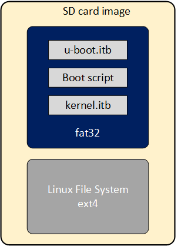{: style="height:500px"}

If you want to replace any the components or add a new item in any of these partitions, without having to run again the Yocto build flow. 

This can be done through the **wic** script available on the **Poky** repository that is included as part of the HPS Baseline System Example Design build directory:

* **$TOP_FOLDER/<*gsrd-directory*>/<*project-directory*>/software/yocto_linux/poky/scripts/wic** 

The **wic** command requires to be run in the Yocto build environment that can be setup as shown next in a Linux terminal:

  ```bash
  cd $TOP_FOLDER/<gsrd-directory>/<project-directory>/software/yocto_linux/
  source poky/oe-init-build-env build
  ```
You can verify that the Yocto environment has been setup using the **which bitbake**  command, which will respond with the path of the **bitbake** command located at **poky/bitbake/bin/bitbake**.

The **wic** command allows you to inspect the content of a SD Card image, delete, add or replace any component inside of the image. This command is also provided with help support:

   ```bash
   $ $TOP_FOLDER/<gsrd-directory>/<project-directory>/software/yocto_linux/poky/scripts/wic help
   
   Creates a customized OpenEmbedded image.

   Usage:  wic [--version]
           wic help [COMMAND or TOPIC]
           wic COMMAND [ARGS]

       usage 1: Returns the current version of Wic
       usage 2: Returns detailed help for a COMMAND or TOPIC
       usage 3: Executes COMMAND

   COMMAND:

    list   -   List available canned images and source plugins
    ls     -   List contents of partitioned image or partition
    rm     -   Remove files or directories from the vfat or ext* partitions
    help   -   Show help for a wic COMMAND or TOPIC
    write  -   Write an image to a device
    cp     -   Copy files and directories to the vfat or ext* partitions
    create -   Create a new OpenEmbedded image
    :
    :
   ```

   The following steps show you how to replace the **kernel.itb** file inside of the fat32 partition in a .wic image.

1. The **wic ls** command allows you to inspect or navigate over the directory structure inside of the SD Card image. For example you can observe the partitions  in the SD Card image in this way.

  ```bash   
  # Here you can inspect the content a wic image see the 2 partitions inside of the SD Card image
  $ $TOP_FOLDER/<gsrd-directory>/<project-directory>/software/yocto_linux/poky/scripts/wic ls my_image.wic
   Num     Start        End          Size      Fstype
   1       1048576    525336575    524288000  fat32
   2     525336576   2098200575   1572864000  ext4

   
  # Here you can naviagate inside of the partition 1
   $ $TOP_FOLDER/<gsrd-directory>/<project-directory>/software/yocto_linux/poky/scripts/wic ls my_image.wic:1
  Volume in drive : is boot       
  Volume Serial Number is 8F65-ACE9
  Directory for ::/

  BOOTSC~1 UIM      2739 2011-04-05  23:00  boot.scr.uimg
  kernel   itb  12885831 2011-04-05  23:00 
  uboot    env      8192 2011-04-05  23:00 
  u-boot   itb    938816 2011-04-05  23:00 
        4 files          13 835 578 bytes
                        509 370 368 bytes free

  ```

2. The **wic rm** command allows you to delete any of the components in the selected partition. For example, you can delete the **kernel.itb** image from the partition 1(fat32 partition).

   ```bash
   $ $TOP_FOLDER/<gsrd-directory>/<project-directory>/software/yocto_linux/poky/scripts/wic rm my_image.wic:1/kernel.itb
   ```

3. The **wic cp** command allows you to copy any new item or file from your Linux machine to a specific partition and location inside of the SD Card image. For example, you can copy a new **kernel.itb** to the partition 1.

   ```bash
   $ $TOP_FOLDER/<gsrd-directory>/<project-directory>/software/yocto_linux/poky/scripts/wic cp <path_new_kernel.itb> my_image.wic:1/kernel.itb
   ```

**NOTE**: The **wic** application also allows you to modify any image with compatible vfat and ext* type partitions which also covers images used for **eMMC** boot flow.

## Configure Through AVSTx8 

This section presents the details on how the GSRD can be configured automatically at power up through AVSTx8, instead of using JTAG. 

The required steps are: 

1\. Create the PFG file
2\. Create the POF file, using the above PFG file 
3\. Create the CDF file, used by Quartus Programmer to know how to write the POF file 
4\. Write the the POF file to MAX10 board controller flash, using the Quartus Programmer 
5\. Configure board through AVSTx8 

**Warning**: When using the AVSTx8 configuration method on the DevKit, the 'reboot' command from U-Boot and Linux will not work. This is because the 'reboot' command issues a Cold Reset to HPS, resulting in SDM wiping HPS and waiting for the configuration bitstream to be re-sent through AVSTx8 which is not implemented on this board. In order to make this work you need to inform the external configuration agent to re-send the configuration bitstream once the Cold Reset happens. 

### Create Programmer Generator Configuration for AVSTx8 

The PFG file contains information needed by the Quartus Programming File Generator to create the POF file to be stored on the QSPI flash attached to the MAX 10 board controller. The MAX 10 board controller reads the information from that QSPI file and configures the FPGA device over AVST. 

This section provides the details on how the PFG file is created. The steps required to create the file are: 

1\. Start Programmer File Generator GUI: 

```bash 
qpfgw & 
```

2\. In the **Output Files** tab: 

- Select **Device family**: Agilex™ 7 
- Select **Configuration mode**: AVSTx8 
- Edit **Name**: ghrd_agmf039r47a1e2vr0 
- Check **Programmer Object File (.pof)** 
- Check **Memory Map File (.map)** 

The window will look similar to this: 

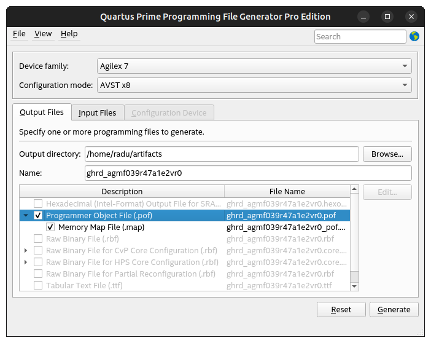 

3\. Click on the **Input Files** tab, then click on **Add Bitstream...** , then select **Files of type** to be "Raw Binary File (*.rbf)" then browse to the `ghrd_agmf039r47a1e2vr0.hps.rbf` file and click **Open**. 

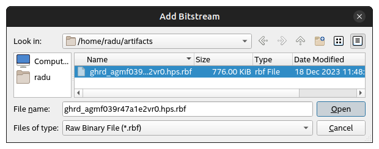 

The window will look similar to this: 

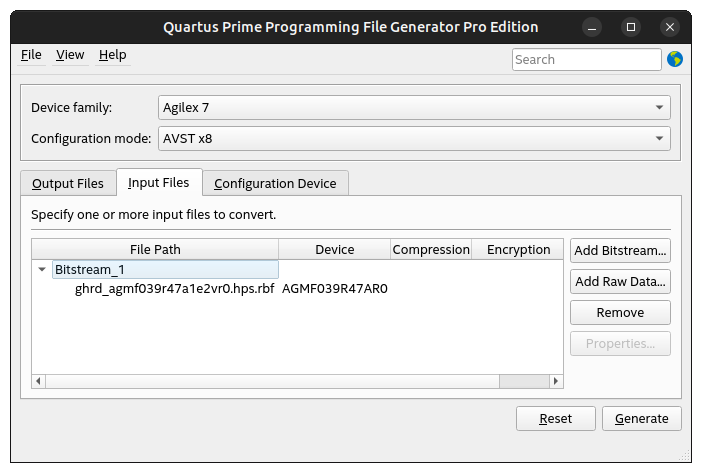 

4\. Go to **Configuration Device** tab, click **Add Device**, select the **CFI_2Gb** option and click **OK**. 

5\. Click on the **OPTIONS** partition to select it, then click the **Edit** button: 

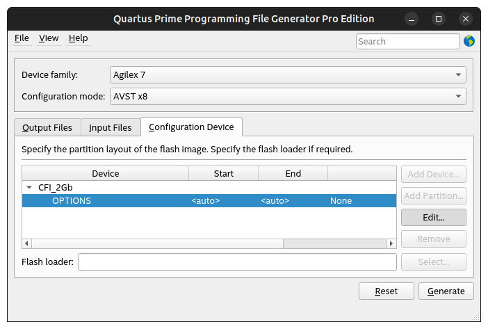 

6\. In the **Edit Partition** window, select the following: 

- **Address Mode**: Start 
- **Start Address**: 0x00002000 

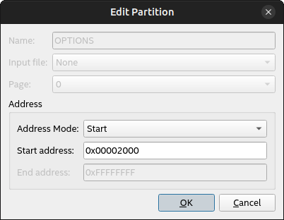 

Press **OK**. 

7\. Click on **CFI_2Gb** then click **Add Partition** and select the following: 

- **Name**: P1 
- **Input file**: Bitstream_1 
- **Address mode**: Start 
- **Start address**: 0x00004000 

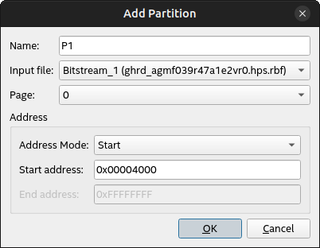 

Press **OK**. 

8\. Go to **File** > **Save** menu and save the configuration file as "ghrd.pfg" 

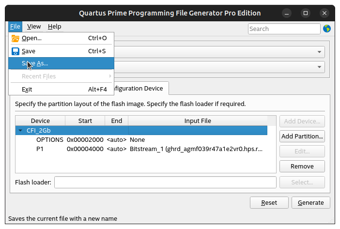 

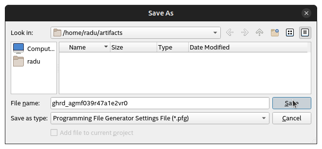 

**Note**: The created PFG file contains absolute paths. The attached PFG file was manually edited to use relative paths instead, so it can be used even when moving files in other folders on the host PC. 

9\. At this point you can generate the POF directly by clicking the **Generate** button. 

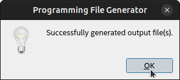 

**Caution**: Please use the addresses 0x00002000 for OPTIONS and 0x00004000 for P1, as they are required by the MAX10 board controller. 

### Create POF AVSTx8 Configuration File 

The POF file is created by using the PFG file and running the following command: 

```bash 
cd $TOP_FOLDER 
quartus_pfg -c ghrd.pfg 
```

The following file is created: 

- $TOP_FOLDER/ghrd.pof - contains the MAX 10 flash image required to configure the Agilex™ 7 device over AVST 

### Create CDF Programmer Configuration File 

This section provides instructions on how to create the configuration file required for the Quartus Programmer to be able to write the POF file to the QSPI attached to the MAX 10 Board Controller. 

1\. Set dipswitch S24 to OFF-OFF-OFF-ON so that board configures through JTAG. 

2\. Power up the board 

3\. Start Programmer GUI: 

```bash 
cd $TOP_FOLDER 
quartus_pgmw & 
```

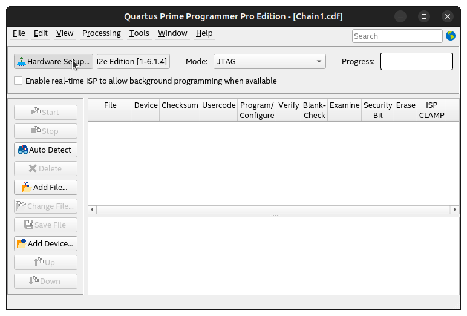 

4\. In the Programmer window, click on **Hardware Setup** and select the following: 

- **Currently selected hardware**: Intel Agilex™ M-Series Development Kit - HBM2e Edition 
- **Hardware Frequency**: 16000000 

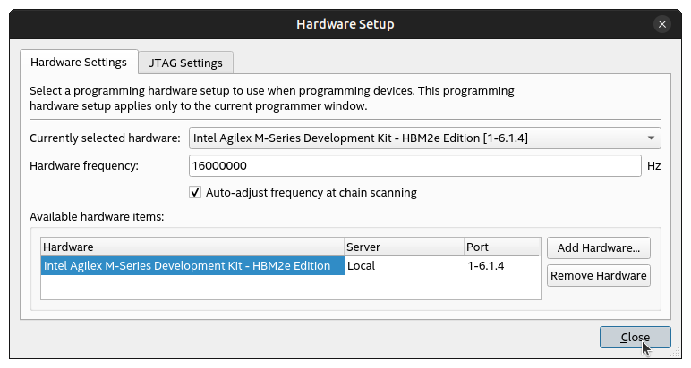 

Then click **Close**. 

5\. In the **Programmer** window click **Autodetect**, then select either option from the **Select Device** window as shown below: 

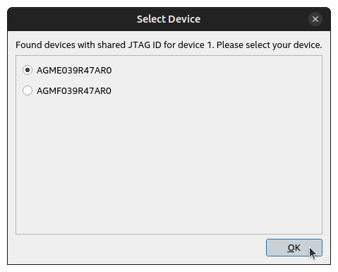 

6\. In the Programmer window, select the **VTAP10** device, then right-click it, and select **Edit** > **Change Device** 

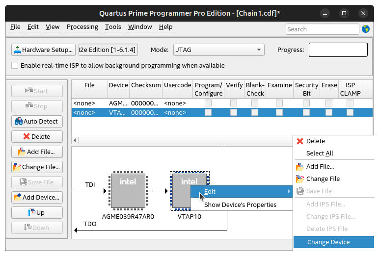 

Select the **MAX 10** > **10M50DAF256** device then click **OK**. 

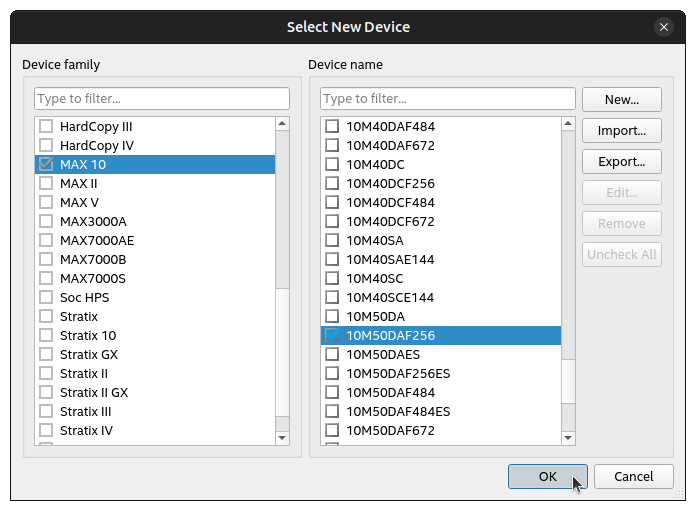 

7\. Right click the MAX10 device, and select **Edit** > **Attach Flash Device** 

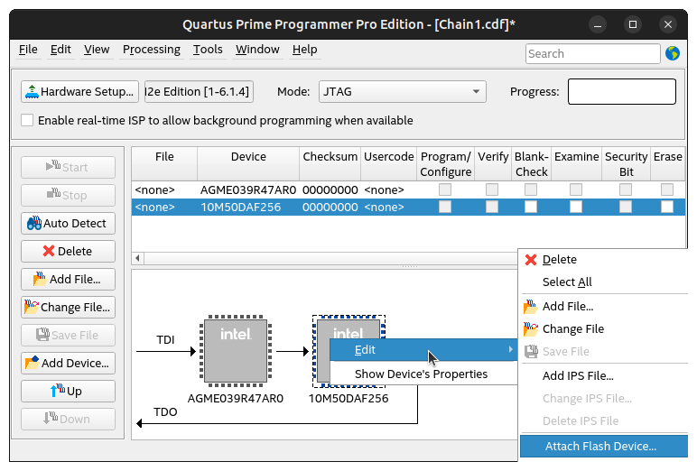 

Select **Quad SPI Flash Memory** > **QSPI_2Gb** option and click **OK** 

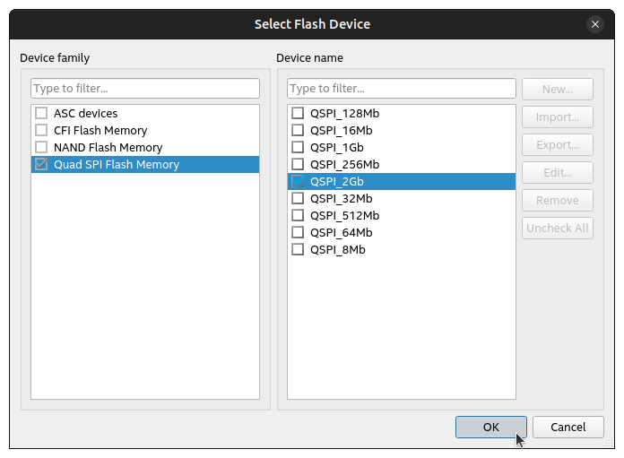 

8\. Right click the **QSPI_2Gb** entry on the top panel, then click **Change File** 

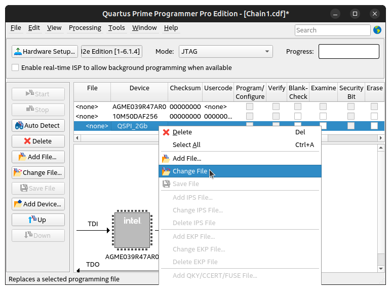 

Browse to "ghrd_agmf039r47a1e2vr0.pof" and click **Open**. 

9\. In the Programmer window, select the **Program/Configure** and **Verify** checkboxes for both "P1" and "OPTION_BITS" partitions 

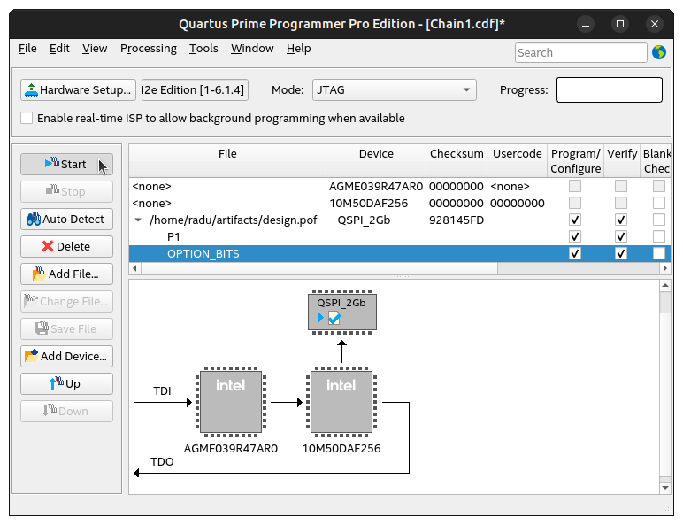 

10\. Go to **File** > **Save** and save the configuration file as "board.cdf" 

**Note**: The output file "ghrd.cdf" has an absolute path to the "ghrd.pof" file. You can hand edit it to use a relative path instead, so files could be located anywhere on the host PC file system. 

11\. At this stage you can also click the **Start** button, for the Programmer to write the file to flash. A progress bar will be shown: 

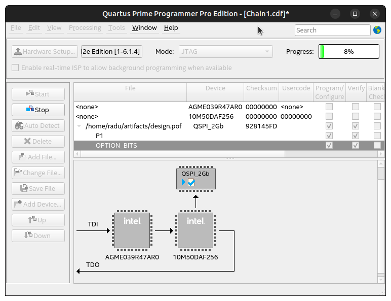 

12\. On successfull completion, the Programmer will show 100% completed: 

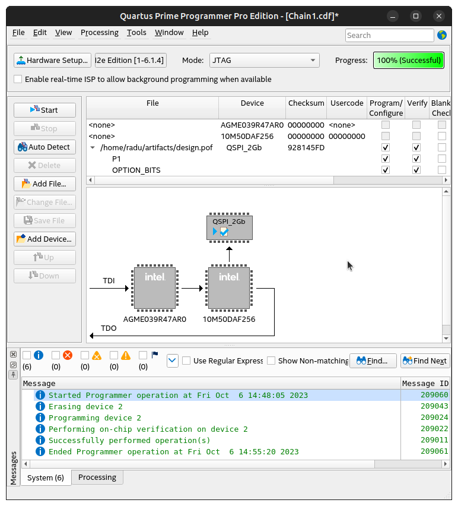 

### Write POF File Using the CDF File 

1\. Connect the following cables to the board: 

- Power: from board to power supply 
- JTAG: from micro USB cable on edge of the board to host PC 

2\. Configure board to the default settings, except set S24 dipswitch to OFF-OFF-OFF-ON, to select MSEL=JTAG, so that board does not configure on power up. 

3\. Power up the board 

4\. Make sure you have the following files in the current folder: 

- ghrd.cdf 
- ghrd.pof 

5\. Run the following command to flash the POF file: 

```bash 
cd $TOP_FOLDER 
quartus_pgm ghrd.cdf 
```

### Boot Linux 

1\. Power down the board 

2\. Set S24 to ON-OFF-OFF-ON to set MSEL=AVSTx8, so that the FPGA device gets configured with the POF on the next power cycle. 

3\. Power up the board 

4\. FPGA device will get configured, the U-Boot SPL will be ran, then U-Boot and then Linux. Log in with 'root' when prompted, no passowrd will be required, just like when configuring board with the RBF file.

## Notices & Disclaimers

Altera<sup>&reg;</sup> Corporation technologies may require enabled hardware, software or service activation.
No product or component can be absolutely secure. 
Performance varies by use, configuration and other factors.
Your costs and results may vary. 
You may not use or facilitate the use of this document in connection with any infringement or other legal analysis concerning Altera or Intel products described herein. You agree to grant Altera Corporation a non-exclusive, royalty-free license to any patent claim thereafter drafted which includes subject matter disclosed herein.
No license (express or implied, by estoppel or otherwise) to any intellectual property rights is granted by this document, with the sole exception that you may publish an unmodified copy. You may create software implementations based on this document and in compliance with the foregoing that are intended to execute on the Altera or Intel product(s) referenced in this document. No rights are granted to create modifications or derivatives of this document.
The products described may contain design defects or errors known as errata which may cause the product to deviate from published specifications.  Current characterized errata are available on request.
Altera disclaims all express and implied warranties, including without limitation, the implied warranties of merchantability, fitness for a particular purpose, and non-infringement, as well as any warranty arising from course of performance, course of dealing, or usage in trade.
You are responsible for safety of the overall system, including compliance with applicable safety-related requirements or standards. 
<sup>&copy;</sup> Altera Corporation.  Altera, the Altera logo, and other Altera marks are trademarks of Altera Corporation.  Other names and brands may be claimed as the property of others. 

OpenCL* and the OpenCL* logo are trademarks of Apple Inc. used by permission of the Khronos Group™.  