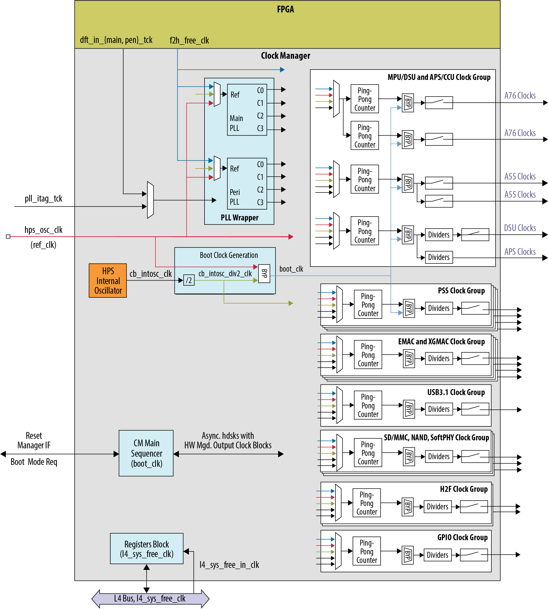

# **Clock Manager Driver for Hard Processor System**

Last updated: **October 06, 2026** 

**Upstream Status**: No

**Devices supported**: Agilex3, Agilex 5

## **Introduction**

Hard Processor System (HPS) clock generation is centralized in the clock manager. The clock manager is responsible for providing software-programmable clock control to configure all clocks generated in the HPS. Clocks are organized into clock groups.

A clock group is a set of clock signals that originate from the same clock source which may be synchronous to each other. The Clock Manager has a two Phase-Locked Loop (PLL) clock group where the clock source is a common PLL voltage-controlled oscillator (VCO). A clock group which is independent and asynchronous to other clocks may only have a single clock, also known as clock slice. Peripheral clocks are a group of independent clock slices.

For more information please refer to the [Altera® Agilex 5 Hard Processor System Technical Reference Manual](https://www.intel.com/content/www/us/en/docs/programmable/814346).

{: style="height:650px"}

## **Features**

* Generates and manages clocks in the HPS.
* Contains two flexible PLL blocks Main PLL and Peripheral PLL.
* Generates clock gate controls for enabling and disabling most of the clocks.
* Allows software to program clock characteristics.
* Supports interrupting the Cortex-A53 MPCore on PLL-lock and loss-of-lock.

## **Driver Sources**

The source code for this driver can be found at [https://github.com/altera-opensource/linux-socfpga/blob/socfpga-6.1.55-lts/drivers/clk/socfpga/clk-agilex5.c](https://github.com/altera-opensource/linux-socfpga/blob/socfpga-6.1.55-lts/drivers/clk/socfpga/clk-agilex5.c).

## **Driver Capabilities**

* Support to configure peripherals clock through common clock framework.
* Support to enable or disable software-managed clocks.

## **Kernel Configurations**

CONFIG_CLK_INTEL_SOCFPGA64

```
Symbol: CLK_INTEL_SOCFPGA64 [=n]
Type  : bool
Defined at drivers/clk/socfpga/Kconfig:15
  Prompt: Altera® Stratix / Agilex / N5X clock / Agilex5 controller support
  Depends on: COMMON_CLK [=y] && CLK_INTEL_SOCFPGA [=n]
  Visible if: COMMON_CLK [=y] && CLK_INTEL_SOCFPGA [=n] && COMPILE_TEST [=n] && (!ARM64 || !ARCH_INTEL_SOCFPGA)
  Location:
    → Device Drivers
(1)     → Common Clock Framework (COMMON_CLK [=y])
        → Altera SoCFPGA family clock support (CLK_INTEL_SOCFPGA [=n])
          → Altera® Stratix / Agilex / N5X clock / Agilex5 controller support (CLK_INTEL_SOCFPGA64 [=n])
```

## **Device Tree**

Example Device tree location:

[https://git.kernel.org/pub/scm/linux/kernel/git/torvalds/linux.git/tree/arch/arm64/boot/dts/intel/socfpga_agilex5.dtsi](https://git.kernel.org/pub/scm/linux/kernel/git/torvalds/linux.git/tree/arch/arm64/boot/dts/intel/socfpga_agilex5.dtsi)
```
clkmgr: clock-controller@10d10000 {
    compatible = "intel,agilex5-clkmgr";
    reg = <0x10d10000 0x1000>;
    #clock-cells = <1>;
};
```

Also dt-bindings can be found at:

[https://github.com/altera-opensource/linux-socfpga/blob/socfpga-6.1.55-lts/include/dt-bindings/clock/agilex5-clock.h](https://github.com/altera-opensource/linux-socfpga/blob/socfpga-6.1.55-lts/include/dt-bindings/clock/agilex5-clock.h)


### Using f2s_free_clk

When using the *f2s_free_clk*, you need to update the device tree to specify the frequency of the clock, as shown in the following example where 100MHz is specified:

```
f2s_free_clk: f2s-free-clk {
            #clock-cells = <0>;
            compatible = "fixed-clock";
            clock-frequency = <100000000>;
};
```

If you do not change the frequency of the *f2s_free_clk* in the device tree, the default value of 0 will be used, which means there is no clock coming from the fabric.

## **Known Issues**

None known

