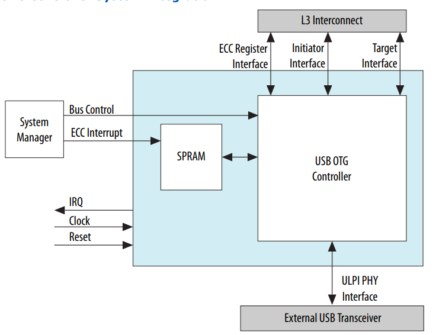
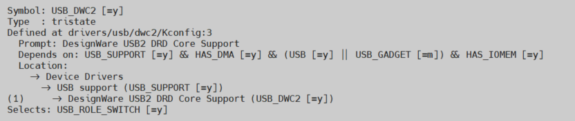
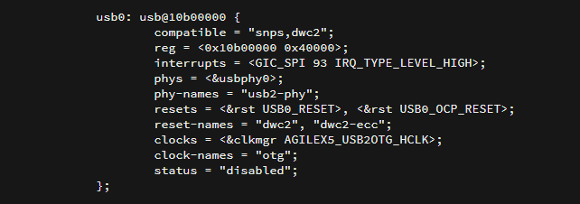

# **USB 2.0 OTG Driver for Hard Processor System**

Last updated: **October 06, 2026** 

**Upstream Status**: [Upstreamed](https://git.kernel.org/pub/scm/linux/kernel/git/torvalds/linux.git/tree/drivers/usb/dwc2)

**Devices supported**: Agilex3, Agilex 5, Agilex 7

## **Introduction**

The hard processor system (HPS) provides a USB On-The-Go (OTG) controller that
supports both device and host functions. The controller is fully compliant with the On
The Go and Embedded Host Supplement to the USB Revision 1.3 and Revision 2.0
Specification. The controller can be programmed for both device and host functions to
support data movement over the USB protocol

For More information please refer to the following link:

[Agilex 5 Hard Processor System Technical Reference Manual](https://www.intel.com/content/www/us/en/docs/programmable/814346)

{: style="height:450px;width:450px"}

## **Driver Sources**

The source code for this driver can be found at:

[https://git.kernel.org/pub/scm/linux/kernel/git/torvalds/linux.git/tree/drivers/usb/dwc2](https://git.kernel.org/pub/scm/linux/kernel/git/torvalds/linux.git/tree/drivers/usb/dwc2)

## **Driver Capabilities**

* Provides basic services for accessing and managing the hardware.
* Enable support for Host and peripheral mode.
* Handle control and data transfers between the USB host and connected USB peripherals.

## **Kernel Configurations**

CONFIG_USB_DWC2

## **Device Tree**

Example Device tree location to configure the usb2_0_otg:

[https://github.com/altera-opensource/linux-socfpga/blob/socfpga-6.1.55-lts/arch/arm64/boot/dts/intel/socfpga_agilex5.dtsi](https://github.com/altera-opensource/linux-socfpga/blob/socfpga-6.1.55-lts/arch/arm64/boot/dts/intel/socfpga_agilex5.dtsi)

## **Known Issues**

None Known

